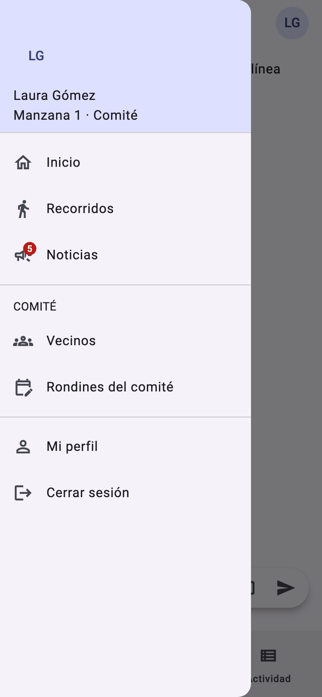
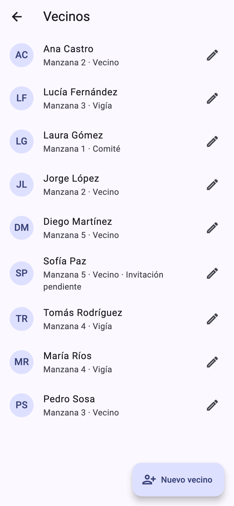
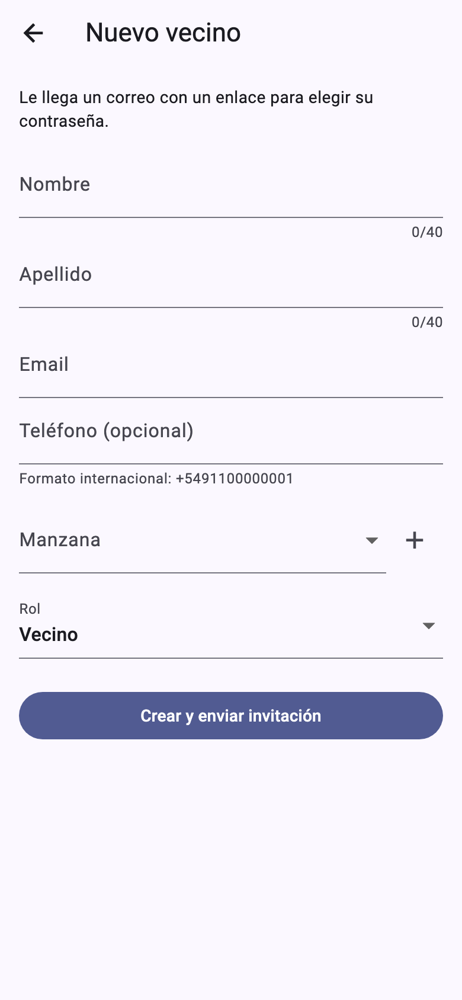
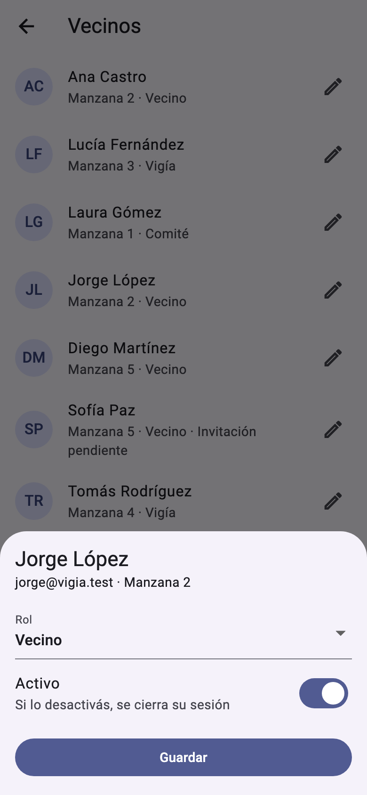
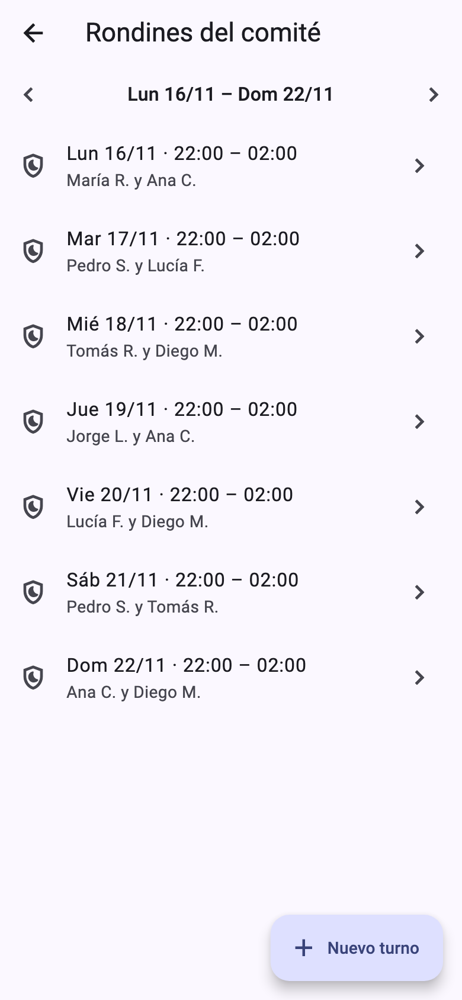
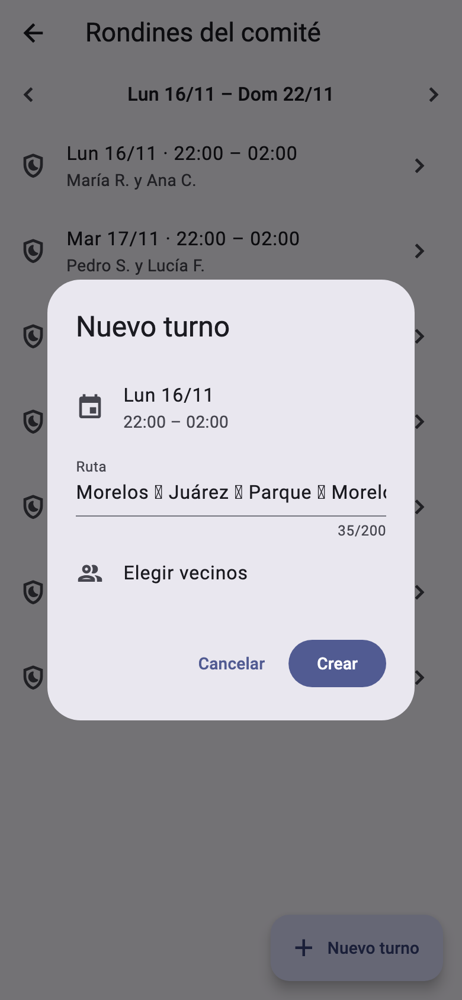
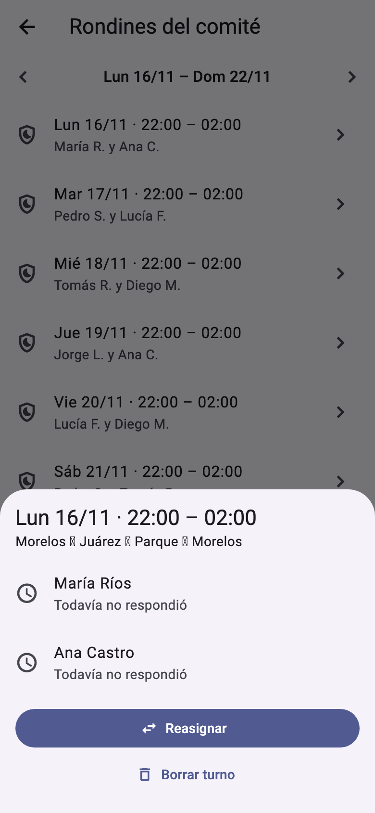
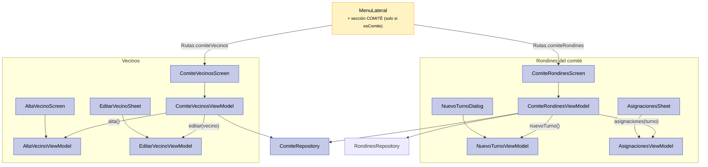
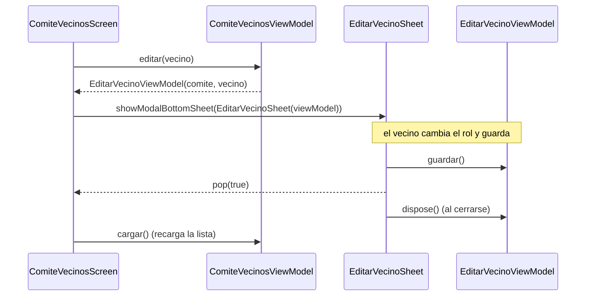

# 16. Comité

!!! abstract "Objetivo"
    El **panel del comité**, que solo ven los vecinos con rol `comite`. Tiene dos pantallas:

    - **Vecinos**: la lista de cuentas, el **alta** de un vecino (con el envío de la invitación por correo) y la **edición** de su rol, del estado activo/inactivo y el reenvío de la invitación.
    - **Rondines del comité**: navegar semana por semana, **crear turnos**, ver quién respondió en cada turno, **reasignar** vecinos y **borrar** turnos.

<div class="capturas" markdown>
<figure markdown="span">
  { .captura }
  <figcaption>El menú del comité</figcaption>
</figure>
<figure markdown="span">
  { .captura }
  <figcaption>Vecinos</figcaption>
</figure>
<figure markdown="span">
  { .captura }
  <figcaption>Alta</figcaption>
</figure>
<figure markdown="span">
  { .captura }
  <figcaption>Edición</figcaption>
</figure>
<figure markdown="span">
  { .captura }
  <figcaption>Rondines del comité</figcaption>
</figure>
<figure markdown="span">
  { .captura }
  <figcaption>Nuevo turno</figcaption>
</figure>
<figure markdown="span">
  { .captura }
  <figcaption>Asignaciones</figcaption>
</figure>
</div>

## Dónde estamos

Este capítulo no trae conceptos de arquitectura nuevos: es **todo lo que ya sabés, aplicado a 17 archivos**. Lo único nuevo es un patrón para los ViewModels de diálogos y hojas: el **ViewModel de la pantalla fabrica los ViewModels de sus diálogos**.



## El patrón: el ViewModel padre fabrica los de sus diálogos

Un diálogo (el alta de un vecino, el nuevo turno) necesita su propio ViewModel, porque tiene estado propio (la manzana elegida, la fecha, el error). ¿Quién lo crea?

- **`Rutas` no**, porque no es una pantalla que se abre desde cualquier lado: es parte de otra pantalla.
- **La vista no**, porque no debería conocer repositorios.

Lo crea el **ViewModel de la pantalla**, que ya tiene los repositorios, con un método fábrica (`alta()`, `editar(vecino)`, `nuevoTurno()`, `asignaciones(turno)`). La vista lo pide, se lo pasa al diálogo, y **el diálogo es su dueño**: lo descarta al cerrarse.



## Paso 1: el repositorio

Creá `lib/data/repositories/comite_repository.dart`:

<!-- archivo: lib/data/repositories/comite_repository.dart cap=c16 notas="Future<List<VecinoAdmin>> obtenerVecinos\(\{bool soloActivos = false\}\)|if \(vecino.activo\) vecino|_api.editarVecino\(id, \{'rol': \?rol, 'activo': \?activo\}\)" -->
```dart title="lib/data/repositories/comite_repository.dart" linenums="1"
// lib/data/repositories/comite_repository.dart
//
// Panel del comité (RF-13): manzanas y cuentas de los vecinos. Si quien
// llama no es del comité, la API responde 403 (ApiException).

import '../../domain/models/comite.dart';
import '../services/api/vigia_api.dart';

class ComiteRepository {
  ComiteRepository(this._api);

  final VigiaApi _api;

  Future<List<Manzana>> obtenerManzanas() => _api.obtenerManzanas();

  Future<Manzana> crearManzana(String nombre) => _api.crearManzana(nombre);

  Future<List<VecinoAdmin>> obtenerVecinos({bool soloActivos = false}) async {  // (1)!
    final vecinos = await _api.obtenerVecinos();
    if (!soloActivos) return vecinos;
    return [
      for (final vecino in vecinos)
        if (vecino.activo) vecino,  // (2)!
    ];
  }

  /// Alta y envío de la invitación por correo.
  Future<VecinoAdmin> crearVecino({
    required String nombre,
    required String apellido,
    required String email,
    String? telefono,
    required int manzanaId,
    required String rol,
  }) => _api.crearVecino(
    nombre: nombre,
    apellido: apellido,
    email: email,
    telefono: telefono,
    manzanaId: manzanaId,
    rol: rol,
  );

  /// Cambia el rol y/o el estado (activo). Solo manda lo que cambió.
  Future<VecinoAdmin> editarVecino(int id, {String? rol, bool? activo}) =>
      _api.editarVecino(id, {'rol': ?rol, 'activo': ?activo});  // (3)!

  Future<void> reenviarInvitacion(int vecinoId) =>
      _api.reenviarInvitacion(vecinoId);
}
```
<!-- /archivo -->

1. Con `soloActivos: true` filtra los desactivados (para elegir parejas de rondín no tiene sentido ofrecerlos).
2. El filtro, con un `if` dentro de la lista.
3. **Entradas opcionales en un mapa** (`'clave': ?valor`): si `rol` es `null`, la clave no se agrega. Así `PATCH` manda solo lo que cambió. Ver [Colecciones](../2-dart/4-colecciones.md#elementos-opcionales).

## Paso 2: Vecinos

### Los ViewModels

<!-- archivo: lib/ui/comite/view_model/comite_vecinos_view_model.dart cap=c16 notas="List<VecinoAdmin>\? _vecinos;|switch \(await ejecutar\(_comite.obtenerVecinos|AltaVecinoViewModel alta\(\)|EditarVecinoViewModel editar\(VecinoAdmin vecino\)" -->
```dart title="lib/ui/comite/view_model/comite_vecinos_view_model.dart" linenums="1"
// lib/ui/comite/view_model/comite_vecinos_view_model.dart

import '../../../data/repositories/comite_repository.dart';
import '../../../domain/models/comite.dart';
import '../../../utils/resultado.dart';
import '../../core/view_model.dart';
import 'alta_vecino_view_model.dart';
import 'editar_vecino_view_model.dart';

class ComiteVecinosViewModel extends ViewModel {
  ComiteVecinosViewModel(this._comite);

  final ComiteRepository _comite;

  List<VecinoAdmin>? _vecinos;  // (1)!
  String? _error;

  /// null mientras carga.
  List<VecinoAdmin>? get vecinos => _vecinos?.soloLectura;
  String? get error => _error;

  Future<void> cargar() async {
    switch (await ejecutar(_comite.obtenerVecinos, marcarOcupado: false)) {  // (2)!
      case Ok(:final valor):
        _vecinos = valor;
      case Fallo(:final mensaje):
        _error = mensaje;
    }
    notifyListeners();
  }

  /// Para el formulario de alta (lo descarta su pantalla).
  AltaVecinoViewModel alta() => AltaVecinoViewModel(_comite);  // (3)!

  /// Para la hoja de edición (la descarta la hoja).
  EditarVecinoViewModel editar(VecinoAdmin vecino) =>  // (4)!
      EditarVecinoViewModel(_comite, vecino);
}
```
<!-- /archivo -->

1. `null` mientras carga; una lista (vacía o no) cuando llegó.
2. Un `switch` directamente sobre el resultado de un `await`.
3. Fábrica del ViewModel del alta…
4. …y del de la edición, con el vecino elegido.

<!-- archivo: lib/ui/comite/view_model/alta_vecino_view_model.dart cap=c16 notas="String _rol = 'vecino';|Future<Resultado<void>> crearManzana|_manzanaId = manzana.id;|manzanaId: _manzanaId!," -->
```dart title="lib/ui/comite/view_model/alta_vecino_view_model.dart" linenums="1"
// lib/ui/comite/view_model/alta_vecino_view_model.dart

import '../../../data/repositories/comite_repository.dart';
import '../../../domain/models/comite.dart';
import '../../../utils/resultado.dart';
import '../../../utils/validadores.dart';
import '../../core/view_model.dart';

class AltaVecinoViewModel extends ViewModel {
  AltaVecinoViewModel(this._comite);

  final ComiteRepository _comite;

  List<Manzana> _manzanas = [];
  int? _manzanaId;
  String _rol = 'vecino';  // (1)!

  List<Manzana> get manzanas => _manzanas.soloLectura;
  int? get manzanaId => _manzanaId;
  String get rol => _rol;

  Future<Resultado<void>> cargarManzanas() async {
    final resultado = await ejecutar(
      _comite.obtenerManzanas,
      marcarOcupado: false,
    );
    if (resultado case Ok(:final valor)) {
      _manzanas = valor;
      notifyListeners();
    }
    return resultado;
  }

  /// Crea la manzana y la deja elegida.
  Future<Resultado<void>> crearManzana(String nombre) async {  // (2)!
    final resultado = await ejecutar(
      () => _comite.crearManzana(nombre),
      marcarOcupado: false,
    );
    if (resultado case Ok(valor: final manzana)) {
      _manzanas = [..._manzanas, manzana];
      _manzanaId = manzana.id;  // (3)!
      notifyListeners();
    }
    return resultado;
  }

  void elegirManzana(int? manzanaId) {
    _manzanaId = manzanaId;
    notifyListeners();
  }

  void elegirRol(String rol) {
    _rol = rol;
    notifyListeners();
  }

  /// Crea al vecino y le manda la invitación. Antes hay que elegir manzana
  /// (lo valida el formulario).
  Future<Resultado<VecinoAdmin>> crear({
    required String nombre,
    required String apellido,
    required String email,
    required String telefono,
  }) {
    return ejecutar(
      () => _comite.crearVecino(
        nombre: nombre.trim(),
        apellido: apellido.trim(),
        email: email.trim(),
        telefono: textoOpcional(telefono),
        manzanaId: _manzanaId!,  // (4)!
        rol: _rol,
      ),
    );
  }
}
```
<!-- /archivo -->

1. Por defecto, un vecino común.
2. Si la manzana no existe, el comité la crea desde el mismo formulario…
3. …y queda elegida.
4. El `!` es seguro porque el formulario no deja enviar sin manzana (su validador).

<!-- archivo: lib/ui/comite/view_model/editar_vecino_view_model.dart cap=c16 notas=": _rol = vecino.rol,|bool get hayCambios|rol: _rol != vecino.rol \? _rol : null," -->
```dart title="lib/ui/comite/view_model/editar_vecino_view_model.dart" linenums="1"
// lib/ui/comite/view_model/editar_vecino_view_model.dart

import '../../../data/repositories/comite_repository.dart';
import '../../../domain/models/comite.dart';
import '../../../utils/resultado.dart';
import '../../core/view_model.dart';

/// Rol, activo/inactivo y reenvío de la invitación de un vecino.
class EditarVecinoViewModel extends ViewModel {
  EditarVecinoViewModel(this._comite, this.vecino)
    : _rol = vecino.rol,  // (1)!
      _activo = vecino.activo;

  final ComiteRepository _comite;
  final VecinoAdmin vecino;

  String _rol;
  bool _activo;

  String get rol => _rol;
  bool get activo => _activo;
  bool get hayCambios => _rol != vecino.rol || _activo != vecino.activo;  // (2)!

  void elegirRol(String rol) {
    _rol = rol;
    notifyListeners();
  }

  /// Desactivarlo cierra su sesión.
  void elegirActivo(bool activo) {
    _activo = activo;
    notifyListeners();
  }

  /// Manda solo lo que cambió.
  Future<Resultado<void>> guardar() => ejecutar(
    () => _comite.editarVecino(
      vecino.id,
      rol: _rol != vecino.rol ? _rol : null,  // (3)!
      activo: _activo != vecino.activo ? _activo : null,
    ),
  );

  Future<Resultado<void>> reenviarInvitacion() =>
      ejecutar(() => _comite.reenviarInvitacion(vecino.id));
}
```
<!-- /archivo -->

1. Arranca con los valores actuales del vecino.
2. El botón "Guardar" solo se habilita si algo cambió.
3. Manda solo lo que cambió (con el repositorio del paso 1).

### Los widgets

Dos widgets chicos reutilizables, un diálogo para pedir un texto y un selector de rol:

<!-- archivo: lib/ui/comite/widgets/texto_dialog.dart cap=c16 -->
```dart title="lib/ui/comite/widgets/texto_dialog.dart" linenums="1"
// lib/ui/comite/widgets/texto_dialog.dart

import 'package:flutter/material.dart';

/// Diálogo con un campo de texto. Devuelve el texto (o null si cancela).
class TextoDialog extends StatefulWidget {
  const TextoDialog({
    required this.titulo,
    required this.etiqueta,
    required this.maximo,
    super.key,
  });

  final String titulo;
  final String etiqueta;
  final int maximo;

  @override
  State<TextoDialog> createState() => _TextoDialogState();
}

class _TextoDialogState extends State<TextoDialog> {
  final _texto = TextEditingController();

  @override
  void dispose() {
    _texto.dispose();
    super.dispose();
  }

  void _crear() {
    final texto = _texto.text.trim();
    if (texto.isNotEmpty) Navigator.pop(context, texto);
  }

  @override
  Widget build(BuildContext context) {
    return AlertDialog(
      title: Text(widget.titulo),
      content: TextField(
        controller: _texto,
        autofocus: true,
        maxLength: widget.maximo,
        decoration: InputDecoration(labelText: widget.etiqueta),
      ),
      actions: [
        TextButton(
          onPressed: () => Navigator.pop(context),
          child: const Text('Cancelar'),
        ),
        FilledButton(onPressed: _crear, child: const Text('Crear')),
      ],
    );
  }
}
```
<!-- /archivo -->

<!-- archivo: lib/ui/comite/widgets/selector_rol.dart cap=c16 -->
```dart title="lib/ui/comite/widgets/selector_rol.dart" linenums="1"
// lib/ui/comite/widgets/selector_rol.dart

import 'package:flutter/material.dart';

import '../../../domain/models/sesion.dart';

/// Desplegable con los roles (vecino, vigía, comité).
class SelectorRol extends StatelessWidget {
  const SelectorRol({required this.rol, required this.onChanged, super.key});

  final String rol;
  final ValueChanged<String> onChanged;

  @override
  Widget build(BuildContext context) {
    return DropdownButtonFormField<String>(
      initialValue: rol,
      decoration: const InputDecoration(labelText: 'Rol'),
      items: [
        for (final MapEntry(:key, :value) in roles.entries)
          DropdownMenuItem(value: key, child: Text(value)),
      ],
      onChanged: (valor) => onChanged(valor!),
    );
  }
}
```
<!-- /archivo -->

La pantalla de la lista:

<!-- archivo: lib/ui/comite/widgets/comite_vecinos_screen.dart cap=c16 notas="final altaViewModel = _viewModel.alta\(\);|final editarViewModel = _viewModel.editar\(vecino\);|showModalBottomSheet<bool>\(" -->
```dart title="lib/ui/comite/widgets/comite_vecinos_screen.dart" linenums="1"
// lib/ui/comite/widgets/comite_vecinos_screen.dart
//
// Panel del comité · Vecinos (RF-13): lista con el estado de cada cuenta,
// alta con invitación por correo, edición de rol y baja lógica (activo).

import 'package:flutter/material.dart';

import '../../../domain/models/comite.dart';
import '../../../domain/models/sesion.dart';
import '../../core/widgets/avisos.dart';
import '../../core/widgets/estados_carga.dart';
import '../view_model/comite_vecinos_view_model.dart';
import 'alta_vecino_screen.dart';
import 'editar_vecino_sheet.dart';

class ComiteVecinosScreen extends StatefulWidget {
  const ComiteVecinosScreen({required this.viewModel, super.key});

  final ComiteVecinosViewModel viewModel;

  @override
  State<ComiteVecinosScreen> createState() => _ComiteVecinosScreenState();
}

class _ComiteVecinosScreenState extends State<ComiteVecinosScreen> {
  // Se toma una sola vez: si el padre se redibuja, la pantalla sigue con el
  // mismo ViewModel (el que después descarta en dispose).
  late final ComiteVecinosViewModel _viewModel = widget.viewModel;

  @override
  void initState() {
    super.initState();
    _viewModel.cargar();
  }

  @override
  void dispose() {
    _viewModel.dispose();
    super.dispose();
  }

  Future<void> _alta() async {
    final altaViewModel = _viewModel.alta();  // (1)!
    final nuevo = await Navigator.push<VecinoAdmin>(
      context,
      MaterialPageRoute(
        builder: (context) => AltaVecinoScreen(viewModel: altaViewModel),
      ),
    );
    if (nuevo == null || !mounted) return;
    mostrarAviso(
      context,
      nuevo.invitacionEnviada == false
          ? 'Se creó a ${nuevo.nombreCompleto}, pero el correo no salió. '
                'Reenviá la invitación.'
          : 'Invitación enviada a ${nuevo.email}',
    );
    _viewModel.cargar();
  }

  Future<void> _editar(VecinoAdmin vecino) async {
    final editarViewModel = _viewModel.editar(vecino);  // (2)!
    final cambio = await showModalBottomSheet<bool>(  // (3)!
      context: context,
      isScrollControlled: true,
      builder: (context) => EditarVecinoSheet(viewModel: editarViewModel),
    );
    if (cambio == true) _viewModel.cargar();
  }

  @override
  Widget build(BuildContext context) {
    return Scaffold(
      appBar: AppBar(title: const Text('Vecinos')),
      floatingActionButton: FloatingActionButton.extended(
        onPressed: _alta,
        icon: const Icon(Icons.person_add_alt),
        label: const Text('Nuevo vecino'),
      ),
      body: ListenableBuilder(
        listenable: _viewModel,
        builder: (context, _) {
          if (_viewModel.error case final error?) {
            return ErrorConReintento(mensaje: error);
          }
          final vecinos = _viewModel.vecinos;
          if (vecinos == null) return const Cargando();
          return RefreshIndicator(
            onRefresh: _viewModel.cargar,
            child: ListView.builder(
              padding: const EdgeInsets.only(bottom: 88), // deja ver el FAB
              itemCount: vecinos.length,
              itemBuilder: (context, index) => _FilaVecino(
                vecino: vecinos[index],
                onTap: () => _editar(vecinos[index]),
              ),
            ),
          );
        },
      ),
    );
  }
}

class _FilaVecino extends StatelessWidget {
  const _FilaVecino({required this.vecino, required this.onTap});

  final VecinoAdmin vecino;
  final VoidCallback onTap;

  @override
  Widget build(BuildContext context) {
    return ListTile(
      leading: CircleAvatar(
        child: Text('${vecino.nombre[0]}${vecino.apellido[0]}'),
      ),
      title: Text(
        vecino.nombreCompleto,
        style: vecino.activo
            ? null
            : const TextStyle(decoration: TextDecoration.lineThrough),
      ),
      subtitle: Text(
        [
          vecino.manzana,
          roles[vecino.rol] ?? vecino.rol,
          if (!vecino.activo) 'Inactivo',
          if (vecino.invitacionPendiente) 'Invitación pendiente',
        ].join(' · '),
      ),
      trailing: const Icon(Icons.edit_outlined),
      onTap: onTap,
    );
  }
}
```
<!-- /archivo -->

1. Pide el ViewModel del alta al de la pantalla y se lo pasa a la pantalla del alta.
2. Lo mismo para editar…
3. …en una hoja que sube desde abajo. Devuelve `true` si hubo cambios, para recargar la lista.

El alta (una pantalla completa, porque es un formulario largo) y la edición (una hoja):

<!-- archivo: lib/ui/comite/widgets/alta_vecino_screen.dart cap=c16 notas="_viewModel.dispose\(\);|final nombre = await showDialog<String>\(|Navigator.pop\(context, nuevo\);" -->
```dart title="lib/ui/comite/widgets/alta_vecino_screen.dart" linenums="1"
// lib/ui/comite/widgets/alta_vecino_screen.dart

import 'package:flutter/material.dart';

import '../../../utils/resultado.dart';
import '../../../utils/validadores.dart';
import '../../core/widgets/avisos.dart';
import '../view_model/alta_vecino_view_model.dart';
import 'selector_rol.dart';
import 'texto_dialog.dart';

/// Formulario de alta. Devuelve el vecino creado.
class AltaVecinoScreen extends StatefulWidget {
  const AltaVecinoScreen({required this.viewModel, super.key});

  final AltaVecinoViewModel viewModel;

  @override
  State<AltaVecinoScreen> createState() => _AltaVecinoScreenState();
}

class _AltaVecinoScreenState extends State<AltaVecinoScreen> {
  final _form = GlobalKey<FormState>();
  final _nombre = TextEditingController();
  final _apellido = TextEditingController();
  final _email = TextEditingController();
  final _telefono = TextEditingController();

  // Se toma una sola vez: si el padre se redibuja, la pantalla sigue con el
  // mismo ViewModel (el que después descarta en dispose).
  late final AltaVecinoViewModel _viewModel = widget.viewModel;

  @override
  void initState() {
    super.initState();
    _cargarManzanas();
  }

  @override
  void dispose() {
    _nombre.dispose();
    _apellido.dispose();
    _email.dispose();
    _telefono.dispose();
    _viewModel.dispose();  // (1)!
    super.dispose();
  }

  Future<void> _cargarManzanas() async {
    final resultado = await _viewModel.cargarManzanas();
    if (mounted) avisarSiFallo(context, resultado);
  }

  Future<void> _nuevaManzana() async {
    final nombre = await showDialog<String>(  // (2)!
      context: context,
      builder: (context) => const TextoDialog(
        titulo: 'Nueva manzana',
        etiqueta: 'Nombre',
        maximo: 50,
      ),
    );
    if (nombre == null) return;
    final resultado = await _viewModel.crearManzana(nombre);
    if (mounted) avisarSiFallo(context, resultado);
  }

  Future<void> _guardar() async {
    if (!_form.currentState!.validate()) return;
    final resultado = await _viewModel.crear(
      nombre: _nombre.text,
      apellido: _apellido.text,
      email: _email.text,
      telefono: _telefono.text,
    );
    if (!mounted) return;
    switch (resultado) {
      case Ok(valor: final nuevo):
        Navigator.pop(context, nuevo);  // (3)!
      case Fallo(:final mensaje):
        mostrarAviso(context, mensaje);
    }
  }

  @override
  Widget build(BuildContext context) {
    return Scaffold(
      appBar: AppBar(title: const Text('Nuevo vecino')),
      body: Form(
        key: _form,
        child: ListenableBuilder(
          listenable: _viewModel,
          builder: (context, _) => ListView(
            padding: const EdgeInsets.all(16),
            children: [
              const Text(
                'Le llega un correo con un enlace para elegir su contraseña.',
              ),
              const SizedBox(height: 16),
              TextFormField(
                controller: _nombre,
                decoration: const InputDecoration(labelText: 'Nombre'),
                maxLength: 40,
                validator: validarRequerido,
              ),
              TextFormField(
                controller: _apellido,
                decoration: const InputDecoration(labelText: 'Apellido'),
                maxLength: 40,
                validator: validarRequerido,
              ),
              TextFormField(
                controller: _email,
                decoration: const InputDecoration(labelText: 'Email'),
                keyboardType: TextInputType.emailAddress,
                validator: validarEmail,
              ),
              TextFormField(
                controller: _telefono,
                decoration: const InputDecoration(
                  labelText: 'Teléfono (opcional)',
                  helperText: 'Formato internacional: +5491100000001',
                ),
                keyboardType: TextInputType.phone,
              ),
              const SizedBox(height: 16),
              Row(
                children: [
                  Expanded(
                    child: DropdownButtonFormField<int>(
                      // initialValue solo se lee al crear el campo: la key lo
                      // recrea cuando "+" elige la manzana nueva.
                      key: ValueKey(_viewModel.manzanaId),
                      initialValue: _viewModel.manzanaId,
                      decoration: const InputDecoration(labelText: 'Manzana'),
                      items: [
                        for (final manzana in _viewModel.manzanas)
                          DropdownMenuItem(
                            value: manzana.id,
                            child: Text(manzana.nombre),
                          ),
                      ],
                      onChanged: _viewModel.elegirManzana,
                      validator: (valor) =>
                          valor == null ? 'Elegí una manzana' : null,
                    ),
                  ),
                  IconButton(
                    icon: const Icon(Icons.add),
                    tooltip: 'Nueva manzana',
                    onPressed: _nuevaManzana,
                  ),
                ],
              ),
              const SizedBox(height: 16),
              SelectorRol(rol: _viewModel.rol, onChanged: _viewModel.elegirRol),
              const SizedBox(height: 24),
              FilledButton(
                onPressed: _viewModel.ocupado ? null : _guardar,
                child: const Text('Crear y enviar invitación'),
              ),
            ],
          ),
        ),
      ),
    );
  }
}
```
<!-- /archivo -->

1. La pantalla es dueña del ViewModel que recibió: lo descarta.
2. "Nueva manzana" pide un nombre con el `TextoDialog`.
3. Devuelve el vecino creado a la lista.

<!-- archivo: lib/ui/comite/widgets/editar_vecino_sheet.dart cap=c16 notas="_viewModel.dispose\(\);|if \(resultado is Ok && mounted\) Navigator.pop\(context, true\)" -->
```dart title="lib/ui/comite/widgets/editar_vecino_sheet.dart" linenums="1"
// lib/ui/comite/widgets/editar_vecino_sheet.dart

import 'package:flutter/material.dart';

import '../../../utils/resultado.dart';
import '../view_model/editar_vecino_view_model.dart';
import 'selector_rol.dart';

/// Rol, activo/inactivo y reenvío de la invitación. Devuelve true si cambió
/// algo.
class EditarVecinoSheet extends StatefulWidget {
  const EditarVecinoSheet({required this.viewModel, super.key});

  final EditarVecinoViewModel viewModel;

  @override
  State<EditarVecinoSheet> createState() => _EditarVecinoSheetState();
}

class _EditarVecinoSheetState extends State<EditarVecinoSheet> {
  // Se toma una sola vez: si el padre se redibuja, la pantalla sigue con el
  // mismo ViewModel (el que después descarta en dispose).
  late final EditarVecinoViewModel _viewModel = widget.viewModel;

  @override
  void dispose() {
    _viewModel.dispose();  // (1)!
    super.dispose();
  }

  // El aviso sale en la pantalla de abajo: la hoja se cierra si salió bien.
  Future<void> _hacer(
    Future<Resultado<void>> Function() accion,
    String textoOk,
  ) async {
    final messenger = ScaffoldMessenger.of(context);
    final resultado = await accion();
    final texto = switch (resultado) {
      Ok() => textoOk,
      Fallo(:final mensaje) => mensaje,
    };
    messenger.showSnackBar(SnackBar(content: Text(texto)));
    if (resultado is Ok && mounted) Navigator.pop(context, true);  // (2)!
  }

  void _guardar() {
    if (!_viewModel.hayCambios) {
      Navigator.pop(context, false);
      return;
    }
    _hacer(_viewModel.guardar, 'Cambios guardados');
  }

  @override
  Widget build(BuildContext context) {
    final vecino = _viewModel.vecino;
    return Padding(
      padding: EdgeInsets.fromLTRB(
        16,
        16,
        16,
        16 + MediaQuery.viewInsetsOf(context).bottom,
      ),
      child: ListenableBuilder(
        listenable: _viewModel,
        builder: (context, _) => Column(
          mainAxisSize: MainAxisSize.min,
          crossAxisAlignment: CrossAxisAlignment.stretch,
          children: [
            Text(
              vecino.nombreCompleto,
              style: Theme.of(context).textTheme.titleLarge,
            ),
            Text('${vecino.email} · ${vecino.manzana}'),
            const SizedBox(height: 16),
            SelectorRol(rol: _viewModel.rol, onChanged: _viewModel.elegirRol),
            SwitchListTile(
              contentPadding: EdgeInsets.zero,
              title: const Text('Activo'),
              subtitle: const Text('Si lo desactivás, se cierra su sesión'),
              value: _viewModel.activo,
              onChanged: _viewModel.elegirActivo,
            ),
            if (vecino.invitacionPendiente)
              OutlinedButton.icon(
                onPressed: _viewModel.ocupado
                    ? null
                    : () => _hacer(
                        _viewModel.reenviarInvitacion,
                        'Invitación reenviada a ${vecino.email}',
                      ),
                icon: const Icon(Icons.forward_to_inbox),
                label: const Text('Reenviar invitación'),
              ),
            const SizedBox(height: 8),
            FilledButton(
              onPressed: _viewModel.ocupado ? null : _guardar,
              child: const Text('Guardar'),
            ),
          ],
        ),
      ),
    );
  }
}
```
<!-- /archivo -->

1. La hoja también es dueña de su ViewModel.
2. Si guardó bien, se cierra avisando que hubo cambios.

## Paso 3: Rondines del comité

### Los ViewModels

<!-- archivo: lib/ui/comite/view_model/comite_rondines_view_model.dart cap=c16 notas="DateTime\? hoy,|\}\) : _desde = lunesDe\(hoy \?\? DateTime.now\(\)\);|DateTime get hasta|Future<void> moverSemana\(int semanas\)|NuevoTurnoViewModel nuevoTurno\(\)|AsignacionesViewModel asignaciones\(TurnoRondin turno\)" -->
```dart title="lib/ui/comite/view_model/comite_rondines_view_model.dart" linenums="1"
// lib/ui/comite/view_model/comite_rondines_view_model.dart

import '../../../data/repositories/comite_repository.dart';
import '../../../data/repositories/rondines_repository.dart';
import '../../../domain/models/comite.dart';
import '../../../domain/models/rondin.dart';
import '../../../utils/fechas.dart';
import '../../../utils/resultado.dart';
import '../../core/view_model.dart';
import 'asignaciones_view_model.dart';
import 'nuevo_turno_view_model.dart';

class ComiteRondinesViewModel extends ViewModel {
  ComiteRondinesViewModel({
    required this._rondines,
    required this._comite,
    DateTime? hoy,  // (1)!
  }) : _desde = lunesDe(hoy ?? DateTime.now());  // (2)!

  final RondinesRepository _rondines;
  final ComiteRepository _comite;

  DateTime _desde;
  List<TurnoRondin>? _turnos;
  List<VecinoAdmin> _vecinos = []; // los activos, para elegir parejas
  String? _error;

  /// Lunes de la semana que se muestra.
  DateTime get desde => _desde;

  /// Domingo de la semana que se muestra.
  DateTime get hasta => _desde.add(const Duration(days: 6));  // (3)!

  /// null mientras carga.
  List<TurnoRondin>? get turnos => _turnos?.soloLectura;
  List<VecinoAdmin> get vecinos => _vecinos.soloLectura;
  String? get error => _error;

  Future<void> cargar() async {
    _turnos = null;
    _error = null; // si la semana anterior falló, se vuelve a intentar
    notifyListeners();
    final resultado = await ejecutar(
      () => _rondines.obtenerSemana(desde: _desde),
      marcarOcupado: false,
    );
    switch (resultado) {
      case Ok(:final valor):
        _turnos = valor;
      case Fallo(:final mensaje):
        _error = mensaje;
    }
    notifyListeners();
  }

  Future<Resultado<void>> cargarVecinos() async {
    final resultado = await ejecutar(
      () => _comite.obtenerVecinos(soloActivos: true),
      marcarOcupado: false,
    );
    if (resultado case Ok(:final valor)) {
      _vecinos = valor;
      notifyListeners();
    }
    return resultado;
  }

  /// [semanas] = -1 la anterior, 1 la siguiente.
  Future<void> moverSemana(int semanas) {  // (4)!
    _desde = _desde.add(Duration(days: 7 * semanas));
    return cargar();
  }

  /// Para el diálogo de alta (lo descarta el diálogo).
  NuevoTurnoViewModel nuevoTurno() =>  // (5)!
      NuevoTurnoViewModel(_rondines, vecinos: _vecinos, fechaInicial: _desde);

  /// Para la hoja del turno (la descarta la hoja).
  AsignacionesViewModel asignaciones(TurnoRondin turno) =>  // (6)!
      AsignacionesViewModel(_rondines, turno: turno, vecinos: _vecinos);
}
```
<!-- /archivo -->

1. "Hoy" se puede pasar desde afuera: para los tests (igual que `ahora` en las fechas del capítulo 2).
2. Arranca en el lunes de esta semana.
3. Un getter calculado: el domingo.
4. Las flechas `<` `>` mueven de a 7 días y recargan.
5. Fábrica del ViewModel del diálogo de nuevo turno…
6. …y del de la hoja de asignaciones.

<!-- archivo: lib/ui/comite/view_model/nuevo_turno_view_model.dart cap=c16 notas="static const rutaSugerida|Set<int> _vecinoIds = \{\};|List<String> get nombresElegidos|Future<bool> crear\(String ruta\)" -->
```dart title="lib/ui/comite/view_model/nuevo_turno_view_model.dart" linenums="1"
// lib/ui/comite/view_model/nuevo_turno_view_model.dart

import '../../../data/repositories/rondines_repository.dart';
import '../../../domain/models/comite.dart';
import '../../../utils/resultado.dart';
import '../../core/view_model.dart';

/// Alta de un turno: fecha, ruta y vecinos.
class NuevoTurnoViewModel extends ViewModel {
  NuevoTurnoViewModel(
    this._rondines, {
    required this.vecinos,
    required DateTime fechaInicial,
  }) : _fecha = fechaInicial;

  static const rutaSugerida = 'Morelos → Juárez → Parque → Morelos';  // (1)!

  final RondinesRepository _rondines;

  /// Los vecinos que se pueden asignar.
  final List<VecinoAdmin> vecinos;

  DateTime _fecha;
  Set<int> _vecinoIds = {};  // (2)!
  String? _error;

  DateTime get fecha => _fecha;
  Set<int> get vecinoIds => _vecinoIds;
  String? get error => _error;

  /// Los nombres de los elegidos, en el orden de la lista.
  List<String> get nombresElegidos => [  // (3)!
    for (final vecino in vecinos)
      if (_vecinoIds.contains(vecino.id)) vecino.nombreCompleto,
  ];

  void elegirFecha(DateTime fecha) {
    _fecha = fecha;
    notifyListeners();
  }

  void elegirVecinos(List<int> vecinoIds) {
    _vecinoIds = vecinoIds.toSet();
    notifyListeners();
  }

  /// Devuelve true si lo creó. Si no, el motivo queda en [error] (409: ya
  /// hay un turno ese día).
  Future<bool> crear(String ruta) async {  // (4)!
    final limpia = ruta.trim();
    _error = limpia.isEmpty ? 'Escribí la ruta' : null;
    notifyListeners();
    if (_error != null) return false;

    final resultado = await ejecutar(
      () => _rondines.crearTurno(
        fecha: _fecha,
        ruta: limpia,
        vecinoIds: _vecinoIds.toList(),
      ),
    );
    if (resultado case Fallo(:final mensaje)) {
      _error = mensaje;
      notifyListeners();
      return false;
    }
    return true;
  }
}
```
<!-- /archivo -->

1. La ruta de siempre, para no escribirla cada vez.
2. Un `Set`: un vecino no puede estar dos veces.
3. Los nombres de los elegidos, en el orden de la lista.
4. Devuelve si lo creó; si no, el motivo queda en `error` (por ejemplo, un 409 si ya hay turno ese día).

<!-- archivo: lib/ui/comite/view_model/asignaciones_view_model.dart cap=c16 notas="Set<int> get asignados => \{|Future<Resultado<void>> _actualizar\(" -->
```dart title="lib/ui/comite/view_model/asignaciones_view_model.dart" linenums="1"
// lib/ui/comite/view_model/asignaciones_view_model.dart

import '../../../data/repositories/rondines_repository.dart';
import '../../../domain/models/comite.dart';
import '../../../domain/models/rondin.dart';
import '../../../utils/resultado.dart';
import '../../core/view_model.dart';

/// Quién hace un turno y qué respondió; reasignarlo o borrarlo.
class AsignacionesViewModel extends ViewModel {
  AsignacionesViewModel(
    this._rondines, {
    required this.turno,
    required this.vecinos,
  });

  final RondinesRepository _rondines;
  final TurnoRondin turno;

  /// Los vecinos que se pueden asignar.
  final List<VecinoAdmin> vecinos;

  List<Asignacion>? _asignaciones;

  /// null mientras carga.
  List<Asignacion>? get asignaciones => _asignaciones?.soloLectura;

  Set<int> get asignados => {  // (1)!
    for (final asignacion in _asignaciones ?? <Asignacion>[])
      asignacion.vecinoId,
  };

  Future<Resultado<void>> cargar() =>
      _actualizar(() => _rondines.obtenerAsignaciones(turno.id));

  Future<Resultado<void>> reasignar(List<int> vecinoIds) =>
      _actualizar(() => _rondines.reasignar(turno.id, vecinoIds));

  Future<Resultado<void>> borrarTurno() =>
      ejecutar(() => _rondines.borrarTurno(turno.id));

  Future<Resultado<void>> _actualizar(  // (2)!
    Future<List<Asignacion>> Function() pedido,
  ) async {
    final resultado = await ejecutar(pedido);
    if (resultado case Ok(:final valor)) {
      _asignaciones = valor;
      notifyListeners();
    }
    return resultado;
  }
}
```
<!-- /archivo -->

1. Un `Set` armado con un `for` adentro (un *set literal* con *collection for*).
2. Cargar y reasignar devuelven la lista nueva de asignaciones: las dos pasan por el mismo ayudante, que recibe **la función** que hace el pedido.

### Los widgets

<!-- archivo: lib/ui/comite/widgets/comite_rondines_screen.dart cap=c16 notas="final nuevoTurno = _viewModel.nuevoTurno\(\);|final asignaciones = _viewModel.asignaciones\(turno\);" -->
```dart title="lib/ui/comite/widgets/comite_rondines_screen.dart" linenums="1"
// lib/ui/comite/widgets/comite_rondines_screen.dart
//
// Panel del comité · Rondines (RF-14): la semana de turnos con flechas para
// moverse, alta de un turno por fecha, quién respondió qué (las ausencias
// resaltadas) y reasignación de vecinos.

import 'package:flutter/material.dart';

import '../../../domain/models/rondin.dart';
import '../../../utils/fechas.dart';
import '../../core/widgets/avisos.dart';
import '../../core/widgets/estados_carga.dart';
import '../view_model/comite_rondines_view_model.dart';
import 'asignaciones_sheet.dart';
import 'nuevo_turno_dialog.dart';

class ComiteRondinesScreen extends StatefulWidget {
  const ComiteRondinesScreen({required this.viewModel, super.key});

  final ComiteRondinesViewModel viewModel;

  @override
  State<ComiteRondinesScreen> createState() => _ComiteRondinesScreenState();
}

class _ComiteRondinesScreenState extends State<ComiteRondinesScreen> {
  // Se toma una sola vez: si el padre se redibuja, la pantalla sigue con el
  // mismo ViewModel (el que después descarta en dispose).
  late final ComiteRondinesViewModel _viewModel = widget.viewModel;

  @override
  void initState() {
    super.initState();
    _viewModel.cargar();
    _cargarVecinos();
  }

  @override
  void dispose() {
    _viewModel.dispose();
    super.dispose();
  }

  Future<void> _cargarVecinos() async {
    final resultado = await _viewModel.cargarVecinos();
    if (mounted) avisarSiFallo(context, resultado);
  }

  Future<void> _nuevoTurno() async {
    final nuevoTurno = _viewModel.nuevoTurno();  // (1)!
    final creado = await showDialog<bool>(
      context: context,
      builder: (context) => NuevoTurnoDialog(viewModel: nuevoTurno),
    );
    if (creado == true) _viewModel.cargar();
  }

  Future<void> _abrir(TurnoRondin turno) async {
    final asignaciones = _viewModel.asignaciones(turno);  // (2)!
    await showModalBottomSheet<void>(
      context: context,
      isScrollControlled: true,
      builder: (context) => AsignacionesSheet(viewModel: asignaciones),
    );
    _viewModel.cargar(); // pudo reasignar o borrar
  }

  @override
  Widget build(BuildContext context) {
    return Scaffold(
      appBar: AppBar(title: const Text('Rondines del comité')),
      floatingActionButton: FloatingActionButton.extended(
        onPressed: _nuevoTurno,
        icon: const Icon(Icons.add),
        label: const Text('Nuevo turno'),
      ),
      body: ListenableBuilder(
        listenable: _viewModel,
        builder: (context, _) => Column(
          children: [
            Row(
              children: [
                IconButton(
                  icon: const Icon(Icons.chevron_left),
                  tooltip: 'Semana anterior',
                  onPressed: () => _viewModel.moverSemana(-1),
                ),
                Expanded(
                  child: Text(
                    '${diaCorto(_viewModel.desde)} – '
                    '${diaCorto(_viewModel.hasta)}',
                    textAlign: TextAlign.center,
                    style: Theme.of(context).textTheme.titleMedium,
                  ),
                ),
                IconButton(
                  icon: const Icon(Icons.chevron_right),
                  tooltip: 'Semana siguiente',
                  onPressed: () => _viewModel.moverSemana(1),
                ),
              ],
            ),
            Expanded(child: _turnos()),
          ],
        ),
      ),
    );
  }

  Widget _turnos() {
    if (_viewModel.error case final error?) {
      return ErrorConReintento(mensaje: error);
    }
    final turnos = _viewModel.turnos;
    if (turnos == null) return const Cargando();
    if (turnos.isEmpty) {
      return const Center(child: Text('No hay turnos cargados esta semana'));
    }
    return ListView(
      padding: const EdgeInsets.only(bottom: 88),
      children: [
        for (final turno in turnos)
          ListTile(
            leading: const Icon(Icons.shield_moon_outlined),
            title: Text('${diaCorto(turno.fecha)} · ${turno.horario}'),
            subtitle: Text(
              turno.pareja.isEmpty
                  ? 'Sin vecinos asignados'
                  : turno.pareja.join(' y '),
            ),
            trailing: const Icon(Icons.chevron_right),
            onTap: () => _abrir(turno),
          ),
      ],
    );
  }
}
```
<!-- /archivo -->

1. El mismo patrón: pedir el ViewModel del diálogo y pasárselo.
2. Lo mismo para la hoja de asignaciones.

<!-- archivo: lib/ui/comite/widgets/nuevo_turno_dialog.dart cap=c16 notas="showDatePicker\(" -->
```dart title="lib/ui/comite/widgets/nuevo_turno_dialog.dart" linenums="1"
// lib/ui/comite/widgets/nuevo_turno_dialog.dart

import 'package:flutter/material.dart';

import '../../../utils/fechas.dart';
import '../../core/widgets/estados_carga.dart';
import '../view_model/nuevo_turno_view_model.dart';
import 'elegir_vecinos_dialog.dart';

/// Alta de un turno: fecha, ruta y vecinos. Devuelve true si lo creó.
class NuevoTurnoDialog extends StatefulWidget {
  const NuevoTurnoDialog({required this.viewModel, super.key});

  final NuevoTurnoViewModel viewModel;

  @override
  State<NuevoTurnoDialog> createState() => _NuevoTurnoDialogState();
}

class _NuevoTurnoDialogState extends State<NuevoTurnoDialog> {
  final _ruta = TextEditingController(text: NuevoTurnoViewModel.rutaSugerida);

  // Se toma una sola vez: si el padre se redibuja, la pantalla sigue con el
  // mismo ViewModel (el que después descarta en dispose).
  late final NuevoTurnoViewModel _viewModel = widget.viewModel;

  @override
  void dispose() {
    _ruta.dispose();
    _viewModel.dispose();
    super.dispose();
  }

  Future<void> _elegirFecha() async {
    final ahora = DateTime.now();
    final fecha = await showDatePicker(  // (1)!
      context: context,
      initialDate: _viewModel.fecha,
      firstDate: ahora.subtract(const Duration(days: 30)),
      lastDate: ahora.add(const Duration(days: 365)),
    );
    if (fecha != null) _viewModel.elegirFecha(fecha);
  }

  Future<void> _elegirVecinos() async {
    final elegidos = await showDialog<List<int>>(
      context: context,
      builder: (context) => ElegirVecinosDialog(
        vecinos: _viewModel.vecinos,
        seleccionados: _viewModel.vecinoIds,
      ),
    );
    if (elegidos != null) _viewModel.elegirVecinos(elegidos);
  }

  Future<void> _crear() async {
    final creado = await _viewModel.crear(_ruta.text);
    if (creado && mounted) Navigator.pop(context, true);
  }

  @override
  Widget build(BuildContext context) {
    return ListenableBuilder(
      listenable: _viewModel,
      builder: (context, _) {
        final nombres = _viewModel.nombresElegidos;
        return AlertDialog(
          title: const Text('Nuevo turno'),
          content: Column(
            mainAxisSize: MainAxisSize.min,
            children: [
              ListTile(
                contentPadding: EdgeInsets.zero,
                leading: const Icon(Icons.event),
                title: Text(diaCorto(_viewModel.fecha)),
                subtitle: const Text('22:00 – 02:00'),
                onTap: _elegirFecha,
              ),
              TextField(
                controller: _ruta,
                decoration: const InputDecoration(labelText: 'Ruta'),
                maxLength: 200,
              ),
              ListTile(
                contentPadding: EdgeInsets.zero,
                leading: const Icon(Icons.group_outlined),
                title: Text(
                  nombres.isEmpty ? 'Elegir vecinos' : nombres.join(' y '),
                ),
                onTap: _elegirVecinos,
              ),
              if (_viewModel.error case final error?) TextoError(error),
            ],
          ),
          actions: [
            TextButton(
              onPressed: () => Navigator.pop(context, false),
              child: const Text('Cancelar'),
            ),
            FilledButton(
              onPressed: _viewModel.ocupado ? null : _crear,
              child: const Text('Crear'),
            ),
          ],
        );
      },
    );
  }
}
```
<!-- /archivo -->

1. `showDatePicker` muestra el calendario de Material y devuelve la fecha elegida (o `null`).

<!-- archivo: lib/ui/comite/widgets/elegir_vecinos_dialog.dart cap=c16 notas="CheckboxListTile\(" -->
```dart title="lib/ui/comite/widgets/elegir_vecinos_dialog.dart" linenums="1"
// lib/ui/comite/widgets/elegir_vecinos_dialog.dart

import 'package:flutter/material.dart';

import '../../../domain/models/comite.dart';

/// Lista de vecinos con casillas. Devuelve los ids elegidos. Las casillas
/// marcadas son estado efímero del diálogo: no hace falta un ViewModel.
class ElegirVecinosDialog extends StatefulWidget {
  const ElegirVecinosDialog({
    required this.vecinos,
    required this.seleccionados,
    super.key,
  });

  final List<VecinoAdmin> vecinos;
  final Set<int> seleccionados;

  @override
  State<ElegirVecinosDialog> createState() => _ElegirVecinosDialogState();
}

class _ElegirVecinosDialogState extends State<ElegirVecinosDialog> {
  late final Set<int> _elegidos = {...widget.seleccionados};

  void _marcar(int vecinoId, bool marcado) {
    setState(() {
      marcado ? _elegidos.add(vecinoId) : _elegidos.remove(vecinoId);
    });
  }

  @override
  Widget build(BuildContext context) {
    return AlertDialog(
      title: const Text('Vecinos del turno'),
      content: SizedBox(
        width: double.maxFinite,
        child: ListView(
          shrinkWrap: true,
          children: [
            for (final vecino in widget.vecinos)
              CheckboxListTile(  // (1)!
                title: Text(vecino.nombreCompleto),
                subtitle: Text(vecino.manzana),
                value: _elegidos.contains(vecino.id),
                onChanged: (marcado) => _marcar(vecino.id, marcado == true),
              ),
          ],
        ),
      ),
      actions: [
        TextButton(
          onPressed: () => Navigator.pop(context),
          child: const Text('Cancelar'),
        ),
        FilledButton(
          onPressed: () => Navigator.pop(context, _elegidos.toList()),
          child: const Text('Listo'),
        ),
      ],
    );
  }
}
```
<!-- /archivo -->

1. Una fila con casilla para elegir varios. Este diálogo no tiene ViewModel: lo elegido es estado efímero del diálogo, y lo devuelve al cerrarse.

<!-- archivo: lib/ui/comite/widgets/asignaciones_sheet.dart cap=c16 notas="final elegidos = await showDialog<List<int>>\(" -->
```dart title="lib/ui/comite/widgets/asignaciones_sheet.dart" linenums="1"
// lib/ui/comite/widgets/asignaciones_sheet.dart

import 'package:flutter/material.dart';

import '../../../domain/models/comite.dart';
import '../../../domain/models/rondin.dart';
import '../../../utils/fechas.dart';
import '../../../utils/resultado.dart';
import '../../core/widgets/avisos.dart';
import '../../core/widgets/estados_carga.dart';
import '../view_model/asignaciones_view_model.dart';
import 'elegir_vecinos_dialog.dart';

/// Quién hace el turno y qué respondió; reasignar o borrar el turno.
class AsignacionesSheet extends StatefulWidget {
  const AsignacionesSheet({required this.viewModel, super.key});

  final AsignacionesViewModel viewModel;

  @override
  State<AsignacionesSheet> createState() => _AsignacionesSheetState();
}

class _AsignacionesSheetState extends State<AsignacionesSheet> {
  // Se toma una sola vez: si el padre se redibuja, la pantalla sigue con el
  // mismo ViewModel (el que después descarta en dispose).
  late final AsignacionesViewModel _viewModel = widget.viewModel;

  @override
  void initState() {
    super.initState();
    _hacer(_viewModel.cargar());
  }

  @override
  void dispose() {
    _viewModel.dispose();
    super.dispose();
  }

  Future<void> _hacer(Future<Resultado<void>> accion) async {
    final resultado = await accion;
    if (mounted) avisarSiFallo(context, resultado);
  }

  Future<void> _reasignar() async {
    final elegidos = await showDialog<List<int>>(  // (1)!
      context: context,
      builder: (context) => ElegirVecinosDialog(
        vecinos: _viewModel.vecinos,
        seleccionados: _viewModel.asignados,
      ),
    );
    if (elegidos != null) await _hacer(_viewModel.reasignar(elegidos));
  }

  Future<void> _borrar() async {
    final borrar = await confirmar(
      context,
      titulo: '¿Borrar el turno?',
      mensaje: 'Se borran también sus asignaciones.',
    );
    if (!borrar || !mounted) return;
    // El aviso sale en la pantalla de abajo, después de cerrar la hoja.
    final messenger = ScaffoldMessenger.of(context);
    final navegador = Navigator.of(context);
    switch (await _viewModel.borrarTurno()) {
      case Ok():
        navegador.pop();
        messenger.showSnackBar(const SnackBar(content: Text('Turno borrado')));
      case Fallo(:final mensaje):
        messenger.showSnackBar(SnackBar(content: Text(mensaje)));
    }
  }

  @override
  Widget build(BuildContext context) {
    final turno = _viewModel.turno;
    return Padding(
      padding: const EdgeInsets.all(16),
      child: ListenableBuilder(
        listenable: _viewModel,
        builder: (context, _) {
          final asignaciones = _viewModel.asignaciones;
          return Column(
            mainAxisSize: MainAxisSize.min,
            crossAxisAlignment: CrossAxisAlignment.stretch,
            children: [
              Text(
                '${diaCorto(turno.fecha)} · ${turno.horario}',
                style: Theme.of(context).textTheme.titleLarge,
              ),
              Text(turno.ruta),
              const SizedBox(height: 8),
              if (asignaciones == null)
                const Cargando()
              else if (asignaciones.isEmpty)
                const ListTile(title: Text('Sin vecinos asignados'))
              else
                for (final asignacion in asignaciones)
                  _FilaAsignacion(asignacion: asignacion),
              const SizedBox(height: 8),
              FilledButton.icon(
                onPressed: asignaciones == null ? null : _reasignar,
                icon: const Icon(Icons.swap_horiz),
                label: const Text('Reasignar'),
              ),
              TextButton.icon(
                onPressed: _borrar,
                icon: const Icon(Icons.delete_outline),
                label: const Text('Borrar turno'),
              ),
            ],
          );
        },
      ),
    );
  }
}

class _FilaAsignacion extends StatelessWidget {
  const _FilaAsignacion({required this.asignacion});

  final Asignacion asignacion;

  @override
  Widget build(BuildContext context) {
    final ausente = asignacion.estado == EstadoAsistencia.ausente;
    return ListTile(
      contentPadding: EdgeInsets.zero,
      leading: Icon(switch (asignacion.estado) {
        EstadoAsistencia.confirmado => Icons.check_circle,
        EstadoAsistencia.ausente => Icons.cancel,
        _ => Icons.schedule,
      }, color: ausente ? Theme.of(context).colorScheme.error : null),
      title: Text(asignacion.nombre),
      subtitle: Text(switch (asignacion.estado) {
        EstadoAsistencia.confirmado => 'Se presenta',
        EstadoAsistencia.ausente => 'No se presenta: hay que reasignar',
        _ => 'Todavía no respondió',
      }),
    );
  }
}
```
<!-- /archivo -->

1. Abre el diálogo de elegir vecinos y espera la lista de ids.

## Paso 4: conectar

`ComiteRepository` va a `Dependencias` (que queda **completo**) y a `main.dart`:

<!-- diff: lib/dependencias.dart cap=c16 -->
```diff title="Qué cambia en lib/dependencias.dart"
--- lib/dependencias.dart (cap. 15)
+++ lib/dependencias.dart (cap. 16)
@@ -10,4 +10,5 @@
 import 'data/repositories/alertas_repository.dart';
 import 'data/repositories/chat_repository.dart';
+import 'data/repositories/comite_repository.dart';
 import 'data/repositories/fotos_repository.dart';
 import 'data/repositories/publicaciones_repository.dart';
@@ -25,4 +26,5 @@
     required this.alertas,
     required this.rondines,
+    required this.comite,
     required this.fotos,
     this.ubicacion = const UbicacionService(),
@@ -38,4 +40,5 @@
   final AlertasRepository alertas;
   final RondinesRepository rondines;
+  final ComiteRepository comite;
   final FotosRepository fotos;
   final UbicacionService ubicacion;
```
<!-- /diff -->

<!-- archivo: lib/dependencias.dart cap=c16 -->
```dart title="lib/dependencias.dart" linenums="1" hl_lines="12 28 42"
// lib/dependencias.dart
//
// Los repositorios y servicios de la app, una sola instancia de cada uno.
// Es un InheritedWidget (el mecanismo de Flutter para compartir datos con
// todo el árbol): MyApp lo pone arriba de todo y las rutas lo leen para
// armar el ViewModel de cada pantalla, sin pasarlo de widget en widget.

import 'package:flutter/widgets.dart';

import 'data/repositories/alertas_repository.dart';
import 'data/repositories/chat_repository.dart';
import 'data/repositories/comite_repository.dart';
import 'data/repositories/fotos_repository.dart';
import 'data/repositories/publicaciones_repository.dart';
import 'data/repositories/rondines_repository.dart';
import 'data/repositories/sesion_repository.dart';
import 'data/services/lanzador_externo.dart';
import 'data/services/ubicacion_service.dart';
import 'ui/rondines/view_model/rondin_view_model.dart';

class Dependencias extends InheritedWidget {
  const Dependencias({
    required this.sesion,
    required this.publicaciones,
    required this.chat,
    required this.alertas,
    required this.rondines,
    required this.comite,
    required this.fotos,
    this.ubicacion = const UbicacionService(),
    this.lanzador = const LanzadorExterno(),
    required this.rondin,
    required super.child,
    super.key,
  });

  final SesionRepository sesion;
  final PublicacionesRepository publicaciones;
  final ChatRepository chat;
  final AlertasRepository alertas;
  final RondinesRepository rondines;
  final ComiteRepository comite;
  final FotosRepository fotos;
  final UbicacionService ubicacion;
  final LanzadorExterno lanzador;

  /// El rondín del vecino: lo escuchan la tarjeta del Inicio y la pantalla
  /// de Recorridos, así las dos muestran lo mismo.
  final RondinViewModel rondin;

  /// No registra dependencia: las instancias no cambian nunca, así que
  /// nadie tiene que redibujarse.
  static Dependencias of(BuildContext context) {
    final dependencias = context.getInheritedWidgetOfExactType<Dependencias>();
    assert(dependencias != null, 'Falta Dependencias arriba en el árbol');
    return dependencias!;
  }

  @override
  bool updateShouldNotify(Dependencias oldWidget) => false;
}
```
<!-- /archivo -->

<!-- diff: lib/main.dart cap=c16 -->
```diff title="Qué cambia en lib/main.dart"
--- lib/main.dart (cap. 15)
+++ lib/main.dart (cap. 16)
@@ -19,4 +19,5 @@
 import 'data/repositories/alertas_repository.dart';
 import 'data/repositories/chat_repository.dart';
+import 'data/repositories/comite_repository.dart';
 import 'data/repositories/fotos_repository.dart';
 import 'data/repositories/publicaciones_repository.dart';
@@ -69,4 +70,5 @@
   late final _alertas = AlertasRepository(widget.api);
   late final _rondines = RondinesRepository(widget.api);
+  late final _comite = ComiteRepository(widget.api);
   late final _fotos = FotosRepository(widget.api);
 
@@ -129,4 +131,5 @@
       alertas: _alertas,
       rondines: _rondines,
+      comite: _comite,
       fotos: _fotos,
       rondin: _rondin,
```
<!-- /diff -->

<!-- archivo: lib/main.dart cap=c16 -->
```dart title="lib/main.dart" linenums="1" hl_lines="21 72 133"
// lib/main.dart
//
// Punto de entrada y raíz de composición: acá se crea una sola instancia de
// cada servicio, repositorio y ViewModel compartido, y se pone todo en
// Dependencias, arriba del árbol de widgets.
//
// Capas (MVVM, guía de arquitectura de Flutter):
//   ui/<pantalla>/widgets     Vistas: dibujan y le avisan al ViewModel.
//   ui/<pantalla>/view_model  ViewModels: estado de la pantalla y acciones.
//   data/repositories         Fuente de verdad de cada área (sesión, alertas…).
//   data/services             API, GPS, cámara, almacenamiento seguro.
//   domain/models             Los datos de la app, en Dart puro.

import 'dart:async';

import 'package:app_links/app_links.dart';
import 'package:flutter/material.dart';

import 'data/repositories/alertas_repository.dart';
import 'data/repositories/chat_repository.dart';
import 'data/repositories/comite_repository.dart';
import 'data/repositories/fotos_repository.dart';
import 'data/repositories/publicaciones_repository.dart';
import 'data/repositories/rondines_repository.dart';
import 'data/repositories/sesion_repository.dart';
import 'data/services/api/fake_vigia_api.dart';
import 'data/services/api/vigia_api.dart';
import 'data/services/lanzador_externo.dart';
import 'dependencias.dart';
import 'routing/rutas.dart';
import 'ui/carga/widgets/pantalla_carga.dart';
import 'ui/chat/view_model/chat_view_model.dart';
import 'ui/inicio/view_model/inicio_view_model.dart';
import 'ui/inicio/widgets/inicio_screen.dart';
import 'ui/login/view_model/login_view_model.dart';
import 'ui/login/widgets/login_screen.dart';
import 'ui/rondines/view_model/rondin_view_model.dart';
import 'utils/validadores.dart';

void main() {
  // AppLinks habla con la plataforma: Flutter tiene que estar inicializado
  // antes de usarlo.
  WidgetsFlutterBinding.ensureInitialized();
  // uriLinkStream también trae el enlace con el que se abrió la app
  // (vigiaapp://clave?token=… desde el correo de invitación).
  runApp(MyApp(enlaces: AppLinks().uriLinkStream));
}

class MyApp extends StatefulWidget {
  MyApp({super.key, VigiaApi? api, this.enlaces}) : api = api ?? FakeVigiaApi();

  final VigiaApi api;

  /// Deep links entrantes. En los tests no se pasa (no hay plataforma).
  final Stream<Uri>? enlaces;

  @override
  State<MyApp> createState() => _MyAppState();
}

class _MyAppState extends State<MyApp> {
  // La llave del Navigator: deja navegar desde afuera de las pantallas
  // (cuando llega un enlace).
  final _navegador = GlobalKey<NavigatorState>();

  // Una sola instancia de cada repositorio para toda la app.
  late final _sesion = SesionRepository(widget.api)..iniciar();
  late final _publicaciones = PublicacionesRepository(widget.api);
  late final _chat = ChatRepository(widget.api);
  late final _alertas = AlertasRepository(widget.api);
  late final _rondines = RondinesRepository(widget.api);
  late final _comite = ComiteRepository(widget.api);
  late final _fotos = FotosRepository(widget.api);

  // Compartido por la tarjeta del Inicio y la pantalla de Recorridos.
  late final _rondin = RondinViewModel(_rondines);

  StreamSubscription<Uri>? _enlaces;
  EstadoSesion _estadoAnterior = EstadoSesion.iniciando;

  @override
  void initState() {
    super.initState();
    _enlaces = widget.enlaces?.listen(_abrirEnlace);
    _sesion.addListener(_alCambiarSesion);
  }

  @override
  void dispose() {
    _enlaces?.cancel();
    _sesion.removeListener(_alCambiarSesion);
    _sesion.dispose();
    _rondin.dispose();
    super.dispose();
  }

  // Si la sesión se cierra (logout o 401) con pantallas abiertas encima del
  // Inicio, se cierran todas: debajo ya está el Login.
  void _alCambiarSesion() {
    if (_estadoAnterior == EstadoSesion.conSesion &&
        _sesion.estado == EstadoSesion.sinSesion) {
      _navegador.currentState?.popUntil((ruta) => ruta.isFirst);
    }
    _estadoAnterior = _sesion.estado;
  }

  void _abrirEnlace(Uri enlace) {
    final contexto = _navegador.currentContext;
    if (enlace.scheme != 'vigiaapp' || enlace.host != 'clave') return;
    if (contexto == null) return;
    Rutas.elegirClave(contexto, token: tokenDelEnlace(enlace.toString()));
  }

  InicioViewModel _crearInicio() {
    return InicioViewModel(
      sesion: _sesion,
      publicaciones: _publicaciones,
      alertas: _alertas,
      lanzador: const LanzadorExterno(),
      rondin: _rondin,
      chat: ChatViewModel(chat: _chat, fotos: _fotos, vecino: _sesion.vecino!),
    );
  }

  @override
  Widget build(BuildContext context) {
    return Dependencias(
      sesion: _sesion,
      publicaciones: _publicaciones,
      chat: _chat,
      alertas: _alertas,
      rondines: _rondines,
      comite: _comite,
      fotos: _fotos,
      rondin: _rondin,
      child: MaterialApp(
        title: 'VigiaApp',
        navigatorKey: _navegador,
        theme: ThemeData(colorSchemeSeed: Colors.indigo),
        // Solo se redibuja cuando cambia la sesión: cada pantalla raíz
        // recibe un ViewModel nuevo.
        home: ListenableBuilder(
          listenable: _sesion,
          builder: (context, _) => switch (_sesion.estado) {
            EstadoSesion.iniciando => const PantallaCarga(),
            EstadoSesion.sinSesion => LoginScreen(
              viewModel: LoginViewModel(_sesion),
            ),
            // La key: si entra otro vecino, el Inicio arranca de cero.
            EstadoSesion.conSesion => InicioScreen(
              key: ValueKey(_sesion.vecino!.id),
              viewModel: _crearInicio(),
            ),
          },
        ),
      ),
    );
  }
}
```
<!-- /archivo -->

`Rutas` queda completo:

<!-- diff: lib/routing/rutas.dart cap=c16 -->
```diff title="Qué cambia en lib/routing/rutas.dart"
--- lib/routing/rutas.dart (cap. 15)
+++ lib/routing/rutas.dart (cap. 16)
@@ -17,4 +17,8 @@
 import '../ui/alerta/widgets/alerta_propia_screen.dart';
 import '../ui/alerta/widgets/alerta_vecino_screen.dart';
+import '../ui/comite/view_model/comite_rondines_view_model.dart';
+import '../ui/comite/view_model/comite_vecinos_view_model.dart';
+import '../ui/comite/widgets/comite_rondines_screen.dart';
+import '../ui/comite/widgets/comite_vecinos_screen.dart';
 import '../ui/elegir_clave/view_model/elegir_clave_view_model.dart';
 import '../ui/elegir_clave/widgets/elegir_clave_screen.dart';
@@ -123,3 +127,17 @@
     return _abrir(context, AlertaVecinoScreen(viewModel: viewModel));
   }
+
+  static Future<void> comiteVecinos(BuildContext context) {
+    final viewModel = ComiteVecinosViewModel(Dependencias.of(context).comite);
+    return _abrir(context, ComiteVecinosScreen(viewModel: viewModel));
+  }
+
+  static Future<void> comiteRondines(BuildContext context) {
+    final d = Dependencias.of(context);
+    final viewModel = ComiteRondinesViewModel(
+      rondines: d.rondines,
+      comite: d.comite,
+    );
+    return _abrir(context, ComiteRondinesScreen(viewModel: viewModel));
+  }
 }
```
<!-- /diff -->

<!-- archivo: lib/routing/rutas.dart cap=c16 -->
```dart title="lib/routing/rutas.dart" linenums="1" hl_lines="19-22 129-142"
// lib/routing/rutas.dart
//
// Navegación de la app. Cada método arma el ViewModel de la pantalla con los
// repositorios de Dependencias y la abre. Así las vistas solo dicen "abrí el
// perfil" y nunca tocan un repositorio.
//
// El ViewModel se crea UNA vez, afuera del builder de la ruta: el builder se
// puede volver a ejecutar, y crearía otro ViewModel distinto.

import 'package:flutter/material.dart';

import '../dependencias.dart';
import '../domain/models/alerta.dart';
import '../domain/models/publicacion.dart';
import '../ui/alerta/view_model/alerta_propia_view_model.dart';
import '../ui/alerta/view_model/alerta_vecino_view_model.dart';
import '../ui/alerta/widgets/alerta_propia_screen.dart';
import '../ui/alerta/widgets/alerta_vecino_screen.dart';
import '../ui/comite/view_model/comite_rondines_view_model.dart';
import '../ui/comite/view_model/comite_vecinos_view_model.dart';
import '../ui/comite/widgets/comite_rondines_screen.dart';
import '../ui/comite/widgets/comite_vecinos_screen.dart';
import '../ui/elegir_clave/view_model/elegir_clave_view_model.dart';
import '../ui/elegir_clave/widgets/elegir_clave_screen.dart';
import '../ui/emergencia/widgets/modo_emergencia_screen.dart';
import '../ui/noticias/view_model/noticias_view_model.dart';
import '../ui/noticias/widgets/noticias_screen.dart';
import '../ui/perfil/view_model/perfil_view_model.dart';
import '../ui/perfil/widgets/perfil_screen.dart';
import '../ui/publicacion/view_model/nueva_publicacion_view_model.dart';
import '../ui/publicacion/view_model/publicacion_view_model.dart';
import '../ui/publicacion/widgets/nueva_publicacion_screen.dart';
import '../ui/publicacion/widgets/publicacion_screen.dart';
import '../ui/rondines/widgets/recorridos_screen.dart';

abstract final class Rutas {
  static Future<T?> _abrir<T>(BuildContext context, Widget pantalla) {
    return Navigator.push<T>(
      context,
      MaterialPageRoute(builder: (context) => pantalla),
    );
  }

  /// Invitación o recuperación de la clave. [token] viene del enlace del
  /// correo, si la app se abrió desde ahí.
  static Future<void> elegirClave(BuildContext context, {String? token}) {
    final viewModel = ElegirClaveViewModel(
      Dependencias.of(context).sesion,
      tokenDelCorreo: token,
    );
    return _abrir(context, ElegirClaveScreen(viewModel: viewModel));
  }

  static Future<void> perfil(BuildContext context) {
    final viewModel = PerfilViewModel(Dependencias.of(context).sesion);
    return _abrir(context, PerfilScreen(viewModel: viewModel));
  }

  /// El RondinViewModel es compartido con el Inicio: no se crea uno nuevo.
  static Future<void> recorridos(BuildContext context) {
    final viewModel = Dependencias.of(context).rondin;
    return _abrir(context, RecorridosScreen(viewModel: viewModel));
  }

  static Future<void> noticias(BuildContext context) {
    final d = Dependencias.of(context);
    final viewModel = NoticiasViewModel(
      d.publicaciones,
      vecino: d.sesion.vecino,
    );
    return _abrir(context, NoticiasScreen(viewModel: viewModel));
  }

  static Future<void> publicacion(BuildContext context, int publicacionId) {
    final d = Dependencias.of(context);
    final viewModel = PublicacionViewModel(
      publicacionId: publicacionId,
      publicaciones: d.publicaciones,
      fotos: d.fotos,
      vecino: d.sesion.vecino,
    );
    return _abrir(context, PublicacionScreen(viewModel: viewModel));
  }

  /// Devuelve la publicación creada (null si no publicó).
  static Future<Publicacion?> nuevaPublicacion(
    BuildContext context, {
    String tipo = TipoPublicacion.actividad,
  }) {
    final d = Dependencias.of(context);
    final viewModel = NuevaPublicacionViewModel(
      publicaciones: d.publicaciones,
      fotos: d.fotos,
      vecino: d.sesion.vecino!,
      tipo: tipo,
    );
    return _abrir(context, NuevaPublicacionScreen(viewModel: viewModel));
  }

  /// Devuelve true si el vecino deslizó el 911 hasta arriba.
  static Future<bool?> modoEmergencia(BuildContext context) =>
      _abrir(context, const ModoEmergenciaScreen());

  static Future<void> alertaPropia(BuildContext context, int alertaId) {
    final d = Dependencias.of(context);
    final viewModel = AlertaPropiaViewModel(
      alertaId: alertaId,
      vecino: d.sesion.vecino!,
      alertas: d.alertas,
      fotos: d.fotos,
      ubicacion: d.ubicacion,
      lanzador: d.lanzador,
    );
    return _abrir(context, AlertaPropiaScreen(viewModel: viewModel));
  }

  static Future<void> alertaVecino(BuildContext context, EstadoAlerta alerta) {
    final d = Dependencias.of(context);
    final viewModel = AlertaVecinoViewModel(
      alerta: alerta,
      vecino: d.sesion.vecino!,
      alertas: d.alertas,
      fotos: d.fotos,
      ubicacion: d.ubicacion,
      lanzador: d.lanzador,
    );
    return _abrir(context, AlertaVecinoScreen(viewModel: viewModel));
  }

  static Future<void> comiteVecinos(BuildContext context) {
    final viewModel = ComiteVecinosViewModel(Dependencias.of(context).comite);
    return _abrir(context, ComiteVecinosScreen(viewModel: viewModel));
  }

  static Future<void> comiteRondines(BuildContext context) {
    final d = Dependencias.of(context);
    final viewModel = ComiteRondinesViewModel(
      rondines: d.rondines,
      comite: d.comite,
    );
    return _abrir(context, ComiteRondinesScreen(viewModel: viewModel));
  }
}
```
<!-- /archivo -->

El menú suma la sección del comité. Los callbacks son **opcionales**: si son `null`, la sección no aparece.

<!-- diff: lib/ui/inicio/widgets/menu_lateral.dart cap=c16 -->
```diff title="Qué cambia en lib/ui/inicio/widgets/menu_lateral.dart"
--- lib/ui/inicio/widgets/menu_lateral.dart (cap. 15)
+++ lib/ui/inicio/widgets/menu_lateral.dart (cap. 16)
@@ -15,4 +15,6 @@
     required this.onPerfil,
     required this.onCerrarSesion,
+    this.onComiteVecinos,
+    this.onComiteRondines,
     super.key,
   });
@@ -25,6 +27,12 @@
   final VoidCallback onCerrarSesion;
 
+  /// Solo para el comité (null = no se muestra la sección).
+  final VoidCallback? onComiteVecinos;
+  final VoidCallback? onComiteRondines;
+
   @override
   Widget build(BuildContext context) {
+    final onComiteVecinos = this.onComiteVecinos;
+    final onComiteRondines = this.onComiteRondines;
     return Drawer(
       child: ListView(
@@ -65,4 +73,21 @@
             onTap: onNoticias,
           ),
+          if (onComiteVecinos != null && onComiteRondines != null) ...[
+            const Divider(),
+            const Padding(
+              padding: EdgeInsets.fromLTRB(16, 8, 16, 4),
+              child: Text('COMITÉ'),
+            ),
+            _Opcion(
+              icono: const Icon(Icons.groups_outlined),
+              texto: 'Vecinos',
+              onTap: onComiteVecinos,
+            ),
+            _Opcion(
+              icono: const Icon(Icons.edit_calendar_outlined),
+              texto: 'Rondines del comité',
+              onTap: onComiteRondines,
+            ),
+          ],
           const Divider(),
           _Opcion(
```
<!-- /diff -->

<!-- archivo: lib/ui/inicio/widgets/menu_lateral.dart cap=c16 notas="final VoidCallback\? onComiteVecinos;|final onComiteVecinos = this.onComiteVecinos;|if \(onComiteVecinos != null && onComiteRondines != null\) \.\.\.\[" -->
```dart title="lib/ui/inicio/widgets/menu_lateral.dart" linenums="1" hl_lines="17-18 29-32 35-36 75-91"
// lib/ui/inicio/widgets/menu_lateral.dart

import 'package:flutter/material.dart';

import '../../../domain/models/sesion.dart';

/// Menú lateral (pantalla 9 del Manual). No navega por su cuenta: avisa al
/// padre con callbacks y el padre decide (patrón callback, apunte 8).
class MenuLateral extends StatelessWidget {
  const MenuLateral({
    required this.vecino,
    required this.cantidadNoticias,
    required this.onRecorridos,
    required this.onNoticias,
    required this.onPerfil,
    required this.onCerrarSesion,
    this.onComiteVecinos,
    this.onComiteRondines,
    super.key,
  });

  final VecinoSesion vecino;
  final int cantidadNoticias;
  final VoidCallback onRecorridos;
  final VoidCallback onNoticias;
  final VoidCallback onPerfil;
  final VoidCallback onCerrarSesion;

  /// Solo para el comité (null = no se muestra la sección).
  final VoidCallback? onComiteVecinos;  // (1)!
  final VoidCallback? onComiteRondines;

  @override
  Widget build(BuildContext context) {
    final onComiteVecinos = this.onComiteVecinos;  // (2)!
    final onComiteRondines = this.onComiteRondines;
    return Drawer(
      child: ListView(
        padding: EdgeInsets.zero,
        children: [
          DrawerHeader(
            decoration: BoxDecoration(
              color: Theme.of(context).colorScheme.primaryContainer,
            ),
            child: Column(
              crossAxisAlignment: CrossAxisAlignment.start,
              mainAxisAlignment: MainAxisAlignment.end,
              children: [
                CircleAvatar(radius: 28, child: Text(vecino.iniciales)),
                const SizedBox(height: 8),
                Text(vecino.nombre),
                Text(vecino.descripcion),
              ],
            ),
          ),
          ListTile(
            leading: const Icon(Icons.home_outlined),
            title: const Text('Inicio'),
            onTap: () => Navigator.pop(context), // ya estamos en Inicio
          ),
          _Opcion(
            icono: const Icon(Icons.directions_walk),
            texto: 'Recorridos',
            onTap: onRecorridos,
          ),
          _Opcion(
            icono: Badge(
              isLabelVisible: cantidadNoticias > 0,
              label: Text('$cantidadNoticias'),
              child: const Icon(Icons.campaign_outlined),
            ),
            texto: 'Noticias',
            onTap: onNoticias,
          ),
          if (onComiteVecinos != null && onComiteRondines != null) ...[  // (3)!
            const Divider(),
            const Padding(
              padding: EdgeInsets.fromLTRB(16, 8, 16, 4),
              child: Text('COMITÉ'),
            ),
            _Opcion(
              icono: const Icon(Icons.groups_outlined),
              texto: 'Vecinos',
              onTap: onComiteVecinos,
            ),
            _Opcion(
              icono: const Icon(Icons.edit_calendar_outlined),
              texto: 'Rondines del comité',
              onTap: onComiteRondines,
            ),
          ],
          const Divider(),
          _Opcion(
            icono: const Icon(Icons.person_outline),
            texto: 'Mi perfil',
            onTap: onPerfil,
          ),
          _Opcion(
            icono: const Icon(Icons.logout),
            texto: 'Cerrar sesión',
            onTap: onCerrarSesion, // MyApp vuelve solo al Login
          ),
        ],
      ),
    );
  }
}

/// Una opción del menú: 1) cierra el menú, 2) avisa al padre.
class _Opcion extends StatelessWidget {
  const _Opcion({
    required this.icono,
    required this.texto,
    required this.onTap,
  });

  final Widget icono;
  final String texto;
  final VoidCallback onTap;

  @override
  Widget build(BuildContext context) {
    return ListTile(
      leading: icono,
      title: Text(texto),
      onTap: () {
        Navigator.pop(context);
        onTap();
      },
    );
  }
}
```
<!-- /archivo -->

1. Opcionales (`?`): `null` = no se muestra.
2. Copia a variables locales para que la promoción de tipos funcione en el `if` (nota 3).
3. La sección solo si las dos acciones existen. Adentro del `if`, Dart ya sabe que no son `null`.

Y el Inicio decide si pasarlos según el rol:

<!-- diff: lib/ui/inicio/widgets/inicio_screen.dart cap=c16 -->
```diff title="Qué cambia en lib/ui/inicio/widgets/inicio_screen.dart"
--- lib/ui/inicio/widgets/inicio_screen.dart (cap. 15)
+++ lib/ui/inicio/widgets/inicio_screen.dart (cap. 16)
@@ -145,4 +145,10 @@
             onPerfil: () => Rutas.perfil(context),
             onCerrarSesion: _viewModel.cerrarSesion,
+            onComiteVecinos: vecino.esComite
+                ? () => Rutas.comiteVecinos(context)
+                : null,
+            onComiteRondines: vecino.esComite
+                ? () => Rutas.comiteRondines(context)
+                : null,
           ),
           body: SafeArea(
```
<!-- /diff -->

<!-- archivo: lib/ui/inicio/widgets/inicio_screen.dart cap=c16 notas="onComiteVecinos: vecino.esComite" -->
```dart title="lib/ui/inicio/widgets/inicio_screen.dart" linenums="1" hl_lines="147-152"
// lib/ui/inicio/widgets/inicio_screen.dart
//
// Pantalla de Inicio. Arriba el estado de la red y los avisos de SOS de
// otros vecinos; en el medio el chat o la actividad del barrio; abajo la
// barra con el botón SOS.

import 'package:flutter/material.dart';

import '../../../domain/models/alerta.dart';
import '../../../domain/models/publicacion.dart';
import '../../../routing/rutas.dart';
import '../../../utils/resultado.dart';
import '../../chat/widgets/chat_vecinos.dart';
import '../../core/widgets/avisos.dart';
import '../view_model/inicio_view_model.dart';
import 'banner_alerta.dart';
import 'barra_inferior.dart';
import 'estado_red.dart';
import 'lista_actividad.dart';
import 'menu_lateral.dart';

class InicioScreen extends StatefulWidget {
  const InicioScreen({required this.viewModel, super.key});

  final InicioViewModel viewModel;

  @override
  State<InicioScreen> createState() => _InicioScreenState();
}

class _InicioScreenState extends State<InicioScreen> {
  // Avisa cuando la app pasa a segundo plano, para no seguir consultando al
  // servidor con el celular guardado.
  late final AppLifecycleListener _cicloDeVida;

  // Se toma una sola vez: si el padre se redibuja, la pantalla sigue con el
  // mismo ViewModel (el que después descarta en dispose).
  late final InicioViewModel _viewModel = widget.viewModel;

  @override
  void initState() {
    super.initState();
    _viewModel.iniciar();
    _cicloDeVida = AppLifecycleListener(
      onPause: _viewModel.pausar,
      onResume: _viewModel.reanudar,
    );
  }

  @override
  void dispose() {
    _cicloDeVida.dispose();
    _viewModel.dispose();
    super.dispose();
  }

  Future<void> _abrirAlertaVecino(EstadoAlerta alerta) async {
    await Rutas.alertaVecino(context, alerta);
    _viewModel.recargarAlertas(); // al volver, puede haberse cerrado
  }

  Future<void> _abrirPublicacion(Publicacion publicacion) async {
    await Rutas.publicacion(context, publicacion.id);
    _viewModel.cargarDatos(); // pudo responder o borrarla
  }

  Future<void> _publicar() async {
    final publicacion = await Rutas.nuevaPublicacion(context);
    if (publicacion != null) _viewModel.cargarDatos();
  }

  // Deslizar una publicación propia (o cualquiera, si es del comité) la borra
  // en el servidor, previa confirmación; una ajena solo se oculta de la lista.
  Future<bool> _confirmarDeslizar(Publicacion publicacion) async {
    if (!_viewModel.puedeBorrar(publicacion)) return true;
    final borrar = await confirmar(
      context,
      titulo: '¿Borrar la publicación?',
      mensaje: 'Se borra para todo el barrio, con sus respuestas.',
    );
    if (!borrar) return false;
    final resultado = await _viewModel.borrar(publicacion);
    if (!mounted) return resultado is Ok;
    return avisarSiFallo(context, resultado);
  }

  // El SOS de la barra abre el modo emergencia; si ahí se desliza el botón
  // 911 hasta arriba, vuelve con true y se dispara la alerta.
  Future<void> _abrirModoEmergencia() async {
    final activar = await Rutas.modoEmergencia(context);
    if (activar == true) _dispararAlerta();
  }

  Future<void> _dispararAlerta() async {
    final resultado = await _viewModel.dispararAlerta(); // POST /alertas
    if (!mounted) return;
    switch (resultado) {
      case Ok(valor: final alertaId):
        Rutas.alertaPropia(context, alertaId);
      case Fallo():
        ScaffoldMessenger.of(context).showSnackBar(
          SnackBar(
            content: const Text('No se pudo enviar la alerta. Llamá al 911.'),
            duration: const Duration(seconds: 10),
            action: SnackBarAction(
              label: 'Llamar',
              onPressed: _viewModel.llamarEmergencia,
            ),
          ),
        );
    }
  }

  @override
  Widget build(BuildContext context) {
    return ListenableBuilder(
      listenable: _viewModel,
      builder: (context, _) {
        final vecino = _viewModel.vecino;
        return Scaffold(
          appBar: AppBar(
            leading: Builder(
              builder: (context) => IconButton(
                icon: const Icon(Icons.menu),
                onPressed: () => Scaffold.of(context).openDrawer(),
              ),
            ),
            title: const Text('Inicio'),
            centerTitle: true,
            actions: [
              Padding(
                padding: const EdgeInsets.only(right: 16),
                child: GestureDetector(
                  onTap: () => Rutas.perfil(context),
                  child: CircleAvatar(child: Text(vecino.iniciales)),
                ),
              ),
            ],
          ),
          drawer: MenuLateral(
            vecino: vecino,
            cantidadNoticias: _viewModel.cantidadNoticias,
            onRecorridos: () => Rutas.recorridos(context),
            onNoticias: () => Rutas.noticias(context),
            onPerfil: () => Rutas.perfil(context),
            onCerrarSesion: _viewModel.cerrarSesion,
            onComiteVecinos: vecino.esComite  // (1)!
                ? () => Rutas.comiteVecinos(context)
                : null,
            onComiteRondines: vecino.esComite
                ? () => Rutas.comiteRondines(context)
                : null,
          ),
          body: SafeArea(
            bottom: false, // abajo está la barra con el SOS
            child: Column(
              children: [
                for (final alerta in _viewModel.alertasVecinos)
                  BannerAlerta(
                    alerta: alerta,
                    onTap: () => _abrirAlertaVecino(alerta),
                  ),
                EstadoRed(barrio: _viewModel.barrio),
                Expanded(
                  child: _viewModel.verChat
                      ? ChatVecinos(viewModel: _viewModel.chat)
                      : ListaActividad(
                          viewModel: _viewModel,
                          onPublicar: _publicar,
                          onVerTodo: () => Rutas.noticias(context),
                          onAbrir: _abrirPublicacion,
                          onAbrirRondin: () => Rutas.recorridos(context),
                          confirmarDeslizar: _confirmarDeslizar,
                        ),
                ),
              ],
            ),
          ),
          // Con el teclado abierto (escribiendo en el chat) no entra todo: la
          // barra con el SOS vuelve apenas se cierra el teclado.
          bottomNavigationBar: MediaQuery.viewInsetsOf(context).bottom == 0
              ? BarraInferior(
                  enChat: _viewModel.verChat,
                  onChat: () => _viewModel.mostrarChat(true),
                  onActividad: () => _viewModel.mostrarChat(false),
                  onSos: _abrirModoEmergencia,
                )
              : null,
        );
      },
    );
  }
}
```
<!-- /archivo -->

1. Solo para el comité. Igual, el servidor es el que **de verdad** controla los permisos: si un vecino común llamara a `GET /vecinos`, recibiría un 403. Esconder el botón es comodidad, no seguridad.

## Probalo

1. Entrá como `laura@vigia.test`. En el menú aparece la sección **COMITÉ**.
2. **Vecinos** → **Nuevo vecino**: completá los datos, elegí una manzana (o creá una con :material-plus:) y tocá **Crear y enviar invitación**.
3. Tocá un vecino: cambiá el rol a "Vigía" y guardá.
4. **Rondines del comité**: navegá con las flechas. **Nuevo turno**: elegí un día sin turno, dos vecinos y creá. Tocá un turno para ver quién respondió, **Reasignar** o **Borrar turno**.
5. Entrá como María: el menú no tiene la sección COMITÉ.

Y el test, `test/comite_vecinos_view_model_test.dart`:

<!-- archivo: test/comite_vecinos_view_model_test.dart cap=c16 notas="token fake-5 = Laura|expect\(viewModel.error, isNotNull\)" -->
```dart title="test/comite_vecinos_view_model_test.dart" linenums="1"
// test/comite_vecinos_view_model_test.dart
//
// Pruebas del panel del comité (capítulo 16).

import 'package:flutter_test/flutter_test.dart';

import 'package:vigia_app/data/repositories/comite_repository.dart';
import 'package:vigia_app/data/services/api/fake_vigia_api.dart';
import 'package:vigia_app/ui/comite/view_model/comite_vecinos_view_model.dart';

void main() {
  test('el comité ve a todos los vecinos', () async {
    // token fake-5 = Laura Gómez, del comité. (1)
    final api = FakeVigiaApi(demora: Duration.zero)..token = 'fake-5';
    final viewModel = ComiteVecinosViewModel(ComiteRepository(api));

    await viewModel.cargar();
    expect(viewModel.error, isNull);
    expect(viewModel.vecinos, hasLength(9));
  });

  test('un vecino común recibe el 403 como error', () async {
    final api = FakeVigiaApi(demora: Duration.zero)..token = 'fake-1';
    final viewModel = ComiteVecinosViewModel(ComiteRepository(api));

    await viewModel.cargar();
    expect(viewModel.error, isNotNull);  // (2)!
  });
}
```
<!-- /archivo -->

1. Laura es del comité: ve los 9 vecinos.
2. María no: el servidor falso responde 403, como el real, y el error llega a la pantalla.

```bash
flutter analyze && flutter test
```

```text
No issues found!
00:03 +36: All tests passed!
```

## Así queda el proyecto

Con este capítulo, **la app está completa**. Solo le falta conectarse al servidor real, en la Parte 6.

<!-- arbol: cap=c16 -->
```text title="Así queda el proyecto"
vigia_app/
    lib/
        config.dart
        data/
            repositories/
                alertas_repository.dart
                chat_repository.dart
                comite_repository.dart  ← nuevo
                fotos_repository.dart
                publicaciones_repository.dart
                rondines_repository.dart
                sesion_repository.dart
            services/
                almacen_token.dart
                api/
                    fake_vigia_api.dart
                    vigia_api.dart
                errores.dart
                lanzador_externo.dart
                selector_fotos.dart
                ubicacion_service.dart
        dependencias.dart  ← cambia
        domain/
            models/
                alerta.dart
                comite.dart
                coordenadas.dart
                mensaje.dart
                noticia.dart
                publicacion.dart
                rondin.dart
                sesion.dart
        main.dart  ← cambia
        routing/
            rutas.dart  ← cambia
        ui/
            alerta/
                view_model/
                    alerta_propia_view_model.dart
                    alerta_vecino_view_model.dart
                    alerta_view_model.dart
                widgets/
                    alerta_propia_screen.dart
                    alerta_vecino_screen.dart
                    confirmacion_tile.dart
                    mapa_alerta.dart
                    pantalla_alerta.dart
            carga/
                widgets/
                    pantalla_carga.dart
            chat/
                view_model/
                    chat_view_model.dart
                widgets/
                    burbuja_mensaje.dart
                    chat_vecinos.dart
            comite/
                view_model/
                    alta_vecino_view_model.dart  ← nuevo
                    asignaciones_view_model.dart  ← nuevo
                    comite_rondines_view_model.dart  ← nuevo
                    comite_vecinos_view_model.dart  ← nuevo
                    editar_vecino_view_model.dart  ← nuevo
                    nuevo_turno_view_model.dart  ← nuevo
                widgets/
                    alta_vecino_screen.dart  ← nuevo
                    asignaciones_sheet.dart  ← nuevo
                    comite_rondines_screen.dart  ← nuevo
                    comite_vecinos_screen.dart  ← nuevo
                    editar_vecino_sheet.dart  ← nuevo
                    elegir_vecinos_dialog.dart  ← nuevo
                    nuevo_turno_dialog.dart  ← nuevo
                    selector_rol.dart  ← nuevo
                    texto_dialog.dart  ← nuevo
            core/
                view_model.dart
                widgets/
                    avisos.dart
                    elegir_origen_foto.dart
                    estados_carga.dart
                    foto_vigia.dart
            elegir_clave/
                view_model/
                    elegir_clave_view_model.dart
                widgets/
                    elegir_clave_screen.dart
            emergencia/
                widgets/
                    modo_emergencia_screen.dart
            inicio/
                view_model/
                    inicio_view_model.dart
                widgets/
                    banner_alerta.dart
                    barra_inferior.dart
                    estado_red.dart
                    inicio_screen.dart  ← cambia
                    lista_actividad.dart
                    menu_lateral.dart  ← cambia
                    tarjeta_rondin.dart
            login/
                view_model/
                    login_view_model.dart
                widgets/
                    login_screen.dart
                    recuperar_clave_dialog.dart
            noticias/
                view_model/
                    filas_noticias.dart
                    noticias_view_model.dart
                widgets/
                    noticias_screen.dart
            perfil/
                view_model/
                    perfil_view_model.dart
                widgets/
                    cambiar_clave_dialog.dart
                    perfil_screen.dart
            publicacion/
                view_model/
                    nueva_publicacion_view_model.dart
                    publicacion_view_model.dart
                widgets/
                    nueva_publicacion_screen.dart
                    publicacion_screen.dart
            rondines/
                view_model/
                    rondin_view_model.dart
                widgets/
                    recorridos_screen.dart
        utils/
            fechas.dart
            resultado.dart
            sondeo.dart
            validadores.dart
    pubspec.yaml
    test/
        chat_view_model_test.dart
        comite_vecinos_view_model_test.dart  ← nuevo
        elegir_clave_view_model_test.dart
        fake_api_test.dart
        inicio_view_model_test.dart
        login_view_model_test.dart
        modelos_test.dart
        noticias_view_model_test.dart
        publicacion_view_model_test.dart
        rondin_view_model_test.dart
        sesion_repository_test.dart
        utils_test.dart
```
<!-- /arbol -->

## Errores comunes

??? failure "`A ... ViewModel was used after being disposed` al abrir dos veces el mismo diálogo"
    Se está reusando un ViewModel que el diálogo anterior ya descartó. Pedí uno nuevo al ViewModel de la pantalla **cada vez** que abrís el diálogo (`_viewModel.alta()` adentro del método que abre, no guardado en un campo).

??? failure "Un vecino común ve la sección del comité"
    En el Inicio se están pasando los callbacks sin mirar `vecino.esComite`.

??? failure "`ApiException(409)` al crear un turno"
    Ya hay un turno ese día. El diálogo muestra el mensaje del servidor: elegí otra fecha.

## Lo que aprendiste

- [x] Un ViewModel de pantalla puede **fabricar** los ViewModels de sus diálogos y hojas; el diálogo es su dueño y lo descarta.
- [x] Un mapa con **entradas opcionales** (`{'rol': ?rol}`) arma un `PATCH` con solo lo que cambió.
- [x] Callbacks **opcionales** para mostrar u ocultar partes de un widget.
- [x] `showDatePicker`, `CheckboxListTile`, `showModalBottomSheet` con resultado.
- [x] Esconder un botón no es seguridad: los permisos los controla el servidor.

[Siguiente: Parte 6, Pruebas y entrega :material-arrow-right:](../6-pruebas-y-entrega/index.md){ .md-button .md-button--primary }
