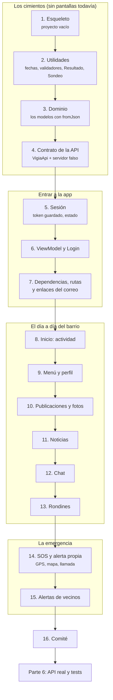

# 5. Construcción paso a paso

Esta es la parte central de la wiki. En 16 capítulos vas a **rehacer VigiaApp desde una carpeta vacía** hasta tener la app completa: login, inicio, chat, publicaciones con fotos, noticias, rondines, el botón SOS con mapa y el panel del comité.

!!! abstract "Antes de empezar"
    Esta parte da por sabidas las Partes 2, 3 y 4. No hace falta saberlas de memoria, porque cada vez que aparece un concepto hay un enlace a la página que lo explica. Si te trabás, volvé, leé esa página y retomá.

## Cómo está armado cada capítulo

Todos los capítulos tienen la misma forma, para que sepas siempre dónde estás:

| Sección | Qué tiene |
|---|---|
| **Objetivo** | Qué vas a tener andando al final, con una captura. |
| **Dónde estamos** | Un diagrama de las capas con lo que toca este capítulo resaltado. |
| **Paso a paso** | Cada archivo completo, con las líneas nuevas resaltadas y notas numeradas (tocá los :material-plus-circle: del código). |
| **Probalo** | Qué hacer en la app o qué test correr para ver que funciona. |
| **Así queda el proyecto** | El árbol de carpetas, con `← nuevo` y `← cambia` en lo que tocaste. |
| **Errores comunes** | Los problemas que más aparecen en ese capítulo y cómo salir. |
| **Lo que aprendiste** | El resumen, para repasar. |

!!! success "El código de esta parte está verificado"
    Cada capítulo se armó en un proyecto real y pasó `flutter analyze` (sin avisos) y `flutter test` (todos los tests en verde) antes de escribir la página. Si copiás el código en orden, compila. Si algo no compila, casi siempre falta un archivo de un capítulo anterior o hay un error al copiar: la sección **Así queda el proyecto** te ayuda a encontrar qué falta.

## El recorrido completo

## Cuánto crece el proyecto

Cada capítulo agrega archivos. La mayoría son nuevos; unos pocos (`main.dart`, `rutas.dart`, `dependencias.dart` y los del Inicio) **crecen** capítulo a capítulo, porque son los que conectan todo. Cuando un archivo cambia, se muestra completo otra vez con las líneas nuevas resaltadas, y además un bloque **Qué cambia** con solo la diferencia.

| Capítulo | Archivos nuevos | Archivos que cambian | Tests al final |
|---|---|---|---|
| 1. Esqueleto | 3 | — | 0 |
| 2. Utilidades | 5 | — | 8 |
| 3. Dominio | 9 | — | 13 |
| 4. Contrato de la API | 4 | — | 17 |
| 5. Sesión | 4 | 2 | 20 |
| 6. Login | 7 | 1 | 23 |
| 7. Dependencias y rutas | 5 | 3 | 25 |
| 8. Inicio I | 6 | 2 | 29 |
| 9. Menú y perfil | 4 | 2 | 29 |
| 10. Publicaciones y fotos | 9 | 6 | 30 |
| 11. Noticias | 4 | 5 | 32 |
| 12. Chat | 6 | 5 | 33 |
| 13. Rondines | 5 | 8 | 34 |
| 14. SOS y alerta propia | 10 | 8 | 34 |
| 15. Alertas de vecinos | 3 | 3 | 34 |
| 16. Comité | 17 | 5 | 36 |
| Parte 6 | 6 | 2 | **121** |

## Si te perdiste

- **No compila después de copiar:** compará tu árbol de carpetas con el de **Así queda el proyecto** del capítulo. Lo más común es un archivo en la carpeta equivocada o un `import` con la ruta mal.
- **Compila pero no anda como dice:** corré `flutter test`. Cada capítulo deja tests que prueban lo que hiciste.
- **Errores que no entendés:** buscá el mensaje en [Errores frecuentes](../7-referencia/errores-frecuentes.md).
- **Querés ver dónde está algo en la app real:** usá el [Mapa de archivos](../7-referencia/mapa-de-archivos.md).

[Empezar: 1. Esqueleto :material-arrow-right:](01-esqueleto.md){ .md-button .md-button--primary }
