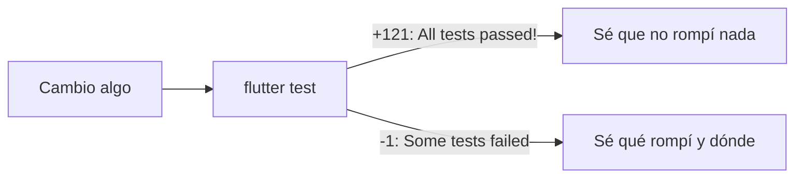
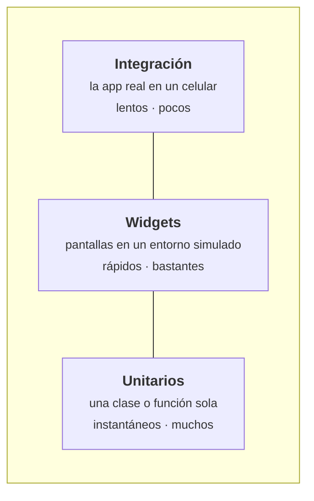
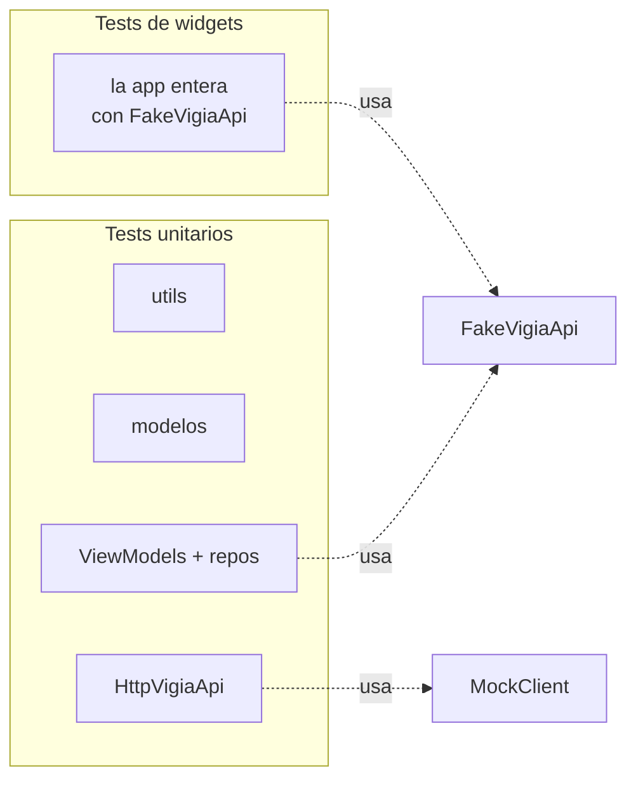

# Estrategia de pruebas

!!! abstract "Objetivo"
    Entender **para qué** sirven los tests, los **tres tipos** que tiene Flutter (unitarios, de widgets y de integración), **cuál conviene** para cada capa de la arquitectura, y la **sintaxis** básica (`test`, `expect`, `group`, `setUp`, los *matchers*). Con esto vas a poder leer cualquier test de VigiaApp.

## Para qué sirven

Un **test** es código que **usa** tu código y **comprueba** que hace lo que tiene que hacer. Se corre con un comando y responde "sí" o "no", en segundos.



Sin tests, para saber si un cambio rompió algo hay que abrir la app y probar **todo** a mano: el login, el chat, la alerta, el comité… Nadie lo hace todas las veces. Con tests, cada cambio se verifica entero.

Además, los tests:

- **Documentan**: "`ChatViewModel no duplica el mensaje recién enviado`" dice qué tiene que pasar mejor que cualquier comentario.
- **Dan confianza para cambiar**: en VigiaApp, el paso de "todo en los widgets" a MVVM se hizo **con los tests andando**. Si seguían en verde, el cambio era seguro (ver [caracterización](5-tests-de-caracterizacion.md)).
- **Empujan a un buen diseño**: si algo es difícil de probar, casi siempre es porque está mezclado con otra cosa.

## Los tres tipos de tests en Flutter



| | Unitario | De widgets | De integración |
|---|---|---|---|
| **Prueba** | Una función, un modelo, un ViewModel | Una pantalla o la app, sin celular | La app real en un celular o emulador |
| **Función** | `test(...)` | `testWidgets(...)` | `testWidgets(...)` con `integration_test` |
| **Velocidad** | Milisegundos | Decenas de ms | Segundos o minutos |
| **Necesita** | Nada | Nada (Flutter simula la pantalla) | Un dispositivo |
| **En VigiaApp** | 74 | 47 | 0 |

Se le dice **pirámide** porque conviene tener **muchos** de abajo (baratos, rápidos, precisos) y **pocos** de arriba (caros, lentos, pero prueban todo junto). VigiaApp no tiene tests de integración: los de widgets con el servidor de mentira cubren casi lo mismo sin necesitar un emulador.

## Qué test para qué capa

La arquitectura de la [Parte 4](../4-arquitectura/index.md) hace que cada capa se pruebe de la forma más simple posible:

| Capa | Tipo de test | Con qué reemplaza lo de afuera | Archivos de VigiaApp |
|---|---|---|---|
| Utilidades | Unitario | Nada | `utils_test.dart` |
| Modelos | Unitario | Mapas de ejemplo (el JSON) | `modelos_test.dart` |
| Servidor falso | Unitario | — | `fake_api_test.dart` |
| Repositorios | Unitario | `FakeVigiaApi`, almacén en memoria | `sesion_repository_test.dart`, `view_models_test.dart` |
| ViewModels | Unitario | `FakeVigiaApi`, `UbicacionDePrueba` | `*_view_model_test.dart`, `view_models_test.dart` |
| Vistas y la app entera | De widgets | `FakeVigiaApi`, `MapaDePrueba` | `widget_test.dart`, `caracterizacion_test.dart` |
| Cliente HTTP | Unitario | `MockClient` del paquete `http` | `api_test.dart` |



## Cuántos tiene cada archivo

| Archivo | Capítulo | Tests |
|---|---|---|
| `utils_test.dart` | [2](../5-construccion/02-utilidades.md) | 8 |
| `modelos_test.dart` | [3](../5-construccion/03-dominio.md) | 5 |
| `fake_api_test.dart` | [4](../5-construccion/04-contrato-api.md) | 4 |
| `sesion_repository_test.dart` | [5](../5-construccion/05-sesion.md) | 3 |
| `login_view_model_test.dart` | [6](../5-construccion/06-login.md) | 3 |
| `elegir_clave_view_model_test.dart` | [7](../5-construccion/07-dependencias-y-rutas.md) | 2 |
| `inicio_view_model_test.dart` | [8](../5-construccion/08-inicio.md) a 14 | 4 |
| `publicacion_view_model_test.dart` | [10](../5-construccion/10-publicaciones-y-fotos.md) | 1 |
| `noticias_view_model_test.dart` | [11](../5-construccion/11-noticias.md) | 2 |
| `chat_view_model_test.dart` | [12](../5-construccion/12-chat.md) | 1 |
| `rondin_view_model_test.dart` | [13](../5-construccion/13-rondines.md) | 1 |
| `comite_vecinos_view_model_test.dart` | [16](../5-construccion/16-comite.md) | 2 |
| **Subtotal Parte 5** | | **36** |
| `view_models_test.dart` | [Parte 6](3-tests-de-view-models.md) | 12 |
| `widget_test.dart` | [Parte 6](4-tests-de-widgets.md) | 35 |
| `caracterizacion_test.dart` | [Parte 6](5-tests-de-caracterizacion.md) | 13 |
| `api_test.dart` | [Parte 6](6-tests-del-cliente-http.md) | 25 |
| **Total** | | **121** |

## La sintaxis

Los tests usan el paquete `flutter_test` (ya viene en `dev_dependencies`). Un archivo de test es un programa con `main()`:

```dart title="test/utils_test.dart (fragmento)" linenums="1"
import 'package:flutter_test/flutter_test.dart';  // (1)!

import 'package:vigia_app/utils/fechas.dart';  // (2)!
import 'package:vigia_app/utils/validadores.dart';

void main() {
  group('fechas', () {  // (3)!
    final ahora = DateTime(2026, 11, 16, 12, 0); // un lunes al mediodía

    test('haceCuanto', () {  // (4)!
      expect(
        haceCuanto(DateTime(2026, 11, 16, 11, 35), ahora: ahora),
        'hace 25 min',  // (5)!
      );
      expect(haceCuanto(DateTime(2026, 11, 15, 10, 0), ahora: ahora), 'ayer');
    });
  });

  group('validadores', () {
    test('validarEmail', () {
      expect(validarEmail(''), 'Ingresá tu email');
      expect(validarEmail('maria@'), 'El email no es válido');
      expect(validarEmail(' maria@vigia.test '), isNull);  // (6)!
    });
  });
}
```

1. La biblioteca de tests.
2. Los tests están fuera de `lib/`, así que importan con `package:vigia_app/...` ([Librerías](../2-dart/10-librerias-y-paquetes.md#relativo-o-package)).
3. `group` agrupa tests relacionados. Aparece en los nombres al correrlos: `fechas haceCuanto`.
4. `test(nombre, función)`: un test. El nombre dice **qué** se prueba.
5. `expect(real, esperado)`: si no coinciden, el test falla mostrando los dos valores.
6. Un **matcher**: en vez de un valor exacto, una condición.

!!! info "¿Por qué `haceCuanto` recibe `ahora`?"
    Para poder probarla. Si usara siempre `DateTime.now()`, el resultado dependería de **cuándo** se corre el test. Con `ahora` como parámetro opcional, la app usa el reloj y el test usa una hora fija. Es inyección de dependencias en su forma más chica ([capítulo 2](../5-construccion/02-utilidades.md)).

### Los matchers más usados

| Matcher | Pasa si… |
|---|---|
| `expect(x, 3)` | `x == 3` |
| `isNull` / `isNotNull` | es / no es `null` |
| `isTrue` / `isFalse` | es `true` / `false` |
| `hasLength(3)` | tiene 3 elementos |
| `isEmpty` / `isNotEmpty` | está vacío / no |
| `contains('x')` | contiene `'x'` |
| `greaterThan(0)` | es mayor que 0 |
| `isA<Ok<void>>()` | es de ese tipo |
| `throwsA(isA<ApiException>())` | la función lanza ese error |
| `throwsUnsupportedError` | lanza `UnsupportedError` (modificar una lista de solo lectura) |
| `findsOneWidget` / `findsNothing` | (widgets) hay uno / no hay ninguno |

### Preparar y limpiar

```dart
setUp(() { … });         // antes de CADA test del grupo
tearDown(() { … });      // después de CADA test
setUpAll(() { … });      // una vez, antes de todos
addTearDown(algo.dispose);  // dentro de un test: limpiar esto al terminar
```

`addTearDown` es el que más se usa en VigiaApp: cada test que crea un ViewModel lo descarta al final, para no dejar timers corriendo.

### Tests asíncronos

Si el test espera algo, se marca `async` y se usa `await`, como cualquier función:

```dart
test('login con la clave correcta', () async {
  final api = FakeVigiaApi(demora: Duration.zero);  // sin esperas falsas
  final sesion = await api.login('maria@vigia.test', 'vigia1234');
  expect(sesion.vecino.nombre, 'María Ríos');
});
```

`demora: Duration.zero` hace que el servidor falso responda al instante: los tests no esperan los 400 ms que usa en la app.

## Correr los tests

```bash
flutter test                                # todos
flutter test test/chat_view_model_test.dart # un archivo
flutter test --name "no duplica"            # los que tengan eso en el nombre
flutter test --reporter expanded            # un renglón por test
```

En VS Code, cada `test(` tiene arriba un enlace **Run | Debug**, y la pestaña **Testing** (el matraz :material-flask-outline:) muestra todos en un árbol.

```text title="Salida"
00:04 +121: All tests passed!
```

`+121` son los que pasaron; si alguno falla aparece `-1` y el detalle de qué se esperaba y qué llegó ([leer los errores de los tests](../1-preparacion/4-correr-y-depurar.md#los-errores-de-los-tests)).

## Qué probar (y qué no)

!!! tip "Probá comportamiento, no implementación"
    Un buen test dice **qué** tiene que pasar, no **cómo**. "Después de enviar, hay un mensaje más y es mío" sobrevive a que cambies cómo se guarda la lista. "Llamó a `_agregar` una vez" se rompe con cualquier refactor.

Prioridades en una app como VigiaApp:

1. **Las reglas**: quién puede borrar, que no se dupliquen mensajes, que un 401 cierre la sesión.
2. **Los caminos principales**: entrar, publicar, mandar un SOS.
3. **Los errores**: sin conexión, el servidor dice que no, el GPS apagado.
4. **Los bordes**: listas vacías, textos con espacios, un enlace mal pegado.

No hace falta probar que Flutter dibuje un `Text`: eso ya lo prueba el equipo de Flutter.

## Lo que aprendiste

- [x] Los tests verifican en segundos lo que a mano llevaría horas, y permiten cambiar con confianza.
- [x] **Unitarios** (una pieza), **de widgets** (pantallas simuladas) y **de integración** (celular real).
- [x] Cada capa de la arquitectura tiene su forma natural de probarse, con `FakeVigiaApi` o `MockClient`.
- [x] `test`, `group`, `expect`, matchers, `setUp`/`addTearDown`, y `flutter test` para correrlos.

[Siguiente: Conectar la API real :material-arrow-right:](2-api-real.md){ .md-button .md-button--primary }
