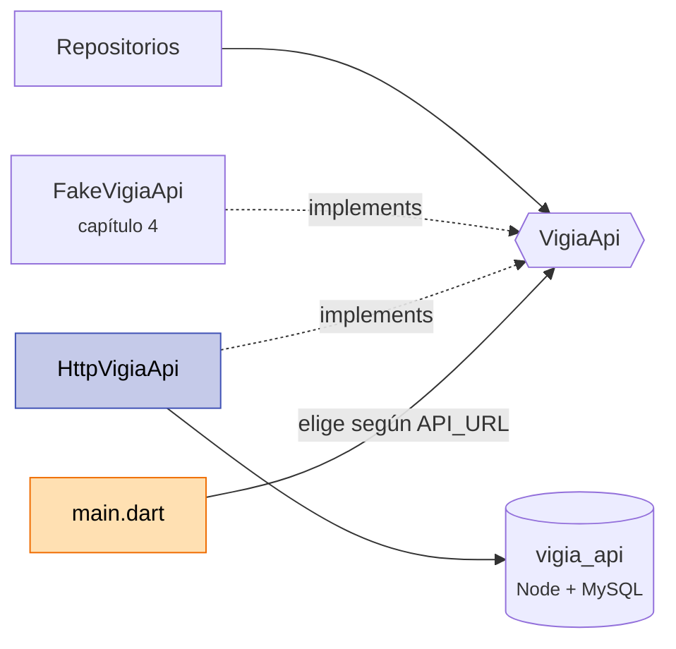
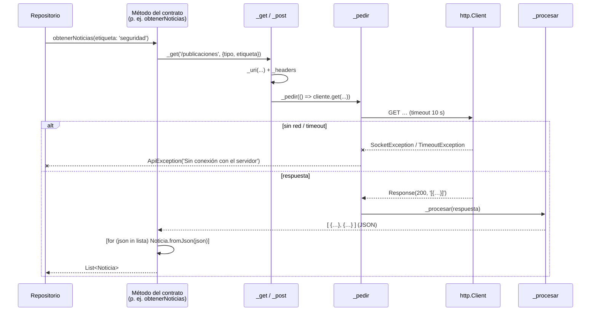
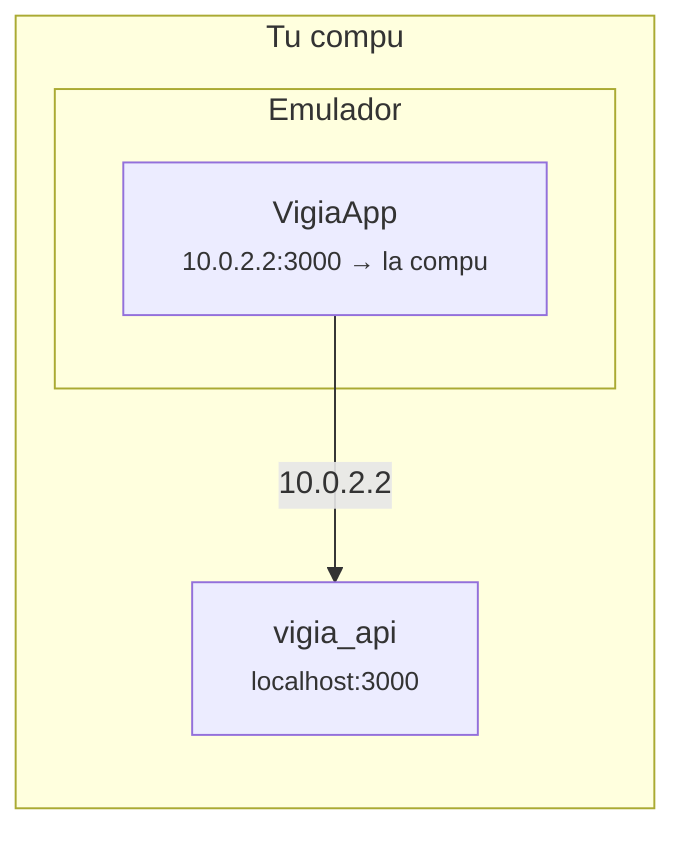

# Conectar la API real

!!! abstract "Objetivo"
    Escribir **`HttpVigiaApi`**, la segunda implementación del contrato `VigiaApi`, que habla con el servidor de verdad usando el paquete **`http`**, y elegir entre el servidor falso y el real **al compilar**, con `--dart-define`. Es el momento en que se cumple la promesa de la Parte 4: cambiar de servidor sin tocar ni un ViewModel ni una pantalla.

## Dónde estamos



Se agrega **un** archivo y cambian **dos**. Ningún repositorio, ViewModel ni pantalla se entera.

## El servidor

El servidor de VigiaApp (**vigia_api**) está en otro repositorio: es una API REST hecha con Node.js, Express y MySQL, publicada en un *hosting*. Sus reglas están en su especificación OpenAPI, resumidas en el [Contrato de la API](../7-referencia/contrato-api.md). Lo que importa para la app:

- La URL base es `https://hotpink-aardvark-846933.hostingersite.com/api/v1` (la constante `apiProduccion` de `config.dart`).
- Habla **JSON** en UTF-8.
- Casi todas las rutas piden el encabezado `Authorization: Bearer <token>`; el token (64 caracteres hexadecimales) lo devuelven `/auth/login` y `/auth/clave`, y vale 24 horas.
- Los errores vienen como `{"error": {"codigo": "...", "mensaje": "..."}}` ([Los errores](../4-arquitectura/7-errores.md#paso-1-el-servidor)).

!!! warning "La app nunca habla con la base de datos"
    La app solo conoce la URL de la API. Las credenciales de MySQL viven **solo** en el servidor. Si una app tuviera la contraseña de la base adentro, cualquiera podría sacarla del APK y leer (o borrar) todo.

## Paso 1: el paquete `http`

```bash
flutter pub add http
```

En el mismo paso agregamos, como dependencia de desarrollo, un paquete que van a necesitar los tests de widgets de la [página 4](4-tests-de-widgets.md) (para reemplazar el mapa de Google por uno de mentira):

```bash
flutter pub add --dev google_maps_flutter_platform_interface
```

<!-- archivo: pubspec.yaml cap=c17 notas="http: \^1.6.0|google_maps_flutter_platform_interface" -->
```yaml title="pubspec.yaml" linenums="1" hl_lines="12 24"
name: vigia_app
description: "VigiaApp: red de alerta vecinal (versión de la wiki, solo Material)."
publish_to: 'none'
version: 1.0.0+1

environment:
  sdk: ^3.12.2

dependencies:
  flutter:
    sdk: flutter
  http: ^1.6.0  # (1)!
  flutter_secure_storage: ^11.2.0
  app_links: ^7.2.1
  image_picker: ^1.2.4
  url_launcher: ^6.3.3
  geolocator: ^14.1.2
  google_maps_flutter: ^2.18.1

dev_dependencies:
  flutter_test:
    sdk: flutter
  flutter_lints: ^6.0.0
  google_maps_flutter_platform_interface: ^2.17.0  # (2)!

flutter:
  uses-material-design: true
```
<!-- /archivo -->

1. El cliente HTTP oficial del equipo de Dart. Trae `get`, `post`, `put`, `patch`, `delete` y, para los tests, un `MockClient`.
2. Solo para los tests: la "interfaz de plataforma" de Google Maps, que deja enchufar un mapa falso.

## Paso 2: `HttpVigiaApi`

Es el archivo más largo de la app (unas 450 líneas), pero **muy repetitivo**: la parte interesante son las primeras 120 líneas (cómo se hace un pedido y cómo se procesa la respuesta). El resto son los 39 métodos del contrato, cada uno de 3 a 10 líneas, todos con la misma forma.

Creá `lib/data/services/api/http_vigia_api.dart`:

<!-- archivo: lib/data/services/api/http_vigia_api.dart cap=c17 notas="import 'package:http/http.dart' as http;|class HttpVigiaApi implements VigiaApi|http.Client\? cliente|static const _timeout|Map<String, String> get _headers|if \(token != null\) 'Authorization'|Uri _uri\(|Future<dynamic> _get\(|Future<http.Response> _pedir|throw ApiException\('Sin conexión|dynamic _procesar|on FormatException|respuesta.statusCode == 401 && token != null|throw ApiException\(mensaje, codigo|Future<Sesion> login|token = sesion.token|Future<void> logout|'etiqueta': \?etiqueta|Future<int> subirFoto|Future<Uint8List> obtenerFoto" -->
```dart title="lib/data/services/api/http_vigia_api.dart" linenums="1"
// lib/data/services/api/http_vigia_api.dart
//
// Implementación real de VigiaApi: habla con la API REST publicada en el
// hosting (repo vigia_api: Express + MySQL). Usa el paquete http, agregado
// con `flutter pub add http` (apunte 13).
//
// La app NUNCA se conecta directo a MySQL: solo conoce la URL de la API.
// Las credenciales de la base quedan del lado del servidor.

import 'dart:convert';
import 'dart:typed_data';

import 'package:http/http.dart' as http;  // (1)!

import '../../../domain/models/alerta.dart';
import '../../../domain/models/comite.dart';
import '../../../domain/models/mensaje.dart';
import '../../../domain/models/noticia.dart';
import '../../../domain/models/publicacion.dart';
import '../../../domain/models/rondin.dart';
import '../../../domain/models/sesion.dart';
import '../../../utils/fechas.dart';
import 'vigia_api.dart';

class HttpVigiaApi implements VigiaApi {  // (2)!
  HttpVigiaApi(
    this.baseUrl, {
    this.token,
    this.onSesionVencida,
    http.Client? cliente,  // (3)!
  }) : _cliente = cliente ?? http.Client();

  /// Ejemplo: 'https://vigiaapp.midominio.com/api/v1'
  final String baseUrl;

  @override
  String? token;

  @override
  void Function()? onSesionVencida;

  final http.Client _cliente;
  static const _timeout = Duration(seconds: 10);  // (4)!

  Map<String, String> get _headers => {  // (5)!
    'Content-Type': 'application/json',
    'Accept': 'application/json',
    if (token != null) 'Authorization': 'Bearer $token',  // (6)!
  };

  Uri _uri(String ruta, [Map<String, String>? query]) {  // (7)!
    final uri = Uri.parse('$baseUrl$ruta');
    return query == null || query.isEmpty
        ? uri
        : uri.replace(queryParameters: query);
  }

  String? _json(Map<String, dynamic>? body) =>
      body == null ? null : jsonEncode(body);

  // 1) arma la URL, 2) hace el pedido, 3) revisa la respuesta
  Future<dynamic> _get(String ruta, [Map<String, String>? query]) =>  // (8)!
      _enviar(() => _cliente.get(_uri(ruta, query), headers: _headers));

  Future<dynamic> _post(String ruta, [Map<String, dynamic>? body]) => _enviar(
    () => _cliente.post(_uri(ruta), headers: _headers, body: _json(body)),
  );

  Future<dynamic> _put(String ruta, Map<String, dynamic> body) => _enviar(
    () => _cliente.put(_uri(ruta), headers: _headers, body: _json(body)),
  );

  Future<dynamic> _patch(String ruta, Map<String, dynamic> body) => _enviar(
    () => _cliente.patch(_uri(ruta), headers: _headers, body: _json(body)),
  );

  Future<dynamic> _delete(String ruta) =>
      _enviar(() => _cliente.delete(_uri(ruta), headers: _headers));

  // Sin conexión, DNS o timeout también terminan en ApiException: así las
  // pantallas solo tienen que atrapar un tipo de error.
  Future<http.Response> _pedir(Future<http.Response> Function() pedido) async {  // (9)!
    try {
      return await pedido().timeout(_timeout);
    } on Exception {
      throw ApiException('Sin conexión con el servidor');  // (10)!
    }
  }

  Future<dynamic> _enviar(Future<http.Response> Function() pedido) async =>
      _procesar(await _pedir(pedido));

  // Si el servidor respondió 2xx devuelve el JSON (null si fue 204); si no,
  // lanza ApiException con el mensaje que manda la API:
  // {"error": {"codigo": ..., "mensaje": ...}}
  dynamic _procesar(http.Response respuesta) {  // (11)!
    final ok = respuesta.statusCode >= 200 && respuesta.statusCode < 300;
    dynamic cuerpo;
    try {
      cuerpo = respuesta.body.isEmpty
          ? null
          : jsonDecode(utf8.decode(respuesta.bodyBytes));
    } on FormatException {  // (12)!
      // No vino JSON: p. ej. la página HTML del hosting con un 503 mientras
      // la API reinicia. También es ApiException, así las pantallas la atrapan.
      if (ok) throw ApiException('Respuesta inválida del servidor');
    }

    if (!ok) {
      // 401 con sesión iniciada = la sesión venció. Un 401 sin token (login
      // con la clave mal) no cierra nada.
      if (respuesta.statusCode == 401 && token != null) {  // (13)!
        token = null;
        onSesionVencida?.call();
      }
      final mensaje = cuerpo is Map && cuerpo['error'] is Map
          ? cuerpo['error']['mensaje'] as String
          : 'Error del servidor';
      throw ApiException(mensaje, codigo: respuesta.statusCode);  // (14)!
    }
    return cuerpo;
  }

  // ---- Sesión ----

  @override
  Future<Sesion> login(String email, String password) async {  // (15)!
    final sesion = Sesion.fromJson(
      await _post('/auth/login', {'email': email, 'password': password}),
    );
    token = sesion.token;  // (16)!
    return sesion;
  }

  @override
  Future<Sesion> elegirClave(String tokenEnlace, String password) async {
    final sesion = Sesion.fromJson(
      await _post('/auth/clave', {'token': tokenEnlace, 'password': password}),
    );
    token = sesion.token;
    return sesion;
  }

  @override
  Future<void> recuperarClave(String email) async {
    await _post('/auth/recuperar', {'email': email});
  }

  @override
  Future<void> logout() async {  // (17)!
    try {
      await _post('/auth/logout');
    } finally {
      token = null;
    }
  }

  @override
  Future<Perfil> obtenerPerfil() async {
    return Perfil.fromJson(await _get('/yo'));
  }

  @override
  Future<void> cambiarClave(String actual, String nueva) async {
    await _post('/yo/clave', {'actual': actual, 'nueva': nueva});
  }

  // ---- Inicio, noticias, rondines y alertas ----

  @override
  Future<EstadoBarrio> obtenerEstadoBarrio() async {
    return EstadoBarrio.fromJson(await _get('/barrio/estado'));
  }

  @override
  Future<List<Publicacion>> obtenerActividad() async {
    final lista = await _get('/publicaciones', {'tipo': 'actividad'}) as List;
    return [for (final json in lista) Publicacion.fromJson(json)];
  }

  @override
  Future<List<Noticia>> obtenerNoticias({String? etiqueta}) async {
    final lista =
        await _get('/publicaciones', {
              'tipo': 'noticia',
              'etiqueta': ?etiqueta, // solo se agrega si no es null (18)
            })
            as List;
    return [for (final json in lista) Noticia.fromJson(json)];
  }

  @override
  Future<Publicacion> publicar({
    required String tipo,
    required String titulo,
    String? cuerpo,
    String? etiqueta,
    String? firma,
    int? fotoId,
  }) async {
    return Publicacion.fromJson(
      await _post('/publicaciones', {
        'tipo': tipo,
        'titulo': titulo,
        'cuerpo': ?cuerpo,
        'etiqueta': ?etiqueta,
        'firma': ?firma,
        'foto_id': ?fotoId,
      }),
    );
  }

  @override
  Future<Publicacion> obtenerPublicacion(int id) async {
    return Publicacion.fromJson(await _get('/publicaciones/$id'));
  }

  @override
  Future<void> borrarPublicacion(int id) async {
    await _delete('/publicaciones/$id');
  }

  @override
  Future<List<RespuestaPublicacion>> obtenerRespuestas(
    int publicacionId,
  ) async {
    final lista =
        await _get('/publicaciones/$publicacionId/respuestas') as List;
    return [for (final json in lista) RespuestaPublicacion.fromJson(json)];
  }

  @override
  Future<RespuestaPublicacion> responder(
    int publicacionId,
    String texto,
  ) async {
    return RespuestaPublicacion.fromJson(
      await _post('/publicaciones/$publicacionId/respuestas', {'texto': texto}),
    );
  }

  @override
  Future<List<Mensaje>> obtenerMensajes({int? despues}) async {
    final lista =
        await _get('/mensajes', {if (despues != null) 'despues': '$despues'})
            as List;
    return [for (final json in lista) Mensaje.fromJson(json)];
  }

  @override
  Future<Mensaje> enviarMensaje({String? texto, int? fotoId}) async {
    return Mensaje.fromJson(
      await _post('/mensajes', {'texto': ?texto, 'foto_id': ?fotoId}),
    );
  }

  @override
  Future<List<TurnoRondin>> obtenerSemanaRondin({DateTime? desde}) async {
    final lista =
        await _get('/rondines/semana', {
              if (desde != null) 'desde': fechaApi(desde),
            })
            as List;
    return [for (final json in lista) TurnoRondin.fromJson(json)];
  }

  @override
  Future<TurnoRondin> responderAsistencia(int turnoId, bool presente) async {
    final json = await _post('/rondines/$turnoId/asistencia', {
      'presente': presente,
    });
    return TurnoRondin.fromJson(json);
  }

  @override
  Future<int> crearAlerta({double? lat, double? lng}) async {
    final json = await _post('/alertas', {'lat': lat, 'lng': lng});
    return json['id'] as int;
  }

  @override
  Future<EstadoAlerta> obtenerAlerta(int alertaId) async {
    return EstadoAlerta.fromJson(await _get('/alertas/$alertaId'));
  }

  @override
  Future<void> cancelarAlerta(int alertaId) async {
    await _post('/alertas/$alertaId/cancelar');
  }

  @override
  Future<List<EstadoAlerta>> obtenerAlertas({String estado = 'activa'}) async {
    final lista = await _get('/alertas', {'estado': estado}) as List;
    return [for (final json in lista) EstadoAlerta.fromJson(json)];
  }

  @override
  Future<EstadoAlerta> marcarEnCamino(
    int alertaId, {
    bool enCamino = true,
  }) async {
    return EstadoAlerta.fromJson(
      await _post('/alertas/$alertaId/en-camino', {'en_camino': enCamino}),
    );
  }

  @override
  Future<void> resolverAlerta(int alertaId) async {
    await _post('/alertas/$alertaId/resolver');
  }

  @override
  Future<EstadoAlerta> confirmar911(int alertaId) async {
    return EstadoAlerta.fromJson(
      await _post('/alertas/$alertaId/confirmar-911'),
    );
  }

  @override
  Future<void> enviarUbicacion(int alertaId, double lat, double lng) async {
    await _post('/alertas/$alertaId/ubicacion', {'lat': lat, 'lng': lng});
  }

  @override
  Future<EstadoAlerta> adjuntarFotoAlerta(int alertaId, int fotoId) async {
    return EstadoAlerta.fromJson(
      await _post('/alertas/$alertaId/foto', {'foto_id': fotoId}),
    );
  }

  // ---- Fotos ----

  // El cuerpo no es JSON: son los bytes de la imagen, con su Content-Type.
  @override
  Future<int> subirFoto(Uint8List bytes, String mime) async {  // (19)!
    final json = await _enviar(
      () => _cliente.post(
        _uri('/fotos'),
        headers: {..._headers, 'Content-Type': mime},
        body: bytes,
      ),
    );
    return json['id'] as int;
  }

  // La respuesta tampoco es JSON: si salió bien, son los bytes de la imagen.
  @override
  Future<Uint8List> obtenerFoto(int fotoId) async {  // (20)!
    final respuesta = await _pedir(
      () => _cliente.get(_uri('/fotos/$fotoId'), headers: _headers),
    );
    if (respuesta.statusCode != 200) _procesar(respuesta); // lanza el error
    return respuesta.bodyBytes;
  }

  // ---- Comité ----

  @override
  Future<List<Manzana>> obtenerManzanas() async {
    final lista = await _get('/manzanas') as List;
    return [for (final json in lista) Manzana.fromJson(json)];
  }

  @override
  Future<Manzana> crearManzana(String nombre) async {
    return Manzana.fromJson(await _post('/manzanas', {'nombre': nombre}));
  }

  @override
  Future<List<VecinoAdmin>> obtenerVecinos() async {
    final lista = await _get('/vecinos') as List;
    return [for (final json in lista) VecinoAdmin.fromJson(json)];
  }

  @override
  Future<VecinoAdmin> crearVecino({
    required String nombre,
    required String apellido,
    required String email,
    String? telefono,
    required int manzanaId,
    String rol = 'vecino',
  }) async {
    return VecinoAdmin.fromJson(
      await _post('/vecinos', {
        'nombre': nombre,
        'apellido': apellido,
        'email': email,
        'telefono': ?telefono,
        'manzana_id': manzanaId,
        'rol': rol,
      }),
    );
  }

  @override
  Future<VecinoAdmin> editarVecino(int id, Map<String, dynamic> cambios) async {
    return VecinoAdmin.fromJson(await _patch('/vecinos/$id', cambios));
  }

  @override
  Future<void> reenviarInvitacion(int vecinoId) async {
    await _post('/vecinos/$vecinoId/invitacion');
  }

  @override
  Future<TurnoRondin> crearTurno({
    required DateTime fecha,
    required String ruta,
    String? horaInicio,
    String? horaFin,
    List<int> vecinoIds = const [],
  }) async {
    return TurnoRondin.fromJson(
      await _post('/rondines', {
        'fecha': fechaApi(fecha),
        'ruta': ruta,
        'hora_inicio': ?horaInicio,
        'hora_fin': ?horaFin,
        'vecino_ids': vecinoIds,
      }),
    );
  }

  @override
  Future<List<Asignacion>> obtenerAsignaciones(int turnoId) async {
    final lista = await _get('/rondines/$turnoId/asignaciones') as List;
    return [for (final json in lista) Asignacion.fromJson(json)];
  }

  @override
  Future<List<Asignacion>> reasignarTurno(
    int turnoId,
    List<int> vecinoIds,
  ) async {
    final lista =
        await _put('/rondines/$turnoId/asignaciones', {'vecino_ids': vecinoIds})
            as List;
    return [for (final json in lista) Asignacion.fromJson(json)];
  }

  @override
  Future<void> borrarTurno(int turnoId) async {
    await _delete('/rondines/$turnoId');
  }
}
```
<!-- /archivo -->

1. El paquete se importa **con prefijo** (`http.`): sus funciones tienen nombres muy genéricos (`get`, `post`) que chocarían con los nuestros ([`as`](../2-dart/10-librerias-y-paquetes.md#show-hide-y-as)).
2. Cumple el **mismo contrato** que `FakeVigiaApi`. Si le falta un método, no compila.
3. El cliente HTTP se puede **inyectar**: en la app se usa uno real (`http.Client()`); en los tests, un `MockClient` que responde lo que queramos ([página 6](6-tests-del-cliente-http.md)).
4. Si el servidor no responde en 10 segundos, se corta.
5. Los encabezados de **todos** los pedidos: el cuerpo es JSON y esperamos JSON…
6. …y, si hay sesión, el token. Un *collection if* ([Colecciones](../2-dart/4-colecciones.md#collection-if-y-collection-for)) dentro de un mapa.
7. Pega la ruta a la URL base y agrega los parámetros (`?tipo=noticia&etiqueta=seguridad`). `Uri` se encarga de codificar los caracteres raros.
8. Cuatro ayudantes, uno por verbo HTTP. Todos hacen lo mismo: (1) arman la URL, (2) hacen el pedido, (3) revisan la respuesta.
9. **Hace** el pedido con *timeout*…
10. …y cualquier problema de red (sin señal, DNS, timeout) se convierte en **un** error con un mensaje claro.
11. **Revisa** la respuesta: devuelve el JSON si salió bien, o lanza `ApiException` si no.
12. Si la respuesta no es JSON (la página HTML de un 503 del hosting) y además decía "todo bien", es un error.
13. Un **401 con sesión** = la sesión venció: se borra el token y se avisa (`SesionRepository` vuelve al Login). Un 401 **sin** sesión es una contraseña incorrecta y no cierra nada.
14. Cualquier otro error: con el mensaje que mandó el servidor, en castellano, y el código HTTP.
15. Los métodos del contrato. El primero: el login…
16. …que, si sale bien, **guarda el token** para los pedidos siguientes.
17. `logout` borra el token **pase lo que pase** (`finally`), aunque el servidor no conteste.
18. [Elemento opcional](../2-dart/4-colecciones.md#elementos-opcionales): si no hay etiqueta, el parámetro ni se manda.
19. Las fotos son distintas: el cuerpo **no** es JSON sino los bytes de la imagen, con su tipo (`image/jpeg`)…
20. …y al bajarlas, la respuesta tampoco es JSON: son los bytes. Si no es un 200, `_procesar` lanza el error correspondiente.

### Cómo es un pedido, de punta a punta



### La forma de todos los métodos

Casi todos los métodos son una de estas tres formas:

=== "Un objeto"

    ```dart
    @override
    Future<Perfil> obtenerPerfil() async {
      return Perfil.fromJson(await _get('/yo'));
    }
    ```

=== "Una lista"

    ```dart
    @override
    Future<List<Publicacion>> obtenerActividad() async {
      final lista = await _get('/publicaciones', {'tipo': 'actividad'}) as List;
      return [for (final json in lista) Publicacion.fromJson(json)];
    }
    ```

=== "Nada (solo que salió bien)"

    ```dart
    @override
    Future<void> cambiarClave(String actual, String nueva) async {
      await _post('/yo/clave', {'actual': actual, 'nueva': nueva});
    }
    ```

Fijate que **los modelos y sus `fromJson` son los mismos** que usa `FakeVigiaApi` desde el [capítulo 3](../5-construccion/03-dominio.md). Por eso el servidor falso guarda los datos como mapas con las mismas claves que el JSON real: cuando llegamos acá, los `fromJson` ya están probados.

## Paso 3: elegir la API al compilar

En `main.dart`, la API por defecto deja de ser siempre `FakeVigiaApi`: se elige según `apiUrl`, que viene de `--dart-define=API_URL=…` ([capítulo 1](../5-construccion/01-esqueleto.md#paso-4-la-configuracion)).

<!-- archivo: lib/main.dart cap=c17 notas="import 'config.dart';|import 'data/services/api/http_vigia_api.dart';|: api = api \?\? _apiSegunConfig\(\);|static VigiaApi _apiSegunConfig" -->
```dart title="lib/main.dart" linenums="1" hl_lines="19 28 52-53 59-62"
// lib/main.dart
//
// Punto de entrada y raíz de composición: acá se crea una sola instancia de
// cada servicio, repositorio y ViewModel compartido, y se pone todo en
// Dependencias, arriba del árbol de widgets.
//
// Capas (MVVM, guía de arquitectura de Flutter):
//   ui/<pantalla>/widgets     Vistas: dibujan y le avisan al ViewModel.
//   ui/<pantalla>/view_model  ViewModels: estado de la pantalla y acciones.
//   data/repositories         Fuente de verdad de cada área (sesión, alertas…).
//   data/services             API, GPS, cámara, almacenamiento seguro.
//   domain/models             Los datos de la app, en Dart puro.

import 'dart:async';

import 'package:app_links/app_links.dart';
import 'package:flutter/material.dart';

import 'config.dart';  // (1)!
import 'data/repositories/alertas_repository.dart';
import 'data/repositories/chat_repository.dart';
import 'data/repositories/comite_repository.dart';
import 'data/repositories/fotos_repository.dart';
import 'data/repositories/publicaciones_repository.dart';
import 'data/repositories/rondines_repository.dart';
import 'data/repositories/sesion_repository.dart';
import 'data/services/api/fake_vigia_api.dart';
import 'data/services/api/http_vigia_api.dart';  // (2)!
import 'data/services/api/vigia_api.dart';
import 'data/services/lanzador_externo.dart';
import 'dependencias.dart';
import 'routing/rutas.dart';
import 'ui/carga/widgets/pantalla_carga.dart';
import 'ui/chat/view_model/chat_view_model.dart';
import 'ui/inicio/view_model/inicio_view_model.dart';
import 'ui/inicio/widgets/inicio_screen.dart';
import 'ui/login/view_model/login_view_model.dart';
import 'ui/login/widgets/login_screen.dart';
import 'ui/rondines/view_model/rondin_view_model.dart';
import 'utils/validadores.dart';

void main() {
  // AppLinks habla con la plataforma: Flutter tiene que estar inicializado
  // antes de usarlo.
  WidgetsFlutterBinding.ensureInitialized();
  // uriLinkStream también trae el enlace con el que se abrió la app
  // (vigiaapp://clave?token=… desde el correo de invitación).
  runApp(MyApp(enlaces: AppLinks().uriLinkStream));
}

class MyApp extends StatefulWidget {
  MyApp({super.key, VigiaApi? api, this.enlaces})
    : api = api ?? _apiSegunConfig();  // (3)!

  final VigiaApi api;

  /// Deep links entrantes. En los tests no se pasa (no hay plataforma).
  final Stream<Uri>? enlaces;

  /// 'fake' (por defecto) → datos en memoria; una URL → el servidor real.
  static VigiaApi _apiSegunConfig() =>  // (4)!
      apiUrl == 'fake' ? FakeVigiaApi() : HttpVigiaApi(apiUrl);

  @override
  State<MyApp> createState() => _MyAppState();
}

class _MyAppState extends State<MyApp> {
  // La llave del Navigator: deja navegar desde afuera de las pantallas
  // (cuando llega un enlace).
  final _navegador = GlobalKey<NavigatorState>();

  // Una sola instancia de cada repositorio para toda la app.
  late final _sesion = SesionRepository(widget.api)..iniciar();
  late final _publicaciones = PublicacionesRepository(widget.api);
  late final _chat = ChatRepository(widget.api);
  late final _alertas = AlertasRepository(widget.api);
  late final _rondines = RondinesRepository(widget.api);
  late final _comite = ComiteRepository(widget.api);
  late final _fotos = FotosRepository(widget.api);

  // Compartido por la tarjeta del Inicio y la pantalla de Recorridos.
  late final _rondin = RondinViewModel(_rondines);

  StreamSubscription<Uri>? _enlaces;
  EstadoSesion _estadoAnterior = EstadoSesion.iniciando;

  @override
  void initState() {
    super.initState();
    _enlaces = widget.enlaces?.listen(_abrirEnlace);
    _sesion.addListener(_alCambiarSesion);
  }

  @override
  void dispose() {
    _enlaces?.cancel();
    _sesion.removeListener(_alCambiarSesion);
    _sesion.dispose();
    _rondin.dispose();
    super.dispose();
  }

  // Si la sesión se cierra (logout o 401) con pantallas abiertas encima del
  // Inicio, se cierran todas: debajo ya está el Login.
  void _alCambiarSesion() {
    if (_estadoAnterior == EstadoSesion.conSesion &&
        _sesion.estado == EstadoSesion.sinSesion) {
      _navegador.currentState?.popUntil((ruta) => ruta.isFirst);
    }
    _estadoAnterior = _sesion.estado;
  }

  void _abrirEnlace(Uri enlace) {
    final contexto = _navegador.currentContext;
    if (enlace.scheme != 'vigiaapp' || enlace.host != 'clave') return;
    if (contexto == null) return;
    Rutas.elegirClave(contexto, token: tokenDelEnlace(enlace.toString()));
  }

  InicioViewModel _crearInicio() {
    return InicioViewModel(
      sesion: _sesion,
      publicaciones: _publicaciones,
      alertas: _alertas,
      lanzador: const LanzadorExterno(),
      rondin: _rondin,
      chat: ChatViewModel(chat: _chat, fotos: _fotos, vecino: _sesion.vecino!),
    );
  }

  @override
  Widget build(BuildContext context) {
    return Dependencias(
      sesion: _sesion,
      publicaciones: _publicaciones,
      chat: _chat,
      alertas: _alertas,
      rondines: _rondines,
      comite: _comite,
      fotos: _fotos,
      rondin: _rondin,
      child: MaterialApp(
        title: 'VigiaApp',
        navigatorKey: _navegador,
        theme: ThemeData(colorSchemeSeed: Colors.indigo),
        // Solo se redibuja cuando cambia la sesión: cada pantalla raíz
        // recibe un ViewModel nuevo.
        home: ListenableBuilder(
          listenable: _sesion,
          builder: (context, _) => switch (_sesion.estado) {
            EstadoSesion.iniciando => const PantallaCarga(),
            EstadoSesion.sinSesion => LoginScreen(
              viewModel: LoginViewModel(_sesion),
            ),
            // La key: si entra otro vecino, el Inicio arranca de cero.
            EstadoSesion.conSesion => InicioScreen(
              key: ValueKey(_sesion.vecino!.id),
              viewModel: _crearInicio(),
            ),
          },
        ),
      ),
    );
  }
}
```
<!-- /archivo -->

1. Para leer `apiUrl`.
2. La implementación nueva.
3. Si quien crea `MyApp` pasa una API (los tests), se usa esa. Si no, se elige según la configuración.
4. **El único lugar de toda la app** que decide qué API se usa: `'fake'` → datos en memoria; cualquier otra cosa → esa URL.

<!-- diff: lib/main.dart cap=c17 -->
```diff title="Qué cambia en lib/main.dart"
--- lib/main.dart (cap. 16)
+++ lib/main.dart (cap. 17)
@@ -17,4 +17,5 @@
 import 'package:flutter/material.dart';
 
+import 'config.dart';
 import 'data/repositories/alertas_repository.dart';
 import 'data/repositories/chat_repository.dart';
@@ -25,4 +26,5 @@
 import 'data/repositories/sesion_repository.dart';
 import 'data/services/api/fake_vigia_api.dart';
+import 'data/services/api/http_vigia_api.dart';
 import 'data/services/api/vigia_api.dart';
 import 'data/services/lanzador_externo.dart';
@@ -48,5 +50,6 @@
 
 class MyApp extends StatefulWidget {
-  MyApp({super.key, VigiaApi? api, this.enlaces}) : api = api ?? FakeVigiaApi();
+  MyApp({super.key, VigiaApi? api, this.enlaces})
+    : api = api ?? _apiSegunConfig();
 
   final VigiaApi api;
@@ -54,4 +57,8 @@
   /// Deep links entrantes. En los tests no se pasa (no hay plataforma).
   final Stream<Uri>? enlaces;
+
+  /// 'fake' (por defecto) → datos en memoria; una URL → el servidor real.
+  static VigiaApi _apiSegunConfig() =>
+      apiUrl == 'fake' ? FakeVigiaApi() : HttpVigiaApi(apiUrl);
 
   @override
```
<!-- /diff -->

Eso es todo. **Ningún otro archivo cambia.**

## Probalo

=== "Con datos de mentira (como hasta ahora)"

    ```bash
    flutter run
    ```

    `apiUrl` vale `'fake'`. Entrás con `maria@vigia.test` / `vigia1234`.

=== "Con el servidor de producción"

    ```bash
    flutter run --dart-define=API_URL=https://hotpink-aardvark-846933.hostingersite.com/api/v1
    ```

    En producción **no hay usuarios de prueba**: se entra por invitación del comité. Si no tenés una cuenta, vas a ver "Email o contraseña incorrectos." (que, de paso, prueba que la app habla con el servidor).

=== "Con la API en tu compu"

    Si tenés el repositorio `vigia_api` y una base MySQL local:

    ```bash
    # En la carpeta de vigia_api
    npm run db:migrate   # crea las tablas
    npm run db:seed      # datos de ejemplo (BORRA lo que haya)
    npm run dev          # http://localhost:3000/api/v1
    ```

    Y en la app:

    ```bash
    flutter run --dart-define=API_URL=http://10.0.2.2:3000/api/v1
    ```

    El *seed* crea los mismos vecinos que el servidor falso, con la misma contraseña.

!!! question "¿Por qué `10.0.2.2` y no `localhost`?"
    Adentro del emulador de Android, `localhost` es **el propio emulador**, no tu compu. Android reserva la dirección `10.0.2.2` para referirse a la compu que lo está corriendo. Si usás un celular de verdad, tiene que ser la IP de tu compu en la red local (por ejemplo `192.168.0.15`), y los dos tienen que estar en la misma red Wi-Fi.



### Ver los pedidos

Con la app corriendo, abrí **DevTools → Network** ([Correr y depurar](../1-preparacion/4-correr-y-depurar.md#flutter-devtools)): aparece cada pedido con su URL, encabezados, cuerpo, respuesta y tiempo. Es la mejor forma de entender qué está pasando cuando algo no anda con el servidor real.

## Así queda el proyecto

<!-- arbol: cap=c17 -->
```text title="Así queda el proyecto"
vigia_app/
    lib/
        config.dart
        data/
            repositories/
                alertas_repository.dart
                chat_repository.dart
                comite_repository.dart
                fotos_repository.dart
                publicaciones_repository.dart
                rondines_repository.dart
                sesion_repository.dart
            services/
                almacen_token.dart
                api/
                    fake_vigia_api.dart
                    http_vigia_api.dart  ← nuevo
                    vigia_api.dart
                errores.dart
                lanzador_externo.dart
                selector_fotos.dart
                ubicacion_service.dart
        dependencias.dart
        domain/
            models/
                alerta.dart
                comite.dart
                coordenadas.dart
                mensaje.dart
                noticia.dart
                publicacion.dart
                rondin.dart
                sesion.dart
        main.dart  ← cambia
        routing/
            rutas.dart
        ui/
            alerta/
                view_model/
                    alerta_propia_view_model.dart
                    alerta_vecino_view_model.dart
                    alerta_view_model.dart
                widgets/
                    alerta_propia_screen.dart
                    alerta_vecino_screen.dart
                    confirmacion_tile.dart
                    mapa_alerta.dart
                    pantalla_alerta.dart
            carga/
                widgets/
                    pantalla_carga.dart
            chat/
                view_model/
                    chat_view_model.dart
                widgets/
                    burbuja_mensaje.dart
                    chat_vecinos.dart
            comite/
                view_model/
                    alta_vecino_view_model.dart
                    asignaciones_view_model.dart
                    comite_rondines_view_model.dart
                    comite_vecinos_view_model.dart
                    editar_vecino_view_model.dart
                    nuevo_turno_view_model.dart
                widgets/
                    alta_vecino_screen.dart
                    asignaciones_sheet.dart
                    comite_rondines_screen.dart
                    comite_vecinos_screen.dart
                    editar_vecino_sheet.dart
                    elegir_vecinos_dialog.dart
                    nuevo_turno_dialog.dart
                    selector_rol.dart
                    texto_dialog.dart
            core/
                view_model.dart
                widgets/
                    avisos.dart
                    elegir_origen_foto.dart
                    estados_carga.dart
                    foto_vigia.dart
            elegir_clave/
                view_model/
                    elegir_clave_view_model.dart
                widgets/
                    elegir_clave_screen.dart
            emergencia/
                widgets/
                    modo_emergencia_screen.dart
            inicio/
                view_model/
                    inicio_view_model.dart
                widgets/
                    banner_alerta.dart
                    barra_inferior.dart
                    estado_red.dart
                    inicio_screen.dart
                    lista_actividad.dart
                    menu_lateral.dart
                    tarjeta_rondin.dart
            login/
                view_model/
                    login_view_model.dart
                widgets/
                    login_screen.dart
                    recuperar_clave_dialog.dart
            noticias/
                view_model/
                    filas_noticias.dart
                    noticias_view_model.dart
                widgets/
                    noticias_screen.dart
            perfil/
                view_model/
                    perfil_view_model.dart
                widgets/
                    cambiar_clave_dialog.dart
                    perfil_screen.dart
            publicacion/
                view_model/
                    nueva_publicacion_view_model.dart
                    publicacion_view_model.dart
                widgets/
                    nueva_publicacion_screen.dart
                    publicacion_screen.dart
            rondines/
                view_model/
                    rondin_view_model.dart
                widgets/
                    recorridos_screen.dart
        utils/
            fechas.dart
            resultado.dart
            sondeo.dart
            validadores.dart
    pubspec.yaml  ← cambia
    test/
        chat_view_model_test.dart
        comite_vecinos_view_model_test.dart
        elegir_clave_view_model_test.dart
        fake_api_test.dart
        inicio_view_model_test.dart
        login_view_model_test.dart
        modelos_test.dart
        noticias_view_model_test.dart
        publicacion_view_model_test.dart
        rondin_view_model_test.dart
        sesion_repository_test.dart
        utils_test.dart
```
<!-- /arbol -->

## Errores comunes

??? failure "\"Sin conexión con el servidor\" con la API local"
    - ¿Está corriendo `npm run dev`? Probá `http://localhost:3000/api/v1/health` en el navegador de la compu… (ojo: `/health` está fuera de `/api/v1`, es `http://localhost:3000/health`).
    - ¿Usaste `localhost` en vez de `10.0.2.2`?
    - Con un celular real: ¿la IP es la de la compu, y están en la misma red?

??? failure "`Insecure HTTP is not allowed by platform`"
    Algunas configuraciones bloquean `http://` sin cifrar. Para la API local, en `android/app/src/debug/AndroidManifest.xml`, dentro de `<application>` (creala si no está), agregá `android:usesCleartextTraffic="true"`. Solo en `debug/`: la versión final habla siempre con `https://`.

??? failure "Entra, pero al rato vuelve al Login"
    El token vence a las 24 horas, o el comité desactivó al vecino. Es el [caso de la sesión vencida](../4-arquitectura/7-errores.md#el-caso-especial-la-sesion-vencida) funcionando como debe.

??? failure "`type 'Null' is not a subtype of type 'String' in type cast`"
    El servidor mandó un campo como `null` (o no lo mandó) y el `fromJson` esperaba un texto. Compará la respuesta (en DevTools → Network) con el modelo: puede que el campo tenga que ser nullable (`as String?`).

## Lo que aprendiste

- [x] `HttpVigiaApi` cumple el mismo contrato que `FakeVigiaApi`, con el paquete `http`.
- [x] Todo pedido pasa por **un** lugar que pone el token, controla el *timeout* y convierte errores en `ApiException`.
- [x] `main.dart` elige la API con `--dart-define=API_URL=…`: es el **único** cambio necesario en la app.
- [x] En el emulador, la compu es `10.0.2.2`.

[Siguiente: Tests de ViewModels :material-arrow-right:](3-tests-de-view-models.md){ .md-button .md-button--primary }
