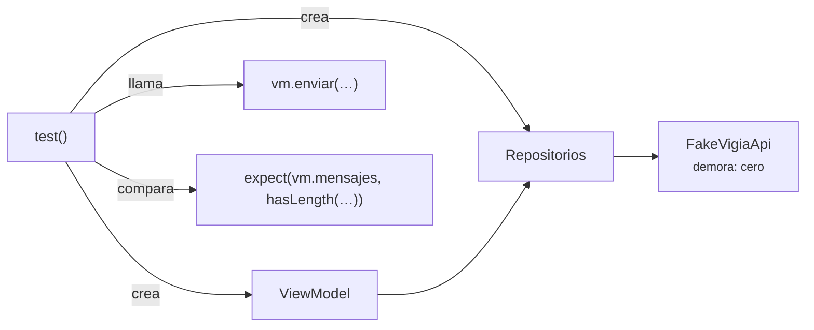
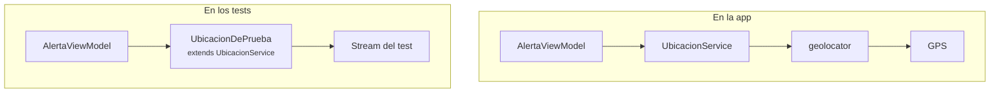

# Tests de ViewModels

!!! abstract "Objetivo"
    Escribir tests **unitarios** de los ViewModels y repositorios: sin pantallas, sin servidor, sin GPS. Vas a crear los **ayudantes** que comparten todos los tests (un mapa y un GPS de mentira, una vecina de ejemplo) y un archivo con 12 tests que recorren casi toda la app en milisegundos.

## Por qué los ViewModels se prueban tan fácil

Por cómo los armamos en la [Parte 4](../4-arquitectura/index.md):

- **No conocen widgets**: no hace falta dibujar nada.
- **Reciben todo por el constructor**: se les pasan repositorios con `FakeVigiaApi`.
- **Exponen su estado** con getters: se lee y se compara.
- **Las acciones devuelven `Resultado`**: se comprueba si es `Ok` o `Fallo`.



El esquema de **todos** los tests de esta página:

```dart
test('qué tiene que pasar', () async {
  // 1. Preparar: la API falsa, los repositorios y el ViewModel.
  final api = FakeVigiaApi(demora: Duration.zero)..token = 'fake-1';
  final vm = AlgoViewModel(AlgoRepository(api));
  addTearDown(vm.dispose);

  // 2. Actuar: lo que haría el vecino.
  await vm.cargar();
  final resultado = await vm.hacerAlgo();

  // 3. Comprobar: el estado y el resultado.
  expect(resultado, isA<Ok<void>>());
  expect(vm.lista, hasLength(3));
});
```

Se le dice **Preparar – Actuar – Comprobar** (*Arrange – Act – Assert*).

## Paso 1: los ayudantes

Algunas cosas se repiten en muchos tests: la plataforma de prueba (sin mapa ni GPS nativos), una vecina de ejemplo y cómo armar los ViewModels de las alertas (que reciben seis dependencias). Van en un archivo que **no** termina en `_test.dart` (así `flutter test` no lo corre solo, pero los tests lo pueden importar).

Creá `test/ayudantes.dart`:

<!-- archivo: test/ayudantes.dart cap=c18 notas="import 'package:google_maps_flutter_platform_interface|class MapaDePrueba extends GoogleMapsFlutterPlatform|=> const SizedBox.expand\(\);|void usarPlataformaDePrueba|GoogleMapsFlutterPlatform.instance = MapaDePrueba|setMockMethodCallHandler|\(call\) async => false|class UbicacionDePrueba extends UbicacionService|Stream<Coordenadas> seguir\(\) => _posiciones;|final maria = VecinoSesion|AlertaPropiaViewModel alertaPropia\(" -->
```dart title="test/ayudantes.dart" linenums="1"
// test/ayudantes.dart
//
// Lo que comparten los tests: la plataforma de prueba (sin mapa ni GPS
// nativos), la vecina María y cómo armar los ViewModels de las alertas.

import 'package:flutter/services.dart';
import 'package:flutter/widgets.dart';
import 'package:flutter_test/flutter_test.dart';
import 'package:google_maps_flutter_platform_interface/google_maps_flutter_platform_interface.dart'  // (1)!
    show
        GoogleMapsFlutterPlatform,
        MapConfiguration,
        MapObjects,
        MapWidgetConfiguration;

import 'package:vigia_app/data/repositories/alertas_repository.dart';
import 'package:vigia_app/data/repositories/fotos_repository.dart';
import 'package:vigia_app/data/services/api/fake_vigia_api.dart';
import 'package:vigia_app/data/services/lanzador_externo.dart';
import 'package:vigia_app/data/services/ubicacion_service.dart';
import 'package:vigia_app/domain/models/alerta.dart';
import 'package:vigia_app/domain/models/coordenadas.dart';
import 'package:vigia_app/domain/models/sesion.dart';
import 'package:vigia_app/ui/alerta/view_model/alerta_propia_view_model.dart';
import 'package:vigia_app/ui/alerta/view_model/alerta_vecino_view_model.dart';

// En los tests no hay mapa nativo: GoogleMap dibuja este recuadro y, como
// nunca avisa que el mapa se creó, no le pide nada más a la plataforma.
class MapaDePrueba extends GoogleMapsFlutterPlatform {  // (2)!
  @override
  Widget buildViewWithConfiguration(
    int creationId,
    PlatformViewCreatedCallback onPlatformViewCreated, {
    required MapWidgetConfiguration widgetConfiguration,
    MapConfiguration mapConfiguration = const MapConfiguration(),
    MapObjects mapObjects = const MapObjects(),
  }) => const SizedBox.expand();  // (3)!
}

/// Sin mapa nativo y con la ubicación del "celular" apagada.
void usarPlataformaDePrueba() {  // (4)!
  TestWidgetsFlutterBinding.ensureInitialized();
  GoogleMapsFlutterPlatform.instance = MapaDePrueba();  // (5)!
  TestDefaultBinaryMessengerBinding.instance.defaultBinaryMessenger
      .setMockMethodCallHandler(  // (6)!
        const MethodChannel('flutter.baseflow.com/geolocator'),
        (call) async => false,  // (7)!
      );
}

// En los tests no hay GPS: las posiciones salen de este Stream.
class UbicacionDePrueba extends UbicacionService {  // (8)!
  UbicacionDePrueba(this._posiciones);

  final Stream<Coordenadas> _posiciones;

  @override
  Stream<Coordenadas> seguir() => _posiciones;  // (9)!
}

final maria = VecinoSesion(  // (10)!
  id: 1,
  nombre: 'María Ríos',
  manzana: 'Manzana 4',
  rol: 'vigia',
);

AlertaPropiaViewModel alertaPropia(  // (11)!
  FakeVigiaApi api,
  int alertaId, {
  required Stream<Coordenadas> posiciones,
  VecinoSesion? vecino,
}) => AlertaPropiaViewModel(
  alertaId: alertaId,
  vecino: vecino ?? maria,
  alertas: AlertasRepository(api),
  fotos: FotosRepository(api),
  ubicacion: UbicacionDePrueba(posiciones),
  lanzador: const LanzadorExterno(),
);

AlertaVecinoViewModel alertaVecino(
  FakeVigiaApi api,
  EstadoAlerta alerta, {
  required Stream<Coordenadas> posiciones,
  VecinoSesion? vecino,
}) => AlertaVecinoViewModel(
  alerta: alerta,
  vecino: vecino ?? maria,
  alertas: AlertasRepository(api),
  fotos: FotosRepository(api),
  ubicacion: UbicacionDePrueba(posiciones),
  lanzador: const LanzadorExterno(),
);
```
<!-- /archivo -->

1. La "interfaz de plataforma" de Google Maps: el paquete que agregamos como `dev_dependencies` en la [página anterior](2-api-real.md#paso-1-el-paquete-http). `show` trae solo lo que usamos.
2. Un mapa de mentira. `GoogleMap` no dibuja el mapa él mismo: le pide a la "plataforma" que lo haga. Reemplazamos la plataforma por una que…
3. …dibuja un recuadro vacío. Como nunca avisa que "el mapa se creó", `GoogleMap` no le pide nada más.
4. Se llama una vez al principio de los tests que abren pantallas con mapa o GPS.
5. Enchufa el mapa de mentira.
6. Para el GPS: intercepta los mensajes que `geolocator` le manda a Android por su [canal de plataforma](../3-flutter/8-plugins-y-plataformas.md#dos-mundos)…
7. …y a todo responde `false`. Para `isLocationServiceEnabled`, eso significa "el GPS está apagado": la app tiene que mostrar el aviso y no romperse.
8. Otra forma de reemplazar el GPS, más fina: una **subclase** de nuestro `UbicacionService`…
9. …que en vez de leer el GPS devuelve las posiciones que le dé el test. Así un test puede "mover" a la vecina por el mapa.
10. Una vecina de ejemplo, igual a la del servidor falso (el `id` 1 es María).
11. Las alertas reciben seis dependencias. Estas dos funciones las arman en una línea.



Es la idea de [envolver lo de afuera](../4-arquitectura/3-direccion-de-dependencias.md#envolver-lo-de-afuera) dando frutos: como el ViewModel depende de **nuestro** `UbicacionService`, se puede reemplazar por una subclase sin tocar nada.

## Paso 2: los tests

Creá `test/view_models_test.dart`. Son 12 tests en dos grupos: repositorios y ViewModels.

<!-- archivo: test/view_models_test.dart cap=c18 notas="FakeVigiaApi apiCon\(|\.\.token = token;|Future<SesionRepository> sesionDe|setMockInitialValues\(\{'token': token\}\)|group\('Repositorios'|for \(var i = 0; i < 41; i\+\+\)|api.simularError = true;|throwsA\(isA<ApiException>\(\)\)|test\('AlmacenToken|throwsUnsupportedError\);|whereType<FilaNoticia>\(\).length, 5|isA<Fallo<void>>\(\)|sesion.login\('laura@vigia.test'|expect\(detalle.puedeBorrar, isTrue\);|test\('ChatViewModel no duplica|addTearDown\(viewModel.dispose\);|await viewModel.cargarNuevos\(\);|expect\(viewModel.esMio|conAlertaVecino: true\);|isA<Ok<int>>\(\)|viewModel.nuevoTurno\(\)|final alta = viewModel.alta\(\);|Stream.error\(const UbicacionException|await Future<void>.delayed\(Duration.zero\);|StreamController<Coordenadas>\(\)|gps.hasListener, isTrue|gps.hasListener, isFalse|'b' \* 64" -->
```dart title="test/view_models_test.dart" linenums="1"
// test/view_models_test.dart
//
// Pruebas unitarias de la arquitectura MVVM, sin dibujar pantallas: los
// ViewModels se prueban solos, contra la FakeVigiaApi, verificando el
// estado que exponen, que sus listas sean de solo lectura y que las acciones
// devuelvan Ok o Fallo. También el caché de fotos y el token guardado.
//
// Basadas en los tests que escribió Lucho para el PR #30.

import 'dart:async';
import 'dart:typed_data';

import 'package:flutter_secure_storage/flutter_secure_storage.dart';
import 'package:flutter_test/flutter_test.dart';

import 'package:vigia_app/data/repositories/alertas_repository.dart';
import 'package:vigia_app/data/repositories/chat_repository.dart';
import 'package:vigia_app/data/repositories/comite_repository.dart';
import 'package:vigia_app/data/repositories/fotos_repository.dart';
import 'package:vigia_app/data/repositories/publicaciones_repository.dart';
import 'package:vigia_app/data/repositories/rondines_repository.dart';
import 'package:vigia_app/data/repositories/sesion_repository.dart';
import 'package:vigia_app/data/services/almacen_token.dart';
import 'package:vigia_app/data/services/api/fake_vigia_api.dart';
import 'package:vigia_app/data/services/errores.dart';
import 'package:vigia_app/data/services/lanzador_externo.dart';
import 'package:vigia_app/domain/models/coordenadas.dart';
import 'package:vigia_app/domain/models/publicacion.dart';
import 'package:vigia_app/ui/chat/view_model/chat_view_model.dart';
import 'package:vigia_app/ui/comite/view_model/comite_rondines_view_model.dart';
import 'package:vigia_app/ui/comite/view_model/comite_vecinos_view_model.dart';
import 'package:vigia_app/ui/elegir_clave/view_model/elegir_clave_view_model.dart';
import 'package:vigia_app/ui/inicio/view_model/inicio_view_model.dart';
import 'package:vigia_app/ui/noticias/view_model/filas_noticias.dart';
import 'package:vigia_app/ui/noticias/view_model/noticias_view_model.dart';
import 'package:vigia_app/ui/perfil/view_model/perfil_view_model.dart';
import 'package:vigia_app/ui/publicacion/view_model/nueva_publicacion_view_model.dart';
import 'package:vigia_app/ui/publicacion/view_model/publicacion_view_model.dart';
import 'package:vigia_app/ui/rondines/view_model/rondin_view_model.dart';
import 'package:vigia_app/utils/resultado.dart';

import 'ayudantes.dart';

/// La API de prueba con la sesión de [token] (fake-1 = María, fake-5 =
/// Laura, del comité).
FakeVigiaApi apiCon(String? token, {bool conAlertaVecino = false}) =>  // (1)!
    FakeVigiaApi(demora: Duration.zero, conAlertaVecino: conAlertaVecino)
      ..token = token;  // (2)!

/// Una sesión iniciada como el dueño de [token].
Future<SesionRepository> sesionDe(FakeVigiaApi api, String token) async {  // (3)!
  FlutterSecureStorage.setMockInitialValues({'token': token});  // (4)!
  final sesion = SesionRepository(api);
  await sesion.iniciar();
  return sesion;
}

void main() {
  group('Repositorios', () {  // (5)!
    test('FotosRepository guarda las últimas 40 fotos en memoria', () async {
      final api = apiCon('fake-1');
      final fotos = FotosRepository(api);
      final ids = [
        for (var i = 0; i < 41; i++)  // (6)!
          await api.subirFoto(Uint8List.fromList([i]), 'image/jpeg'),
      ];
      for (final id in ids) {
        await fotos.obtener(id);
      }

      // Sin servidor: las 40 más recientes salen de memoria; la primera se
      // descartó y hay que pedirla a la red.
      api.simularError = true;  // (7)!
      expect(await fotos.obtener(ids.last), [40]);
      expect(await fotos.obtener(ids[1]), [1]);
      expect(() => fotos.obtener(ids.first), throwsA(isA<ApiException>()));  // (8)!
    });

    test('AlmacenToken guarda, lee y borra el token', () async {  // (9)!
      FlutterSecureStorage.setMockInitialValues({});
      final almacen = AlmacenToken();

      expect(await almacen.leer(), isNull);
      await almacen.guardar('mi-token');
      expect(await almacen.leer(), 'mi-token');
      await almacen.guardar(null);
      expect(await almacen.leer(), isNull);
    });
  });

  group('ViewModels (sin pantalla)', () {
    test('RondinViewModel expone los turnos de solo lectura', () async {
      final viewModel = RondinViewModel(RondinesRepository(apiCon('fake-1')));
      await viewModel.cargarSemana();

      expect(viewModel.turnos, isNotEmpty);
      expect(() => viewModel.turnos.clear(), throwsUnsupportedError);  // (10)!
    });

    test('NoticiasViewModel intercala encabezados y filtra', () async {
      final viewModel = NoticiasViewModel(
        PublicacionesRepository(apiCon('fake-1')),
      );

      await viewModel.cargar();
      expect(viewModel.cargando, isFalse);
      expect(viewModel.error, isNull);
      expect(viewModel.filas.first, isA<FilaEncabezado>());
      expect(viewModel.filas.whereType<FilaNoticia>().length, 5);  // (11)!
      expect(() => viewModel.filas.clear(), throwsUnsupportedError);

      await viewModel.filtrar('obras');
      expect(viewModel.etiqueta, 'obras');
      final filtradas = viewModel.filas.whereType<FilaNoticia>().toList();
      expect(filtradas.single.noticia.etiqueta, 'obras');
    });

    test('PerfilViewModel carga el perfil y cambia la clave', () async {
      final viewModel = PerfilViewModel(SesionRepository(apiCon('fake-1')));

      await viewModel.cargar();
      expect(viewModel.perfil?.nombre, 'María');
      expect(viewModel.fallo, isFalse);

      final mal = await viewModel.cambiarClave('incorrecta', 'nueva12345');
      expect(mal, isA<Fallo<void>>());  // (12)!
      expect((mal as Fallo).mensaje, contains('no es correcta'));

      final bien = await viewModel.cambiarClave(
        FakeVigiaApi.clave,
        'nueva12345',
      );
      expect(bien, isA<Ok<void>>());
    });

    test('el comité publica una noticia, la abre y la responde', () async {
      final api = apiCon(null);
      final sesion = SesionRepository(api);
      await sesion.login('laura@vigia.test', FakeVigiaApi.clave);  // (13)!
      final publicaciones = PublicacionesRepository(api);
      final fotos = FotosRepository(api);

      final nueva = NuevaPublicacionViewModel(
        publicaciones: publicaciones,
        fotos: fotos,
        vecino: sesion.vecino!,
      );
      nueva.elegirTipo(TipoPublicacion.noticia);
      nueva.elegirEtiqueta('obras');
      final creada = await nueva.publicar(
        titulo: 'Corte programado',
        cuerpo: 'De 14 a 16 hs',
        firma: 'Comité',
      );
      expect(creada, isA<Ok<Publicacion>>());

      final detalle = PublicacionViewModel(
        publicacionId: (creada as Ok<Publicacion>).valor.id,
        publicaciones: publicaciones,
        fotos: fotos,
        vecino: sesion.vecino,
      );
      await detalle.cargar();
      expect(detalle.publicacion?.titulo, 'Corte programado');
      expect(detalle.puedeBorrar, isTrue);  // (14)!

      expect(await detalle.responder('Gracias por avisar'), isA<Ok<void>>());
      expect(detalle.respuestas, hasLength(1));
      expect(() => detalle.respuestas.clear(), throwsUnsupportedError);
    });

    test('ChatViewModel no duplica el mensaje recién enviado', () async {  // (15)!
      final api = apiCon('fake-1');
      final viewModel = ChatViewModel(
        chat: ChatRepository(api),
        fotos: FotosRepository(api),
        vecino: maria,
      );
      addTearDown(viewModel.dispose);  // (16)!

      await viewModel.cargarNuevos();  // (17)!
      final antes = viewModel.mensajes.length;
      expect(antes, greaterThan(0));
      expect(() => viewModel.mensajes.clear(), throwsUnsupportedError);

      final enviado = await viewModel.enviar(texto: 'Mensaje de prueba');
      expect(enviado, isA<Ok<void>>());
      expect(viewModel.mensajes, hasLength(antes + 1));
      expect(viewModel.esMio(viewModel.mensajes.last), isTrue);  // (18)!

      // Si el polling corre enseguida, el mensaje no aparece dos veces.
      await viewModel.cargarNuevos();
      expect(viewModel.mensajes, hasLength(antes + 1));
    });

    test('InicioViewModel junta publicaciones y alertas de otros', () async {
      final api = apiCon('fake-1', conAlertaVecino: true);  // (19)!
      final sesion = await sesionDe(api, 'fake-1');
      final viewModel = InicioViewModel(
        sesion: sesion,
        publicaciones: PublicacionesRepository(api),
        alertas: AlertasRepository(api),
        lanzador: const LanzadorExterno(),
        rondin: RondinViewModel(RondinesRepository(api)),
        chat: ChatViewModel(
          chat: ChatRepository(api),
          fotos: FotosRepository(api),
          vecino: sesion.vecino!,
        ),
      );
      addTearDown(viewModel.dispose);

      await viewModel.cargarDatos();
      await viewModel.recargarAlertas();
      expect(viewModel.barrio?.vecinosTotal, 40);
      expect(viewModel.actividad, isNotEmpty);
      expect(viewModel.cantidadNoticias, 5);
      expect(viewModel.alertasVecinos, hasLength(1));
      expect(() => viewModel.actividad.clear(), throwsUnsupportedError);
      expect(() => viewModel.alertasVecinos.clear(), throwsUnsupportedError);

      viewModel.mostrarChat(false);
      expect(viewModel.verChat, isFalse);

      expect(await viewModel.dispararAlerta(), isA<Ok<int>>());  // (20)!
    });

    test('ComiteRondinesViewModel mueve la semana y crea un turno', () async {
      final api = apiCon('fake-5');
      final viewModel = ComiteRondinesViewModel(
        rondines: RondinesRepository(api),
        comite: ComiteRepository(api),
      );

      await viewModel.cargar();
      await viewModel.cargarVecinos();
      expect(viewModel.turnos, hasLength(7));
      expect(viewModel.vecinos, isNotEmpty);
      expect(() => viewModel.turnos!.clear(), throwsUnsupportedError);
      expect(() => viewModel.vecinos.clear(), throwsUnsupportedError);

      await viewModel.moverSemana(1);
      expect(viewModel.turnos, isEmpty);

      final nuevoTurno = viewModel.nuevoTurno()  // (21)!
        ..elegirVecinos([viewModel.vecinos.first.id]);
      expect(await nuevoTurno.crear('Ruta Norte'), isTrue);
      nuevoTurno.dispose();

      await viewModel.cargar();
      expect(viewModel.turnos, hasLength(1));
    });

    test(
      'ComiteVecinosViewModel lista vecinos y el alta crea manzanas',
      () async {
        final viewModel = ComiteVecinosViewModel(
          ComiteRepository(apiCon('fake-5')),
        );
        await viewModel.cargar();
        expect(viewModel.vecinos, isNotEmpty);
        expect(() => viewModel.vecinos!.clear(), throwsUnsupportedError);

        final alta = viewModel.alta();  // (22)!
        await alta.cargarManzanas();
        expect(alta.manzanas, isNotEmpty);
        expect(await alta.crearManzana('Manzana 9'), isA<Ok<void>>());
        expect(alta.manzanas.last.nombre, 'Manzana 9');
        expect(alta.manzanaId, alta.manzanas.last.id); // queda elegida
        alta.dispose();
      },
    );

    test('las alertas manejan el GPS, el comité y la alerta propia', () async {
      final api = apiCon('fake-5', conAlertaVecino: true);
      final laura = (await sesionDe(api, 'fake-5')).vecino!;
      final alerta = (await AlertasRepository(
        api,
      ).activasDeOtros(laura.id)).single;

      final deUnVecino = alertaVecino(
        api,
        alerta,
        vecino: laura,
        posiciones: Stream.error(const UbicacionException('Sin GPS de prueba')),  // (23)!
      )..iniciar();
      expect(await deUnVecino.marcarEnCamino(true), isA<Ok<void>>());
      expect(deUnVecino.estado.voyEnCamino, isTrue);
      expect(deUnVecino.compartiendoUbicacion, isTrue);
      await Future<void>.delayed(Duration.zero);  // (24)!
      expect(deUnVecino.avisoUbicacion, 'Sin GPS de prueba');

      expect(await deUnVecino.confirmar911(), isA<Ok<void>>());
      expect(deUnVecino.estado.central911Confirmada, isTrue);
      deUnVecino.dispose();

      final gps = StreamController<Coordenadas>();  // (25)!
      final propia = alertaPropia(
        api,
        await AlertasRepository(api).crear(),
        vecino: laura,
        posiciones: gps.stream,
      )..iniciar();
      await propia.consultar();
      expect(propia.estado?.activa, isTrue);
      expect(gps.hasListener, isTrue); // comparte la ubicación (26)

      expect(await propia.resolver(), isA<Ok<void>>());
      await propia.consultar();
      expect(propia.estado?.activa, isFalse);
      expect(gps.hasListener, isFalse); // cerrada, deja de compartir (27)
      propia.dispose();
      await gps.close();
    });

    test('ElegirClaveViewModel rechaza un enlace inválido', () async {
      FlutterSecureStorage.setMockInitialValues({});
      final sesion = SesionRepository(apiCon(null));
      final viewModel = ElegirClaveViewModel(sesion);

      expect(
        await viewModel.guardar(enlace: 'invalido', clave: 'nuevaclave123'),
        isFalse,
      );
      expect(viewModel.error, 'El enlace no es válido');

      // Token de la invitación pendiente de Sofía en la FakeVigiaApi.
      expect(
        await viewModel.guardar(enlace: 'b' * 64, clave: 'nuevaclave123'),  // (28)!
        isTrue,
      );
      expect(sesion.estado, EstadoSesion.conSesion);
      viewModel.dispose();
    });
  });
}
```
<!-- /archivo -->

1. Un ayudante local: la API falsa **sin demora**, con la sesión de un vecino ya puesta. `fake-1` es María (vigía), `fake-5` es Laura (comité).
2. El token del servidor falso es `fake-<id>`: con esto, "ya inició sesión".
3. Una sesión iniciada de verdad (con `SesionRepository.iniciar`), para los ViewModels que necesitan una.
4. `flutter_secure_storage` necesita Android; en los tests, `setMockInitialValues` lo reemplaza por un mapa en memoria con lo que digamos.
5. **Repositorios**: se prueban igual que los ViewModels.
6. Sube 41 fotos y las baja todas: la memoria del repositorio guarda como máximo 40.
7. Corta la "red". Desde acá, todo lo que vaya al servidor falla…
8. …así que la **primera** foto (la que se descartó) falla, y las otras salen de memoria. Prueba el [caché del repositorio](../4-arquitectura/2-mvvm-y-capas.md#repositorios) sin mirar adentro: solo por lo que hace.
9. El almacén del token, con el almacenamiento seguro simulado.
10. Las listas que expone un ViewModel **no se pueden modificar** desde afuera ([`soloLectura`](../4-arquitectura/6-viewmodel-base.md)). Se repite en casi todos los tests.
11. Las noticias se agrupan por día: la primera fila es un encabezado ("HOY") y hay 5 noticias.
12. Con la clave actual incorrecta, `cambiarClave` devuelve un `Fallo` con el mensaje del servidor.
13. Una sesión de **Laura** (comité), iniciada con el login como lo haría el vecino.
14. El comité puede borrar cualquier publicación. Es la regla `VecinoSesion.puedeBorrar`, probada a través del ViewModel.
15. El test del [recorrido de la Parte 4](../4-arquitectura/8-un-toque-de-punta-a-punta.md).
16. `addTearDown`: al terminar el test, descartar el ViewModel (cancela su `Sondeo`).
17. Simula el sondeo: pide lo nuevo.
18. El mensaje que mandó María es "suyo" (va a la derecha).
19. La API falsa con una **alerta activa de Jorge**, para probar el banner y las alertas de vecinos.
20. Disparar el SOS devuelve el `id` de la alerta nueva.
21. El ViewModel de la pantalla **fabrica** el del diálogo ([Regla 4](../4-arquitectura/6-viewmodel-base.md#quien-crea-y-quien-descarta))…
22. …y lo mismo para el alta. El test lo descarta al final, como haría el diálogo.
23. Un GPS que **falla** de entrada: un `Stream` que solo emite un error.
24. Deja correr las tareas pendientes (que el error del `Stream` llegue) antes de mirar el aviso.
25. Un GPS que controla el test: con un `StreamController` se pueden emitir posiciones cuando se quiera.
26. Mientras la alerta está activa, el ViewModel está **escuchando** el GPS…
27. …y al resolverse, **dejó de escuchar**: no quedan suscripciones colgadas.
28. El servidor falso tiene una invitación pendiente (la de Sofía) con este token.

## Los tests de los capítulos

Además de este archivo, cada capítulo de la Parte 5 dejó sus tests chicos. Funcionan igual: `chat_view_model_test.dart` ([capítulo 12](../5-construccion/12-chat.md)), `noticias_view_model_test.dart` ([11](../5-construccion/11-noticias.md)), etc. Este archivo los complementa con los casos que cruzan varias piezas.

## Probalo

```bash
flutter test test/view_models_test.dart
```

```text
00:01 +12: All tests passed!
```

Y todos juntos:

```bash
flutter test
```

```text
00:02 +48: All tests passed!
```

!!! tip "Rompé algo a propósito"
    Comentá el `if (mensaje.id > ultimo)` de `ChatViewModel._agregar` y corré los tests. Tiene que fallar `ChatViewModel no duplica el mensaje recién enviado`, con un mensaje que diga cuántos esperaba y cuántos hay. Así se comprueba que el test **de verdad** prueba algo. Después volvé a dejarlo como estaba.

## Errores comunes

??? failure "`MissingPluginException(No implementation found for method read on channel plugins.it_nomads.com/flutter_secure_storage)`"
    Falta `FlutterSecureStorage.setMockInitialValues({...})` antes de crear el `SesionRepository` o el `AlmacenToken`.

??? failure "`A Timer is still pending even after the widget tree was disposed` / el test no termina"
    Un ViewModel con `Sondeo` quedó vivo. Agregá `addTearDown(viewModel.dispose)` o llamá a `dispose()` al final.

??? failure "El test tarda 400 ms por cada pedido"
    Falta `demora: Duration.zero` en la `FakeVigiaApi`.

## Lo que aprendiste

- [x] Un test de ViewModel: **preparar** (API falsa + repositorios + ViewModel), **actuar** (llamar métodos), **comprobar** (estado y `Resultado`).
- [x] Los **ayudantes** reemplazan el mapa (plataforma de prueba), el GPS (`UbicacionDePrueba` o un canal simulado) y el almacenamiento seguro (`setMockInitialValues`).
- [x] `addTearDown(vm.dispose)` evita timers colgados.
- [x] Un test se valida **rompiendo** el código a propósito y viendo que falla.

[Siguiente: Tests de widgets :material-arrow-right:](4-tests-de-widgets.md){ .md-button .md-button--primary }
