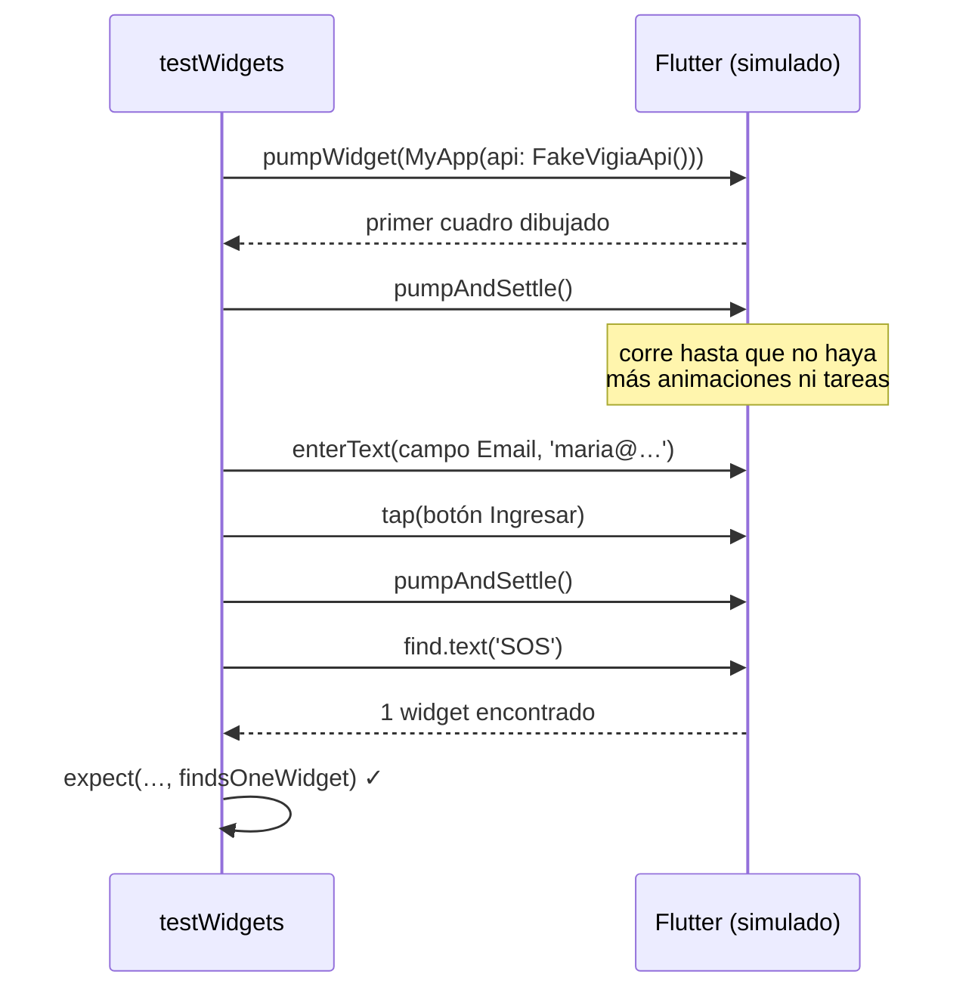
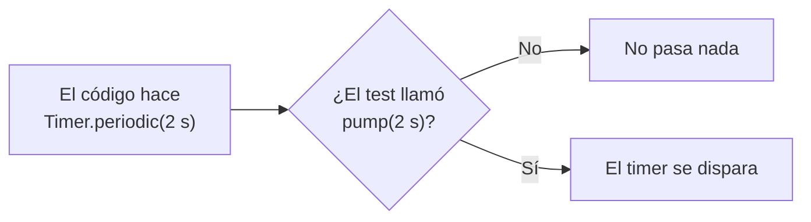

# Tests de widgets

!!! abstract "Objetivo"
    Probar la app **como la usaría un vecino**: abrirla, escribir, tocar botones, deslizar, y comprobar qué aparece en pantalla. Todo **sin emulador**: Flutter simula la pantalla en memoria. Vas a conocer el `WidgetTester` (`pumpWidget`, `tap`, `enterText`, `pump`…), los *finders* (`find.text`, `find.byType`…) y el truco del **reloj falso**.

## Cómo funciona un test de widgets

`testWidgets` arranca un **Flutter de mentira**: tiene todo (el árbol de widgets, el layout, los toques, las animaciones), pero no dibuja en una pantalla real ni tiene Android abajo. Es rápido (decenas de milisegundos por test) y determinista.



## Las herramientas

### `WidgetTester`: lo que hace el "vecino"

| Método | Qué hace |
|---|---|
| `pumpWidget(widget)` | Pone ese widget como raíz y dibuja un cuadro. |
| `pump([duración])` | Dibuja **un** cuadro, avanzando el reloj la duración dada. |
| `pumpAndSettle()` | Dibuja cuadros hasta que no quede nada pendiente (animaciones, transiciones). |
| `tap(finder)` | Toca el centro del widget. |
| `enterText(finder, texto)` | Escribe en un campo de texto. |
| `drag(finder, Offset(dx, dy))` | Arrastra (deslizar para borrar, el botón SOS). |
| `runAsync(() async {…})` | Corre código asíncrono **real** (ver [el reloj](#el-reloj-falso)). |
| `widget<T>(finder)` | Devuelve el widget encontrado, para mirar sus propiedades. |

### *Finders*: encontrar cosas en pantalla

| Finder | Encuentra |
|---|---|
| `find.text('Ingresar')` | Widgets `Text` con ese texto exacto. |
| `find.byIcon(Icons.menu)` | Íconos. |
| `find.byType(GoogleMap)` | Widgets de ese tipo. |
| `find.widgetWithText(TextFormField, 'Email')` | Un `TextFormField` que **contiene** el texto "Email" (su etiqueta). |
| `find.byKey(ValueKey(42))` | El widget con esa key. |

Y se comprueba con matchers especiales: `findsOneWidget`, `findsNothing`, `findsWidgets` (uno o más), `findsNWidgets(3)`.

## Probar la app entera

Gracias a que `MyApp` [recibe la API](../4-arquitectura/5-inyeccion-de-dependencias.md#la-raiz-de-composicion), un test puede arrancar **la app completa** con el servidor falso. Así arranca cada test de `widget_test.dart`:

<!-- archivo: test/widget_test.dart cap=c18 desde="^MyApp crearApp\(" hasta="^}$" notas="FlutterSecureStorage.setMockInitialValues|return MyApp\(|FakeVigiaApi\(demora: Duration.zero" -->
```dart title="test/widget_test.dart (fragmento)" linenums="27"
MyApp crearApp({
  bool conSesion = true,
  String token = 'fake-1',
  bool conAlertaVecino = false,
}) {
  FlutterSecureStorage.setMockInitialValues({if (conSesion) 'token': token});  // (1)!
  return MyApp(  // (2)!
    api: FakeVigiaApi(demora: Duration.zero, conAlertaVecino: conAlertaVecino),  // (3)!
  );
}
```
<!-- /archivo -->

1. ¿Hay sesión guardada? Con `token: 'fake-1'`, la app arranca como María; sin token, en el Login.
2. **La app real**, la misma de `main.dart`…
3. …con el servidor falso, sin demoras.

Y un ayudante para entrar como lo haría el vecino:

<!-- archivo: test/widget_test.dart cap=c18 desde="^Future<void> ingresar\(" hasta="^}$" notas="find.widgetWithText\(TextFormField, 'Email'\)|find.widgetWithText\(FilledButton, 'Ingresar'\)|await tester.pumpAndSettle\(\);" -->
```dart title="test/widget_test.dart (fragmento)" linenums="38"
Future<void> ingresar(WidgetTester tester, String email, String clave) async {
  await tester.enterText(find.widgetWithText(TextFormField, 'Email'), email);  // (1)!
  await tester.enterText(
    find.widgetWithText(TextFormField, 'Contraseña'),
    clave,
  );
  await tester.tap(find.widgetWithText(FilledButton, 'Ingresar'));  // (2)!
  await tester.pumpAndSettle();  // (3)!
}
```
<!-- /archivo -->

1. Busca el campo cuya etiqueta es "Email" y escribe.
2. Toca el botón **Ingresar** (no cualquier texto "Ingresar": el `FilledButton`).
3. Espera a que termine todo: el pedido al servidor falso, el cambio de sesión, la transición al Inicio.

### Un test completo

<!-- archivo: test/widget_test.dart cap=c18 desde="testWidgets\('con la clave correcta" hasta="^    \}\);" notas="crearApp\(conSesion: false\)|await ingresar\(tester|find.text\('SOS'\), findsOneWidget|find.text\('LG'\)|find.byIcon\(Icons.menu\)|'Manzana 1 · Comité'" -->
```dart title="test/widget_test.dart (fragmento)" linenums="291"
    testWidgets('con la clave correcta entra al Inicio con sus datos', (
      tester,
    ) async {
      await tester.pumpWidget(crearApp(conSesion: false));  // (1)!
      await tester.pumpAndSettle();

      await ingresar(tester, 'laura@vigia.test', FakeVigiaApi.clave);  // (2)!

      expect(find.text('SOS'), findsOneWidget);  // (3)!
      expect(find.text('LG'), findsOneWidget); // avatar (4)
      await tester.tap(find.byIcon(Icons.menu));  // (5)!
      await tester.pumpAndSettle();
      expect(find.text('Laura Gómez'), findsOneWidget);
      expect(find.text('Manzana 1 · Comité'), findsOneWidget);  // (6)!
    });
```
<!-- /archivo -->

1. Arranca en el Login (sin sesión guardada).
2. Entra como Laura, del comité.
3. Si se ve el botón SOS, estamos en el Inicio.
4. El avatar con las iniciales de **Laura Gómez**: prueba que los datos de la sesión llegaron a la pantalla.
5. Abre el menú lateral…
6. …y ahí está su descripción, armada por `VecinoSesion.descripcion`.

Este test atraviesa **toda** la app: `LoginScreen` → `LoginViewModel` → `SesionRepository` → `FakeVigiaApi` → `Sesion.fromJson` → `notifyListeners` → `MyApp` cambia la raíz → `InicioScreen` → `MenuLateral`. Si cualquiera de esas piezas se rompe, falla.

## El reloj falso

Dentro de `testWidgets`, **el tiempo no pasa solo**. `Future.delayed`, `Timer` y las animaciones avanzan **solo** cuando el test llama a `pump(duración)` o `pumpAndSettle()`. Es a propósito: así un test que espera "10 segundos de sondeo" tarda milisegundos.



Consecuencias que vas a ver en `widget_test.dart`:

- Para que corra el sondeo de una alerta (cada 2 s): `await tester.pump(const Duration(seconds: 2));`.
- `pumpAndSettle()` **no termina nunca** si hay algo que se repite para siempre (un `CircularProgressIndicator` girando, un `Timer.periodic`). En esos casos se usa `pump` con duraciones.
- Para usar la API falsa **fuera** de la app (por ejemplo, crear una alerta antes de abrir la pantalla), hay que salir del reloj falso con `tester.runAsync`:

<!-- archivo: test/widget_test.dart cap=c18 desde="testWidgets\('la víctima manda" hasta="^    \}\);" notas="tester.runAsync\(\(\) async => alertaId|home: AlertaPropiaScreen\(|posiciones: Stream.value|await tester.pump\(const Duration\(milliseconds: 100\)\); // POST|await tester.pump\(const Duration\(seconds: 2\)\);|tester.widget<GoogleMap>|find.text\('Cómo llegar'\), findsNothing" -->
```dart title="test/widget_test.dart (fragmento)" linenums="725"
    testWidgets('la víctima manda su ubicación y aparece en el mapa', (
      tester,
    ) async {
      final api = crearApiConSesion();
      late int alertaId;
      await tester.runAsync(() async => alertaId = await api.crearAlerta());  // (1)!
      await tester.pumpWidget(
        MaterialApp(
          home: AlertaPropiaScreen(  // (2)!
            viewModel: alertaPropia(
              api,
              alertaId,
              posiciones: Stream.value(const Coordenadas(-34.6, -58.38)),  // (3)!
            ),
          ),
        ),
      );
      await tester.pump(const Duration(milliseconds: 100)); // POST ubicación (4)
      await tester.pump(const Duration(seconds: 2)); // consulta del estado (5)
      await tester.pump(const Duration(milliseconds: 100));

      expect(find.text('Esperando la ubicación…'), findsNothing);
      expect(find.byType(GoogleMap), findsOneWidget);
      final mapa = tester.widget<GoogleMap>(find.byType(GoogleMap));  // (6)!
      expect(mapa.markers.single.markerId.value, 'victima');
      expect(find.text('Cómo llegar'), findsNothing); // es la víctima (7)
    });
```
<!-- /archivo -->

1. Crea una alerta en la API falsa con el reloj **real** (si no, el `Future.delayed` interno del fake nunca terminaría).
2. No hace falta la app entera: se prueba **una pantalla** con su ViewModel, armado con el ayudante de la [página anterior](3-tests-de-view-models.md#paso-1-los-ayudantes).
3. El "GPS" emite una sola posición.
4. Avanza el reloj lo justo para que se mande la ubicación…
5. …y 2 segundos para que corra la consulta periódica de la alerta.
6. Toma el `GoogleMap` (el de mentira, gracias a `MapaDePrueba`) para mirar sus marcadores.
7. La víctima no ve "Cómo llegar" (es para los vecinos).

## Lo que prueba `widget_test.dart`

Los 35 tests, agrupados:

| Grupo | Qué recorre |
|---|---|
| (sueltos) | El Inicio y deslizar para borrar; el SOS (deslizar hasta arriba, deslizar poco, deslizar hacia abajo, cancelar); confirmar asistencia al rondín; filtrar noticias; la pantalla de carga |
| **Sesión** | Sin token → Login; clave correcta e incorrecta; cerrar sesión; elegir clave con el enlace del correo; enlace mal pegado |
| **Alertas del barrio** | El banner y "Voy en camino"; el comité confirma el 911 y resuelve; sin alertas no hay banner; "Ya estoy a salvo" |
| **Publicaciones** | Borrar con confirmación; publicar, responder y borrar; solo el autor o el comité ven "Borrar"; solo el comité publica noticias |
| **Chat del barrio** | Escribir; con el teclado abierto se esconde el 911 |
| **Fotos** | En el chat, en una publicación y en la alerta propia |
| **Ubicación en vivo** | Los marcadores del mapa; la víctima manda su ubicación; el vecino la comparte solo mientras va |
| **Panel del comité** | Un vigía no ve la sección; alta de vecino; rondines: un turno por fecha y reasignación |

!!! info "Algunos nombres están en inglés"
    Los primeros tests de VigiaApp se escribieron en inglés y quedaron así. Los nuevos están en español. El código de la app no cambia por eso.

## El archivo completo

Creá `test/widget_test.dart` (son 881 líneas: está plegado para que no ocupe toda la página; tocá para abrirlo y usá el botón de copiar):

<!-- archivo: test/widget_test.dart cap=c18 plegado="test/widget_test.dart (881 líneas)" -->
??? example "test/widget_test.dart (881 líneas)"

    ```dart title="test/widget_test.dart" linenums="1"
    import 'dart:async';

    import 'package:flutter/material.dart';
    import 'package:flutter/services.dart';
    import 'package:flutter_secure_storage/flutter_secure_storage.dart';
    import 'package:flutter_test/flutter_test.dart';
    import 'package:google_maps_flutter/google_maps_flutter.dart';

    import 'package:vigia_app/data/repositories/publicaciones_repository.dart';
    import 'package:vigia_app/data/services/api/fake_vigia_api.dart';
    import 'package:vigia_app/domain/models/alerta.dart';
    import 'package:vigia_app/domain/models/coordenadas.dart';
    import 'package:vigia_app/main.dart';
    import 'package:vigia_app/ui/alerta/widgets/alerta_propia_screen.dart';
    import 'package:vigia_app/ui/alerta/widgets/alerta_vecino_screen.dart';
    import 'package:vigia_app/ui/alerta/widgets/mapa_alerta.dart';
    import 'package:vigia_app/ui/carga/widgets/pantalla_carga.dart';
    import 'package:vigia_app/ui/core/widgets/foto_vigia.dart';
    import 'package:vigia_app/ui/noticias/view_model/noticias_view_model.dart';
    import 'package:vigia_app/ui/noticias/widgets/noticias_screen.dart';

    import 'ayudantes.dart';

    // En los tests el "servidor" responde al instante. Por defecto la app arranca
    // con la sesión de María guardada (token `fake-1` del FakeVigiaApi).
    // `token: 'fake-5'` es Laura Gómez (comité).
    MyApp crearApp({
      bool conSesion = true,
      String token = 'fake-1',
      bool conAlertaVecino = false,
    }) {
      FlutterSecureStorage.setMockInitialValues({if (conSesion) 'token': token});
      return MyApp(
        api: FakeVigiaApi(demora: Duration.zero, conAlertaVecino: conAlertaVecino),
      );
    }

    Future<void> ingresar(WidgetTester tester, String email, String clave) async {
      await tester.enterText(find.widgetWithText(TextFormField, 'Email'), email);
      await tester.enterText(
        find.widgetWithText(TextFormField, 'Contraseña'),
        clave,
      );
      await tester.tap(find.widgetWithText(FilledButton, 'Ingresar'));
      await tester.pumpAndSettle();
    }

    // Toca el SOS de la barra (abre el modo emergencia) y desliza el botón 911
    // hacia arriba [distancia] píxeles (con 400 llega hasta arriba).
    Future<void> deslizar911(WidgetTester tester, {double distancia = 400}) async {
      await tester.tap(find.text('SOS'));
      await tester.pumpAndSettle();
      await tester.drag(find.text('911'), Offset(0, -distancia));
      // pump() sin duración no dispara Timers: el fake "responde" con un
      // Future.delayed, así que avanzamos el reloj un poco.
      await tester.pump(const Duration(milliseconds: 100)); // vuelve + POST
      await tester.pump(const Duration(milliseconds: 500)); // transiciones
      await tester.pump(const Duration(milliseconds: 500));
    }

    // PNG de 1×1 transparente: una imagen válida y chiquita para los tests.
    const png = <int>[
      0x89, 0x50, 0x4E, 0x47, 0x0D, 0x0A, 0x1A, 0x0A, 0x00, 0x00, 0x00, 0x0D, //
      0x49, 0x48, 0x44, 0x52, 0x00, 0x00, 0x00, 0x01, 0x00, 0x00, 0x00, 0x01, //
      0x08, 0x06, 0x00, 0x00, 0x00, 0x1F, 0x15, 0xC4, 0x89, 0x00, 0x00, 0x00, //
      0x0A, 0x49, 0x44, 0x41, 0x54, 0x78, 0x9C, 0x63, 0x00, 0x01, 0x00, 0x00, //
      0x05, 0x00, 0x01, 0x0D, 0x0A, 0x2D, 0xB4, 0x00, 0x00, 0x00, 0x00, 0x49, //
      0x45, 0x4E, 0x44, 0xAE, 0x42, 0x60, 0x82,
    ];

    // Una API de prueba con la sesión de María, para cargarle datos (fotos)
    // antes de abrir la app. Los pedidos al fake van con tester.runAsync: el
    // reloj de testWidgets no avanza solo.
    FakeVigiaApi crearApiConSesion({bool conAlertaVecino = false}) {
      FlutterSecureStorage.setMockInitialValues({'token': 'fake-1'});
      return FakeVigiaApi(demora: Duration.zero, conAlertaVecino: conAlertaVecino)
        ..token = 'fake-1';
    }

    // El Inicio abre en el chat: el feed de actividad está en la otra pestaña.
    Future<void> verActividad(WidgetTester tester) async {
      await tester.tap(find.text('Actividad'));
      await tester.pumpAndSettle();
    }

    void main() {
      setUpAll(() {
        // Sin mapa nativo ni GPS de verdad: el "celular" tiene la ubicación
        // apagada.
        usarPlataformaDePrueba();
      });

      testWidgets('Home screen renders and activity items are dismissible', (
        WidgetTester tester,
      ) async {
        await tester.pumpWidget(crearApp());
        await tester.pumpAndSettle(); // espera la carga desde la API
        await verActividad(tester);

        expect(find.text('Inicio'), findsOneWidget);
        expect(find.text('Red activa · 38 de 40 vecinos en línea'), findsOneWidget);
        expect(find.text('Cierre de la calle Juárez por obra'), findsOneWidget);
        expect(find.text('Jorge L. · hace 25 min'), findsOneWidget);
        expect(find.text('SOS'), findsOneWidget);

        await tester.drag(
          find.text('Cierre de la calle Juárez por obra'),
          const Offset(-500, 0),
        );
        await tester.pumpAndSettle();

        expect(find.text('Cierre de la calle Juárez por obra'), findsNothing);
      });

      testWidgets('Sliding the 911 button up opens the active alert', (
        WidgetTester tester,
      ) async {
        await tester.pumpWidget(crearApp());
        await tester.pumpAndSettle();

        await deslizar911(tester);

        expect(find.text('ALERTA ACTIVA'), findsOneWidget);
        // Con la ubicación apagada, la pantalla avisa en vez de romperse.
        expect(
          find.text('Prendé la ubicación del celular para compartir dónde estás.'),
          findsOneWidget,
        );
        // Sin --dart-define marca *555: nunca el 911 de verdad.
        expect(find.text('Llamar al *555'), findsOneWidget);

        // Después de una consulta (polling cada 2 s) ya hay vecinos avisados.
        await tester.pump(const Duration(seconds: 2));
        await tester.pump(const Duration(milliseconds: 100));
        expect(find.text('Confirmada'), findsOneWidget);
      });

      testWidgets('A short slide does not trigger the alert', (
        WidgetTester tester,
      ) async {
        await tester.pumpWidget(crearApp());
        await tester.pumpAndSettle();

        await deslizar911(tester, distancia: 80);

        expect(find.text('ALERTA ACTIVA'), findsNothing);
        expect(find.text('Emergencia'), findsOneWidget); // sigue en el modo SOS
      });

      testWidgets('El SOS abre el modo emergencia y "Cancelar" vuelve sin alerta', (
        WidgetTester tester,
      ) async {
        await tester.pumpWidget(crearApp());
        await tester.pumpAndSettle();

        await tester.tap(find.text('SOS'));
        await tester.pumpAndSettle();
        expect(find.text('Emergencia'), findsOneWidget);
        expect(find.text('911'), findsOneWidget);

        await tester.tap(find.text('Cancelar'));
        await tester.pumpAndSettle();
        expect(find.text('Emergencia'), findsNothing);
        expect(find.text('ALERTA ACTIVA'), findsNothing);
        expect(find.text('Inicio'), findsOneWidget);
      });

      testWidgets('Sliding the 911 button down does not trigger the alert', (
        WidgetTester tester,
      ) async {
        await tester.pumpWidget(crearApp());
        await tester.pumpAndSettle();

        await tester.tap(find.text('SOS'));
        await tester.pumpAndSettle();
        await tester.drag(find.text('911'), const Offset(0, 300));
        await tester.pumpAndSettle();

        expect(find.text('ALERTA ACTIVA'), findsNothing);
        expect(find.text('Emergencia'), findsOneWidget);
      });

      testWidgets('Cancelling the alert asks for confirmation and goes back', (
        WidgetTester tester,
      ) async {
        await tester.pumpWidget(crearApp());
        await tester.pumpAndSettle();
        await deslizar911(tester);

        await tester.tap(find.text('Cancelar alerta (falsa alarma)'));
        await tester.pump();
        await tester.pump(const Duration(milliseconds: 300));
        expect(find.text('¿Cancelar la alerta?'), findsOneWidget);

        await tester.tap(find.text('Sí, cancelar'));
        await tester.pump(const Duration(milliseconds: 100)); // cierra el diálogo
        await tester.pump(const Duration(milliseconds: 100)); // POST cancelar
        await tester.pump(const Duration(milliseconds: 500)); // vuelve al Inicio

        expect(find.text('ALERTA ACTIVA'), findsNothing);
        expect(find.text('Inicio'), findsOneWidget);
      });

      testWidgets('Confirming the patrol shift updates the home card too', (
        WidgetTester tester,
      ) async {
        await tester.pumpWidget(crearApp());
        await tester.pumpAndSettle();
        await verActividad(tester);

        // Drawer → Recorridos
        await tester.tap(find.byIcon(Icons.menu));
        await tester.pumpAndSettle();
        await tester.tap(find.text('Recorridos'));
        await tester.pumpAndSettle();

        expect(find.text('ESTA SEMANA'), findsOneWidget);
        await tester.tap(find.text('Me presento'));
        await tester.pumpAndSettle();

        // Volvemos al Inicio: la tarjeta escucha el mismo RondinViewModel.
        await tester.pageBack();
        await tester.pumpAndSettle();
        await tester.scrollUntilVisible(
          find.text('Confirmaste tu asistencia ✓'),
          100,
          scrollable: find.byType(Scrollable).first,
        );
        expect(find.text('Confirmaste tu asistencia ✓'), findsOneWidget);
      });

      testWidgets('News filter only shows the selected tag', (
        WidgetTester tester,
      ) async {
        await tester.pumpWidget(
          MaterialApp(
            home: NoticiasScreen(
              viewModel: NoticiasViewModel(
                PublicacionesRepository(FakeVigiaApi(demora: Duration.zero)),
              ),
            ),
          ),
        );
        await tester.pumpAndSettle();

        expect(
          find.text('Reunión con el cuadrante policial el jueves 19 h'),
          findsOneWidget,
        );
        // La primera noticia del fake es de "hace 2 h": entre las 00:00 y las
        // 02:00 cae en el día anterior, así que el encabezado puede ser HOY o AYER.
        expect(
          find.byWidgetPredicate(
            (w) => w is Text && (w.data == 'HOY' || w.data == 'AYER'),
          ),
          findsWidgets,
        );

        await tester.tap(find.widgetWithText(FilterChip, 'Obras'));
        await tester.pumpAndSettle();

        expect(
          find.text('Repavimentación de calle Morelos hasta el viernes'),
          findsOneWidget,
        );
        expect(
          find.text('Reunión con el cuadrante policial el jueves 19 h'),
          findsNothing,
        );
      });

      testWidgets('mientras valida la sesión muestra la pantalla de carga', (
        tester,
      ) async {
        await tester.pumpWidget(crearApp());
        // Primer cuadro: todavía no terminó de leer el token guardado.
        expect(find.byType(PantallaCarga), findsOneWidget);
        await tester.pumpAndSettle();
        expect(find.text('Inicio'), findsOneWidget);
      });

      group('Sesión', () {
        testWidgets('sin token guardado muestra el login', (tester) async {
          await tester.pumpWidget(crearApp(conSesion: false));
          await tester.pumpAndSettle();

          expect(find.text('Ingresar'), findsOneWidget);
          expect(find.text('SOS'), findsNothing);
        });

        testWidgets('con la clave correcta entra al Inicio con sus datos', (
          tester,
        ) async {
          await tester.pumpWidget(crearApp(conSesion: false));
          await tester.pumpAndSettle();

          await ingresar(tester, 'laura@vigia.test', FakeVigiaApi.clave);

          expect(find.text('SOS'), findsOneWidget);
          expect(find.text('LG'), findsOneWidget); // avatar
          await tester.tap(find.byIcon(Icons.menu));
          await tester.pumpAndSettle();
          expect(find.text('Laura Gómez'), findsOneWidget);
          expect(find.text('Manzana 1 · Comité'), findsOneWidget);
        });

        testWidgets('con la clave incorrecta muestra el error de la API', (
          tester,
        ) async {
          await tester.pumpWidget(crearApp(conSesion: false));
          await tester.pumpAndSettle();

          await ingresar(tester, 'maria@vigia.test', 'otra-cosa');

          expect(find.text('Email o contraseña incorrectos.'), findsOneWidget);
          expect(find.text('SOS'), findsNothing);
        });

        testWidgets('"Cerrar sesión" vuelve al login', (tester) async {
          await tester.pumpWidget(crearApp());
          await tester.pumpAndSettle();

          await tester.tap(find.byIcon(Icons.menu));
          await tester.pumpAndSettle();
          await tester.tap(find.text('Cerrar sesión'));
          await tester.pumpAndSettle();

          expect(find.text('Ingresar'), findsOneWidget);
        });

        testWidgets('pegando el enlace de la invitación elige clave y entra', (
          tester,
        ) async {
          await tester.pumpWidget(crearApp(conSesion: false));
          await tester.pumpAndSettle();

          await tester.tap(find.text('Tengo una invitación'));
          await tester.pumpAndSettle();
          await tester.enterText(
            find.widgetWithText(TextFormField, 'Enlace del correo'),
            'vigiaapp://clave?token=${'ab' * 32}',
          );
          await tester.enterText(
            find.widgetWithText(TextFormField, 'Contraseña nueva'),
            'sofia-clave-1',
          );
          await tester.enterText(
            find.widgetWithText(TextFormField, 'Repetí la contraseña'),
            'sofia-clave-1',
          );
          await tester.tap(find.text('Guardar y entrar'));
          await tester.pumpAndSettle();

          expect(find.text('SOS'), findsOneWidget);
          expect(find.text('SP'), findsOneWidget); // Sofía Paz
        });

        testWidgets('un enlace mal pegado no se envía', (tester) async {
          await tester.pumpWidget(crearApp(conSesion: false));
          await tester.pumpAndSettle();

          await tester.tap(find.text('Tengo una invitación'));
          await tester.pumpAndSettle();
          await tester.enterText(
            find.widgetWithText(TextFormField, 'Enlace del correo'),
            'https://ejemplo.com/sin-token',
          );
          await tester.tap(find.text('Guardar y entrar'));
          await tester.pumpAndSettle();

          expect(find.text('El enlace no es válido'), findsOneWidget);
        });
      });

      group('Alertas del barrio', () {
        testWidgets('el banner abre la alerta y "Voy en camino" suma uno', (
          tester,
        ) async {
          await tester.pumpWidget(crearApp(conAlertaVecino: true));
          await tester.pumpAndSettle();

          expect(find.text('SOS · Jorge López · Manzana 2'), findsOneWidget);
          await tester.tap(find.text('SOS · Jorge López · Manzana 2'));
          await tester.pumpAndSettle();

          expect(find.text('ALERTA DE UN VECINO'), findsOneWidget);
          expect(find.text('1'), findsOneWidget); // en camino
          expect(find.text('Confirmar 911'), findsNothing); // María no es comité

          await tester.tap(find.text('Voy en camino'));
          await tester.pumpAndSettle();

          expect(find.text('2'), findsOneWidget);
          expect(find.text('Ya no voy'), findsOneWidget);
        });

        testWidgets('el comité confirma el 911 y resuelve la alerta', (
          tester,
        ) async {
          await tester.pumpWidget(crearApp(token: 'fake-5', conAlertaVecino: true));
          await tester.pumpAndSettle();
          await tester.tap(find.text('SOS · Jorge López · Manzana 2'));
          await tester.pumpAndSettle();

          expect(find.text('Esperando…'), findsOneWidget);
          await tester.tap(find.text('Confirmar 911'));
          await tester.pumpAndSettle();
          expect(find.text('Confirmada'), findsOneWidget);

          await tester.tap(find.text('Resolver alerta'));
          await tester.pumpAndSettle();
          expect(find.text('La alerta se resolvió'), findsOneWidget);

          await tester.pageBack();
          await tester.pumpAndSettle();
          expect(find.text('SOS · Jorge López · Manzana 2'), findsNothing);
        });

        testWidgets('sin alertas de otros no hay banner', (tester) async {
          await tester.pumpWidget(crearApp());
          await tester.pumpAndSettle();
          expect(find.textContaining('SOS ·'), findsNothing);
        });

        testWidgets('"Ya estoy a salvo" resuelve la alerta propia', (tester) async {
          await tester.pumpWidget(crearApp());
          await tester.pumpAndSettle();
          await deslizar911(tester);

          await tester.tap(find.text('Ya estoy a salvo (resolver)'));
          await tester.pump(const Duration(milliseconds: 100)); // POST resolver
          await tester.pump(const Duration(milliseconds: 500)); // vuelve al Inicio

          expect(find.text('ALERTA ACTIVA'), findsNothing);
          expect(find.text('Inicio'), findsOneWidget);
        });
      });

      group('Publicaciones', () {
        testWidgets('el comité desliza una publicación: pide confirmar', (
          tester,
        ) async {
          await tester.pumpWidget(crearApp(token: 'fake-5')); // Laura, comité
          await tester.pumpAndSettle();
          await verActividad(tester);
          const titulo = 'Cierre de la calle Juárez por obra'; // es de Jorge

          await tester.drag(find.text(titulo), const Offset(-500, 0));
          await tester.pumpAndSettle();
          expect(find.text('¿Borrar la publicación?'), findsOneWidget);

          // Cancelar: la publicación sigue ahí.
          await tester.tap(find.text('Cancelar'));
          await tester.pumpAndSettle();
          expect(find.text(titulo), findsOneWidget);

          // Confirmar: se borra y no vuelve al recargar.
          await tester.drag(find.text(titulo), const Offset(-500, 0));
          await tester.pumpAndSettle();
          await tester.tap(find.widgetWithText(FilledButton, 'Borrar'));
          await tester.pumpAndSettle();
          expect(find.text(titulo), findsNothing);
        });

        testWidgets('publicar, responder y borrar una publicación propia', (
          tester,
        ) async {
          await tester.pumpWidget(crearApp());
          await tester.pumpAndSettle();
          await verActividad(tester);

          await tester.tap(find.byTooltip('Publicar'));
          await tester.pumpAndSettle();
          expect(find.text('Noticia'), findsNothing); // María no es comité
          await tester.enterText(
            find.widgetWithText(TextFormField, 'Título'),
            'Perro suelto en la plaza',
          );
          await tester.tap(find.widgetWithText(FilledButton, 'Publicar'));
          await tester.pumpAndSettle();

          expect(find.text('Perro suelto en la plaza'), findsOneWidget);
          await tester.tap(find.text('Perro suelto en la plaza'));
          await tester.pumpAndSettle();

          expect(find.text('Todavía no hay respuestas'), findsOneWidget);
          await tester.enterText(
            find.byType(TextField),
            'Es de Pedro, ya le aviso',
          );
          await tester.tap(find.byTooltip('Responder'));
          await tester.pumpAndSettle();
          expect(find.text('Es de Pedro, ya le aviso'), findsOneWidget);
          expect(find.text('1 respuesta'), findsOneWidget);

          await tester.tap(find.byTooltip('Borrar'));
          await tester.pumpAndSettle();
          await tester.tap(find.widgetWithText(FilledButton, 'Borrar'));
          await tester.pumpAndSettle();

          expect(find.text('Inicio'), findsOneWidget);
          expect(find.text('Perro suelto en la plaza'), findsNothing);
        });

        testWidgets('en una publicación ajena no aparece "Borrar"', (tester) async {
          await tester.pumpWidget(crearApp());
          await tester.pumpAndSettle();
          await verActividad(tester);

          await tester.tap(find.text('Camioneta gris estacionada desde ayer'));
          await tester.pumpAndSettle();

          expect(find.text('2 respuestas'), findsOneWidget);
          expect(find.text('Ya avisé al cuadrante.'), findsOneWidget);
          expect(find.byTooltip('Borrar'), findsNothing);
        });

        testWidgets('solo el comité publica noticias, con etiqueta', (
          tester,
        ) async {
          // El formulario de noticia es más alto que la pantalla default (800×600).
          tester.view.physicalSize = const Size(800, 1400);
          tester.view.devicePixelRatio = 1;
          addTearDown(tester.view.reset);

          await tester.pumpWidget(crearApp(token: 'fake-5')); // Laura, comité
          await tester.pumpAndSettle();
          await verActividad(tester);
          await tester.tap(find.text('Ver todo'));
          await tester.pumpAndSettle();

          await tester.tap(find.text('Publicar noticia'));
          await tester.pumpAndSettle();
          await tester.enterText(
            find.widgetWithText(TextFormField, 'Título'),
            'Corte de agua el lunes',
          );
          await tester.tap(find.widgetWithText(FilledButton, 'Publicar'));
          await tester.pumpAndSettle();
          expect(find.text('Las noticias llevan etiqueta'), findsOneWidget);

          await tester.tap(find.text('Etiqueta'));
          await tester.pumpAndSettle();
          await tester.tap(find.text('Obras').last);
          await tester.pumpAndSettle();
          await tester.tap(find.widgetWithText(FilledButton, 'Publicar'));
          await tester.pumpAndSettle();

          expect(find.text('Corte de agua el lunes'), findsOneWidget);
          expect(find.text('Comité · Obras'), findsWidgets);
        });

        testWidgets('un vecino común no ve "Publicar noticia"', (tester) async {
          await tester.pumpWidget(crearApp());
          await tester.pumpAndSettle();
          await verActividad(tester);
          await tester.tap(find.text('Ver todo'));
          await tester.pumpAndSettle();

          expect(find.text('Publicar noticia'), findsNothing);
        });
      });

      group('Chat del barrio', () {
        testWidgets('el Inicio abre en el chat y se puede escribir', (
          tester,
        ) async {
          await tester.pumpWidget(crearApp());
          await tester.pumpAndSettle();

          expect(
            find.text('¿Alguien vio un perro marrón suelto por la plaza?'),
            findsOneWidget,
          );
          expect(find.text('Ana C.'), findsOneWidget); // ajeno: muestra el autor

          await tester.enterText(
            find.widgetWithText(TextField, 'Escribile al barrio…'),
            'Lo tengo yo, está en casa',
          );
          await tester.tap(find.byTooltip('Enviar'));
          await tester.pumpAndSettle();

          expect(find.text('Lo tengo yo, está en casa'), findsOneWidget);
          expect(find.text('María R.'), findsNothing); // propio: sin autor

          // El polling (cada 10 s) no lo duplica.
          await tester.pump(const Duration(seconds: 10));
          await tester.pumpAndSettle();
          expect(find.text('Lo tengo yo, está en casa'), findsOneWidget);
        });

        testWidgets('con el teclado abierto se esconde el 911', (tester) async {
          await tester.pumpWidget(crearApp());
          await tester.pumpAndSettle();
          expect(find.text('SOS'), findsOneWidget);

          tester.view.viewInsets = const FakeViewPadding(bottom: 300);
          addTearDown(tester.view.reset);
          await tester.pump();
          expect(find.text('SOS'), findsNothing);
        });
      });

      group('Fotos', () {
        testWidgets('un mensaje con foto la muestra en el chat', (tester) async {
          final api = crearApiConSesion();
          await tester.runAsync(() async {
            final fotoId = await api.subirFoto(
              Uint8List.fromList(png),
              'image/png',
            );
            await api.enviarMensaje(fotoId: fotoId);
          });
          await tester.pumpWidget(MyApp(api: api));
          await tester.pumpAndSettle();

          expect(find.byType(FotoVigia), findsOneWidget);
          expect(find.byType(Image), findsOneWidget);
          expect(find.byTooltip('Mandar foto'), findsOneWidget);

          // Tocarla la abre a pantalla completa, y la X la cierra.
          await tester.tap(find.byType(FotoVigia));
          await tester.pumpAndSettle();
          expect(find.byType(FotoCompleta), findsOneWidget);
          expect(find.byType(InteractiveViewer), findsOneWidget);
          // Ocupa toda la pantalla, no una esquina.
          expect(
            tester.getSize(find.byType(InteractiveViewer)),
            tester.getSize(find.byType(FotoCompleta)),
          );
          await tester.tap(find.byTooltip('Cerrar'));
          await tester.pumpAndSettle();
          expect(find.byType(FotoCompleta), findsNothing);
        });

        testWidgets('una publicación con foto lleva el ícono y la muestra', (
          tester,
        ) async {
          final api = crearApiConSesion();
          await tester.runAsync(() async {
            final fotoId = await api.subirFoto(
              Uint8List.fromList(png),
              'image/png',
            );
            await api.publicar(
              tipo: 'actividad',
              titulo: 'Pozo en la vereda',
              fotoId: fotoId,
            );
          });
          await tester.pumpWidget(MyApp(api: api));
          await tester.pumpAndSettle();
          await verActividad(tester);

          expect(find.byIcon(Icons.photo_outlined), findsOneWidget);
          await tester.tap(find.text('Pozo en la vereda'));
          await tester.pumpAndSettle();
          expect(find.byType(Image), findsOneWidget);
        });

        testWidgets('la foto de la alerta propia aparece con el polling', (
          tester,
        ) async {
          final api = crearApiConSesion();
          await tester.pumpWidget(MyApp(api: api));
          await tester.pumpAndSettle();
          await deslizar911(tester);
          expect(find.byTooltip('Agregar foto'), findsOneWidget);
          expect(find.byType(FotoVigia), findsNothing);

          await tester.runAsync(() async {
            final fotoId = await api.subirFoto(
              Uint8List.fromList(png),
              'image/png',
            );
            await api.adjuntarFotoAlerta(1, fotoId);
          });
          await tester.pump(const Duration(seconds: 2)); // consulta del estado
          await tester.pump(const Duration(milliseconds: 100)); // pide la foto
          await tester.pump(const Duration(milliseconds: 100));
          // Va debajo del mapa: bajamos hasta verla.
          await tester.scrollUntilVisible(
            find.byType(Image),
            100,
            scrollable: find.byType(Scrollable).last,
          );
          expect(find.byType(Image), findsOneWidget);
        });
      });

      group('Ubicación en vivo', () {
        test('el mapa marca en rojo a la víctima y en azul a los que van', () {
          final estado = EstadoAlerta.fromJson({
            'id': 1,
            'estado': 'activa',
            'central_911_confirmada': false,
            'vecinos_avisados': 8,
            'en_camino': 1,
            'lat': -34.6037,
            'lng': -58.3816,
            'vecino': {'id': 3, 'nombre': 'Jorge López', 'manzana': 'Manzana 2'},
            'en_camino_ubicaciones': [
              {
                'vecino_id': 4,
                'nombre': 'Ana Castro',
                'lat': -34.6049,
                'lng': -58.3834,
                'actualizado_en': '2026-11-03T18:35:00Z',
              },
            ],
          });

          final marcadores = {
            for (final m in marcadoresDe(estado)) m.markerId.value: m,
          };
          expect(marcadores.keys, {'victima', 'vecino-4'});
          expect(marcadores['victima']!.infoWindow.title, 'SOS · Jorge López');
          expect(
            marcadores['vecino-4']!.position,
            const LatLng(-34.6049, -58.3834),
          );
        });

        testWidgets('la víctima manda su ubicación y aparece en el mapa', (
          tester,
        ) async {
          final api = crearApiConSesion();
          late int alertaId;
          await tester.runAsync(() async => alertaId = await api.crearAlerta());
          await tester.pumpWidget(
            MaterialApp(
              home: AlertaPropiaScreen(
                viewModel: alertaPropia(
                  api,
                  alertaId,
                  posiciones: Stream.value(const Coordenadas(-34.6, -58.38)),
                ),
              ),
            ),
          );
          await tester.pump(const Duration(milliseconds: 100)); // POST ubicación
          await tester.pump(const Duration(seconds: 2)); // consulta del estado
          await tester.pump(const Duration(milliseconds: 100));

          expect(find.text('Esperando la ubicación…'), findsNothing);
          expect(find.byType(GoogleMap), findsOneWidget);
          final mapa = tester.widget<GoogleMap>(find.byType(GoogleMap));
          expect(mapa.markers.single.markerId.value, 'victima');
          expect(find.text('Cómo llegar'), findsNothing); // es la víctima
        });

        testWidgets('el vecino comparte su ubicación solo mientras va en camino', (
          tester,
        ) async {
          final api = crearApiConSesion(conAlertaVecino: true);
          final posiciones = StreamController<Coordenadas>.broadcast();
          addTearDown(posiciones.close);
          late EstadoAlerta alerta;
          Future<List<String>> enCamino() async {
            final estado = await api.obtenerAlerta(alerta.id);
            return [for (final u in estado.enCaminoUbicaciones) u.nombre];
          }

          await tester.runAsync(
            () async => alerta = (await api.obtenerAlertas()).single,
          );
          await tester.pumpWidget(
            MaterialApp(
              home: AlertaVecinoScreen(
                viewModel: alertaVecino(api, alerta, posiciones: posiciones.stream),
              ),
            ),
          );
          await tester.pump(const Duration(milliseconds: 100));
          expect(find.byType(GoogleMap), findsOneWidget);
          expect(find.text('Cómo llegar'), findsOneWidget);
          expect(posiciones.hasListener, isFalse); // todavía no dijo "voy"

          await tester.tap(find.text('Voy en camino'));
          await tester.pump(const Duration(milliseconds: 100));
          expect(posiciones.hasListener, isTrue);
          posiciones.add(const Coordenadas(-34.605, -58.382));
          await tester.pump(const Duration(milliseconds: 100)); // POST ubicación
          expect(await tester.runAsync(enCamino), ['Ana Castro', 'María Ríos']);

          await tester.tap(find.text('Ya no voy'));
          await tester.pump(const Duration(milliseconds: 100));
          expect(posiciones.hasListener, isFalse);
          expect(await tester.runAsync(enCamino), ['Ana Castro']);
        });
      });

      group('Panel del comité', () {
        Future<void> abrirDesdeElMenu(WidgetTester tester, String opcion) async {
          await tester.tap(find.byIcon(Icons.menu));
          await tester.pumpAndSettle();
          await tester.tap(find.text(opcion));
          await tester.pumpAndSettle();
        }

        testWidgets('un vigía no ve la sección del comité', (tester) async {
          await tester.pumpWidget(crearApp());
          await tester.pumpAndSettle();
          await tester.tap(find.byIcon(Icons.menu));
          await tester.pumpAndSettle();

          expect(find.text('COMITÉ'), findsNothing);
          expect(find.text('Rondines del comité'), findsNothing);
        });

        testWidgets('alta de un vecino: queda con la invitación pendiente', (
          tester,
        ) async {
          tester.view.physicalSize = const Size(800, 1600);
          tester.view.devicePixelRatio = 1;
          addTearDown(tester.view.reset);

          await tester.pumpWidget(crearApp(token: 'fake-5')); // Laura, comité
          await tester.pumpAndSettle();
          await abrirDesdeElMenu(tester, 'Vecinos');

          expect(find.text('Sofía Paz'), findsOneWidget);
          await tester.tap(find.text('Nuevo vecino'));
          await tester.pumpAndSettle();
          await tester.enterText(
            find.widgetWithText(TextFormField, 'Nombre'),
            'Nora',
          );
          await tester.enterText(
            find.widgetWithText(TextFormField, 'Apellido'),
            'Vega',
          );
          await tester.enterText(
            find.widgetWithText(TextFormField, 'Email'),
            'nora@vigia.test',
          );
          await tester.tap(find.text('Manzana'));
          await tester.pumpAndSettle();
          await tester.tap(find.text('Manzana 2').last);
          await tester.pumpAndSettle();
          await tester.tap(find.text('Crear y enviar invitación'));
          await tester.pumpAndSettle();

          expect(find.text('Invitación enviada a nora@vigia.test'), findsOneWidget);
          expect(
            find.text('Manzana 2 · Vecino · Invitación pendiente'),
            findsOneWidget,
          );
        });

        testWidgets('rondines: un turno por fecha y reasignación', (tester) async {
          await tester.pumpWidget(crearApp(token: 'fake-5'));
          await tester.pumpAndSettle();
          await abrirDesdeElMenu(tester, 'Rondines del comité');

          // El fake ya tiene turno el lunes: crear otro ese día da 409.
          await tester.tap(find.text('Nuevo turno'));
          await tester.pumpAndSettle();
          await tester.tap(find.widgetWithText(FilledButton, 'Crear'));
          await tester.pumpAndSettle();
          expect(find.text('Ya hay un turno en esa fecha.'), findsOneWidget);
          await tester.tap(find.text('Cancelar'));
          await tester.pumpAndSettle();

          // Lunes: Jorge López y Ana Castro (a menos que hoy sea lunes).
          await tester.tap(find.byType(ListTile).first);
          await tester.pumpAndSettle();
          expect(find.text('Todavía no respondió'), findsNWidgets(2));

          await tester.tap(find.text('Reasignar'));
          await tester.pumpAndSettle();
          await tester.tap(find.widgetWithText(CheckboxListTile, 'Diego Martínez'));
          await tester.tap(find.text('Listo'));
          await tester.pumpAndSettle();

          expect(find.text('Diego Martínez'), findsOneWidget);
          expect(find.text('Todavía no respondió'), findsNWidgets(3));
        });
      });
    }
    ```
<!-- /archivo -->

## Probalo

```bash
flutter test test/widget_test.dart
```

```text
00:04 +35: All tests passed!
```

Y todos (36 de la Parte 5 + 12 de ViewModels + 35 de widgets):

```bash
flutter test
```

```text
00:05 +83: All tests passed!
```

## Errores comunes

??? failure "`pumpAndSettle timed out`"
    Hay algo que nunca termina: una ruedita de carga girando (porque el pedido nunca respondió) o un timer periódico. Usá `pump(Duration(...))` en lugar de `pumpAndSettle`, o revisá por qué la carga no termina (¿falta `demora: Duration.zero`? ¿un `runAsync`?).

??? failure "`Bad state: No element` / `Expected: exactly one matching candidate. Actual: _TextWidgetFinder:<Found 0 widgets…>`"
    El texto no está en pantalla. Causas típicas: falta un `pumpAndSettle` después de tocar algo; el texto tiene otro espacio o una tilde distinta; el widget está en otra pestaña (por eso existe el ayudante `verActividad`).

??? failure "`Found 2 widgets with text "Ingresar"`"
    El texto está en más de un lugar (un título y un botón). Hacé el finder más preciso: `find.widgetWithText(FilledButton, 'Ingresar')`.

??? failure "`MissingPluginException` en un test de widgets"
    Una pantalla usa un plugin que no reemplazamos. Llamá a `usarPlataformaDePrueba()` en `setUpAll`, o inyectá la versión de prueba del servicio.

??? failure "`A RenderFlex overflowed…` solo en los tests"
    La pantalla del test es de 800×600 por defecto (no la de un celular). Si el contenido no entra, el test falla. Se puede cambiar con `tester.view.physicalSize = …` o, mejor, hacer que la pantalla se desplace.

## Lo que aprendiste

- [x] `testWidgets` simula Flutter entero sin emulador: rápido y determinista.
- [x] `pumpWidget`, `tap`, `enterText`, `drag`, `pump`, `pumpAndSettle` hacen lo que haría el vecino.
- [x] `find.text`, `find.byType`, `find.widgetWithText`… encuentran widgets; `findsOneWidget` y compañía comprueban.
- [x] El tiempo avanza solo con `pump`; `runAsync` corre código asíncrono real.
- [x] Como `MyApp` recibe la API, un test arranca **la app entera** con el servidor falso.

[Siguiente: Tests de caracterización :material-arrow-right:](5-tests-de-caracterizacion.md){ .md-button .md-button--primary }
