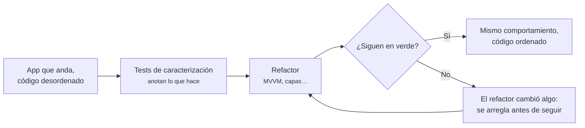

# Tests de caracterización

!!! abstract "Objetivo"
    Conocer un tipo de test con un propósito especial: **fijar el comportamiento que la app ya tiene** (lo que se ve, lo que pasa al tocar, cómo responde a los errores) para poder **cambiar el código por dentro** sin cambiar nada por fuera. Son los tests que permitieron pasar VigiaApp a MVVM sin romperla.

## La idea

Un **test de caracterización** no pregunta "¿está bien lo que hace?" sino "**¿qué hace hoy?**". Se escribe mirando la app andando, y anota su comportamiento observable:

- "Al tocar el avatar, se abre *Mi perfil* con el nombre, el rol, el correo, el teléfono y la manzana."
- "Si falla la carga del perfil, aparece *No se pudo cargar tu perfil* y un botón *Reintentar*."
- "Si la sesión vence con pantallas abiertas, se vuelve al Login."

Después se cambia el código por dentro (se reorganiza, se separa en capas) y se corren los tests: si siguen en verde, el comportamiento no cambió.



!!! info "Un poco de historia"
    VigiaApp no nació con esta arquitectura. Las primeras versiones tenían la lógica adentro de las pantallas (como el [chat "todo junto"](../4-arquitectura/1-por-que.md#el-chat-todo-en-un-widget)). Antes de reorganizarla en MVVM, un integrante del equipo escribió estos tests contra la versión vieja. Con el refactor, se adaptaron solo en cómo **arman** las pantallas (ahora reciben un ViewModel), no en lo que **comprueban**.

## Qué tiene de distinto

Técnicamente son **tests de widgets** como los de la [página anterior](4-tests-de-widgets.md). La diferencia es el **enfoque**:

| | Tests de widgets "normales" | Tests de caracterización |
|---|---|---|
| Se escriben… | Junto con la funcionalidad | Sobre algo que ya existe |
| Preguntan… | ¿Hace lo que tiene que hacer? | ¿Sigue haciendo lo mismo? |
| Se enfocan en… | Los caminos principales | Los **bordes**: errores, reintentos, casos raros |
| Miran… | El resultado | Todo lo **observable**: textos exactos, íconos, a qué pantalla se vuelve |

Por eso este archivo se concentra en lo que `widget_test.dart` no cubría: errores con reintento, el vencimiento de la sesión, enlaces del correo, conflictos (409), fotos que no existen.

## El archivo

Empieza con dos ayudantes:

<!-- archivo: test/caracterizacion_test.dart cap=c18 desde="^FakeVigiaApi _crearApi\(" hasta="^\);$" notas="setMockInitialValues\(\{if \(conSesion\)|\.\.token = conSesion \? token : null;|^Widget _perfil|home: PerfilScreen\(viewModel: PerfilViewModel" -->
```dart title="test/caracterizacion_test.dart (fragmento)" linenums="30"
FakeVigiaApi _crearApi({
  bool conSesion = true,
  String token = 'fake-1',
  bool conAlertaVecino = false,
}) {
  FlutterSecureStorage.setMockInitialValues({if (conSesion) 'token': token});  // (1)!
  return FakeVigiaApi(demora: Duration.zero, conAlertaVecino: conAlertaVecino)
    ..token = conSesion ? token : null;  // (2)!
}

Widget _perfil(FakeVigiaApi api) => MaterialApp(  // (3)!
  home: PerfilScreen(viewModel: PerfilViewModel(SesionRepository(api))),  // (4)!
);
```
<!-- /archivo -->

1. El almacenamiento seguro simulado, con o sin token guardado.
2. La API falsa ya con la sesión puesta (o sin ella).
3. Para probar **una** pantalla sola, sin toda la app: un `MaterialApp` con solo esa pantalla…
4. …armada como la arma `Rutas`: con su ViewModel y el repositorio real sobre la API falsa.

### Un ejemplo: error y reintento

<!-- archivo: test/caracterizacion_test.dart cap=c18 desde="testWidgets\('si falla la carga del perfil" hasta="^    \}\);" notas="_crearApi\(\)\.\.simularError = true;|'No se pudo cargar tu perfil'|api.simularError = false;|find.text\('Reintentar'\)|find.text\('María Ríos'\), findsOneWidget" -->
```dart title="test/caracterizacion_test.dart (fragmento)" linenums="66"
    testWidgets('si falla la carga del perfil permite reintentar', (
      tester,
    ) async {
      final api = _crearApi()..simularError = true;  // (1)!
      await tester.pumpWidget(_perfil(api));
      await tester.pumpAndSettle();

      expect(find.text('No se pudo cargar tu perfil'), findsOneWidget);  // (2)!

      api.simularError = false;  // (3)!
      await tester.tap(find.text('Reintentar'));  // (4)!
      await tester.pumpAndSettle();

      expect(find.text('María Ríos'), findsOneWidget);  // (5)!
    });
```
<!-- /archivo -->

1. La API falsa "sin conexión": todo pedido falla con `ApiException`.
2. Se ve el mensaje de error (el de `ErrorConReintento`)…
3. Vuelve la conexión…
4. …el vecino toca **Reintentar**…
5. …y se ven los datos.

Este test protege una cadena de cosas: que `PerfilViewModel.cargar` ponga `fallo` en `true`, que la vista muestre `ErrorConReintento` con ese texto, que el botón llame de nuevo a `cargar`, y que `cargar` limpie el error antes de reintentar. Si alguien cambia cualquiera de esas piezas sin querer, falla.

### Un ejemplo: la sesión vence con pantallas abiertas

<!-- archivo: test/caracterizacion_test.dart cap=c18 desde="testWidgets\('si vence la sesión" hasta="^    \}\);" notas="await tester.pumpWidget\(MyApp\(api: api\)\);|find.text\('MR'\)|api.onSesionVencida\?.call\(\);|find.text\('Mi perfil'\), findsNothing|find.text\('Ingresar'\), findsOneWidget" -->
```dart title="test/caracterizacion_test.dart (fragmento)" linenums="181"
    testWidgets('si vence la sesión con pantallas abiertas vuelve al Login', (
      tester,
    ) async {
      final api = _crearApi();
      await tester.pumpWidget(MyApp(api: api));  // (1)!
      await tester.pumpAndSettle();

      // Abrimos una pantalla encima del Inicio.
      await tester.tap(find.text('MR'));  // (2)!
      await tester.pumpAndSettle();
      expect(find.text('Mi perfil'), findsOneWidget);

      // Simulamos un 401 que dispara onSesionVencida.
      api.onSesionVencida?.call();  // (3)!
      await tester.pumpAndSettle();

      expect(find.text('Mi perfil'), findsNothing);  // (4)!
      expect(find.text('Ingresar'), findsOneWidget);  // (5)!
    });
```
<!-- /archivo -->

1. La app entera, con la sesión de María.
2. Toca el avatar: se abre *Mi perfil* **encima** del Inicio.
3. Simula lo que hace `HttpVigiaApi` al recibir un 401 con sesión ([Los errores](../4-arquitectura/7-errores.md#el-caso-especial-la-sesion-vencida)).
4. La pantalla de perfil se cerró sola (el `popUntil` de `main.dart`)…
5. …y debajo está el Login.

### Un ejemplo: un conflicto (409)

El vecino está mirando la alerta de Jorge. Mientras tanto, el comité la resuelve. El vecino toca "Voy en camino":

<!-- archivo: test/caracterizacion_test.dart cap=c18 desde="'409 en AlertaVecinoScreen" hasta="^    \);" notas="tester.runAsync\(\(\) async \{|lauraApi.resolverAlerta|find.text\('Voy en camino'\)|'La alerta ya no está activa.'|'La alerta se resolvió'" -->
```dart title="test/caracterizacion_test.dart (fragmento)" linenums="317"
      '409 en AlertaVecinoScreen muestra aviso y refresca la alerta cerrada',
      (tester) async {
        final api = _crearApi(conAlertaVecino: true);
        late EstadoAlerta alerta;
        await tester.runAsync(
          () async => alerta = (await api.obtenerAlertas()).single,
        );

        await tester.pumpWidget(
          MaterialApp(
            home: AlertaVecinoScreen(
              viewModel: alertaVecino(
                api,
                alerta,
                posiciones: const Stream.empty(),
              ),
            ),
          ),
        );
        await tester.pump(const Duration(milliseconds: 100));

        // El comité o quien la disparó la resuelve en el servidor antes del toque.
        await tester.runAsync(() async {  // (1)!
          final lauraApi = api..token = 'fake-5';
          await lauraApi.resolverAlerta(alerta.id);  // (2)!
          api.token = 'fake-1';
        });

        await tester.tap(find.text('Voy en camino'));  // (3)!
        await tester.pumpAndSettle();

        expect(find.text('La alerta ya no está activa.'), findsOneWidget);  // (4)!
        expect(find.text('La alerta se resolvió'), findsOneWidget);  // (5)!
      },
    );
```
<!-- /archivo -->

1. Con el reloj real, otra persona…
2. …resuelve la alerta en el servidor (Laura, del comité).
3. El vecino, que todavía ve la alerta activa, toca **Voy en camino**.
4. El servidor responde 409 con este mensaje, que aparece en un SnackBar…
5. …y además la pantalla **se actualizó sola** y muestra que la alerta terminó. Es el `if (e.codigo == 409) await consultar(); rethrow;` del ViewModel ([Excepciones](../2-dart/6-herencia-y-abstraccion.md#rethrow)).

## Los 13 tests

| Grupo | Test |
|---|---|
| **Perfil y cambio de contraseña** | Abre *Mi perfil* desde el avatar y muestra los datos |
| | Si falla la carga del perfil, permite reintentar |
| | Cambiar la contraseña muestra el error de la API y después actualiza |
| **Recuperación, deep links y 401** | *Olvidé mi contraseña* valida el email y envía la solicitud |
| | El enlace `vigiaapp://clave` abre *Elegir contraseña* con el token |
| | Si vence la sesión con pantallas abiertas, vuelve al Login |
| **Panel del comité** | Editar un vecino cambia el rol y si está activo; reenviar la invitación |
| | Crear una manzana nueva en el alta de vecino la deja elegida |
| | Rondines del comité: navegar semanas, crear y borrar un turno |
| **Resiliencia** | Un 409 en la alerta de un vecino muestra el aviso y refresca |
| | Deslizar una publicación ajena como vigía solo la oculta localmente |
| | Error inicial y *Reintentar* en Noticias |
| | `FotoVigia` muestra el ícono de imagen rota si la foto da 404 |

## El archivo completo

Creá `test/caracterizacion_test.dart`:

<!-- archivo: test/caracterizacion_test.dart cap=c18 plegado="test/caracterizacion_test.dart (414 líneas)" -->
??? example "test/caracterizacion_test.dart (414 líneas)"

    ```dart title="test/caracterizacion_test.dart" linenums="1"
    // test/caracterizacion_test.dart
    //
    // Pruebas de caracterización: fijan el comportamiento observable de las
    // pantallas y casos de borde que no cubría widget_test.dart, para que un
    // cambio de arquitectura no los rompa sin que nos enteremos.
    //
    // Las escribió Lucho para el PR #30; acá adaptadas a los ViewModels.

    import 'dart:async';

    import 'package:flutter/material.dart';
    import 'package:flutter_secure_storage/flutter_secure_storage.dart';
    import 'package:flutter_test/flutter_test.dart';

    import 'package:vigia_app/data/repositories/fotos_repository.dart';
    import 'package:vigia_app/data/repositories/publicaciones_repository.dart';
    import 'package:vigia_app/data/repositories/sesion_repository.dart';
    import 'package:vigia_app/data/services/api/fake_vigia_api.dart';
    import 'package:vigia_app/domain/models/alerta.dart';
    import 'package:vigia_app/main.dart';
    import 'package:vigia_app/ui/alerta/widgets/alerta_vecino_screen.dart';
    import 'package:vigia_app/ui/core/widgets/foto_vigia.dart';
    import 'package:vigia_app/ui/noticias/view_model/noticias_view_model.dart';
    import 'package:vigia_app/ui/noticias/widgets/noticias_screen.dart';
    import 'package:vigia_app/ui/perfil/view_model/perfil_view_model.dart';
    import 'package:vigia_app/ui/perfil/widgets/perfil_screen.dart';

    import 'ayudantes.dart';

    FakeVigiaApi _crearApi({
      bool conSesion = true,
      String token = 'fake-1',
      bool conAlertaVecino = false,
    }) {
      FlutterSecureStorage.setMockInitialValues({if (conSesion) 'token': token});
      return FakeVigiaApi(demora: Duration.zero, conAlertaVecino: conAlertaVecino)
        ..token = conSesion ? token : null;
    }

    Widget _perfil(FakeVigiaApi api) => MaterialApp(
      home: PerfilScreen(viewModel: PerfilViewModel(SesionRepository(api))),
    );

    void main() {
      setUpAll(usarPlataformaDePrueba);

      group('Caracterización · Perfil y cambio de contraseña', () {
        testWidgets('abre Mi perfil desde el avatar y muestra los datos', (
          tester,
        ) async {
          final api = _crearApi();
          await tester.pumpWidget(MyApp(api: api));
          await tester.pumpAndSettle();

          await tester.tap(find.text('MR'));
          await tester.pumpAndSettle();

          expect(find.text('Mi perfil'), findsOneWidget);
          expect(find.text('María Ríos'), findsOneWidget);
          expect(find.text('Vigía'), findsOneWidget);
          expect(find.text('maria@vigia.test'), findsOneWidget);
          expect(find.text('+5491100000001'), findsOneWidget);
          expect(find.text('Manzana 4'), findsOneWidget);
        });

        testWidgets('si falla la carga del perfil permite reintentar', (
          tester,
        ) async {
          final api = _crearApi()..simularError = true;
          await tester.pumpWidget(_perfil(api));
          await tester.pumpAndSettle();

          expect(find.text('No se pudo cargar tu perfil'), findsOneWidget);

          api.simularError = false;
          await tester.tap(find.text('Reintentar'));
          await tester.pumpAndSettle();

          expect(find.text('María Ríos'), findsOneWidget);
        });

        testWidgets('cambiar contraseña valida error de la API y actualiza', (
          tester,
        ) async {
          final api = _crearApi();
          await tester.pumpWidget(_perfil(api));
          await tester.pumpAndSettle();

          await tester.tap(find.text('Cambiar contraseña'));
          await tester.pumpAndSettle();

          await tester.enterText(
            find.widgetWithText(TextFormField, 'Contraseña actual'),
            'clave-incorrecta',
          );
          await tester.enterText(
            find.widgetWithText(TextFormField, 'Contraseña nueva'),
            'nuevaClave123',
          );
          await tester.tap(find.widgetWithText(FilledButton, 'Guardar'));
          await tester.pumpAndSettle();

          expect(find.text('La contraseña actual no es correcta.'), findsOneWidget);

          await tester.enterText(
            find.widgetWithText(TextFormField, 'Contraseña actual'),
            FakeVigiaApi.clave,
          );
          await tester.tap(find.widgetWithText(FilledButton, 'Guardar'));
          await tester.pumpAndSettle();

          expect(find.text('Contraseña actualizada'), findsOneWidget);
        });
      });

      group('Caracterización · Recuperación, deep links y 401', () {
        testWidgets('Olvidé mi contraseña valida email y envía solicitud', (
          tester,
        ) async {
          final api = _crearApi(conSesion: false);
          await tester.pumpWidget(MyApp(api: api));
          await tester.pumpAndSettle();

          await tester.tap(find.text('Olvidé mi contraseña'));
          await tester.pumpAndSettle();
          expect(find.text('Recuperar contraseña'), findsOneWidget);

          await tester.enterText(
            find.descendant(
              of: find.byType(AlertDialog),
              matching: find.byType(TextFormField),
            ),
            'maria@vigia.test',
          );
          await tester.tap(find.widgetWithText(FilledButton, 'Enviar'));
          await tester.pumpAndSettle();

          expect(
            find.text(
              'Si el email está registrado, te llegó un correo con el enlace.',
            ),
            findsOneWidget,
          );
        });

        testWidgets('deep link vigiaapp://clave abre ElegirClaveScreen con token', (
          tester,
        ) async {
          final api = _crearApi(conSesion: false);
          final enlaces = StreamController<Uri>();
          addTearDown(enlaces.close);

          await tester.pumpWidget(MyApp(api: api, enlaces: enlaces.stream));
          await tester.pumpAndSettle();

          enlaces.add(Uri.parse('vigiaapp://clave?token=${'ab' * 32}'));
          await tester.pumpAndSettle();

          expect(find.text('Elegí tu contraseña'), findsOneWidget);
          // Con token en el enlace no pide pegar el enlace manualmente.
          expect(
            find.widgetWithText(TextFormField, 'Enlace del correo'),
            findsNothing,
          );

          await tester.enterText(
            find.widgetWithText(TextFormField, 'Contraseña nueva'),
            'sofia-clave-1',
          );
          await tester.enterText(
            find.widgetWithText(TextFormField, 'Repetí la contraseña'),
            'sofia-clave-1',
          );
          await tester.tap(find.text('Guardar y entrar'));
          await tester.pumpAndSettle();

          expect(find.text('SOS'), findsOneWidget);
          expect(find.text('SP'), findsOneWidget);
        });

        testWidgets('si vence la sesión con pantallas abiertas vuelve al Login', (
          tester,
        ) async {
          final api = _crearApi();
          await tester.pumpWidget(MyApp(api: api));
          await tester.pumpAndSettle();

          // Abrimos una pantalla encima del Inicio.
          await tester.tap(find.text('MR'));
          await tester.pumpAndSettle();
          expect(find.text('Mi perfil'), findsOneWidget);

          // Simulamos un 401 que dispara onSesionVencida.
          api.onSesionVencida?.call();
          await tester.pumpAndSettle();

          expect(find.text('Mi perfil'), findsNothing);
          expect(find.text('Ingresar'), findsOneWidget);
        });
      });

      group('Caracterización · Panel del comité (edición, manzana, turnos)', () {
        Future<void> abrirDesdeElMenu(WidgetTester tester, String opcion) async {
          await tester.tap(find.byIcon(Icons.menu));
          await tester.pumpAndSettle();
          await tester.tap(find.text(opcion));
          await tester.pumpAndSettle();
        }

        testWidgets(
          'editar vecino cambia rol y estado activo; reenvía invitación',
          (tester) async {
            tester.view.physicalSize = const Size(800, 1600);
            tester.view.devicePixelRatio = 1;
            addTearDown(tester.view.reset);

            final api = _crearApi(token: 'fake-5'); // Laura, comité
            await tester.pumpWidget(MyApp(api: api));
            await tester.pumpAndSettle();
            await abrirDesdeElMenu(tester, 'Vecinos');

            // Reenviar invitación a Sofía Paz (tiene invitación pendiente).
            await tester.tap(find.text('Sofía Paz'));
            await tester.pumpAndSettle();
            expect(find.text('Reenviar invitación'), findsOneWidget);
            await tester.tap(find.text('Reenviar invitación'));
            await tester.pumpAndSettle();
            expect(
              find.text('Invitación reenviada a sofia@vigia.test'),
              findsOneWidget,
            );
            await tester.pump(const Duration(seconds: 5));
            await tester.pumpAndSettle();

            // Editar a Ana Castro: desactivar.
            await tester.tap(find.text('Ana Castro'));
            await tester.pumpAndSettle();
            await tester.tap(find.widgetWithText(SwitchListTile, 'Activo'));
            await tester.pumpAndSettle();
            await tester.tap(find.widgetWithText(FilledButton, 'Guardar'));
            await tester.pumpAndSettle();

            expect(find.text('Cambios guardados'), findsOneWidget);
            expect(find.text('Manzana 2 · Vecino · Inactivo'), findsOneWidget);
          },
        );

        testWidgets('crear nueva manzana en el alta de vecino la selecciona', (
          tester,
        ) async {
          tester.view.physicalSize = const Size(800, 1600);
          tester.view.devicePixelRatio = 1;
          addTearDown(tester.view.reset);

          final api = _crearApi(token: 'fake-5');
          await tester.pumpWidget(MyApp(api: api));
          await tester.pumpAndSettle();
          await abrirDesdeElMenu(tester, 'Vecinos');

          await tester.tap(find.text('Nuevo vecino'));
          await tester.pumpAndSettle();

          await tester.tap(find.byTooltip('Nueva manzana'));
          await tester.pumpAndSettle();
          expect(find.text('Nueva manzana'), findsOneWidget);

          await tester.enterText(
            find.descendant(
              of: find.byType(AlertDialog),
              matching: find.byType(TextField),
            ),
            'Manzana 6',
          );
          await tester.tap(find.widgetWithText(FilledButton, 'Crear'));
          await tester.pumpAndSettle();

          expect(find.text('Manzana 6'), findsOneWidget);
        });

        testWidgets('rondines del comité: navegar semana, crear y borrar turno', (
          tester,
        ) async {
          final api = _crearApi(token: 'fake-5');
          await tester.pumpWidget(MyApp(api: api));
          await tester.pumpAndSettle();
          await abrirDesdeElMenu(tester, 'Rondines del comité');

          // Semana siguiente no tiene turnos cargados.
          await tester.tap(find.byTooltip('Semana siguiente'));
          await tester.pumpAndSettle();
          expect(find.text('No hay turnos cargados esta semana'), findsOneWidget);

          // Crear turno en esa semana libre.
          await tester.tap(find.text('Nuevo turno'));
          await tester.pumpAndSettle();
          await tester.tap(find.widgetWithText(FilledButton, 'Crear'));
          await tester.pumpAndSettle();
          expect(find.text('No hay turnos cargados esta semana'), findsNothing);
          expect(find.text('Sin vecinos asignados'), findsOneWidget);

          // Abrir el turno creado y borrarlo.
          await tester.tap(find.byType(ListTile).first);
          await tester.pumpAndSettle();
          await tester.tap(find.text('Borrar turno'));
          await tester.pumpAndSettle();
          expect(find.text('¿Borrar el turno?'), findsOneWidget);
          await tester.tap(find.widgetWithText(FilledButton, 'Borrar'));
          await tester.pumpAndSettle();

          expect(find.text('Turno borrado'), findsOneWidget);
          expect(find.text('No hay turnos cargados esta semana'), findsOneWidget);
        });
      });

      group('Caracterización · Resiliencia en alertas, inicio, noticias y fotos', () {
        testWidgets(
          '409 en AlertaVecinoScreen muestra aviso y refresca la alerta cerrada',
          (tester) async {
            final api = _crearApi(conAlertaVecino: true);
            late EstadoAlerta alerta;
            await tester.runAsync(
              () async => alerta = (await api.obtenerAlertas()).single,
            );

            await tester.pumpWidget(
              MaterialApp(
                home: AlertaVecinoScreen(
                  viewModel: alertaVecino(
                    api,
                    alerta,
                    posiciones: const Stream.empty(),
                  ),
                ),
              ),
            );
            await tester.pump(const Duration(milliseconds: 100));

            // El comité o quien la disparó la resuelve en el servidor antes del toque.
            await tester.runAsync(() async {
              final lauraApi = api..token = 'fake-5';
              await lauraApi.resolverAlerta(alerta.id);
              api.token = 'fake-1';
            });

            await tester.tap(find.text('Voy en camino'));
            await tester.pumpAndSettle();

            expect(find.text('La alerta ya no está activa.'), findsOneWidget);
            expect(find.text('La alerta se resolvió'), findsOneWidget);
          },
        );

        testWidgets(
          'deslizar una publicación ajena como vigía solo la oculta localmente',
          (tester) async {
            final api = _crearApi();
            await tester.pumpWidget(MyApp(api: api));
            await tester.pumpAndSettle();
            await tester.tap(find.text('Actividad'));
            await tester.pumpAndSettle();

            const titulo = 'Cierre de la calle Juárez por obra';
            await tester.drag(find.text(titulo), const Offset(-500, 0));
            await tester.pumpAndSettle();

            expect(find.text(titulo), findsNothing);
            // Sigue existiendo en el servidor porque María no es su autora ni comité.
            final enServidor = await tester.runAsync(() => api.obtenerActividad());
            expect(enServidor!.any((a) => a.titulo == titulo), isTrue);
          },
        );

        testWidgets('error inicial y Reintentar en Inicio y en Noticias', (
          tester,
        ) async {
          final api = _crearApi()..simularError = true;
          await tester.pumpWidget(
            MaterialApp(
              home: NoticiasScreen(
                viewModel: NoticiasViewModel(PublicacionesRepository(api)),
              ),
            ),
          );
          await tester.pumpAndSettle();

          expect(find.text('No se pudieron cargar las noticias'), findsOneWidget);

          api.simularError = false;
          await tester.tap(find.text('Reintentar'));
          await tester.pumpAndSettle();

          expect(
            find.text('Reunión con el cuadrante policial el jueves 19 h'),
            findsOneWidget,
          );
        });

        testWidgets('FotoVigia muestra ícono de imagen rota si la foto da 404', (
          tester,
        ) async {
          final api = _crearApi();
          await tester.pumpWidget(
            MaterialApp(
              home: Scaffold(
                body: FotoVigia(fotoId: 999, cargar: FotosRepository(api).obtener),
              ),
            ),
          );
          await tester.pumpAndSettle();

          expect(find.byIcon(Icons.broken_image_outlined), findsOneWidget);
        });
      });
    }
    ```
<!-- /archivo -->

## Probalo

```bash
flutter test test/caracterizacion_test.dart
```

```text
00:02 +13: All tests passed!
```

Y todos:

```text
00:05 +96: All tests passed!
```

## Cuándo escribir tests de caracterización

- **Antes de un refactor grande** en código que no tiene tests: primero se fija lo que hace, después se cambia.
- **Cuando heredás código** que no conocés: escribir lo que hace es una forma de entenderlo.
- **Cuando aparece un bug**: un test que lo reproduce (y falla) antes de arreglarlo, y pasa después. Así no vuelve.

!!! warning "Fijan lo que hay, no lo que debería haber"
    Si la app tiene un bug, un test de caracterización lo va a **fijar** también. Está bien: el objetivo es que el refactor no cambie nada. Los bugs se arreglan **después**, en un cambio aparte, actualizando el test a sabiendas.

## Lo que aprendiste

- [x] Un test de caracterización anota **lo que la app hace hoy**, para poder cambiar el código sin cambiar el comportamiento.
- [x] Se enfoca en lo observable y en los bordes: errores, reintentos, conflictos, sesión vencida.
- [x] VigiaApp los usó para pasar a MVVM con la red de seguridad puesta.

[Siguiente: Tests del cliente HTTP :material-arrow-right:](6-tests-del-cliente-http.md){ .md-button .md-button--primary }
