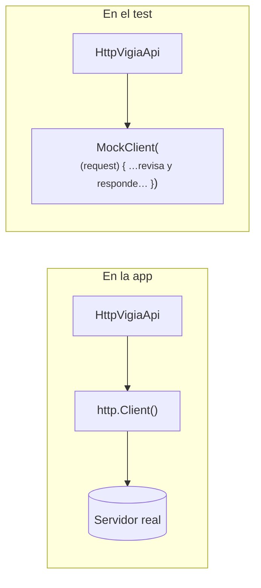
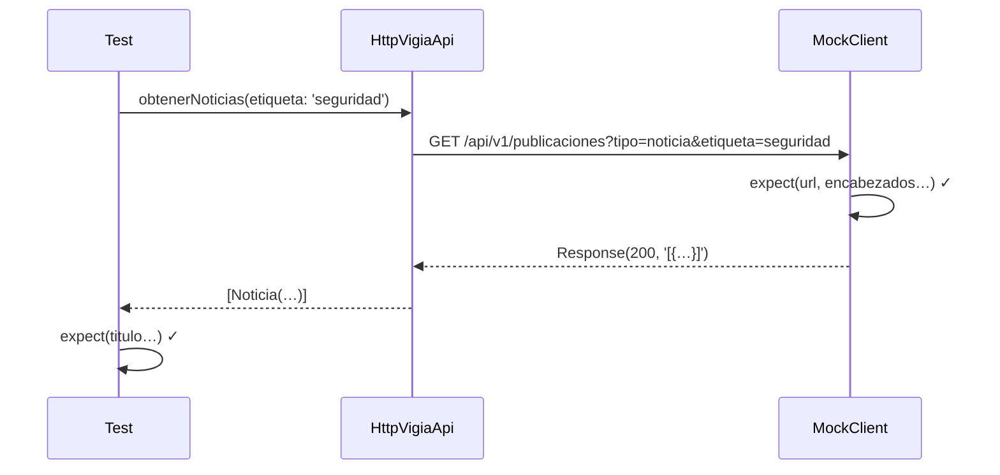
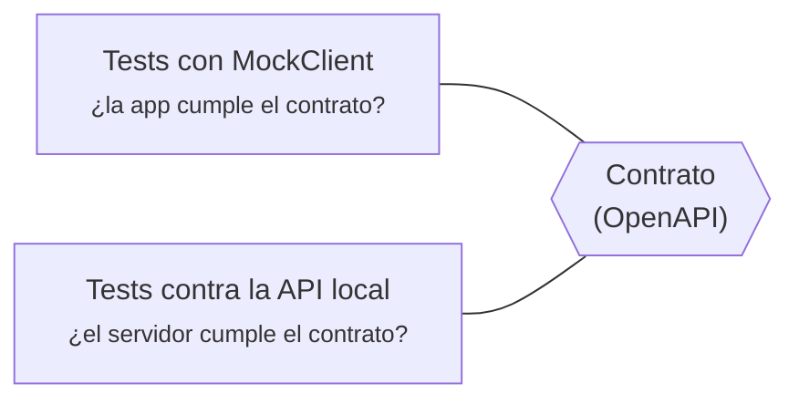

# Tests del cliente HTTP

!!! abstract "Objetivo"
    Probar `HttpVigiaApi` **sin servidor**: con un **`MockClient`** que hace de servidor y responde lo que el test le dice, se comprueba que la app **arma bien los pedidos** (URL, método, encabezados, cuerpo JSON) y que **entiende bien las respuestas** (JSON, 204 sin cuerpo, errores, HTML del *hosting*, sin conexión). Con esto llegamos a los 121 tests.

## El problema

`FakeVigiaApi` sirve para probar todo lo que está **arriba** del contrato. Pero `HttpVigiaApi` es justo la pieza que **no** se prueba con el fake: es la que habla HTTP. ¿Cómo probarla sin depender de que el servidor esté andando, tenga datos y responda rápido?



La respuesta es la misma de siempre: **inyectar** la dependencia. `HttpVigiaApi` recibe el cliente HTTP en el constructor ([la nota 3](2-api-real.md#paso-2-httpvigiaapi)), y el paquete `http` trae, en `package:http/testing.dart`, un **`MockClient`**: un cliente que, en vez de mandar el pedido por la red, se lo pasa a **una función tuya**, que lo revisa y devuelve la respuesta que quieras.

## El esquema

```dart
final api = HttpVigiaApi(
  'https://ejemplo.com/api/v1',
  token: 'abc123',
  cliente: MockClient((request) async {
    // 1. Revisar el pedido que armó la app
    expect(request.method, 'GET');
    expect(request.url.path, '/api/v1/publicaciones');
    expect(request.headers['Authorization'], 'Bearer abc123');
    // 2. Responder como lo haría el servidor
    return http.Response(jsonEncode([…]), 200, headers: _json);
  }),
);

// 3. Usar la API y comprobar lo que devuelve
final noticias = await api.obtenerNoticias(etiqueta: 'seguridad');
expect(noticias.single.titulo, 'Reunión con el cuadrante');
```



Prueba **las dos puntas** del contrato con el servidor: que mandamos lo que el servidor espera, y que entendemos lo que responde.

## Ejemplos

### Que se arme bien el pedido

<!-- archivo: test/api_test.dart cap=c18 desde="test\('arma la URL con filtros" hasta="^    \}\);" notas="late Uri pedida;|cliente: MockClient\(\(request\) async \{|pedida = request.url;|expect\(request.headers\['Authorization'\]|return http.Response\(|await api.obtenerNoticias\(etiqueta: 'seguridad'\)|expect\(pedida.queryParameters" -->
```dart title="test/api_test.dart (fragmento)" linenums="61"
    test('arma la URL con filtros y parsea las noticias', () async {
      late Uri pedida;  // (1)!
      final api = HttpVigiaApi(
        'https://ejemplo.com/api/v1',
        token: 'abc123',
        cliente: MockClient((request) async {  // (2)!
          pedida = request.url;  // (3)!
          expect(request.headers['Authorization'], 'Bearer abc123');  // (4)!
          return http.Response(  // (5)!
            jsonEncode([
              {
                'id': 5,
                'titulo': 'Reunión con el cuadrante',
                'etiqueta': 'seguridad',
                'autor': 'Comité',
                'creado_en': '2026-09-23T18:00:00Z',
              },
            ]),
            200,
            headers: _json,
          );
        }),
      );

      final noticias = await api.obtenerNoticias(etiqueta: 'seguridad');  // (6)!

      expect(pedida.path, '/api/v1/publicaciones');
      expect(pedida.queryParameters, {  // (7)!
        'tipo': 'noticia',
        'etiqueta': 'seguridad',
      });
      expect(noticias.single.titulo, 'Reunión con el cuadrante');
    });
```
<!-- /archivo -->

1. Para guardar la URL que armó la app y revisarla después.
2. El "servidor" del test: una función que recibe el pedido.
3. Guarda la URL…
4. …y revisa que el token vaya en el encabezado.
5. Responde como el servidor real: una lista JSON con una noticia, código 200.
6. Usa la API como la usaría el repositorio.
7. La URL tiene los dos filtros (`tipo` lo agrega la app; `etiqueta` es el parámetro).

### Que los errores se conviertan bien

<!-- archivo: test/api_test.dart cap=c18 desde="test\('un error del servidor se convierte" hasta="^    \}\);" notas="'error': \{'codigo': 'no_autorizado'|^            401,|throwsA\(|\.having\(\(e\) => e.codigo|\.having\(\(e\) => e.mensaje" -->
```dart title="test/api_test.dart (fragmento)" linenums="122"
    test('un error del servidor se convierte en ApiException', () async {
      final api = HttpVigiaApi(
        'https://ejemplo.com/api/v1',
        cliente: MockClient(
          (request) async => http.Response(
            jsonEncode({
              'error': {'codigo': 'no_autorizado', 'mensaje': 'Sesión vencida'},  // (1)!
            }),
            401,  // (2)!
            headers: _json,
          ),
        ),
      );

      expect(
        api.obtenerEstadoBarrio(),
        throwsA(  // (3)!
          isA<ApiException>()
              .having((e) => e.codigo, 'codigo', 401)  // (4)!
              .having((e) => e.mensaje, 'mensaje', 'Sesión vencida'),  // (5)!
        ),
      );
    });
```
<!-- /archivo -->

1. El formato de error de la API ([Contrato](../7-referencia/contrato-api.md))…
2. …con un 401.
3. `throwsA` comprueba que el `Future` **falle** con ese error.
4. `.having` mira **adentro** del error: que el código sea 401…
5. …y que el mensaje sea el que mandó el servidor.

### Que la sesión vencida avise (una sola vez)

<!-- archivo: test/api_test.dart cap=c18 desde="'un 401 con sesión llama" hasta="^    \);" notas="var avisos = 0;|token: 'vencido',|onSesionVencida: \(\) => avisos\+\+,|await expectLater\(api.obtenerPerfil\(\)|expect\(avisos, 1\);|expect\(api.token, isNull\);|api.login\('a@b.c', 'x'\)" -->
```dart title="test/api_test.dart (fragmento)" linenums="189"
      'un 401 con sesión llama a onSesionVencida y borra el token',
      () async {
        var avisos = 0;  // (1)!
        final api = HttpVigiaApi(
          'https://ejemplo.com/api/v1',
          token: 'vencido',  // (2)!
          onSesionVencida: () => avisos++,  // (3)!
          cliente: MockClient(
            (request) async => http.Response(
              jsonEncode({
                'error': {
                  'codigo': 'no_autorizado',
                  'mensaje': 'Sesión vencida',
                },
              }),
              401,
              headers: _json,
            ),
          ),
        );

        await expectLater(api.obtenerPerfil(), throwsA(isA<ApiException>()));  // (4)!
        expect(avisos, 1);  // (5)!
        expect(api.token, isNull);  // (6)!

        // Sin token (p. ej. login con la clave mal) no se avisa de nuevo.
        await expectLater(
          api.login('a@b.c', 'x'),  // (7)!
          throwsA(isA<ApiException>()),
        );
        expect(avisos, 1);
      },
    );
```
<!-- /archivo -->

1. Un contador de avisos.
2. La API arranca **con** sesión.
3. En lugar de cerrar la sesión de verdad, el aviso suma 1.
4. `expectLater` + `await`: esperar a que el `Future` falle antes de seguir.
5. Se avisó una vez…
6. …y se borró el token.
7. Un 401 **sin** sesión (contraseña incorrecta) no vuelve a avisar.

### Que lo raro no rompa la app

<!-- archivo: test/api_test.dart cap=c18 desde="group\('HttpVigiaApi respuestas que no son JSON'" hasta="^  \}\);" notas="HttpVigiaApi conRespuesta\(int codigo\)|'<html><body>503|'Error del servidor'\),|conRespuesta\(200\)" -->
```dart title="test/api_test.dart (fragmento)" linenums="625"
  group('HttpVigiaApi respuestas que no son JSON', () {
    HttpVigiaApi conRespuesta(int codigo) => HttpVigiaApi(  // (1)!
      'https://ejemplo.com/api/v1',
      cliente: MockClient(
        (request) async => http.Response(
          '<html><body>503 Service Unavailable</body></html>',  // (2)!
          codigo,
          headers: {'content-type': 'text/html'},
        ),
      ),
    );

    test('un 503 con HTML del hosting es ApiException', () async {
      expect(
        conRespuesta(503).obtenerEstadoBarrio(),
        throwsA(
          isA<ApiException>()
              .having((e) => e.codigo, 'codigo', 503)
              .having((e) => e.mensaje, 'mensaje', 'Error del servidor'),  // (3)!
        ),
      );
    });

    test('un 200 con HTML también es ApiException', () async {
      expect(
        conRespuesta(200).obtenerEstadoBarrio(),  // (4)!
        throwsA(isA<ApiException>()),
      );
    });
  });
```
<!-- /archivo -->

1. Un ayudante dentro del grupo: una API cuyo "servidor" siempre responde HTML.
2. Lo que de verdad devuelve el *hosting* mientras la API reinicia.
3. Un 503 con HTML es un `ApiException` con un mensaje genérico (no hay `{"error": …}` que leer).
4. Y un 200 con HTML, también: la app no intenta leer HTML como si fuera JSON.

## Los 25 tests

| Grupo | Qué prueba |
|---|---|
| **RondinViewModel** | Pasa por "cargando" y confirma el turno; si la API falla queda en error |
| **HttpVigiaApi** | La URL con filtros; el `POST` con cuerpo JSON; errores → `ApiException`; el login guarda el token y lo manda después; un 401 con sesión avisa una vez; el `logout` con un 204 sin cuerpo; sin conexión → `ApiException` |
| **Alertas** | `GET /alertas?estado=activa` con los campos nuevos; `en-camino` manda `{"en_camino": true}`; el modelo sigue leyendo el formato viejo |
| **Publicaciones** | `publicar` manda solo los campos con valor; `borrar` usa `DELETE` y acepta el 204 |
| **Chat** | El sondeo pide solo lo nuevo con `?despues=` |
| **Ubicación** | `enviarUbicacion` manda `lat` y `lng`; el detalle trae a los que van en camino |
| **Fotos** | Subir manda los bytes con su `Content-Type`; bajar devuelve los bytes, y un 404 es `ApiException` |
| **Comité** | La semana con `?desde=`, el `PUT` de asignaciones y el `PATCH` de un vecino |
| **SesionRepository** | Un token vencido se borra; login guarda y logout borra; si el almacenamiento seguro falla, no se traba |
| **Respuestas que no son JSON** | 503 con HTML; 200 con HTML |

!!! info "Un truco del último grupo: `noSuchMethod`"
    Para probar que la sesión no se traba si el almacenamiento seguro falla, el archivo termina con un `_AlmacenRoto implements FlutterSecureStorage` que, en vez de escribir uno por uno todos los métodos de esa clase, sobrescribe `noSuchMethod`: **cualquier** método que se llame devuelve un error. Es una forma rápida de hacer un doble de prueba "que todo le falla".

## El archivo completo

Creá `test/api_test.dart`:

<!-- archivo: test/api_test.dart cap=c18 plegado="test/api_test.dart (662 líneas)" -->
??? example "test/api_test.dart (662 líneas)"

    ```dart title="test/api_test.dart" linenums="1"
    // Tests de la capa de datos: el ViewModel de rondines y el cliente HTTP.
    // HttpVigiaApi se prueba con MockClient (viene dentro del paquete http),
    // así no hace falta un servidor real para verificar URLs y JSON.

    import 'dart:convert';
    import 'dart:typed_data';

    import 'package:flutter_secure_storage/flutter_secure_storage.dart';
    import 'package:flutter_test/flutter_test.dart';
    import 'package:http/http.dart' as http;
    import 'package:http/testing.dart';

    import 'package:vigia_app/data/repositories/rondines_repository.dart';
    import 'package:vigia_app/data/repositories/sesion_repository.dart';
    import 'package:vigia_app/data/services/almacen_token.dart';
    import 'package:vigia_app/data/services/api/fake_vigia_api.dart';
    import 'package:vigia_app/data/services/api/http_vigia_api.dart';
    import 'package:vigia_app/data/services/api/vigia_api.dart';
    import 'package:vigia_app/domain/models/alerta.dart';
    import 'package:vigia_app/ui/rondines/view_model/rondin_view_model.dart';

    // La API responde siempre JSON en UTF-8 (ver especificacion_api_db.md).
    const _json = {'content-type': 'application/json; charset=utf-8'};

    void main() {
      group('RondinViewModel', () {
        test('pasa por "cargando" y confirma el turno', () async {
          // token fake-1 = María, que tiene turno hoy.
          final model = RondinViewModel(
            RondinesRepository(
              FakeVigiaApi(demora: Duration.zero)..token = 'fake-1',
            ),
          );
          await model.cargarSemana();
          expect(model.turnos.length, 7);
          expect(model.miTurno!.miEstado, 'pendiente');

          final respuesta = model.responderTurno(true);
          expect(model.ocupado, isTrue); // avisó antes del await
          await respuesta;

          expect(model.ocupado, isFalse);
          expect(model.error, isNull);
          expect(model.miTurno!.miEstado, 'confirmado');
        });

        test('si la API falla queda en estado de error', () async {
          final api = FakeVigiaApi(demora: Duration.zero)..token = 'fake-1';
          final model = RondinViewModel(RondinesRepository(api));
          await model.cargarSemana();

          api.simularError = true;
          await model.responderTurno(false);

          expect(model.error, 'No se pudo enviar tu respuesta');
          expect(model.miTurno!.miEstado, 'pendiente'); // no cambió
        });
      });

      group('HttpVigiaApi', () {
        test('arma la URL con filtros y parsea las noticias', () async {
          late Uri pedida;
          final api = HttpVigiaApi(
            'https://ejemplo.com/api/v1',
            token: 'abc123',
            cliente: MockClient((request) async {
              pedida = request.url;
              expect(request.headers['Authorization'], 'Bearer abc123');
              return http.Response(
                jsonEncode([
                  {
                    'id': 5,
                    'titulo': 'Reunión con el cuadrante',
                    'etiqueta': 'seguridad',
                    'autor': 'Comité',
                    'creado_en': '2026-09-23T18:00:00Z',
                  },
                ]),
                200,
                headers: _json,
              );
            }),
          );

          final noticias = await api.obtenerNoticias(etiqueta: 'seguridad');

          expect(pedida.path, '/api/v1/publicaciones');
          expect(pedida.queryParameters, {
            'tipo': 'noticia',
            'etiqueta': 'seguridad',
          });
          expect(noticias.single.titulo, 'Reunión con el cuadrante');
        });

        test('POST de asistencia manda el body en JSON', () async {
          final api = HttpVigiaApi(
            'https://ejemplo.com/api/v1',
            cliente: MockClient((request) async {
              expect(request.method, 'POST');
              expect(request.url.path, '/api/v1/rondines/102/asistencia');
              expect(jsonDecode(request.body), {'presente': true});
              return http.Response(
                jsonEncode({
                  'id': 102,
                  'fecha': '2026-09-23',
                  'hora_inicio': '22:00',
                  'hora_fin': '02:00',
                  'ruta': 'Morelos → Juárez',
                  'pareja': ['María R.', 'Tomás R.'],
                  'mi_estado': 'confirmado',
                }),
                200,
                headers: _json,
              );
            }),
          );

          final turno = await api.responderAsistencia(102, true);
          expect(turno.miEstado, 'confirmado');
        });

        test('un error del servidor se convierte en ApiException', () async {
          final api = HttpVigiaApi(
            'https://ejemplo.com/api/v1',
            cliente: MockClient(
              (request) async => http.Response(
                jsonEncode({
                  'error': {'codigo': 'no_autorizado', 'mensaje': 'Sesión vencida'},
                }),
                401,
                headers: _json,
              ),
            ),
          );

          expect(
            api.obtenerEstadoBarrio(),
            throwsA(
              isA<ApiException>()
                  .having((e) => e.codigo, 'codigo', 401)
                  .having((e) => e.mensaje, 'mensaje', 'Sesión vencida'),
            ),
          );
        });

        test('login guarda el token y lo manda en el pedido siguiente', () async {
          final pedidos = <http.Request>[];
          final api = HttpVigiaApi(
            'https://ejemplo.com/api/v1',
            cliente: MockClient((request) async {
              pedidos.add(request);
              if (request.url.path.endsWith('/auth/login')) {
                return http.Response(
                  jsonEncode({
                    'token': 'f' * 64,
                    'expira_en': '2026-09-24T19:00:00Z',
                    'vecino': {
                      'id': 1,
                      'nombre': 'María Ríos',
                      'manzana': 'Manzana 4',
                      'rol': 'vigia',
                    },
                  }),
                  200,
                  headers: _json,
                );
              }
              return http.Response(
                jsonEncode({'vecinos_en_linea': 1, 'vecinos_total': 2}),
                200,
                headers: _json,
              );
            }),
          );

          final sesion = await api.login('maria@vigia.test', 'vigia1234');
          await api.obtenerEstadoBarrio();

          expect(sesion.vecino.nombre, 'María Ríos');
          expect(jsonDecode(pedidos[0].body), {
            'email': 'maria@vigia.test',
            'password': 'vigia1234',
          });
          expect(pedidos[0].headers.containsKey('Authorization'), isFalse);
          expect(pedidos[1].headers['Authorization'], 'Bearer ${'f' * 64}');
        });

        test(
          'un 401 con sesión llama a onSesionVencida y borra el token',
          () async {
            var avisos = 0;
            final api = HttpVigiaApi(
              'https://ejemplo.com/api/v1',
              token: 'vencido',
              onSesionVencida: () => avisos++,
              cliente: MockClient(
                (request) async => http.Response(
                  jsonEncode({
                    'error': {
                      'codigo': 'no_autorizado',
                      'mensaje': 'Sesión vencida',
                    },
                  }),
                  401,
                  headers: _json,
                ),
              ),
            );

            await expectLater(api.obtenerPerfil(), throwsA(isA<ApiException>()));
            expect(avisos, 1);
            expect(api.token, isNull);

            // Sin token (p. ej. login con la clave mal) no se avisa de nuevo.
            await expectLater(
              api.login('a@b.c', 'x'),
              throwsA(isA<ApiException>()),
            );
            expect(avisos, 1);
          },
        );

        test('logout acepta el 204 sin cuerpo y deja el token en null', () async {
          final api = HttpVigiaApi(
            'https://ejemplo.com/api/v1',
            token: 'abc',
            cliente: MockClient((request) async {
              expect(request.url.path, '/api/v1/auth/logout');
              return http.Response('', 204);
            }),
          );

          await api.logout();
          expect(api.token, isNull);
        });

        test('sin conexión también es ApiException', () async {
          final api = HttpVigiaApi(
            'https://ejemplo.com/api/v1',
            cliente: MockClient(
              (request) async => throw http.ClientException('sin red'),
            ),
          );

          expect(
            api.obtenerEstadoBarrio(),
            throwsA(
              isA<ApiException>().having(
                (e) => e.mensaje,
                'mensaje',
                'Sin conexión con el servidor',
              ),
            ),
          );
        });
      });

      group('HttpVigiaApi alertas', () {
        test('GET /alertas?estado=activa parsea los campos de la v1.1', () async {
          final api = HttpVigiaApi(
            'https://ejemplo.com/api/v1',
            token: 'abc',
            cliente: MockClient((request) async {
              expect(request.url.path, '/api/v1/alertas');
              expect(request.url.queryParameters, {'estado': 'activa'});
              return http.Response(
                jsonEncode([
                  {
                    'id': 17,
                    'estado': 'activa',
                    'central_911_confirmada': false,
                    'vecinos_avisados': 38,
                    'en_camino': 3,
                    'mi_respuesta': 'notificado',
                    'lat': -34.6,
                    'lng': null,
                    'creada_en': '2026-09-23T22:34:27Z',
                    'cerrada_en': null,
                    'vecino': {
                      'id': 3,
                      'nombre': 'Jorge López',
                      'manzana': 'Manzana 2',
                    },
                  },
                ]),
                200,
                headers: _json,
              );
            }),
          );

          final alerta = (await api.obtenerAlertas()).single;
          expect(alerta.vecinoNombre, 'Jorge López');
          expect(alerta.miRespuesta, 'notificado');
          expect(alerta.lat, -34.6);
          expect(alerta.activa, isTrue);
        });

        test('en-camino manda {"en_camino": true}', () async {
          final api = HttpVigiaApi(
            'https://ejemplo.com/api/v1',
            token: 'abc',
            cliente: MockClient((request) async {
              expect(request.method, 'POST');
              expect(request.url.path, '/api/v1/alertas/7/en-camino');
              expect(jsonDecode(request.body), {'en_camino': true});
              return http.Response(
                jsonEncode({
                  'id': 7,
                  'estado': 'activa',
                  'central_911_confirmada': true,
                  'vecinos_avisados': 8,
                  'en_camino': 2,
                  'mi_respuesta': 'en_camino',
                }),
                200,
                headers: _json,
              );
            }),
          );

          final alerta = await api.marcarEnCamino(7);
          expect(alerta.voyEnCamino, isTrue);
          expect(alerta.enCamino, 2);
        });

        test('EstadoAlerta sigue leyendo el JSON de 5 campos de la v1.0', () {
          final alerta = EstadoAlerta.fromJson({
            'id': 1,
            'estado': 'activa',
            'central_911_confirmada': true,
            'vecinos_avisados': 38,
            'en_camino': 3,
          });
          expect(alerta.miRespuesta, isNull);
          expect(alerta.vecinoNombre, isNull);
        });
      });

      group('HttpVigiaApi publicaciones', () {
        test('publicar manda solo los campos con valor', () async {
          final api = HttpVigiaApi(
            'https://ejemplo.com/api/v1',
            token: 'abc',
            cliente: MockClient((request) async {
              expect(request.method, 'POST');
              expect(request.url.path, '/api/v1/publicaciones');
              expect(jsonDecode(request.body), {
                'tipo': 'actividad',
                'titulo': 'Perro suelto',
              });
              return http.Response(
                jsonEncode({
                  'id': 9,
                  'tipo': 'actividad',
                  'titulo': 'Perro suelto',
                  'cuerpo': null,
                  'etiqueta': null,
                  'autor': 'María R.',
                  'iniciales': 'MR',
                  'autor_id': 1,
                  'creado_en': '2026-09-23T18:35:00Z',
                  'respuestas': 0,
                }),
                201,
                headers: _json,
              );
            }),
          );

          final publicacion = await api.publicar(
            tipo: 'actividad',
            titulo: 'Perro suelto',
          );
          expect(publicacion.autorId, 1);
        });

        test('borrar usa DELETE y acepta el 204', () async {
          final api = HttpVigiaApi(
            'https://ejemplo.com/api/v1',
            token: 'abc',
            cliente: MockClient((request) async {
              expect(request.method, 'DELETE');
              expect(request.url.path, '/api/v1/publicaciones/9');
              return http.Response('', 204);
            }),
          );

          await api.borrarPublicacion(9);
        });
      });

      group('HttpVigiaApi chat', () {
        test('el polling pide solo lo nuevo con ?despues', () async {
          final api = HttpVigiaApi(
            'https://ejemplo.com/api/v1',
            token: 'abc',
            cliente: MockClient((request) async {
              expect(request.url.path, '/api/v1/mensajes');
              expect(request.url.queryParameters, {'despues': '7'});
              return http.Response(
                jsonEncode([
                  {
                    'id': 8,
                    'texto': 'Hola',
                    'foto_id': null,
                    'autor': 'Ana C.',
                    'iniciales': 'AC',
                    'autor_id': 4,
                    'creado_en': '2026-09-23T18:35:00Z',
                  },
                ]),
                200,
                headers: _json,
              );
            }),
          );

          final mensajes = await api.obtenerMensajes(despues: 7);
          expect(mensajes.single.id, 8);
          expect(mensajes.single.autor, 'Ana C.');
        });
      });

      group('HttpVigiaApi ubicación', () {
        test('enviarUbicacion manda lat y lng a la alerta', () async {
          final api = HttpVigiaApi(
            'https://ejemplo.com/api/v1',
            token: 'abc',
            cliente: MockClient((request) async {
              expect(request.method, 'POST');
              expect(request.url.path, '/api/v1/alertas/17/ubicacion');
              expect(jsonDecode(request.body), {'lat': -34.6, 'lng': -58.38});
              return http.Response('', 204);
            }),
          );

          await api.enviarUbicacion(17, -34.6, -58.38);
        });

        test('el detalle de la alerta trae a los que van en camino', () {
          final estado = EstadoAlerta.fromJson({
            'id': 17,
            'estado': 'activa',
            'central_911_confirmada': true,
            'vecinos_avisados': 38,
            'en_camino': 1,
            'lat': -34.6,
            'lng': -58.38,
            'ubicacion_en': '2026-11-03T18:35:00Z',
            'en_camino_ubicaciones': [
              {
                'vecino_id': 3,
                'nombre': 'Jorge López',
                'lat': -34.61,
                'lng': -58.39,
                'actualizado_en': '2026-11-03T18:35:02Z',
              },
            ],
          });
          expect(estado.ubicacionEn, isNotNull);
          expect(estado.enCaminoUbicaciones.single.nombre, 'Jorge López');
          expect(estado.enCaminoUbicaciones.single.lng, -58.39);

          // El listado del Inicio no la trae: lista vacía, no error.
          final sinLista = EstadoAlerta.fromJson({
            'id': 17,
            'estado': 'activa',
            'central_911_confirmada': false,
            'vecinos_avisados': 0,
            'en_camino': 0,
          });
          expect(sinLista.enCaminoUbicaciones, isEmpty);
        });
      });

      group('HttpVigiaApi fotos', () {
        test('subir manda los bytes crudos con su Content-Type', () async {
          final bytes = Uint8List.fromList([0xFF, 0xD8, 0xFF, 0xD9]);
          final api = HttpVigiaApi(
            'https://ejemplo.com/api/v1',
            token: 'abc',
            cliente: MockClient((request) async {
              expect(request.method, 'POST');
              expect(request.url.path, '/api/v1/fotos');
              expect(request.headers['Content-Type'], 'image/jpeg');
              expect(request.headers['Authorization'], 'Bearer abc');
              expect(request.bodyBytes, bytes);
              return http.Response(jsonEncode({'id': 5}), 201, headers: _json);
            }),
          );

          expect(await api.subirFoto(bytes, 'image/jpeg'), 5);
        });

        test('bajar devuelve los bytes; si no existe, ApiException', () async {
          final api = HttpVigiaApi(
            'https://ejemplo.com/api/v1',
            token: 'abc',
            cliente: MockClient((request) async {
              if (request.url.path == '/api/v1/fotos/5') {
                return http.Response.bytes(
                  [1, 2, 3],
                  200,
                  headers: {'content-type': 'image/jpeg'},
                );
              }
              return http.Response(
                jsonEncode({
                  'error': {
                    'codigo': 'no_encontrado',
                    'mensaje': 'La foto no existe.',
                  },
                }),
                404,
                headers: _json,
              );
            }),
          );

          expect(await api.obtenerFoto(5), [1, 2, 3]);
          expect(
            () => api.obtenerFoto(6),
            throwsA(isA<ApiException>().having((e) => e.codigo, 'codigo', 404)),
          );
        });
      });

      group('HttpVigiaApi comité', () {
        test('semana con desde, PUT de asignaciones y PATCH de vecino', () async {
          final pedidos = <http.Request>[];
          final api = HttpVigiaApi(
            'https://ejemplo.com/api/v1',
            token: 'abc',
            cliente: MockClient((request) async {
              pedidos.add(request);
              final respuesta = switch (request.method) {
                'GET' => [],
                'PUT' => [
                  {
                    'vecino_id': 2,
                    'nombre': 'Tomás Rodríguez',
                    'estado': 'pendiente',
                    'respondido_en': null,
                  },
                ],
                _ => {
                  'id': 4,
                  'nombre': 'Ana',
                  'apellido': 'Castro',
                  'email': 'ana@vigia.test',
                  'telefono': null,
                  'manzana_id': 2,
                  'manzana': 'Manzana 2',
                  'rol': 'vecino',
                  'activo': false,
                  'invitacion_pendiente': false,
                  'ultimo_acceso': null,
                },
              };
              return http.Response(jsonEncode(respuesta), 200, headers: _json);
            }),
          );

          await api.obtenerSemanaRondin(desde: DateTime(2026, 9, 28));
          final asignaciones = await api.reasignarTurno(102, [2]);
          final vecino = await api.editarVecino(4, {'activo': false});

          expect(pedidos[0].url.queryParameters, {'desde': '2026-09-28'});
          expect(pedidos[1].method, 'PUT');
          expect(pedidos[1].url.path, '/api/v1/rondines/102/asignaciones');
          expect(jsonDecode(pedidos[1].body), {
            'vecino_ids': [2],
          });
          expect(asignaciones.single.nombre, 'Tomás Rodríguez');
          expect(pedidos[2].method, 'PATCH');
          expect(jsonDecode(pedidos[2].body), {'activo': false});
          expect(vecino.activo, isFalse);
        });
      });

      group('SesionRepository', () {
        test('iniciar con un token vencido lo borra y queda sin sesión', () async {
          FlutterSecureStorage.setMockInitialValues({'token': 'fake-99'});
          final sesion = SesionRepository(FakeVigiaApi(demora: Duration.zero));

          await sesion.iniciar();

          expect(sesion.estado, EstadoSesion.sinSesion);
          expect(await const FlutterSecureStorage().read(key: 'token'), isNull);
        });

        test('login guarda el token; logout lo borra', () async {
          FlutterSecureStorage.setMockInitialValues({});
          final api = FakeVigiaApi(demora: Duration.zero);
          final sesion = SesionRepository(api);
          await sesion.iniciar();

          await sesion.login('maria@vigia.test', FakeVigiaApi.clave);
          expect(sesion.estado, EstadoSesion.conSesion);
          expect(sesion.vecino!.iniciales, 'MR');
          expect(await const FlutterSecureStorage().read(key: 'token'), 'fake-1');

          await sesion.logout();
          expect(sesion.estado, EstadoSesion.sinSesion);
          expect(api.token, isNull);
          expect(await const FlutterSecureStorage().read(key: 'token'), isNull);
        });

        test('si el almacenamiento seguro falla, no queda trabada', () async {
          final sesion = SesionRepository(
            FakeVigiaApi(demora: Duration.zero),
            almacen: AlmacenToken(almacen: _AlmacenRoto()),
          );

          await sesion.iniciar(); // antes: excepción y spinner para siempre
          expect(sesion.estado, EstadoSesion.sinSesion);

          // El login funciona igual; el token queda solo en memoria.
          await sesion.login('maria@vigia.test', FakeVigiaApi.clave);
          expect(sesion.estado, EstadoSesion.conSesion);
        });
      });

      group('HttpVigiaApi respuestas que no son JSON', () {
        HttpVigiaApi conRespuesta(int codigo) => HttpVigiaApi(
          'https://ejemplo.com/api/v1',
          cliente: MockClient(
            (request) async => http.Response(
              '<html><body>503 Service Unavailable</body></html>',
              codigo,
              headers: {'content-type': 'text/html'},
            ),
          ),
        );

        test('un 503 con HTML del hosting es ApiException', () async {
          expect(
            conRespuesta(503).obtenerEstadoBarrio(),
            throwsA(
              isA<ApiException>()
                  .having((e) => e.codigo, 'codigo', 503)
                  .having((e) => e.mensaje, 'mensaje', 'Error del servidor'),
            ),
          );
        });

        test('un 200 con HTML también es ApiException', () async {
          expect(
            conRespuesta(200).obtenerEstadoBarrio(),
            throwsA(isA<ApiException>()),
          );
        });
      });
    }

    /// Almacenamiento seguro que siempre falla (Keystore dañado, Linux sin llavero).
    class _AlmacenRoto implements FlutterSecureStorage {
      @override
      dynamic noSuchMethod(Invocation invocation) =>
          Future<Never>.error(Exception('almacenamiento no disponible'));
    }
    ```
<!-- /archivo -->

## Probalo

```bash
flutter test
```

```text
00:05 +121: All tests passed!
```

**121 tests**, en unos 5 segundos, sin emulador, sin servidor y sin internet.

## Así queda el proyecto

<!-- arbol: cap=c18 -->
```text title="Así queda el proyecto"
vigia_app/
    lib/
        config.dart
        data/
            repositories/
                alertas_repository.dart
                chat_repository.dart
                comite_repository.dart
                fotos_repository.dart
                publicaciones_repository.dart
                rondines_repository.dart
                sesion_repository.dart
            services/
                almacen_token.dart
                api/
                    fake_vigia_api.dart
                    http_vigia_api.dart
                    vigia_api.dart
                errores.dart
                lanzador_externo.dart
                selector_fotos.dart
                ubicacion_service.dart
        dependencias.dart
        domain/
            models/
                alerta.dart
                comite.dart
                coordenadas.dart
                mensaje.dart
                noticia.dart
                publicacion.dart
                rondin.dart
                sesion.dart
        main.dart
        routing/
            rutas.dart
        ui/
            alerta/
                view_model/
                    alerta_propia_view_model.dart
                    alerta_vecino_view_model.dart
                    alerta_view_model.dart
                widgets/
                    alerta_propia_screen.dart
                    alerta_vecino_screen.dart
                    confirmacion_tile.dart
                    mapa_alerta.dart
                    pantalla_alerta.dart
            carga/
                widgets/
                    pantalla_carga.dart
            chat/
                view_model/
                    chat_view_model.dart
                widgets/
                    burbuja_mensaje.dart
                    chat_vecinos.dart
            comite/
                view_model/
                    alta_vecino_view_model.dart
                    asignaciones_view_model.dart
                    comite_rondines_view_model.dart
                    comite_vecinos_view_model.dart
                    editar_vecino_view_model.dart
                    nuevo_turno_view_model.dart
                widgets/
                    alta_vecino_screen.dart
                    asignaciones_sheet.dart
                    comite_rondines_screen.dart
                    comite_vecinos_screen.dart
                    editar_vecino_sheet.dart
                    elegir_vecinos_dialog.dart
                    nuevo_turno_dialog.dart
                    selector_rol.dart
                    texto_dialog.dart
            core/
                view_model.dart
                widgets/
                    avisos.dart
                    elegir_origen_foto.dart
                    estados_carga.dart
                    foto_vigia.dart
            elegir_clave/
                view_model/
                    elegir_clave_view_model.dart
                widgets/
                    elegir_clave_screen.dart
            emergencia/
                widgets/
                    modo_emergencia_screen.dart
            inicio/
                view_model/
                    inicio_view_model.dart
                widgets/
                    banner_alerta.dart
                    barra_inferior.dart
                    estado_red.dart
                    inicio_screen.dart
                    lista_actividad.dart
                    menu_lateral.dart
                    tarjeta_rondin.dart
            login/
                view_model/
                    login_view_model.dart
                widgets/
                    login_screen.dart
                    recuperar_clave_dialog.dart
            noticias/
                view_model/
                    filas_noticias.dart
                    noticias_view_model.dart
                widgets/
                    noticias_screen.dart
            perfil/
                view_model/
                    perfil_view_model.dart
                widgets/
                    cambiar_clave_dialog.dart
                    perfil_screen.dart
            publicacion/
                view_model/
                    nueva_publicacion_view_model.dart
                    publicacion_view_model.dart
                widgets/
                    nueva_publicacion_screen.dart
                    publicacion_screen.dart
            rondines/
                view_model/
                    rondin_view_model.dart
                widgets/
                    recorridos_screen.dart
        utils/
            fechas.dart
            resultado.dart
            sondeo.dart
            validadores.dart
    pubspec.yaml
    test/
        api_test.dart  ← nuevo
        ayudantes.dart  ← nuevo
        caracterizacion_test.dart  ← nuevo
        chat_view_model_test.dart
        comite_vecinos_view_model_test.dart
        elegir_clave_view_model_test.dart
        fake_api_test.dart
        inicio_view_model_test.dart
        login_view_model_test.dart
        modelos_test.dart
        noticias_view_model_test.dart
        publicacion_view_model_test.dart
        rondin_view_model_test.dart
        sesion_repository_test.dart
        utils_test.dart
        view_models_test.dart  ← nuevo
        widget_test.dart  ← nuevo
```
<!-- /arbol -->

## Qué no cubren estos tests

Los tests con `MockClient` prueban que la app cumple **lo que creemos** que es el contrato. Si el servidor real cambia (renombra un campo, cambia un código), estos tests siguen en verde y la app falla con el servidor real. Para eso, la app original tiene además un `api_real_test.dart` que corre contra una API **local** con datos de ejemplo (nunca contra producción: crea y borra datos). No está en la wiki porque necesita el servidor instalado; la idea es la misma, sin `MockClient`.



## Lo que aprendiste

- [x] `HttpVigiaApi` recibe el cliente HTTP: en los tests, un **`MockClient`** que revisa el pedido y devuelve la respuesta.
- [x] Se prueban **las dos puntas**: el pedido que arma la app y cómo entiende la respuesta.
- [x] `throwsA(isA<ApiException>().having(…))` mira adentro de un error; `expectLater` lo espera.
- [x] Con estos 25, la app tiene **121 tests** que corren en segundos.

[Siguiente: Compilar para Android :material-arrow-right:](7-compilar.md){ .md-button .md-button--primary }
