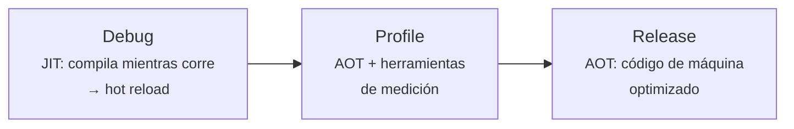
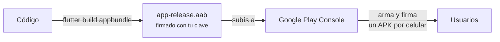

# Compilar para Android

!!! abstract "Objetivo"
    Pasar de "anda en mi emulador" a **un archivo que se instala en cualquier celular Android**: entender los modos de compilación (*debug*, *profile*, *release*), compilar un **APK** con la configuración de producción, instalarlo, versionarlo y saber qué falta para publicarlo en la tienda.

## Los tres modos

`flutter run` compila en modo **debug**, que está pensado para desarrollar, no para usar:

| | Debug | Profile | Release |
|---|---|---|---|
| Comando | `flutter run` | `flutter run --profile` | `flutter run --release` / `flutter build` |
| Hot reload | :material-check: | :material-close: | :material-close: |
| Depurador, `assert`, pantalla roja | :material-check: | :material-close: | :material-close: |
| Velocidad | **Lenta** (código interpretado) | Como release | **Rápida** (código de máquina) |
| DevTools de rendimiento | Parcial | :material-check: | :material-close: |
| Tamaño | Grande | Mediano | Chico |
| Para… | Escribir código | Medir rendimiento | Entregar |



!!! warning "No juzgues la velocidad en debug"
    En debug la app puede ir varias veces más lenta que la real. Medido en VigiaApp sobre un celular de gama media, deslizando el chat: el cuadro más lento (p99) tardaba **29,7 ms en debug** y **1,1 ms en profile**. Si algo "anda lento", probalo con `flutter run --profile` antes de preocuparte.

## Compilar el APK

Un **APK** es el archivo instalable de Android. Para VigiaApp, la versión que se entrega habla con el servidor de producción:

```bash
flutter build apk --release \
  --dart-define=API_URL=https://hotpink-aardvark-846933.hostingersite.com/api/v1 \
  --split-per-abi
```

| Parte | Qué hace |
|---|---|
| `build apk` | Compila un APK (en vez de correr la app). |
| `--release` | En modo release (es el valor por defecto de `build`, pero conviene escribirlo). |
| `--dart-define=API_URL=…` | La app habla con el servidor real ([Conectar la API real](2-api-real.md)). Sin esto, ¡la versión final usaría el servidor de mentira! |
| `--split-per-abi` | Un APK por tipo de procesador, más chico (ver abajo). |

La salida:

```text
✓ Built build/app/outputs/flutter-apk/app-armeabi-v7a-release.apk (…MB)
✓ Built build/app/outputs/flutter-apk/app-arm64-v8a-release.apk (…MB)
✓ Built build/app/outputs/flutter-apk/app-x86_64-release.apk (…MB)
```

(Al lado de cada uno, el tamaño. La primera compilación release tarda varios minutos.)

### ¿Qué es eso de ABI?

Los celulares tienen procesadores de distintas familias (**ABI**, *Application Binary Interface*). Como el código release es código de máquina, hay que compilarlo para cada una:

| ABI | Qué celulares |
|---|---|
| `arm64-v8a` | Casi todos los celulares de los últimos años. **El que vas a usar.** |
| `armeabi-v7a` | Celulares viejos de 32 bits. |
| `x86_64` | Emuladores en PC y algunas tablets. |

Sin `--split-per-abi`, sale **un** APK con los tres adentro (un "APK gordo", unas 3 veces más grande). Sirve si no sabés en qué celular se va a instalar.

### El número de emergencia

El botón "Llamar" de la alerta marca `*555` por seguridad ([capítulo 1](../5-construccion/01-esqueleto.md#paso-4-la-configuracion)). La versión **real** se compila con el número de verdad:

```bash
flutter build apk --release --split-per-abi \
  --dart-define=API_URL=https://hotpink-aardvark-846933.hostingersite.com/api/v1 \
  --dart-define=NUMERO_EMERGENCIA=911
```

!!! danger "Solo para la versión que se entrega"
    Nunca pruebes con `NUMERO_EMERGENCIA=911`: un toque de más y estás llamando a emergencias de verdad.

## Instalarlo

=== "Con el celular conectado"

    ```bash
    flutter install
    ```

    Instala el APK que corresponde al celular conectado.

=== "Con adb"

    ```bash
    adb install build/app/outputs/flutter-apk/app-arm64-v8a-release.apk
    ```

    `adb` (*Android Debug Bridge*) viene con el Android SDK.

=== "Sin cable"

    Mandá el `.apk` por correo, Drive o WhatsApp. En el celular, al abrirlo, Android pide permiso para "instalar apps de origen desconocido". (Así se reparte VigiaApp entre los vecinos: desde la sección *Releases* del repositorio.)

## La versión

En el `pubspec.yaml`:

```yaml
version: 1.3.0+5
```

- `1.3.0` es el **nombre** de la versión (`versionName`), el que ve el usuario. Sigue el [versionado semántico](../2-dart/10-librerias-y-paquetes.md#que-significa-160): MAYOR.MENOR.PARCHE.
- `+5` es el **número de compilación** (`versionCode`). Android lo usa para saber si una versión es más nueva que otra: **tiene que subir** en cada APK que se instala, o Android no deja actualizar.

Flutter los pasa solos a Android (`versionCode = flutter.versionCode` en `build.gradle.kts`).

## El nombre y el ícono

- **Nombre**: el que aparece debajo del ícono es el `android:label` del `AndroidManifest.xml` (`vigia_app` por defecto). Cambialo a `VigiaApp`.
- **Ícono**: está en `android/app/src/main/res/mipmap-*/ic_launcher.png`, en varios tamaños. A mano es tedioso; el paquete `flutter_launcher_icons` los genera desde una sola imagen.

## Firmar (para la tienda)

Android solo instala apps **firmadas** digitalmente. Por defecto, `flutter create` deja la versión release firmada con la **clave de debug**:

```kotlin title="android/app/build.gradle.kts (generado)"
buildTypes {
    release {
        // TODO: Add your own signing config for the release build.
        // Signing with the debug keys for now, so `flutter run --release` works.
        signingConfig = signingConfigs.getByName("debug")
    }
}
```

Para repartir el APK a mano alcanza. Para **Google Play** hace falta una clave propia:

1. Crear un almacén de claves (una vez, y **guardarlo bien**: si se pierde, no se puede actualizar más la app):

    ```bash
    keytool -genkey -v -keystore ~/vigia-release.jks -keyalg RSA \
      -keysize 2048 -validity 10000 -alias vigia
    ```

2. Crear `android/key.properties` (y agregarlo al `.gitignore`: **nunca** se sube):

    ```properties
    storePassword=…
    keyPassword=…
    keyAlias=vigia
    storeFile=/ruta/a/vigia-release.jks
    ```

3. Leerlo en `build.gradle.kts` y usarlo en `release` (la [guía oficial](https://docs.flutter.dev/deployment/android#signing-the-app) tiene el bloque exacto).
4. Para la tienda se sube un **App Bundle** en vez de APK: `flutter build appbundle --release …`. Google Play arma los APK por ABI.



## Otras opciones útiles

| Opción | Para qué |
|---|---|
| `--obfuscate --split-debug-info=build/simbolos` | Hace más difícil leer el código del APK. Guarda los símbolos para poder leer los errores después. |
| `--analyze-size` | Muestra qué ocupa lugar en la app. |
| `flutter build apk --debug` | Un APK de debug (con el banner DEBUG), para pasarle a alguien que pruebe. |

## Errores comunes

??? failure "La versión instalada no se conecta (\"Sin conexión con el servidor\")"
    - ¿Compilaste con `--dart-define=API_URL=…`? Sin eso usa el servidor falso… que sí "conecta". Si dice sin conexión, revisá la URL.
    - ¿Está el permiso `INTERNET` en el manifiesto principal ([Plugins y plataformas](../3-flutter/8-plugins-y-plataformas.md#el-manifiesto))? En debug Flutter lo agrega solo; en release no.

??? failure "`App not installed` / \"La app no se instaló\""
    Ya hay una versión instalada firmada con **otra** clave (por ejemplo, la de debug de otra compu). Desinstalá la anterior y volvé a instalar. O subiste un APK con el mismo o menor `versionCode`.

??? failure "El mapa sale gris en el APK"
    La clave de Google Maps está restringida a la huella SHA-1 de **tu** clave de debug. La clave de release tiene otra huella: hay que agregarla en la consola de Google Cloud ([capítulo 14](../5-construccion/14-sos-y-alerta.md)).

??? failure "`Execution failed for task ':app:minifyReleaseWithR8'`"
    El optimizador de Android (R8) no encuentra alguna clase que usa un plugin. Casi siempre se arregla actualizando los paquetes (`flutter pub upgrade`). Si no, buscá el nombre de la clase en el issue del plugin.

## Lo que aprendiste

- [x] **Debug** para desarrollar, **profile** para medir, **release** para entregar.
- [x] `flutter build apk --release --split-per-abi --dart-define=API_URL=…` arma la versión real.
- [x] `version: X.Y.Z+N`: el `+N` sube en cada APK.
- [x] Para la tienda: clave propia (que no se sube) y `flutter build appbundle`.

[Siguiente: Trabajo en equipo con Git :material-arrow-right:](8-trabajo-en-equipo.md){ .md-button .md-button--primary }
