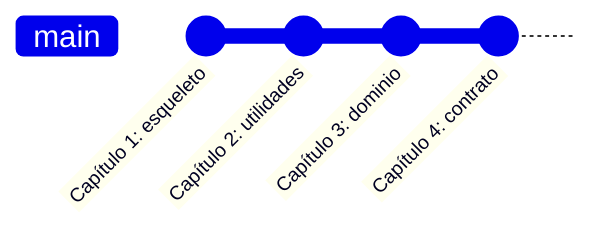
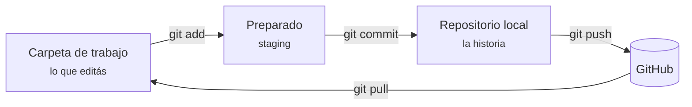
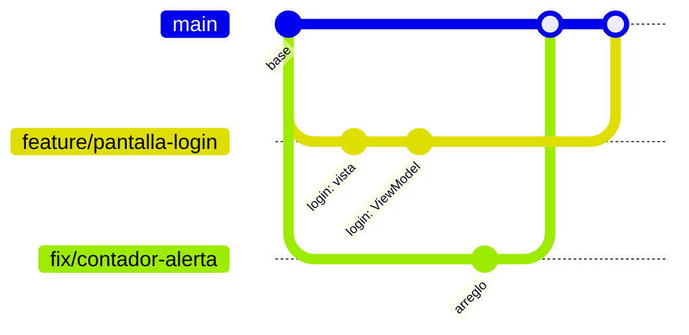
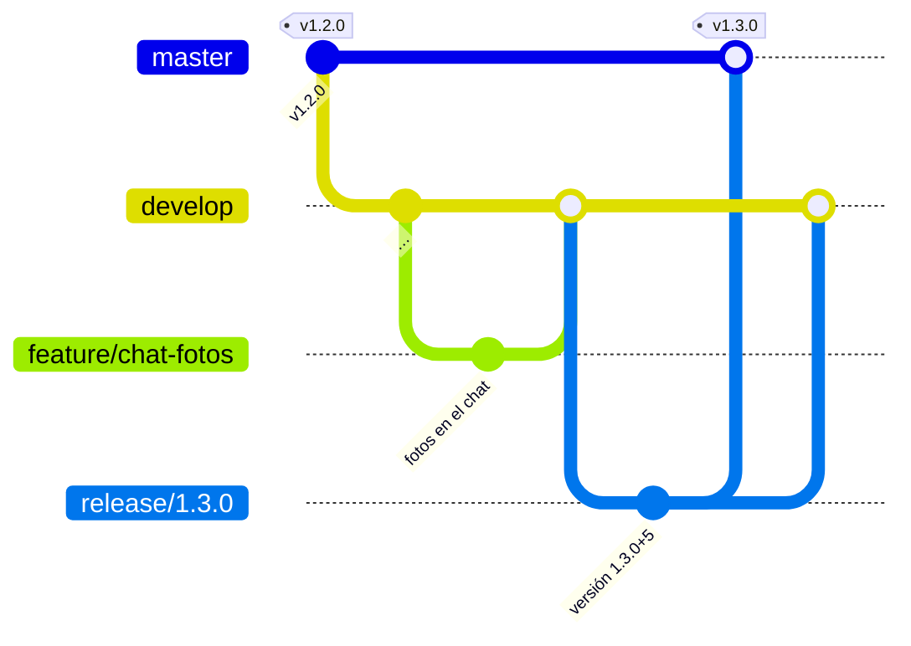
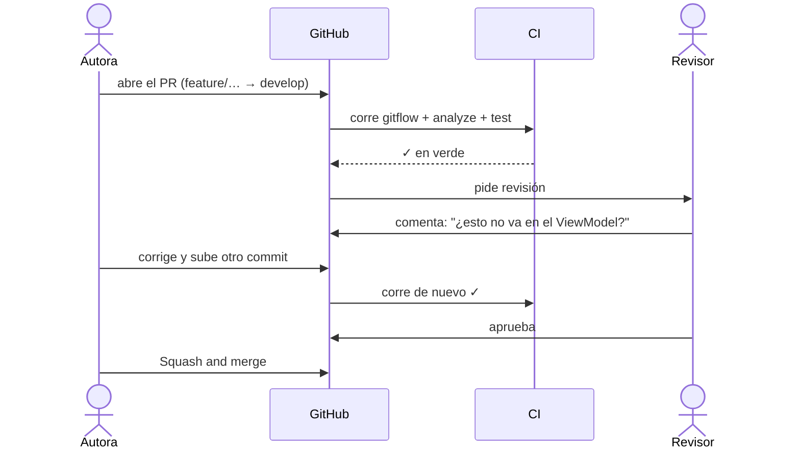
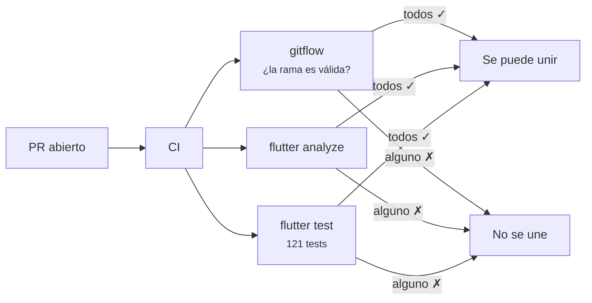

# Trabajo en equipo con Git

!!! abstract "Objetivo"
    Trabajar varias personas sobre el mismo código sin pisarse: los comandos de **Git** que se usan todos los días, **ramas** para cada cambio, el flujo **Gitflow** que usa el equipo de VigiaApp, **Pull Requests** con revisión, mensajes de commit con formato, y la **integración continua** (CI) que corre `flutter analyze` y `flutter test` en cada cambio.

## Git en cinco minutos

**Git** guarda la **historia** del código: cada **commit** es una foto del proyecto en un momento, con un mensaje que dice qué cambió. Con eso se puede volver atrás, ver quién cambió qué, y trabajar en paralelo.



Los comandos de todos los días:

| Comando | Qué hace |
|---|---|
| `git status` | Qué archivos cambiaste. |
| `git diff` | Qué cambiaste, línea por línea. |
| `git add archivo` / `git add .` | Elegir qué cambios van en el próximo commit. |
| `git commit -m "mensaje"` | Guardar la foto. |
| `git log --oneline` | La historia. |
| `git switch rama` | Cambiar de rama. |
| `git switch -c rama-nueva` | Crear una rama y pasarse. |
| `git pull` | Traer los cambios del repositorio remoto (GitHub). |
| `git push` | Mandar tus commits al remoto. |
| `git restore archivo` | Descartar los cambios sin guardar de un archivo. |



!!! tip "Qué no se sube"
    El `.gitignore` que genera `flutter create` ya excluye `build/`, `.dart_tool/` y otros. Además, en VigiaApp **nunca** se suben: `android/local.properties` (la clave de Google Maps), `android/key.properties` y el `.jks` (la firma). Si subís una clave por error, **cambiala**: aunque borres el archivo, queda en la historia.

## Ramas

Una **rama** es una línea de trabajo paralela. Cada cambio (una pantalla nueva, un arreglo) se hace en **su** rama, y cuando está listo se **une** (*merge*) a la principal.



Así, mientras alguien hace el login, otro puede arreglar un bug sin esperar ni romperle nada.

## Gitflow en VigiaApp

El equipo de VigiaApp usa **Gitflow**: dos ramas permanentes y ramas temporales con nombres que dicen qué son.

| Rama | Qué tiene | Cómo se escribe |
|---|---|---|
| `master` | Solo versiones publicadas, cada una con un *tag* `vX.Y.Z`. | Solo por PR desde `release/*` o `hotfix/*` |
| `develop` | Lo último que pasó revisión. | Solo por PR |
| `feature/…` | Una funcionalidad nueva. | Sale de `develop`, vuelve a `develop` |
| `fix/…` | Un bug no urgente. | Sale de `develop`, vuelve a `develop` |
| `docs/…`, `chore/…` | Documentación; configuración, CI, limpieza. | Sale de `develop`, vuelve a `develop` |
| `release/X.Y.Z` | Preparar una versión. | Sale de `develop`, va a `master` **y** a `develop` |
| `hotfix/X.Y.Z` | Un bug urgente en producción. | Sale de `master`, va a `master` **y** a `develop` |

**Nunca** se hace `push` directo a `master` ni a `develop`.



### Un cambio, paso a paso

```bash
git switch develop && git pull              # partir de lo último
git switch -c feature/pantalla-login        # una rama para el cambio
# … trabajo + commits …
flutter analyze && flutter test             # antes de subir, todo en verde
git push -u origin feature/pantalla-login   # subir la rama
gh pr create --base develop --fill          # abrir el Pull Request
```

## Pull Requests

Un **Pull Request** (PR) es un pedido de "uní mi rama a `develop`", con un lugar para que **otro integrante revise** el código antes.

Las reglas del equipo:

1. Cada PR tiene **una sola cosa** (una pantalla, un bug, un documento).
2. Para unirlo hace falta:
    - el **CI en verde** (ver abajo);
    - **una aprobación** de otro integrante. Nadie aprueba su propio PR.
3. Quien lo abrió lo une después de la aprobación, con **Squash and merge** (todos sus commits quedan como uno solo en `develop`).



!!! tip "Qué mirar al revisar un PR de VigiaApp"
    - ¿Cada cosa está en su capa? (Nada de `http` en una vista, nada de `BuildContext` en un ViewModel.)
    - ¿Se descarta todo lo que se abre? (`dispose`, `cancel`, `detener`.)
    - ¿Hay un `await` seguido de `context` sin `mounted`?
    - ¿Tiene tests lo nuevo?
    - ¿Los nombres dicen qué hacen?

## Mensajes de commit

El equipo usa **Conventional Commits**, en español: un prefijo que dice **qué tipo** de cambio es, y una descripción corta.

```text
feat: pantalla de login con email y contraseña
fix: el contador de vecinos no se reiniciaba
docs: actualizar especificación de la API
test: tests del RondinViewModel
refactor: extraer _TarjetaTurno
chore: actualizar dependencias
ci: cachear Flutter en el workflow
```

| Prefijo | Cuándo |
|---|---|
| `feat` | Funcionalidad nueva |
| `fix` | Arreglo de un bug |
| `docs` | Solo documentación |
| `test` | Solo tests |
| `refactor` | Cambio interno sin cambiar el comportamiento |
| `chore` | Mantenimiento (dependencias, configuración) |
| `ci` | La integración continua |

Con *squash*, el **título del PR** se vuelve el commit: tiene que respetar el mismo formato.

## Integración continua (CI)

La **integración continua** es un servidor que, en cada PR y en cada `push` a `develop` o `master`, **corre las verificaciones solo**. En VigiaApp es un *workflow* de **GitHub Actions**, en `.github/workflows/ci.yml`:

```yaml title=".github/workflows/ci.yml (el trabajo de Flutter)"
name: CI

on:
  pull_request:
    branches: [develop, master]
  push:
    branches: [develop, master]

jobs:
  flutter:
    name: flutter
    runs-on: ubuntu-latest  # (1)!
    steps:
      - uses: actions/checkout@v4  # (2)!
      - uses: subosito/flutter-action@v2  # (3)!
        with:
          channel: stable
          flutter-version: 3.44.x
          cache: true
      - run: flutter pub get
      - run: flutter analyze  # (4)!
      - run: flutter test  # (5)!
```

1. Una máquina Linux limpia, en los servidores de GitHub.
2. Baja el código del PR.
3. Instala Flutter (la misma versión que usa el equipo).
4. Si el analizador encuentra **cualquier** problema, el CI falla.
5. Si **un** test falla, el CI falla.

El *workflow* real tiene además un trabajo `gitflow` que rechaza el PR si la rama no respeta la tabla de arriba (por ejemplo, una `feature/…` que apunta a `master`).



Por esto **todos los capítulos de la wiki** terminan con `flutter analyze` sin avisos y `flutter test` en verde: es la misma vara que pone el CI.

## Versiones

- Versionado semántico en el `pubspec.yaml`: `version: MAYOR.MENOR.PARCHE+build` ([Compilar](7-compilar.md#la-version)).
- **MENOR** sube con funcionalidades nuevas (una versión por sprint); **PARCHE**, con un *hotfix*; **build**, en cada APK que se instala.
- La versión se cambia **solo** en una rama `release/*` o `hotfix/*`.
- Al unir a `master`, se marca con un *tag*:

    ```bash
    git tag -a v1.3.0 -m "Versión 1.3.0"
    git push origin v1.3.0
    ```

## Conflictos

Si dos personas cambian **las mismas líneas** en ramas distintas, Git no sabe cuál vale y marca un **conflicto**:

```dart
<<<<<<< HEAD
  late final _sondeo = Sondeo(const Duration(seconds: 10), cargarNuevos);
=======
  late final _sondeo = Sondeo(const Duration(seconds: 5), cargarNuevos);
>>>>>>> feature/chat-mas-rapido
```

Hay que **elegir** (o combinar), borrar las marcas, y hacer commit. VS Code muestra botones *Accept Current / Accept Incoming / Accept Both* arriba de cada conflicto.

!!! tip "Menos conflictos"
    - PRs **chicos** y frecuentes.
    - `git pull` de `develop` seguido en tu rama.
    - La arquitectura ayuda: como cada pantalla vive en su carpeta, dos personas trabajando en pantallas distintas casi nunca tocan el mismo archivo. Los que más chocan son los que conectan todo: `main.dart`, `dependencias.dart`, `rutas.dart`.

## Lo que aprendiste

- [x] Git guarda la historia en commits; las ramas permiten trabajar en paralelo.
- [x] **Gitflow**: `master` (versiones), `develop` (integración) y ramas `feature/`, `fix/`, `release/`, `hotfix/`.
- [x] Todo entra por **Pull Request**, con revisión y CI en verde.
- [x] Commits con formato (`feat:`, `fix:`…); versiones con *tags*.
- [x] El **CI** corre `flutter analyze` y `flutter test` en cada cambio.

!!! success "Terminaste la Parte 6"
    La app está completa, conectada al servidor real, con 121 tests, compilada y lista para trabajar en equipo. La Parte 7 queda para consultar cuando la necesites.

[Siguiente: Parte 7, Referencia :material-arrow-right:](../7-referencia/index.md){ .md-button .md-button--primary }
