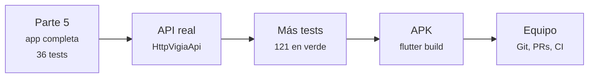

# 6. Pruebas y entrega

Al terminar la Parte 5 tenés la app completa, andando con el servidor de mentira y con 36 tests. Esta parte la **cierra**: la conecta con el **servidor real**, le suma los tests que faltan (hasta llegar a **121**), la **compila** para instalarla en un celular y explica cómo **trabajar en equipo** sobre el mismo código.

!!! abstract "Al terminar esta parte vas a poder"
    - Elegir **qué tipo de test** escribir para cada cosa.
    - Conectar la app al **servidor real** con `HttpVigiaApi` y `--dart-define`.
    - Escribir **tests de ViewModels**, de **widgets**, de **caracterización** y del **cliente HTTP** sin servidor.
    - **Compilar** un APK de *release* e instalarlo.
    - Trabajar con **Git** en equipo: ramas, Pull Requests e integración continua.

## Las páginas

| Página | Archivos | Tests al final |
|---|---|---|
| [1. Estrategia de pruebas](1-estrategia.md) | — | 36 |
| [2. Conectar la API real](2-api-real.md) | `pubspec.yaml`, `http_vigia_api.dart`, `main.dart` | 36 |
| [3. Tests de ViewModels](3-tests-de-view-models.md) | `ayudantes.dart`, `view_models_test.dart` | 48 |
| [4. Tests de widgets](4-tests-de-widgets.md) | `widget_test.dart` | 83 |
| [5. Tests de caracterización](5-tests-de-caracterizacion.md) | `caracterizacion_test.dart` | 96 |
| [6. Tests del cliente HTTP](6-tests-del-cliente-http.md) | `api_test.dart` | **121** |
| [7. Compilar para Android](7-compilar.md) | — | |
| [8. Trabajo en equipo con Git](8-trabajo-en-equipo.md) | — | |

!!! success "El código de esta parte también está verificado"
    Con todos los archivos de las Partes 5 y 6, `flutter analyze` dice `No issues found!` y `flutter test` termina con `+121: All tests passed!`.

[Empezar: Estrategia de pruebas :material-arrow-right:](1-estrategia.md){ .md-button .md-button--primary }
