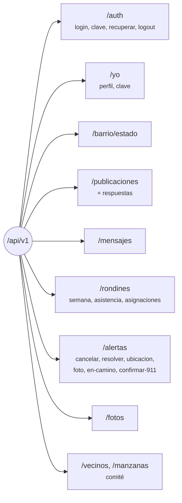

# Contrato de la API

Todo lo que la app le puede pedir al servidor **vigia_api**, sacado de su especificación OpenAPI (versión 1.3.0), con el método de [`VigiaApi`](../5-construccion/04-contrato-api.md) que lo hace.

## Lo general

| | |
|---|---|
| **URL base** | `https://hotpink-aardvark-846933.hostingersite.com/api/v1` (producción) · `http://localhost:3000/api/v1` (local; desde el emulador, `http://10.0.2.2:3000/api/v1`) |
| **Formato** | JSON en UTF-8, salvo las fotos (bytes de la imagen) |
| **Autenticación** | `Authorization: Bearer <token>` en todas las rutas salvo `/auth/login`, `/auth/clave` y `/auth/recuperar` |
| **Token** | 64 caracteres hexadecimales; lo devuelven `/auth/login` y `/auth/clave`; vale **24 horas** |
| **Fechas** | Con hora: ISO 8601 en UTC (`2026-11-16T23:41:07.000Z`). Solo día: `AAAA-MM-DD` |
| **Nombres** | Las claves del JSON van en `snake_case` (`creado_en`, `foto_id`); en Dart, en `camelCase` |

### Errores

Toda respuesta que no sea 2xx trae:

```json
{ "error": { "codigo": "no_autorizado", "mensaje": "Sesión vencida. Volvé a iniciar sesión." } }
```

| HTTP | `codigo` | Cuándo |
|---|---|---|
| 400 | `datos_invalidos` | Falta un campo o tiene formato incorrecto (incluye JSON mal formado) |
| 401 | `no_autorizado` | Token ausente, inválido o vencido, o credenciales incorrectas en el login |
| 403 | `prohibido` | La acción es solo del comité o del autor |
| 404 | `no_encontrado` | El recurso no existe, o el vecino no está asignado o avisado |
| 409 | `conflicto` | El estado actual no lo permite (p. ej. cancelar una alerta que ya no está activa) |
| 429 | `demasiados_intentos` | Más de 20 pedidos a `/auth/*` en 15 minutos desde la misma IP |
| 500 | `error_interno` | Error no controlado (queda en el log, sin detalles al cliente) |

La app convierte cualquier respuesta que no sea 2xx en `ApiException(mensaje, codigo: HTTP)`. Un 401 con sesión iniciada cierra la sesión y vuelve al Login ([Los errores, de punta a punta](../4-arquitectura/7-errores.md)).

## Las rutas



### Sesión y perfil

| Método y ruta | Quién | Qué hace | Responde | `VigiaApi` |
|---|---|---|---|---|
| `POST /auth/login` | Público | Inicia sesión con `{email, password}` | `Sesion` | `login` |
| `POST /auth/clave` | Público | Elige contraseña con `{token, password}` del enlace del correo | `Sesion` | `elegirClave` |
| `POST /auth/recuperar` | Público | Manda el correo para restablecer `{email}` (responde igual exista o no) | 204 | `recuperarClave` |
| `POST /auth/logout` | Sesión | Cierra la sesión actual | 204 | `logout` |
| `GET /yo` | Sesión | El vecino de la sesión | `Perfil` | `obtenerPerfil` |
| `POST /yo/clave` | Sesión | Cambia la contraseña `{actual, nueva}` | 204 | `cambiarClave` |

### Inicio, publicaciones y chat

| Método y ruta | Quién | Qué hace | Responde | `VigiaApi` |
|---|---|---|---|---|
| `GET /barrio/estado` | Sesión | Vecinos en línea | `EstadoBarrio` | `obtenerEstadoBarrio` |
| `GET /publicaciones?tipo=actividad` | Sesión | Feed de actividad | `[Publicacion]` | `obtenerActividad` |
| `GET /publicaciones?tipo=noticia[&etiqueta=…]` | Sesión | Noticias del comité | `[Publicacion]` | `obtenerNoticias` |
| `POST /publicaciones` | Sesión (noticia: comité) | Publica `{tipo, titulo, cuerpo?, etiqueta?, firma?, foto_id?}` | 201 `Publicacion` | `publicar` |
| `GET /publicaciones/{id}` | Sesión | Una publicación con su cuerpo | `PublicacionDetalle` | `obtenerPublicacion` |
| `DELETE /publicaciones/{id}` | Autor o comité | Borra | 204 | `borrarPublicacion` |
| `GET /publicaciones/{id}/respuestas` | Sesión | Respuestas (hasta 200, de la más vieja a la más nueva) | `[Respuesta]` | `obtenerRespuestas` |
| `POST /publicaciones/{id}/respuestas` | Sesión | Responde `{texto}` | 201 `Respuesta` | `responder` |
| `GET /mensajes[?despues=id]` | Sesión | Chat: los últimos 50, o hasta 50 posteriores a `id` | `[Mensaje]` | `obtenerMensajes` |
| `POST /mensajes` | Sesión | Manda `{texto?, foto_id?}` (al menos uno) | 201 `Mensaje` | `enviarMensaje` |

### Rondines

| Método y ruta | Quién | Qué hace | Responde | `VigiaApi` |
|---|---|---|---|---|
| `GET /rondines/semana[?desde=AAAA-MM-DD]` | Sesión | Grilla de la semana (sin `desde`: la actual) | `[Turno]` | `obtenerSemanaRondin` |
| `POST /rondines/{id}/asistencia` | Asignado | "Me presento" / "No me presento" `{presente}` | `Turno` | `responderAsistencia` |
| `POST /rondines` | Comité | Crea un turno `{fecha, ruta, hora_inicio?, hora_fin?, vecino_ids[]}` (uno por fecha; si ya hay, 409) | 201 `Turno` | `crearTurno` |
| `DELETE /rondines/{id}` | Comité | Borra un turno | 204 | `borrarTurno` |
| `GET /rondines/{id}/asignaciones` | Comité | Quiénes hacen el turno y qué respondieron | `[Asignacion]` | `obtenerAsignaciones` |
| `PUT /rondines/{id}/asignaciones` | Comité | Reasigna `{vecino_ids[]}` | `[Asignacion]` | `reasignarTurno` |

### Alertas

| Método y ruta | Quién | Qué hace | Responde | `VigiaApi` |
|---|---|---|---|---|
| `GET /alertas[?estado=activa]` | Sesión | Alertas del barrio (por defecto, las activas) | `[EstadoAlerta]` | `obtenerAlertas` |
| `POST /alertas` | Sesión | Dispara el SOS `{lat?, lng?}` | 201 (o 200 si ya tenía una activa) | `crearAlerta` |
| `GET /alertas/{id}` | Sesión | El estado completo (la app lo consulta cada 2 s) | `EstadoAlerta` | `obtenerAlerta` |
| `POST /alertas/{id}/cancelar` | Quien la disparó | Falsa alarma | `AlertaCerrada` · 409 si no está activa | `cancelarAlerta` |
| `POST /alertas/{id}/resolver` | Quien la disparó o comité | La emergencia terminó | `AlertaCerrada` · 409 si no está activa | `resolverAlerta` |
| `POST /alertas/{id}/ubicacion` | Quien la disparó o un vecino en camino | Ubicación en vivo `{lat, lng}` | 204 | `enviarUbicacion` |
| `POST /alertas/{id}/foto` | Quien la disparó | Agrega una foto `{foto_id}` | `EstadoAlerta` | `adjuntarFotoAlerta` |
| `POST /alertas/{id}/en-camino` | Vecino avisado | "Voy en camino" o "ya no voy" `{en_camino}` | `EstadoAlerta` · 409 si no está activa | `marcarEnCamino` |
| `POST /alertas/{id}/confirmar-911` | Comité | La central 911 tomó el aviso | `EstadoAlerta` · 409 si no está activa | `confirmar911` |

### Fotos

| Método y ruta | Quién | Qué hace | Responde | `VigiaApi` |
|---|---|---|---|---|
| `POST /fotos` | Sesión | Sube los **bytes** de la imagen, con su `Content-Type` (`image/jpeg`…) | 201 `{id}` | `subirFoto` |
| `GET /fotos/{id}` | Sesión | Baja los **bytes** de la imagen | La imagen | `obtenerFoto` |

### Comité

| Método y ruta | Quién | Qué hace | Responde | `VigiaApi` |
|---|---|---|---|---|
| `GET /manzanas` | Sesión | Manzanas del barrio | `[Manzana]` | `obtenerManzanas` |
| `POST /manzanas` | Comité | Crea una manzana `{nombre}` | 201 `Manzana` | `crearManzana` |
| `GET /vecinos` | Comité | Todos los vecinos (activos e inactivos) | `[VecinoAdmin]` | `obtenerVecinos` |
| `POST /vecinos` | Comité | Alta + invitación por correo `{nombre, apellido, email, telefono?, manzana_id, rol?}` (email o teléfono repetido: 409) | 201 `VecinoAdmin` | `crearVecino` |
| `PATCH /vecinos/{id}` | Comité | Edita `nombre`, `apellido`, `telefono`, `manzana_id`, `rol` o `activo` (no se puede cambiar el propio rol ni desactivarse: 409) | `VecinoAdmin` | `editarVecino` |
| `POST /vecinos/{id}/invitacion` | Comité | Reenvía la invitación (si ya la activó: 409) | 204 | `reenviarInvitacion` |

### Salud (fuera de `/api/v1`)

| Ruta | Para qué |
|---|---|
| `GET /health` | ¿El proceso está vivo? (No toca la base.) |
| `GET /health/ready` | ¿Llega a la base? 503 si la base está caída. |

La app no las usa; sirven para probar a mano que el servidor anda.

## Los objetos

Los nombres de la izquierda son los del servidor; a la derecha, la clase de Dart que lo lee ([capítulo 3](../5-construccion/03-dominio.md)).

=== "Sesion → Sesion"

    ```json
    {
      "token": "3f9a…(64 hex)",
      "expira_en": "2026-11-17T23:41:07.000Z",
      "vecino": { "id": 1, "nombre": "María Ríos", "manzana": "Manzana 4", "rol": "vigia" }
    }
    ```

    `rol`: `vecino`, `vigia` o `comite`.

=== "Perfil → Perfil"

    ```json
    {
      "id": 1, "nombre": "María", "apellido": "Ríos",
      "email": "maria@vigia.test", "telefono": "+5491100000001",
      "manzana_id": 4, "manzana": "Manzana 4", "rol": "vigia"
    }
    ```

=== "Publicacion → Publicacion / Noticia"

    ```json
    {
      "id": 12, "tipo": "actividad", "titulo": "Cierre de la calle Juárez por obra",
      "etiqueta": null, "foto_id": null,
      "autor": "Jorge L.", "iniciales": "JL", "autor_id": 3,
      "creado_en": "2026-11-16T11:35:00.000Z", "respuestas": 2
    }
    ```

    `tipo`: `actividad` o `noticia`. `etiqueta` (solo noticias): `obras`, `seguridad`, `alumbrado` o `convivencia`. El detalle (`GET /publicaciones/{id}`) agrega `cuerpo`.

=== "Mensaje → Mensaje"

    ```json
    {
      "id": 58, "texto": "¿Alguien vio un perro marrón?", "foto_id": null,
      "autor": "María R.", "iniciales": "MR", "autor_id": 1,
      "creado_en": "2026-11-16T23:41:07.000Z"
    }
    ```

=== "Turno → TurnoRondin"

    ```json
    {
      "id": 102, "fecha": "2026-11-19", "hora_inicio": "22:00", "hora_fin": "02:00",
      "ruta": "Morelos → Juárez", "pareja": ["María R.", "Tomás R."],
      "mi_estado": "confirmado"
    }
    ```

    `mi_estado`: `pendiente`, `confirmado`, `ausente`, o `null` si el vecino no está en ese turno. `hora_fin` puede ser del día siguiente.

=== "EstadoAlerta → EstadoAlerta"

    ```json
    {
      "id": 7, "estado": "activa", "central_911_confirmada": false,
      "vecinos_avisados": 8, "en_camino": 1, "mi_respuesta": null,
      "lat": -34.6037, "lng": -58.3816, "ubicacion_en": "2026-11-16T23:40:00.000Z",
      "foto_id": null, "creada_en": "2026-11-16T23:39:12.000Z", "cerrada_en": null,
      "vecino": { "id": 3, "nombre": "Jorge López", "manzana": "Manzana 2" },
      "en_camino_ubicaciones": [
        { "vecino_id": 4, "nombre": "Ana Castro", "lat": -34.6049, "lng": -58.3834,
          "actualizado_en": "2026-11-16T23:40:30.000Z" }
      ]
    }
    ```

    `estado`: `activa`, `cancelada` o `resuelta`. `en_camino_ubicaciones` solo viene en el detalle y en las respuestas de las acciones, no en el listado.

=== "Asignacion → Asignacion"

    ```json
    { "vecino_id": 1, "nombre": "María Ríos", "estado": "confirmado", "respondido_en": "2026-11-16T20:00:00.000Z" }
    ```

!!! info "Si el servidor cambia"
    La fuente de verdad es la especificación OpenAPI del repositorio `vigia_api` (`docs/openapi.yaml`). Si una ruta cambia, hay que actualizar **tres** lugares de la app: `HttpVigiaApi` (el pedido), `FakeVigiaApi` (para que el servidor de mentira responda igual) y, si cambia la forma del JSON, el `fromJson` del modelo. Los tests de [`api_test.dart`](../6-pruebas-y-entrega/6-tests-del-cliente-http.md) ayudan a no olvidarse ninguno.
