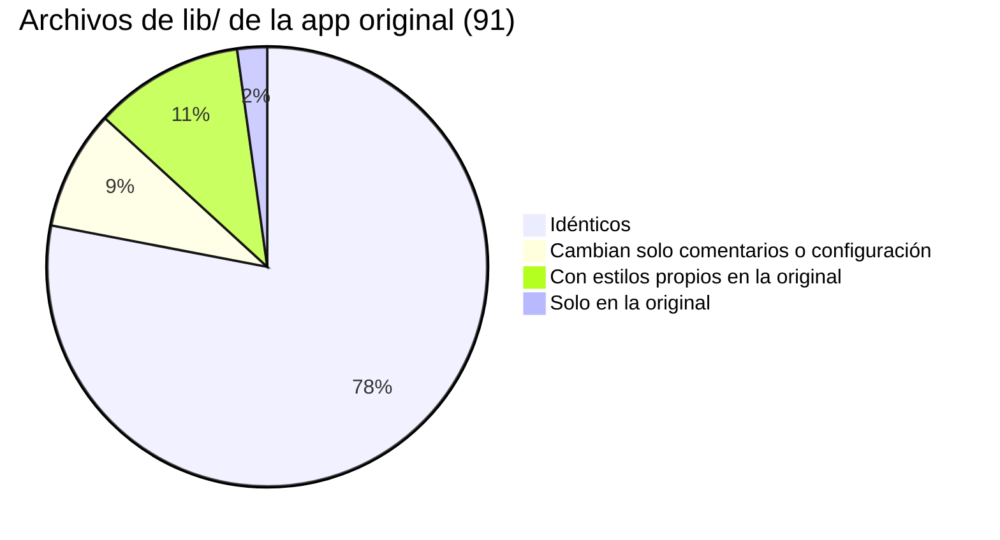

# Diferencias con la app real

La VigiaApp de la wiki **es** la VigiaApp original en todo lo que importa: la misma arquitectura, las mismas carpetas y nombres de archivo, los mismos ViewModels, repositorios, modelos, servidor falso y cliente HTTP, y los mismos tests de comportamiento. Esta página lista **lo que cambia** y **por qué**, para que puedas pasar de una a la otra sin perderte.



## Lo que se dejó afuera

### Estilos propios

La wiki usa **solo Material** con un color semilla (`ThemeData(colorSchemeSeed: Colors.indigo)`). La original tiene un **tema propio** y más trabajo visual:

| En la app original | Para qué | En la wiki |
|---|---|---|
| `lib/ui/core/tema.dart` | Paleta "Ronda nocturna" (azul noche, grises fríos, rojo solo para emergencias) y la fuente Public Sans | No existe: `ThemeData(colorSchemeSeed: …)` en `main.dart` |
| `lib/ui/alerta/widgets/parpadeo.dart` | El indicador que titila en la alerta activa | No existe |
| Fuentes en `assets/fonts/` (Public Sans, Archivo) | Tipografía propia | La del sistema |
| `assets/mapa/` | Puntos propios para el mapa | Los marcadores estándar de Google Maps |
| `flutter_launcher_icons` y `assets/icono/` | El ícono de la app | El ícono por defecto de Flutter |
| Versiones más elaboradas de `barra_inferior`, `modo_emergencia_screen`, `mapa_alerta`, `pantalla_alerta`, `pantalla_carga`, `burbuja_mensaje`, `estado_red`… | Formas, sombras, colores, animaciones | Los mismos archivos, con widgets de Material sin decorar |

Estos archivos de la original tienen **la misma estructura** (reciben los mismos datos, llaman a los mismos métodos del ViewModel): solo cambia **cómo se ven**. Si querés agregar estilos, son el lugar.

!!! tip "Cómo agregar un tema propio"
    1. Creá `lib/ui/core/tema.dart` con un `ThemeData` (colores con `ColorScheme`, tipografía con `TextTheme`).
    2. En `main.dart`, cambiá `theme: ThemeData(colorSchemeSeed: …)` por `theme: temaVigia`.
    3. En las pantallas, tomá siempre los colores de `Theme.of(context).colorScheme`: así el cambio se aplica en todos lados.

### Otras plataformas

La original también compila para **Linux** y **macOS** (para probar rápido en la compu), y por eso `AlmacenToken` tiene una opción especial para el llavero de macOS. La wiki apunta solo a **Android** (y deja iOS configurado).

### Herramientas del proyecto

| En el repositorio original | Qué es |
|---|---|
| `test/api_real_test.dart` | Tests contra la API **local** con el *seed* (crean y borran datos: nunca contra producción) |
| `.github/workflows/ci.yml` | La integración continua ([Trabajo en equipo](../6-pruebas-y-entrega/8-trabajo-en-equipo.md#integracion-continua-ci)) |
| `CONTRIBUTING.md` | Las reglas de Gitflow del equipo |
| `docs/` | El manual del proyecto, la especificación de la API y la base, el prototipo |
| `tools/manual/` | Scripts que generan el manual en PDF |

## Lo que cambia de comportamiento

### La API por defecto

| | App original | Wiki |
|---|---|---|
| `flutter run` sin nada | Servidor de **producción** | Servidor **falso** (`'fake'`) |
| Para el otro | `--dart-define=API_URL=fake` | `--dart-define=API_URL=https://…` |

```dart title="lib/config.dart"
// Original
const apiUrl = String.fromEnvironment('API_URL', defaultValue: apiProduccion);

// Wiki
const apiUrl = String.fromEnvironment('API_URL', defaultValue: 'fake');
```

En la wiki, el servidor falso es el punto de partida porque así se puede hacer toda la Parte 5 sin servidor ni usuario. En la original, la app que se instala tiene que hablar con el servidor real sin parámetros extra.

### La versión

La original está en la versión `1.3.0+4`; la de la wiki empieza en `1.0.0+1`.

## Lo que es igual

Todo lo demás. En particular:

- Las **capas** y la **estructura de carpetas** ([Parte 4](../4-arquitectura/4-estructura-de-carpetas.md)).
- **Todos** los modelos, repositorios, servicios y ViewModels.
- `VigiaApi`, `FakeVigiaApi` (con los mismos vecinos de ejemplo) y `HttpVigiaApi`.
- `main.dart`, `dependencias.dart` y `rutas.dart` (salvo el tema).
- Los tests de la [Parte 6](../6-pruebas-y-entrega/index.md): `view_models_test.dart`, `caracterizacion_test.dart`, `api_test.dart` y `ayudantes.dart` son **idénticos**. `widget_test.dart` cambia en cuatro tests que miraban detalles visuales de la original (el texto "DESLIZÁ HACIA ARRIBA", el halo que late en el mapa, la pantalla de carga azul). La wiki agrega además un archivo de tests chico por capítulo.

Por eso, si entendés la de la wiki, podés abrir la original y encontrar todo en el mismo lugar: el [Mapa de archivos](mapa-de-archivos.md) sirve para las dos.
