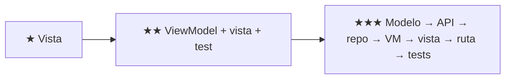

# Ejercicios

Mejoras y funcionalidades nuevas para practicar **sobre la app terminada**. Están ordenadas por dificultad, y cada una dice **qué capas toca**, da **pistas** y explica **cómo saber que está bien**. Hacé cada una en su rama (`git switch -c feature/…`) y terminá siempre con `flutter analyze` y `flutter test` en verde.

| Nivel | Qué practica |
|---|---|
| ★ | Una sola capa, pocas líneas |
| ★★ | Dos o tres capas, un test nuevo |
| ★★★ | Una funcionalidad completa, de punta a punta |

## ★ Para empezar

### 1. Contador en la pestaña Chat

**Objetivo**: que la pestaña **Chat** de la barra inferior muestre un `Badge` con la cantidad de mensajes que llegaron mientras el vecino miraba la Actividad.

**Capas**: vista (`BarraInferior`) y ViewModel (`ChatViewModel` o `InicioViewModel`).

??? tip "Pistas"
    - El `ChatViewModel` sabe cuántos mensajes tiene; el `InicioViewModel` sabe qué pestaña se ve (`verChat`).
    - Guardá cuántos había la última vez que se vio el chat; la diferencia es el número.
    - `NavigationDestination(icon: Badge(isLabelVisible: n > 0, label: Text('$n'), child: Icon(…)))`.
    - Ojo: el sondeo del chat solo corre mientras la pestaña está a la vista. ¿Hay que cambiar eso?

**Cómo saber que está bien**: un test de ViewModel que agregue un mensaje con la pestaña Actividad elegida y compruebe el contador; y que al volver al chat, vuelva a 0.

### 2. El rol como enum

**Objetivo**: cambiar el `String rol` de `VecinoSesion` y `Perfil` por un `enum Rol { vecino, vigia, comite }` con un campo `nombre` ("Vecino", "Vigía", "Comité"), como el ejemplo de [enums con datos](../2-dart/7-enums-records-patrones.md#enums-con-datos).

**Capas**: dominio (y todo lo que use `rol`).

??? tip "Pistas"
    - En `fromJson`: `Rol.values.byName(json['rol'] as String)`.
    - ¿Qué pasa si el servidor manda un rol que no existe? `byName` lanza un error. Decidí: ¿un valor por defecto?
    - `esComite` pasa a ser `rol == Rol.comite`.
    - El analizador te va a marcar **cada** lugar que usaba el texto. Esa es la gracia.

**Cómo saber que está bien**: `modelos_test.dart` y todos los demás tests siguen en verde.

### 3. "Deshacer" al borrar

**Objetivo**: al deslizar una publicación propia para borrarla, mostrar un SnackBar con un botón **Deshacer** durante unos segundos antes de borrarla de verdad en el servidor.

**Capas**: vista (`ListaActividad`) y ViewModel (`InicioViewModel`).

??? tip "Pistas"
    - `SnackBar(content: …, action: SnackBarAction(label: 'Deshacer', onPressed: …))`.
    - `showSnackBar(...)` devuelve un controlador con `.closed`, un `Future` que dice **por qué** se cerró (`SnackBarClosedReason.action` si tocaron Deshacer).
    - El ViewModel necesita "ocultar" la publicación de la lista sin borrarla, y después "confirmar" o "restaurar".

### 4. Saludo según la hora

**Objetivo**: que el Inicio diga "Buen día, María", "Buenas tardes, María" o "Buenas noches, María".

**Capas**: utilidades (una función pura en `fechas.dart`) y vista.

??? tip "Pistas"
    - Escribí `String saludo(String nombre, {DateTime? ahora})`: recibir `ahora` la hace fácil de probar ([como `haceCuanto`](../6-pruebas-y-entrega/1-estrategia.md#la-sintaxis)).
    - Tres tests en `utils_test.dart`, uno por franja.

## ★★ Para afianzar

### 5. Buscar vecinos en el comité

**Objetivo**: un campo de búsqueda arriba de la lista de vecinos del comité que filtre por nombre o email mientras se escribe.

**Capas**: ViewModel (`ComiteVecinosViewModel`) y vista (`ComiteVecinosScreen`).

??? tip "Pistas"
    - El filtro va en el ViewModel: un campo `_busqueda`, un método `buscar(String texto)` y un getter que devuelve la lista filtrada.
    - Comparar sin mayúsculas ni tildes: `toLowerCase()` alcanza para empezar.
    - En la vista, `TextField(onChanged: _viewModel.buscar)`.

**Cómo saber que está bien**: un test de ViewModel con `FakeVigiaApi` que busque "lau" y encuentre solo a Laura.

### 6. Modo oscuro

**Objetivo**: que la app siga el tema oscuro del sistema.

**Capas**: `main.dart`.

??? tip "Pistas"
    - `MaterialApp` tiene `darkTheme:` y `themeMode:`.
    - `ThemeData(colorSchemeSeed: Colors.indigo, brightness: Brightness.dark)`.
    - Recorré las pantallas: ¿algún color quedó fijo (`Colors.white`) en vez de salir de `Theme.of(context).colorScheme`? Ese es el aprendizaje.

### 7. Filtrar la actividad

**Objetivo**: chips arriba de la Actividad para ver "Todo", "Con foto" o "Mías".

**Capas**: ViewModel (`InicioViewModel`) y vista (`ListaActividad`).

??? tip "Pistas"
    - Un `enum FiltroActividad { todo, conFoto, mias }` en el ViewModel.
    - "Mías" usa el `id` del vecino de la sesión (ya lo tiene el ViewModel).
    - `ChoiceChip` para elegir uno ([Chips](../3-flutter/4-material.md#chips)).

### 8. Un test de caracterización nuevo

**Objetivo**: escribir un test que fije qué pasa cuando el vecino intenta **publicar sin título**.

**Capas**: tests.

??? tip "Pistas"
    - Arrancá la app con `crearApp()`, andá a la Actividad, abrí "Nueva publicación" y tocá "Publicar" sin escribir.
    - ¿Qué se ve? ¿Un error en el campo? ¿Se llamó al servidor? Anotalo en `expect`s.
    - Primero mirá la app andando, después escribí el test. [Caracterización](../6-pruebas-y-entrega/5-tests-de-caracterizacion.md)

## ★★★ Funcionalidades completas

### 9. Contactos útiles

**Objetivo**: una pantalla nueva, en el menú lateral, con teléfonos útiles del barrio (comisaría, bomberos, centro de salud), que se puedan llamar con un toque.

**Capas**: todas. Es el ejemplo de [¿Dónde va un archivo nuevo?](../4-arquitectura/4-estructura-de-carpetas.md#donde-va-un-archivo-nuevo).

??? tip "Pasos"
    1. `domain/models/contacto.dart`: `Contacto { id, nombre, telefono }` con `fromJson`.
    2. `VigiaApi.obtenerContactos()`; en `FakeVigiaApi`, una lista fija; en `HttpVigiaApi`, `GET /contactos` (el servidor no lo tiene: dejalo listo para cuando exista).
    3. `data/repositories/contactos_repository.dart`.
    4. Crearlo en `main.dart` y agregarlo a `Dependencias`.
    5. `ui/contactos/view_model/contactos_view_model.dart` (patrón **cargar**).
    6. `ui/contactos/widgets/contactos_screen.dart` con `ListTile`s; al tocar, llamar con `LanzadorExterno` (agregale un método `llamar(String numero)`).
    7. `Rutas.contactos(context)`.
    8. Una opción en `MenuLateral`.
    9. `test/contactos_view_model_test.dart`.

**Cómo saber que está bien**: los tests nuevos y los 121 de antes en verde; y en la app, el menú abre la pantalla.

### 10. Noticias sin conexión

**Objetivo**: si no hay red, mostrar las últimas noticias que se cargaron (con un aviso "Sin conexión: mostrando las guardadas").

**Capas**: repositorio (`PublicacionesRepository`) y ViewModel (`NoticiasViewModel`).

??? tip "Pistas"
    - Empezá guardando en **memoria** (un campo en el repositorio). Es el mismo patrón que la memoria de fotos de `FotosRepository`.
    - El repositorio decide: si la API falla y hay guardadas, las devuelve… pero ¿cómo se entera el ViewModel de que son viejas? Opciones: un record `(noticias, actualizadas)`, o un getter en el repositorio.
    - Para que sobreviva a cerrar la app, el paso siguiente es guardarlas en el celular (paquete `shared_preferences` o un archivo), envuelto en un servicio nuevo.

### 11. Reaccionar a un mensaje

**Objetivo**: mantener apretado un mensaje del chat para ponerle un 👍. (El servidor real no lo soporta: hacelo con el servidor falso, como si existiera `POST /mensajes/{id}/reaccion`.)

**Capas**: todas, empezando por el contrato.

??? tip "Pistas"
    - Primero el **contrato**: ¿qué devuelve? ¿El mensaje actualizado? Agregá `reacciones` a `Mensaje` (y a su `fromJson`, con un valor por defecto para el JSON viejo).
    - `FakeVigiaApi` guarda las reacciones en el mapa del mensaje.
    - El sondeo del chat trae solo mensajes **nuevos** (`?despues=`): ¿cómo se entera un vecino de que otro reaccionó a un mensaje viejo? Pensá la respuesta antes de programar: es un problema de diseño real.

### 12. Pantalla de estadísticas del comité

**Objetivo**: una pantalla solo para el comité con: cuántos vecinos hay por manzana, cuántos turnos de rondín se cubrieron en la semana y cuántas alertas hubo.

**Capas**: ViewModel (combina varios repositorios) y vista.

??? tip "Pistas"
    - El ViewModel recibe `ComiteRepository`, `RondinesRepository` y `AlertasRepository`, y hace los pedidos con `Future.wait` ([a la vez](../2-dart/8-asincronia-future.md#esperar-varias-cosas-a-la-vez)).
    - Los cálculos (agrupar por manzana, contar) son funciones puras: probalas aparte.
    - Para dibujar barras sin paquetes: un `Row` con `Expanded(flex: cantidad, child: Container(color: …))`.

## Para seguir aprendiendo

- La [guía de arquitectura de Flutter](https://docs.flutter.dev/app-architecture), que sigue VigiaApp, tiene un ejemplo completo (*Compass app*) con las mismas capas.
- La [documentación de Dart](https://dart.dev/language) explica cada característica del lenguaje con más detalle.
- El [catálogo de widgets](https://docs.flutter.dev/ui/widgets) muestra todos los widgets de Material con ejemplos.
- [pub.dev](https://pub.dev) para buscar paquetes (y leer su código: es una gran forma de aprender).
