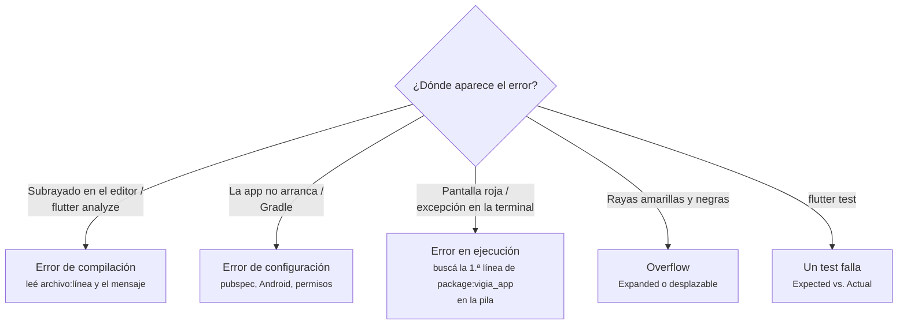

# Errores frecuentes

Los mensajes de error que más aparecen al hacer VigiaApp (y cualquier app de Flutter), **qué significan** y **cómo salir**. Usá ++ctrl+f++ con un pedazo del mensaje.

## Antes de buscar

Cómo leer cada tipo: [Correr, recargar y leer errores](../1-preparacion/4-correr-y-depurar.md#leer-un-error).

## Los más comunes, explicados

### Null y tipos

??? failure "`Null check operator used on a null value`"
    Un `!` sobre algo que **era** `null`. Buscá en la pila la línea con el `!` de tu código. Preguntate por qué estabas seguro de que no era null: casi siempre es un orden distinto al esperado (se usó antes de cargar). Arreglos: un `if (x != null)`, un `??`, o un patrón `if (x case final y?)`. [Null safety](../2-dart/1-variables-y-tipos.md#null-safety)

??? failure "`LateInitializationError: Field '_algo' has not been initialized.`"
    Se leyó una variable `late` antes de asignarla. Revisá que se asigne en `initState` (o antes de usarla) y que `super.initState()` vaya primero. [late](../2-dart/1-variables-y-tipos.md#late-lo-voy-a-inicializar-despues)

??? failure "`type 'Null' is not a subtype of type 'String' in type cast`"
    En un `fromJson`, un campo vino `null` (o no vino) y el código hace `as String`. Si el campo puede faltar, usá `as String?` y que el modelo lo acepte. Compará con el [Contrato de la API](contrato-api.md). [Capítulo 3](../5-construccion/03-dominio.md#errores-comunes)

??? failure "`type 'int' is not a subtype of type 'double' in type cast`"
    El JSON trajo `-34` (entero) y el código hace `as double`. Usá `(json['lat'] as num).toDouble()`. [Capítulo 3](../5-construccion/03-dominio.md#errores-comunes)

??? failure "`The property 'x' can't be unconditionally accessed because the receiver can be 'null'.`"
    Usás algo nullable como si no lo fuera. Si es un **campo**, copialo a una variable local primero (los campos no se promueven). [Promoción](../2-dart/1-variables-y-tipos.md#la-trampa-los-campos-no-se-promueven)

??? failure "`The type 'X' is not exhaustively matched by the switch cases since it doesn't match 'Y'.`"
    Un `switch` sobre un enum o una clase sellada no cubre todos los casos. Agregá el caso que dice el mensaje (o un `_`). [Exhaustividad](../2-dart/7-enums-records-patrones.md#exhaustividad-el-compilador-cuenta-los-casos)

??? failure "`Missing concrete implementation of 'VigiaApi.xxx'`"
    Una clase que hace `implements VigiaApi` no tiene ese método. Agregalo (con `@override`). [Capítulo 4](../5-construccion/04-contrato-api.md#errores-comunes)

### Layout

??? failure "`A RenderFlex overflowed by N pixels on the right.`"
    Algo en una `Row` es más ancho que la pantalla. Envolvé el hijo que crece (casi siempre un `Text`) en `Expanded`. [El error más famoso](../3-flutter/3-layout.md#el-error-mas-famoso)

??? failure "`A RenderFlex overflowed by N pixels on the bottom.`"
    Una `Column` no entra en el alto (a veces por el teclado). Usá `ListView` o `SingleChildScrollView`. [Layout](../3-flutter/3-layout.md#listas-que-se-desplazan)

??? failure "`Vertical viewport was given unbounded height.`"
    Una lista adentro de una `Column` sin límite de alto. Envolvé la lista en `Expanded`. [Layout](../3-flutter/3-layout.md#listas-que-se-desplazan)

??? failure "`Horizontal viewport was given unbounded height.`"
    Una lista horizontal (los chips de Noticias) sin alto fijo. Ponela adentro de un `SizedBox(height: …)`. [Capítulo 11](../5-construccion/11-noticias.md#errores-comunes)

??? failure "`Incorrect use of ParentDataWidget.`"
    Un `Expanded` o `Flexible` que no es hijo **directo** de una `Row`, `Column` o `Flex` (o un `Positioned` fuera de un `Stack`). Sacá el widget que quedó en el medio.

### Estado y ciclo de vida

??? failure "`setState() called after dispose()`"
    Algo (un `Timer`, un `await`, una suscripción) llamó a `setState` cuando el widget ya no estaba. Cancelá timers y suscripciones en `dispose`, y revisá `mounted` después de cada `await`. [Ciclo de vida](../3-flutter/2-stateless-y-stateful.md#ciclo-de-vida)

??? failure "`A ChangeNotifier was used after being disposed.` / `A XxxViewModel was used after being disposed.`"
    Se usó un ViewModel descartado. Causas: dos dueños que lo descartan (uno compartido descartado por una pantalla), o reusar el ViewModel de un diálogo en vez de pedir uno nuevo. Revisá [quién crea y quién descarta](../4-arquitectura/6-viewmodel-base.md#quien-crea-y-quien-descarta).

??? failure "`Don't use 'BuildContext's across async gaps.`"
    Después de un `await` usás el `context` sin preguntar si la pantalla sigue abierta. Agregá `if (!mounted) return;` (o `context.mounted`). [Future y Flutter](../2-dart/8-asincronia-future.md#future-y-flutter-el-context-despues-de-un-await)

??? failure "`setState() or markNeedsBuild() called during build.`"
    Se cambió estado (o se llamó a `notifyListeners`) **mientras** se dibujaba, por ejemplo desde un `build`. Movelo a `initState`, a un callback, o a `WidgetsBinding.instance.addPostFrameCallback`.

??? failure "`Looking up a deactivated widget's ancestor is unsafe.`"
    Se usó un `context` de un widget que ya se fue (por ejemplo, el del menú lateral después de cerrarlo). Guardá lo que necesites **antes** de cerrar, o usá el `context` de la pantalla. [Capítulo 9](../5-construccion/09-menu-y-perfil.md#errores-comunes)

??? failure "`Scaffold.of() called with a context that does not contain a Scaffold.`"
    El `context` está **arriba** del `Scaffold`. Usá un `Builder` o un widget aparte. [BuildContext](../3-flutter/1-todo-es-un-widget.md#buildcontext-donde-estoy-en-el-arbol)

??? failure "`Falta Dependencias arriba en el árbol`"
    Se llamó a `Dependencias.of(context)` desde un widget que no está debajo de `Dependencias` (en un test, por ejemplo). [Capítulo 7](../5-construccion/07-dependencias-y-rutas.md#errores-comunes)

??? failure "La pantalla no se actualiza"
    - ¿El ViewModel llama a `notifyListeners()` después de cambiar?
    - ¿La parte que cambia está **adentro** del `ListenableBuilder`?
    - ¿Con `setState`? ¿El cambio está adentro de `setState`?

### Plugins y plataforma

??? failure "`MissingPluginException(No implementation found for method … on channel …)`"
    - **En la app**: agregaste el paquete con la app corriendo. Pará y volvé a correr (`flutter run`), no alcanza con hot reload.
    - **En un test**: no hay plataforma. Simulala (`FlutterSecureStorage.setMockInitialValues`, `usarPlataformaDePrueba`) o inyectá un servicio de prueba. [Plugins y tests](../3-flutter/8-plugins-y-plataformas.md#plugins-y-tests-missingpluginexception)

??? failure "`uses-sdk:minSdkVersion 21 cannot be smaller than version 23 declared in library [...]`"
    Un plugin necesita un Android más nuevo. Subí `minSdk` en `android/app/build.gradle.kts`. [Capítulo 5](../5-construccion/05-sesion.md#errores-comunes)

??? failure "El mapa sale gris"
    Falta la clave de Google Maps, o está restringida a otra huella SHA-1. [Capítulo 14](../5-construccion/14-sos-y-alerta.md#errores-comunes)

??? failure "No pide el permiso de ubicación / `PERMISSION_DENIED`"
    Faltan los `uses-permission` en el manifiesto. Desinstalá y reinstalá después de agregarlos. [Capítulo 14](../5-construccion/14-sos-y-alerta.md#errores-comunes)

??? failure "El enlace `vigiaapp://` abre el navegador o no hace nada"
    El `intent-filter` no está dentro de la `activity`, o el esquema no coincide letra por letra. [Capítulo 7](../5-construccion/07-dependencias-y-rutas.md#errores-comunes)

### Red y servidor

??? failure "\"Sin conexión con el servidor\""
    `HttpVigiaApi` no llegó al servidor: sin red, URL mal escrita, servidor caído, o `localhost` en el emulador (usá `10.0.2.2`). [API real](../6-pruebas-y-entrega/2-api-real.md#errores-comunes)

??? failure "Entra y al rato vuelve al Login"
    El token venció (24 h) o el vecino fue desactivado: es el comportamiento esperado de un 401. [Los errores](../4-arquitectura/7-errores.md#el-caso-especial-la-sesion-vencida)

??? failure "`ApiException(409)`"
    El servidor dice que el estado actual no lo permite: una alerta que ya terminó, un turno que ya existe ese día, un email repetido. El mensaje explica cuál. [Contrato](contrato-api.md#errores)

### Compilación y herramientas

??? failure "`flutter: command not found`"
    Flutter no está en el PATH. [Instalar](../1-preparacion/2-instalacion.md#problemas-frecuentes)

??? failure "`Because vigia_app requires SDK version ^3.12.2, version solving failed.`"
    Tu Flutter es más viejo: `flutter upgrade`. [Capítulo 1](../5-construccion/01-esqueleto.md#errores-comunes)

??? failure "`Target of URI doesn't exist: 'package:…'`"
    Falta `flutter pub get`, o el paquete no está en el `pubspec.yaml`, o la ruta del import está mal (contá los `..`). [Librerías](../2-dart/10-librerias-y-paquetes.md#tres-tipos-de-import)

??? failure "`Gradle task assembleDebug failed`"
    Error del lado de Android: buscá la primera línea con `error:` o `What went wrong:`. Si no hay pistas: `flutter clean`, `flutter pub get` y de nuevo. [Correr](../1-preparacion/4-correr-y-depurar.md#errores-comunes)

??? failure "Guardé y no cambió nada"
    Hot reload no alcanza para `main`, `initState`, valores iniciales ni paquetes nuevos: hot restart o volver a correr. [Hot reload](../1-preparacion/4-correr-y-depurar.md#hot-reload-hot-restart-y-reinicio-completo)

### Tests

??? failure "`pumpAndSettle timed out`"
    Algo nunca termina (una ruedita girando, un timer periódico). Usá `pump(Duration(…))`. [Tests de widgets](../6-pruebas-y-entrega/4-tests-de-widgets.md#errores-comunes)

??? failure "`Expected: exactly one matching candidate` / `Found 0 widgets`"
    El texto no está en pantalla: falta un `pumpAndSettle`, o el texto no es exactamente igual. [Tests de widgets](../6-pruebas-y-entrega/4-tests-de-widgets.md#errores-comunes)

??? failure "`A Timer is still pending even after the widget tree was disposed`"
    Un ViewModel con `Sondeo` quedó vivo: `addTearDown(viewModel.dispose)`. [Tests de ViewModels](../6-pruebas-y-entrega/3-tests-de-view-models.md#errores-comunes)

## Todos los errores de la wiki, por capítulo

Cada capítulo tiene su sección **Errores comunes** con los problemas propios de ese paso:

| Dónde | Errores |
|---|---|
| [Instalar las herramientas](../1-preparacion/2-instalacion.md#problemas-frecuentes) | PATH, Android SDK, licencias, emulador, `libsecret` |
| [Correr y depurar](../1-preparacion/4-correr-y-depurar.md#errores-comunes) | Hot reload, Gradle, paquetes, pantalla blanca |
| [1. Esqueleto](../5-construccion/01-esqueleto.md#errores-comunes) | Versión de Dart, `pub get`, sin dispositivos |
| [2. Utilidades](../5-construccion/02-utilidades.md#errores-comunes) | Imports, `Sondeo` en tests, `Ok` en un `switch` |
| [3. Dominio](../5-construccion/03-dominio.md#errores-comunes) | Casts de JSON, horas corridas |
| [4. Contrato de la API](../5-construccion/04-contrato-api.md#errores-comunes) | Métodos faltantes, `demora`, tests que no terminan |
| [5. Sesión](../5-construccion/05-sesion.md#errores-comunes) | Almacenamiento seguro, `minSdk`, la raíz no cambia |
| [6. Login](../5-construccion/06-login.md#errores-comunes) | ViewModel descartado, `context` después de `await`, botón deshabilitado |
| [7. Dependencias y rutas](../5-construccion/07-dependencias-y-rutas.md#errores-comunes) | `Dependencias` faltante, enlaces, *binding* |
| [8. Inicio](../5-construccion/08-inicio.md#errores-comunes) | `vecino!`, `Dismissible`, alto sin límite |
| [9. Menú y perfil](../5-construccion/09-menu-y-perfil.md#errores-comunes) | `Scaffold.of`, menú abierto, *context* desactivado |
| [10. Publicaciones y fotos](../5-construccion/10-publicaciones-y-fotos.md#errores-comunes) | Cámara en iPhone, galería, fotos repetidas |
| [11. Noticias](../5-construccion/11-noticias.md#errores-comunes) | `switch` exhaustivo, lista horizontal |
| [12. Chat](../5-construccion/12-chat.md#errores-comunes) | Sondeo después de salir, duplicados |
| [13. Rondines](../5-construccion/13-rondines.md#errores-comunes) | ViewModel compartido, la tarjeta no se actualiza |
| [14. SOS y alerta](../5-construccion/14-sos-y-alerta.md#errores-comunes) | Mapa gris, permisos, marcador, sondeo |
| [15. Alertas de vecinos](../5-construccion/15-alertas-de-vecinos.md#errores-comunes) | El banner no se va, `estado!` |
| [16. Comité](../5-construccion/16-comite.md#errores-comunes) | Diálogo reusado, permisos, 409 |
| [API real](../6-pruebas-y-entrega/2-api-real.md#errores-comunes) | Conexión local, HTTP sin cifrar, casts |
| [Tests de ViewModels](../6-pruebas-y-entrega/3-tests-de-view-models.md#errores-comunes) | Plugins, timers, demora |
| [Tests de widgets](../6-pruebas-y-entrega/4-tests-de-widgets.md#errores-comunes) | `pumpAndSettle`, finders, overflow en tests |
| [Compilar](../6-pruebas-y-entrega/7-compilar.md#errores-comunes) | Sin conexión en release, instalación, R8 |

!!! tip "Si no está acá"
    1. Copiá la **primera línea** del error (sin rutas ni números de tu compu) y buscala en internet: casi siempre alguien ya la tuvo.
    2. Buscá en la pila la **primera línea de `package:vigia_app/`**: ahí está el problema.
    3. Compará tu archivo con el de la wiki (botón :material-content-copy: y una herramienta de diferencias, o `git diff`).
