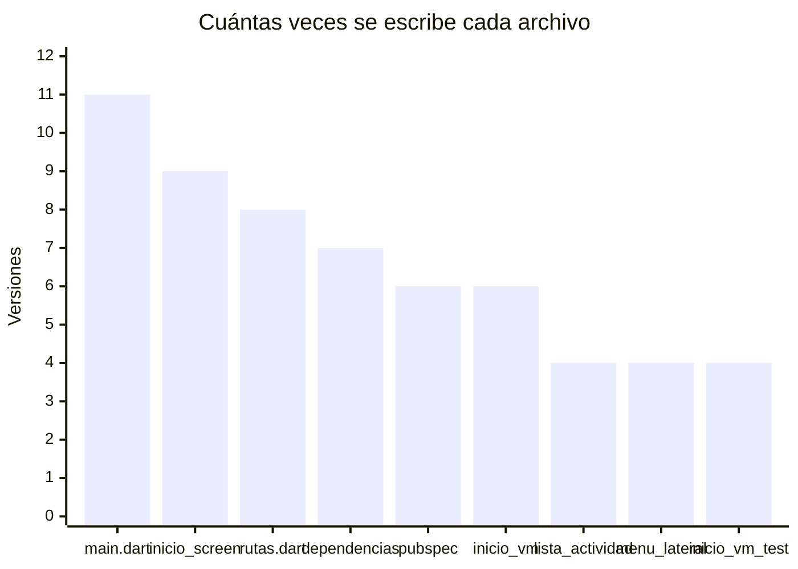

# Mapa de archivos

Cada archivo de la app terminada (89 en `lib/`, 17 en `test/` y el `pubspec.yaml`): **qué hace**, en qué capítulo **aparece** y en cuáles **cambia**. Los números son los capítulos de la [Parte 5](../5-construccion/index.md); **P6** es la [Parte 6](../6-pruebas-y-entrega/index.md).

!!! tip "Para qué sirve"
    - Si no encontrás dónde se define algo, buscalo acá (++ctrl+f++).
    - Si un archivo "cambia en" muchos capítulos, es uno de los que **conectan** todo: si algo no compila, revisalo primero.
    - Para ubicar algo en la app original: las rutas son **las mismas** (ver [Diferencias con la app real](diferencias.md)).

## Los que más cambian



Son la **raíz de composición** (`main.dart`, `dependencias.dart`, `rutas.dart`), la **ficha** (`pubspec.yaml`) y el **Inicio**, que reúne a casi todas las funcionalidades. Todos los demás se escriben **una sola vez** y no se vuelven a tocar.

## Todos los archivos

### Raíz del proyecto

| Archivo | Qué hace | Aparece | Cambia en |
|---|---|---|---|
| `pubspec.yaml` | Nombre del proyecto, versión de Dart y paquetes. | [1](../5-construccion/01-esqueleto.md) | [5](../5-construccion/05-sesion.md), [7](../5-construccion/07-dependencias-y-rutas.md), [10](../5-construccion/10-publicaciones-y-fotos.md), [14](../5-construccion/14-sos-y-alerta.md), [P6](../6-pruebas-y-entrega/2-api-real.md) |

### `lib/`

| Archivo | Qué hace | Aparece | Cambia en |
|---|---|---|---|
| `config.dart` | Configuración que se elige al compilar con --dart-define. | [1](../5-construccion/01-esqueleto.md) | — |
| `dependencias.dart` | Los repositorios y servicios de la app, una sola instancia de cada uno. | [7](../5-construccion/07-dependencias-y-rutas.md) | [8](../5-construccion/08-inicio.md), [10](../5-construccion/10-publicaciones-y-fotos.md), [12](../5-construccion/12-chat.md), [13](../5-construccion/13-rondines.md), [14](../5-construccion/14-sos-y-alerta.md), [16](../5-construccion/16-comite.md) |
| `main.dart` | Punto de entrada y raíz de composición: crea la API, los repositorios y elige Login o Inicio según la sesión. | [1](../5-construccion/01-esqueleto.md) | [5](../5-construccion/05-sesion.md), [6](../5-construccion/06-login.md), [7](../5-construccion/07-dependencias-y-rutas.md), [8](../5-construccion/08-inicio.md), [10](../5-construccion/10-publicaciones-y-fotos.md), [12](../5-construccion/12-chat.md), [13](../5-construccion/13-rondines.md), [14](../5-construccion/14-sos-y-alerta.md), [16](../5-construccion/16-comite.md), [P6](../6-pruebas-y-entrega/2-api-real.md) |

### `lib/data/repositories/`

| Archivo | Qué hace | Aparece | Cambia en |
|---|---|---|---|
| `alertas_repository.dart` | Alertas SOS (RF-10, RF-11): la propia y las de los vecinos. | [14](../5-construccion/14-sos-y-alerta.md) | — |
| `chat_repository.dart` | Chat general del barrio. | [12](../5-construccion/12-chat.md) | — |
| `comite_repository.dart` | Panel del comité (RF-13): manzanas y cuentas de los vecinos. | [16](../5-construccion/16-comite.md) | — |
| `fotos_repository.dart` | Fotos de publicaciones, del chat y de las alertas: subirlas y bajarlas. | [10](../5-construccion/10-publicaciones-y-fotos.md) | — |
| `publicaciones_repository.dart` | Publicaciones del barrio (RF-12): la actividad del Inicio, las noticias del comité y las respuestas de cada publicación. | [8](../5-construccion/08-inicio.md) | — |
| `rondines_repository.dart` | Turnos de rondín: los del vecino (Recorridos) y la administración del comité (RF-14). | [13](../5-construccion/13-rondines.md) | — |
| `sesion_repository.dart` | Sesión del vecino (RF-09): login con email y contraseña, alta por invitación del comité, recuperación de la clave y perfil. | [5](../5-construccion/05-sesion.md) | — |

### `lib/data/services/`

| Archivo | Qué hace | Aparece | Cambia en |
|---|---|---|---|
| `almacen_token.dart` | Guarda el token de sesión en el almacenamiento seguro (Keystore en Android, Keychain en iOS). | [5](../5-construccion/05-sesion.md) | — |
| `errores.dart` | Errores que pueden salir de la capa de datos. | [4](../5-construccion/04-contrato-api.md) | — |
| `lanzador_externo.dart` | Abre otras apps del celular (paquete url_launcher): el marcador del teléfono y Google Maps. | [14](../5-construccion/14-sos-y-alerta.md) | — |
| `selector_fotos.dart` | Saca una foto con la cámara o la elige de la galería (paquete image_picker, apunte 13). | [10](../5-construccion/10-publicaciones-y-fotos.md) | — |
| `ubicacion_service.dart` | Ubicación en vivo para las alertas (paquete geolocator). | [14](../5-construccion/14-sos-y-alerta.md) | — |

### `lib/data/services/api/`

| Archivo | Qué hace | Aparece | Cambia en |
|---|---|---|---|
| `fake_vigia_api.dart` | Implementación de VigiaApi con datos en memoria (la demo y los tests). | [4](../5-construccion/04-contrato-api.md) | — |
| `http_vigia_api.dart` | Implementación de VigiaApi que habla con el servidor real por HTTP. | [P6](../6-pruebas-y-entrega/2-api-real.md) | — |
| `vigia_api.dart` | Contrato de la API de VigiaApp. | [4](../5-construccion/04-contrato-api.md) | — |

### `lib/domain/models/`

| Archivo | Qué hace | Aparece | Cambia en |
|---|---|---|---|
| `alerta.dart` | El estado de una alerta SOS y las ubicaciones de los vecinos en camino. | [3](../5-construccion/03-dominio.md) | — |
| `comite.dart` | Datos del panel del comité: manzanas, vecinos y asignaciones de turnos. | [3](../5-construccion/03-dominio.md) | — |
| `coordenadas.dart` | Un punto en el mapa. | [3](../5-construccion/03-dominio.md) | — |
| `mensaje.dart` | Un mensaje del chat del barrio (GET /mensajes). | [3](../5-construccion/03-dominio.md) | — |
| `noticia.dart` | Una noticia del comité y las etiquetas posibles. | [3](../5-construccion/03-dominio.md) | — |
| `publicacion.dart` | Una publicación, sus respuestas y el estado de la red de vecinos. | [3](../5-construccion/03-dominio.md) | — |
| `rondin.dart` | Un turno de rondín y los estados de asistencia. | [3](../5-construccion/03-dominio.md) | — |
| `sesion.dart` | Sesión del vecino (RF-09): quién entró y con qué rol. | [3](../5-construccion/03-dominio.md) | — |

### `lib/routing/`

| Archivo | Qué hace | Aparece | Cambia en |
|---|---|---|---|
| `rutas.dart` | Navegación de la app. | [7](../5-construccion/07-dependencias-y-rutas.md) | [9](../5-construccion/09-menu-y-perfil.md), [10](../5-construccion/10-publicaciones-y-fotos.md), [11](../5-construccion/11-noticias.md), [13](../5-construccion/13-rondines.md), [14](../5-construccion/14-sos-y-alerta.md), [15](../5-construccion/15-alertas-de-vecinos.md), [16](../5-construccion/16-comite.md) |

### `lib/ui/alerta/view_model/`

| Archivo | Qué hace | Aparece | Cambia en |
|---|---|---|---|
| `alerta_propia_view_model.dart` | La alerta que disparé yo: comparto la ubicación, sumo una foto, llamo, cancelo o resuelvo. | [14](../5-construccion/14-sos-y-alerta.md) | — |
| `alerta_vecino_view_model.dart` | Alerta SOS de OTRO vecino (RF-10, RF-11): aviso "Voy en camino" y, si soy del comité, confirmo el 911 y la resuelvo. | [15](../5-construccion/15-alertas-de-vecinos.md) | — |
| `alerta_view_model.dart` | Lo común a las dos pantallas de alerta: consultar cada 2 s y compartir la ubicación. | [14](../5-construccion/14-sos-y-alerta.md) | — |

### `lib/ui/alerta/widgets/`

| Archivo | Qué hace | Aparece | Cambia en |
|---|---|---|---|
| `alerta_propia_screen.dart` | La alerta que disparé yo: mapa, triple confirmación, foto, llamar, cancelar o resolver. | [14](../5-construccion/14-sos-y-alerta.md) | — |
| `alerta_vecino_screen.dart` | La alerta de otro vecino: mapa, "Voy en camino", cómo llegar; el comité confirma el 911 y la resuelve. | [15](../5-construccion/15-alertas-de-vecinos.md) | — |
| `confirmacion_tile.dart` | Una fila de la triple confirmación de una alerta (Central 911 · vecinos avisados · en camino). | [14](../5-construccion/14-sos-y-alerta.md) | — |
| `mapa_alerta.dart` | Mapa de la alerta (Google Maps): un pin rojo donde está quien la disparó y uno celeste por cada vecino en camino. | [14](../5-construccion/14-sos-y-alerta.md) | — |
| `pantalla_alerta.dart` | Esqueleto común de las dos pantallas de alerta (la propia y la de un vecino): el mapa arriba, la información en el medio y los botones abajo. | [14](../5-construccion/14-sos-y-alerta.md) | — |

### `lib/ui/carga/widgets/`

| Archivo | Qué hace | Aparece | Cambia en |
|---|---|---|---|
| `pantalla_carga.dart` | Lo que se ve mientras se revisa si quedó una sesión guardada. | [5](../5-construccion/05-sesion.md) | — |

### `lib/ui/chat/view_model/`

| Archivo | Qué hace | Aparece | Cambia en |
|---|---|---|---|
| `chat_view_model.dart` | Chat general del barrio, en la pantalla de Inicio. | [12](../5-construccion/12-chat.md) | — |

### `lib/ui/chat/widgets/`

| Archivo | Qué hace | Aparece | Cambia en |
|---|---|---|---|
| `burbuja_mensaje.dart` | Un mensaje: los propios a la derecha, los de los vecinos a la izquierda. | [12](../5-construccion/12-chat.md) | — |
| `chat_vecinos.dart` | Vista del chat del barrio: la lista de mensajes y la barra para escribir. | [12](../5-construccion/12-chat.md) | — |

### `lib/ui/comite/view_model/`

| Archivo | Qué hace | Aparece | Cambia en |
|---|---|---|---|
| `alta_vecino_view_model.dart` | Alta de un vecino: datos, manzana (o una nueva) e invitación. | [16](../5-construccion/16-comite.md) | — |
| `asignaciones_view_model.dart` | Quién hace un turno y qué respondió; reasignarlo o borrarlo. | [16](../5-construccion/16-comite.md) | — |
| `comite_rondines_view_model.dart` | La semana de turnos del comité: moverse entre semanas, crear y borrar turnos. | [16](../5-construccion/16-comite.md) | — |
| `comite_vecinos_view_model.dart` | La lista de vecinos del comité; fabrica los ViewModels del alta y la edición. | [16](../5-construccion/16-comite.md) | — |
| `editar_vecino_view_model.dart` | Rol, activo/inactivo y reenvío de la invitación de un vecino. | [16](../5-construccion/16-comite.md) | — |
| `nuevo_turno_view_model.dart` | Alta de un turno: fecha, ruta y vecinos. | [16](../5-construccion/16-comite.md) | — |

### `lib/ui/comite/widgets/`

| Archivo | Qué hace | Aparece | Cambia en |
|---|---|---|---|
| `alta_vecino_screen.dart` | Formulario de alta de un vecino. | [16](../5-construccion/16-comite.md) | — |
| `asignaciones_sheet.dart` | Quién hace el turno y qué respondió; reasignar o borrar el turno. | [16](../5-construccion/16-comite.md) | — |
| `comite_rondines_screen.dart` | Panel del comité · Rondines: la semana de turnos, alta y asignaciones. | [16](../5-construccion/16-comite.md) | — |
| `comite_vecinos_screen.dart` | Panel del comité · Vecinos: lista, alta con invitación y edición. | [16](../5-construccion/16-comite.md) | — |
| `editar_vecino_sheet.dart` | Rol, activo/inactivo y reenvío de la invitación. | [16](../5-construccion/16-comite.md) | — |
| `elegir_vecinos_dialog.dart` | Lista de vecinos con casillas, para armar un turno. | [16](../5-construccion/16-comite.md) | — |
| `nuevo_turno_dialog.dart` | Alta de un turno: fecha, ruta y vecinos. | [16](../5-construccion/16-comite.md) | — |
| `selector_rol.dart` | Desplegable con los roles (vecino, vigía, comité). | [16](../5-construccion/16-comite.md) | — |
| `texto_dialog.dart` | Diálogo con un campo de texto. | [16](../5-construccion/16-comite.md) | — |

### `lib/ui/core/`

| Archivo | Qué hace | Aparece | Cambia en |
|---|---|---|---|
| `view_model.dart` | Base de los ViewModels (MVVM). | [6](../5-construccion/06-login.md) | — |

### `lib/ui/core/widgets/`

| Archivo | Qué hace | Aparece | Cambia en |
|---|---|---|---|
| `avisos.dart` | Avisos que se repetían en todas las pantallas: el SnackBar con el error y el diálogo de "¿Seguro?". | [6](../5-construccion/06-login.md) | — |
| `elegir_origen_foto.dart` | Pregunta si la foto sale de la cámara o de la galería. | [10](../5-construccion/10-publicaciones-y-fotos.md) | — |
| `estados_carga.dart` | Lo que se muestra mientras carga o si falló una carga. | [6](../5-construccion/06-login.md) | — |
| `foto_vigia.dart` | Fotos de publicaciones, del chat y de las alertas. | [10](../5-construccion/10-publicaciones-y-fotos.md) | — |

### `lib/ui/elegir_clave/view_model/`

| Archivo | Qué hace | Aparece | Cambia en |
|---|---|---|---|
| `elegir_clave_view_model.dart` | Elegir contraseña con el token del enlace del correo. | [7](../5-construccion/07-dependencias-y-rutas.md) | — |

### `lib/ui/elegir_clave/widgets/`

| Archivo | Qué hace | Aparece | Cambia en |
|---|---|---|---|
| `elegir_clave_screen.dart` | Elegir contraseña, desde el enlace del correo (vigiaapp://clave?token=…). | [7](../5-construccion/07-dependencias-y-rutas.md) | — |

### `lib/ui/emergencia/widgets/`

| Archivo | Qué hace | Aparece | Cambia en |
|---|---|---|---|
| `modo_emergencia_screen.dart` | Modo emergencia: se abre con el SOS de la barra del Inicio. | [14](../5-construccion/14-sos-y-alerta.md) | — |

### `lib/ui/inicio/view_model/`

| Archivo | Qué hace | Aparece | Cambia en |
|---|---|---|---|
| `inicio_view_model.dart` | Pantalla de Inicio: el estado de la red, la actividad del barrio, las alertas SOS de otros vecinos y el chat. | [8](../5-construccion/08-inicio.md) | [11](../5-construccion/11-noticias.md), [12](../5-construccion/12-chat.md), [13](../5-construccion/13-rondines.md), [14](../5-construccion/14-sos-y-alerta.md), [15](../5-construccion/15-alertas-de-vecinos.md) |

### `lib/ui/inicio/widgets/`

| Archivo | Qué hace | Aparece | Cambia en |
|---|---|---|---|
| `banner_alerta.dart` | Banner rojo de una alerta SOS de otro vecino. | [15](../5-construccion/15-alertas-de-vecinos.md) | — |
| `barra_inferior.dart` | Barra de abajo: Chat · SOS · Actividad. | [12](../5-construccion/12-chat.md) | [14](../5-construccion/14-sos-y-alerta.md) |
| `estado_red.dart` | "Red activa · 12 de 40 vecinos en línea" (o "Conectando…"). | [8](../5-construccion/08-inicio.md) | — |
| `inicio_screen.dart` | Pantalla de Inicio: pestañas, menú, barra inferior y banner de alertas. | [8](../5-construccion/08-inicio.md) | [9](../5-construccion/09-menu-y-perfil.md), [10](../5-construccion/10-publicaciones-y-fotos.md), [11](../5-construccion/11-noticias.md), [12](../5-construccion/12-chat.md), [13](../5-construccion/13-rondines.md), [14](../5-construccion/14-sos-y-alerta.md), [15](../5-construccion/15-alertas-de-vecinos.md), [16](../5-construccion/16-comite.md) |
| `lista_actividad.dart` | Pestaña "Actividad" del Inicio: el feed del barrio y, al final, la tarjeta del rondín. | [8](../5-construccion/08-inicio.md) | [10](../5-construccion/10-publicaciones-y-fotos.md), [11](../5-construccion/11-noticias.md), [13](../5-construccion/13-rondines.md) |
| `menu_lateral.dart` | El menú lateral: perfil, recorridos, noticias, comité y cerrar sesión. | [9](../5-construccion/09-menu-y-perfil.md) | [11](../5-construccion/11-noticias.md), [13](../5-construccion/13-rondines.md), [16](../5-construccion/16-comite.md) |
| `tarjeta_rondin.dart` | Tarjeta "Tu rondín es hoy". | [13](../5-construccion/13-rondines.md) | — |

### `lib/ui/login/view_model/`

| Archivo | Qué hace | Aparece | Cambia en |
|---|---|---|---|
| `login_view_model.dart` | El estado del Login: ingresar y recuperar la contraseña. | [6](../5-construccion/06-login.md) | — |

### `lib/ui/login/widgets/`

| Archivo | Qué hace | Aparece | Cambia en |
|---|---|---|---|
| `login_screen.dart` | Ingreso con email y contraseña (RF-09). | [6](../5-construccion/06-login.md) | [7](../5-construccion/07-dependencias-y-rutas.md) |
| `recuperar_clave_dialog.dart` | Pide el email para mandar el enlace de recuperación. | [6](../5-construccion/06-login.md) | — |

### `lib/ui/noticias/view_model/`

| Archivo | Qué hace | Aparece | Cambia en |
|---|---|---|---|
| `filas_noticias.dart` | Los dos tipos de fila de la lista de noticias (clase sellada). | [11](../5-construccion/11-noticias.md) | — |
| `noticias_view_model.dart` | Las noticias del comité, agrupadas por día y filtradas por etiqueta. | [11](../5-construccion/11-noticias.md) | — |

### `lib/ui/noticias/widgets/`

| Archivo | Qué hace | Aparece | Cambia en |
|---|---|---|---|
| `noticias_screen.dart` | Las noticias del comité, con filtros por etiqueta. | [11](../5-construccion/11-noticias.md) | — |

### `lib/ui/perfil/view_model/`

| Archivo | Qué hace | Aparece | Cambia en |
|---|---|---|---|
| `perfil_view_model.dart` | Carga el perfil y cambia la contraseña. | [9](../5-construccion/09-menu-y-perfil.md) | — |

### `lib/ui/perfil/widgets/`

| Archivo | Qué hace | Aparece | Cambia en |
|---|---|---|---|
| `cambiar_clave_dialog.dart` | Diálogo para cambiar la contraseña. | [9](../5-construccion/09-menu-y-perfil.md) | — |
| `perfil_screen.dart` | Datos del vecino (GET /yo) y cambio de contraseña (POST /yo/clave). | [9](../5-construccion/09-menu-y-perfil.md) | — |

### `lib/ui/publicacion/view_model/`

| Archivo | Qué hace | Aparece | Cambia en |
|---|---|---|---|
| `nueva_publicacion_view_model.dart` | Publicar: título, cuerpo y foto; el comité además elige noticia y etiqueta. | [10](../5-construccion/10-publicaciones-y-fotos.md) | — |
| `publicacion_view_model.dart` | Una publicación con sus respuestas: responder y borrar. | [10](../5-construccion/10-publicaciones-y-fotos.md) | — |

### `lib/ui/publicacion/widgets/`

| Archivo | Qué hace | Aparece | Cambia en |
|---|---|---|---|
| `nueva_publicacion_screen.dart` | Publicar en el barrio (RF-12). | [10](../5-construccion/10-publicaciones-y-fotos.md) | — |
| `publicacion_screen.dart` | Detalle de una publicación (RF-12): cuerpo, respuestas de los vecinos y un campo para responder. | [10](../5-construccion/10-publicaciones-y-fotos.md) | — |

### `lib/ui/rondines/view_model/`

| Archivo | Qué hace | Aparece | Cambia en |
|---|---|---|---|
| `rondin_view_model.dart` | El rondín del vecino (compartido por el Inicio y Recorridos). | [13](../5-construccion/13-rondines.md) | — |

### `lib/ui/rondines/widgets/`

| Archivo | Qué hace | Aparece | Cambia en |
|---|---|---|---|
| `recorridos_screen.dart` | Los turnos de rondín de la semana y la asistencia. | [13](../5-construccion/13-rondines.md) | — |

### `lib/utils/`

| Archivo | Qué hace | Aparece | Cambia en |
|---|---|---|---|
| `fechas.dart` | Fechas en texto: lo que se muestra al vecino ("hace 25 min", "HOY") y el formato que espera la API ('AAAA-MM-DD'). | [2](../5-construccion/02-utilidades.md) | — |
| `resultado.dart` | Resultado de una acción del ViewModel que la vista tiene que mostrar una sola vez (un SnackBar, cerrar la pantalla). | [2](../5-construccion/02-utilidades.md) | — |
| `sondeo.dart` | Consulta periódica al servidor (polling). | [2](../5-construccion/02-utilidades.md) | — |
| `validadores.dart` | Validaciones de los formularios. | [2](../5-construccion/02-utilidades.md) | — |

### `test/`

| Archivo | Qué hace | Aparece | Cambia en |
|---|---|---|---|
| `api_test.dart` | Tests del cliente HTTP (con MockClient) y del SesionRepository. | [P6](../6-pruebas-y-entrega/6-tests-del-cliente-http.md) | — |
| `ayudantes.dart` | Lo que comparten los tests: la plataforma de prueba (sin mapa ni GPS nativos), la vecina María y cómo armar los ViewModels de las alertas. | [P6](../6-pruebas-y-entrega/3-tests-de-view-models.md) | — |
| `caracterizacion_test.dart` | Tests de caracterización: fijan el comportamiento observable y los casos de borde. | [P6](../6-pruebas-y-entrega/5-tests-de-caracterizacion.md) | — |
| `chat_view_model_test.dart` | Pruebas del chat del barrio (capítulo 12). | [12](../5-construccion/12-chat.md) | — |
| `comite_vecinos_view_model_test.dart` | Pruebas del panel del comité (capítulo 16). | [16](../5-construccion/16-comite.md) | — |
| `elegir_clave_view_model_test.dart` | Pruebas de "Elegí tu contraseña" (capítulo 7). | [7](../5-construccion/07-dependencias-y-rutas.md) | — |
| `fake_api_test.dart` | Pruebas del servidor falso (capítulo 4). | [4](../5-construccion/04-contrato-api.md) | — |
| `inicio_view_model_test.dart` | Pruebas del Inicio (capítulo 8). | [8](../5-construccion/08-inicio.md) | [12](../5-construccion/12-chat.md), [13](../5-construccion/13-rondines.md), [14](../5-construccion/14-sos-y-alerta.md) |
| `login_view_model_test.dart` | Pruebas del LoginViewModel (capítulo 6): se prueba la lógica de la pantalla sin dibujarla. | [6](../5-construccion/06-login.md) | — |
| `modelos_test.dart` | Pruebas de los modelos (capítulo 3): que cada fromJson lea bien el JSON tal como lo manda la API, y que los getters calculen lo que prometen. | [3](../5-construccion/03-dominio.md) | — |
| `noticias_view_model_test.dart` | Pruebas del muro de noticias (capítulo 11). | [11](../5-construccion/11-noticias.md) | — |
| `publicacion_view_model_test.dart` | Pruebas de una publicación con sus respuestas (capítulo 10). | [10](../5-construccion/10-publicaciones-y-fotos.md) | — |
| `rondin_view_model_test.dart` | Pruebas del rondín (capítulo 13). | [13](../5-construccion/13-rondines.md) | — |
| `sesion_repository_test.dart` | Pruebas de la sesión (capítulo 5). | [5](../5-construccion/05-sesion.md) | — |
| `utils_test.dart` | Pruebas de las utilidades (capítulo 2). | [2](../5-construccion/02-utilidades.md) | — |
| `view_models_test.dart` | Tests unitarios de ViewModels y repositorios, contra la FakeVigiaApi. | [P6](../6-pruebas-y-entrega/3-tests-de-view-models.md) | — |
| `widget_test.dart` | Tests de widgets: la app entera con el servidor falso. | [P6](../6-pruebas-y-entrega/4-tests-de-widgets.md) | — |

## Lo que hay además en el repositorio

```text
vigia_app/
├── android/            ← proyecto nativo de Android (manifiesto, Gradle, íconos)
├── ios/                ← proyecto nativo de iOS
├── lib/                ← lo de arriba
├── test/               ← lo de arriba
├── analysis_options.yaml
├── pubspec.yaml
└── pubspec.lock
```

Y en la **app original**, además: `ui/core/tema.dart` (los estilos propios), `ui/alerta/widgets/parpadeo.dart` (una animación), `test/api_real_test.dart` (tests contra la API local), `.github/workflows/ci.yml`, `docs/` (manual, especificación) y `tools/` (scripts del manual). Ver [Diferencias con la app real](diferencias.md).
