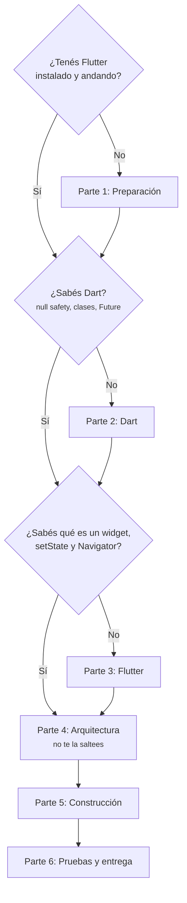

# Cómo usar esta wiki

Cinco minutos acá te ahorran horas después. Esta página explica **en qué orden leer**, **cómo leer el código** y **qué significa cada recuadro de color**.

## En qué orden leer

Depende de lo que ya sabés:



!!! warning "La Parte 4 no es opcional"
    Aunque sepas Flutter, leé la Parte 4. Toda la Parte 5 está organizada según esa arquitectura, y sin ella el código parece tener "demasiados archivos" para lo que hace.

Si **no sabés nada**, leé todo en orden. Las Partes 2 y 3 tienen ejemplos chicos que conviene escribir y correr: leer código no es lo mismo que escribirlo.

## Cómo leer el código

### Bloques con título y números de línea

Cada archivo de la app se muestra **completo**, con su ruta como título:

```dart title="lib/ejemplo.dart" linenums="1"
void main() {
  print('Hola');
}
```

Hay un botón :material-content-copy: arriba a la derecha de cada bloque para copiarlo entero.

### Notas numeradas

Los bloques importantes tienen **notas**: tocá el :material-plus-circle: que aparece al final de una línea y se abre la explicación de esa línea.

```dart title="lib/saludo.dart" linenums="1"
void main() {  // (1)!
  final nombre = 'barrio';  // (2)!
  print('Hola, $nombre');  // (3)!
}
```

1. Acá arranca el programa.
2. Una variable que no se puede reasignar. Ver [Variables y tipos](2-dart/1-variables-y-tipos.md).
3. `$nombre` mete el valor de la variable adentro del texto.

Probá tocar los :material-plus-circle: del bloque de arriba. Las notas también aparecen como lista numerada debajo del bloque, por si las querés leer de corrido.

### Líneas resaltadas

Cuando un archivo **cambia** de un capítulo a otro, se muestra completo otra vez y las líneas nuevas aparecen **resaltadas**:

```dart title="lib/saludo.dart" linenums="1" hl_lines="3"
void main() {
  final nombre = 'barrio';
  final hora = DateTime.now().hour;
  print('Hola, $nombre');
}
```

Además hay un bloque **Qué cambia** con la diferencia en formato *diff*: las líneas con `+` se agregan y las con `-` se borran.

```diff title="Qué cambia en lib/saludo.dart"
 void main() {
   final nombre = 'barrio';
+  final hora = DateTime.now().hour;
   print('Hola, $nombre');
 }
```

### Pestañas

Cuando algo depende del sistema operativo (o hay dos formas de hacerlo), aparece en pestañas:

=== "macOS / Linux"

    ```bash
    flutter --version
    ```

=== "Windows (PowerShell)"

    ```powershell
    flutter --version
    ```

Si elegís una pestaña, todas las demás de la wiki se cambian a la misma.

## Los recuadros

| Recuadro | Para qué es |
|---|---|
| **Objetivo** (abstract) | Qué vas a lograr en la página. |
| **Nota** (info) | Un dato extra que ayuda a entender. |
| **Consejo** (tip) | Una forma más cómoda o más segura de hacer algo. |
| **Cuidado** (warning) | Algo que, si lo hacés mal, rompe o confunde. |
| **Pregunta** (question) | Una duda típica, con la respuesta. |
| **Error** (failure) | Un mensaje de error y cómo salir. Suelen estar plegados: tocalos para abrirlos. |
| **Ejemplo** (example) | Código opcional o largo, plegado para no molestar. |
| **Éxito** (success) | Cómo saber que salió bien. |

Así se ven:

!!! info "Nota"
    Un dato extra.

!!! tip "Consejo"
    Una forma más cómoda.

!!! warning "Cuidado"
    Esto rompe si lo hacés mal.

??? failure "`Un mensaje de error`"
    Cómo salir. (Este estaba plegado.)

## Los diagramas

Hay tres tipos de diagramas que se repiten:

=== "Flujo"

    Muestran **qué pasa después de qué**, o **quién usa a quién**.

    ```mermaid
    flowchart LR
        A["Vista"] -->|"toca un botón"| B["ViewModel"]
        B -->|"pide datos"| C["Repositorio"]
    ```

=== "Secuencia"

    Muestran **una conversación en el tiempo**: de arriba hacia abajo, quién le pide qué a quién.

    ```mermaid
    sequenceDiagram
        participant V as Vista
        participant VM as ViewModel
        participant R as Repositorio
        V->>VM: entrar()
        VM->>R: login(correo, clave)
        R-->>VM: Sesion
        VM-->>V: notifyListeners()
    ```

=== "Estados"

    Muestran **en qué situaciones puede estar algo** y cómo pasa de una a otra.

    ```mermaid
    stateDiagram-v2
        [*] --> iniciando
        iniciando --> sinSesion
        iniciando --> conSesion
        sinSesion --> conSesion: login
        conSesion --> sinSesion: logout
    ```

En los diagramas de capas de la Parte 5, **lo que se agrega en ese capítulo** está pintado de color.

## Las capturas

Las capturas de pantalla no son de un celular: las genera Flutter en los tests (las llamadas *goldens*). Por eso se ven todas con la misma fuente y el mismo tamaño. En tu emulador se van a ver parecidas, con la fuente de tu sistema.

## Las palabras

- Está escrita en **español rioplatense** (vos, tenés, corré).
- Los nombres del código también están en español (`vecino`, `publicaciones`, `ocupado`), salvo lo que viene de Flutter (`build`, `Widget`, `setState`) o es costumbre (`ViewModel`, `Repository`, `Screen`).
- Las palabras técnicas en inglés aparecen la primera vez con su traducción. Si te olvidás de alguna, está en el [Glosario](7-referencia/glosario.md).

## Si algo no anda

1. Leé el mensaje de error completo (en [Correr, recargar y leer errores](1-preparacion/4-correr-y-depurar.md) está cómo).
2. Buscalo en [Errores frecuentes](7-referencia/errores-frecuentes.md) o en los **Errores comunes** del capítulo.
3. Compará tu árbol de carpetas con **Así queda el proyecto** del capítulo.
4. Corré `flutter analyze` y `flutter test`.

[Siguiente: Parte 1, Preparación :material-arrow-right:](1-preparacion/index.md){ .md-button .md-button--primary }
