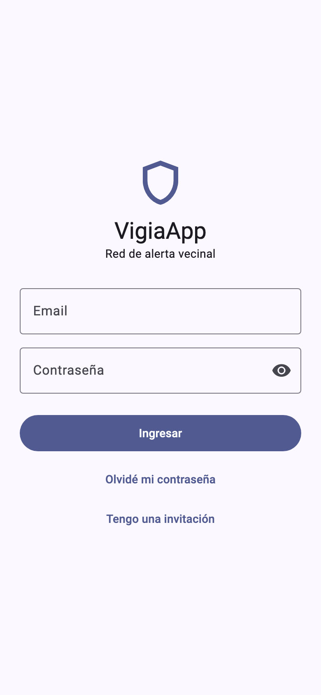
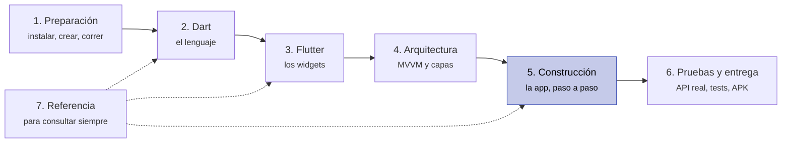
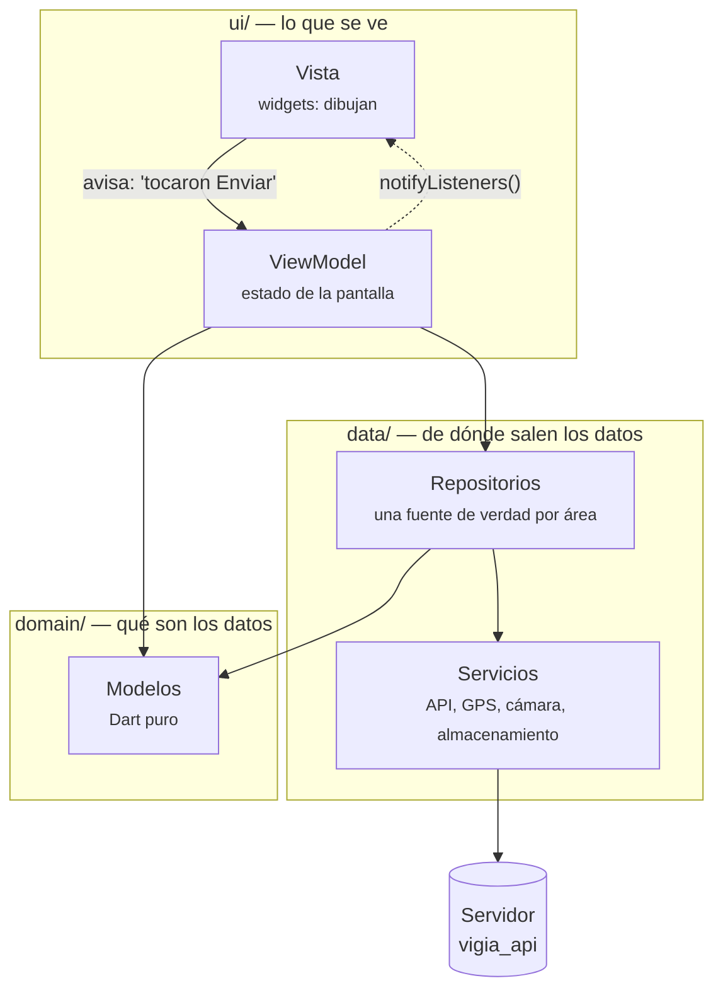

# VigiaApp desde cero

Esta wiki te lleva **desde no saber nada de Dart** hasta **rehacer VigiaApp completa**: una red de alerta vecinal con login, chat del barrio con fotos, noticias, rondines nocturnos, un botón SOS con mapa en vivo y un panel para el comité.

No es un resumen: es un curso entero, escrito para que lo sigas en orden, con el editor abierto al lado.

<figure markdown="span">
  { .captura }
  <figcaption>La app que vas a construir (solo con Material, sin estilos propios).</figcaption>
</figure>

## Qué vas a aprender

-   :material-language-dart:{ .lg .middle } **Dart, el lenguaje**

    ---

    Variables, null safety, funciones, clases, enums, records, patrones, `Future`, `Stream`… Todo con ejemplos chicos que podés correr.

    [:octicons-arrow-right-24: Parte 2](2-dart/index.md)

-   :material-widgets-outline:{ .lg .middle } **Flutter, la interfaz**

    ---

    Qué es un widget, cómo se arma una pantalla, formularios, navegación, estado y plugins (GPS, cámara, mapas).

    [:octicons-arrow-right-24: Parte 3](3-flutter/index.md)

-   :material-layers-triple-outline:{ .lg .middle } **Arquitectura MVVM**

    ---

    Cómo separar la app en capas para que no sea un ovillo: vistas, ViewModels, repositorios y servicios.

    [:octicons-arrow-right-24: Parte 4](4-arquitectura/index.md)

-   :material-hammer-wrench:{ .lg .middle } **La construcción**

    ---

    16 capítulos, archivo por archivo, desde una carpeta vacía hasta la app completa. Todo el código compila y tiene tests.

    [:octicons-arrow-right-24: Parte 5](5-construccion/index.md)

-   :material-test-tube:{ .lg .middle } **Pruebas y entrega**

    ---

    Conectar el servidor real, escribir más de 100 tests, compilar el APK y trabajar en equipo con Git.

    [:octicons-arrow-right-24: Parte 6](6-pruebas-y-entrega/index.md)

-   :material-bookshelf:{ .lg .middle } **Referencia**

    ---

    Glosario, chuletas de Dart y de widgets, el contrato de la API, errores frecuentes y ejercicios.

    [:octicons-arrow-right-24: Parte 7](7-referencia/index.md)

## El mapa de la wiki

Las Partes 1 a 4 son la **base**: te dan el vocabulario. La Parte 5 es el **corazón**: ahí se escribe la app. La Parte 6 la **cierra** y la Parte 7 está para **consultar** cuando lo necesites.

## La app en un vistazo

VigiaApp es una app para vecinos de un barrio. Cada vecino entra con su correo (lo invita el comité) y puede:

| Funcionalidad | Qué hace | Capítulo |
|---|---|---|
| **Login** | Entrar con correo y contraseña, recuperar la clave, elegir una nueva desde el enlace del correo. | [6](5-construccion/06-login.md), [7](5-construccion/07-dependencias-y-rutas.md) |
| **Inicio** | La actividad del barrio: publicaciones, noticias y el estado de la red. | [8](5-construccion/08-inicio.md) |
| **Perfil** | Ver los datos propios y cambiar la contraseña. | [9](5-construccion/09-menu-y-perfil.md) |
| **Publicaciones** | Avisos de vecinos (un perro perdido, algo sospechoso) con foto. | [10](5-construccion/10-publicaciones-y-fotos.md) |
| **Noticias** | Comunicados del comité, agrupados por día. | [11](5-construccion/11-noticias.md) |
| **Chat** | El chat del barrio, que se actualiza solo. | [12](5-construccion/12-chat.md) |
| **Rondines** | Los turnos de vigilancia nocturna: empezar, terminar, ver recorridos. | [13](5-construccion/13-rondines.md) |
| **SOS** | El botón de emergencia: avisa a todos con la ubicación en un mapa y deja llamar. | [14](5-construccion/14-sos-y-alerta.md) |
| **Alertas de vecinos** | Recibir la alerta de otro, ir en camino, ver a todos en el mapa. | [15](5-construccion/15-alertas-de-vecinos.md) |
| **Comité** | Dar de alta vecinos, cambiar roles, armar los turnos de rondín. | [16](5-construccion/16-comite.md) |

## Cómo está hecha por dentro

Un adelanto de lo que vas a entender al terminar la Parte 4. No hace falta que lo entiendas ahora: volvé a este diagrama cuando llegues ahí.

## Antes de arrancar

- [ ] Leé [Cómo usar esta wiki](como-usar.md) (5 minutos): explica las convenciones, los íconos y cómo leer el código anotado.
- [ ] Seguí la [Parte 1](1-preparacion/index.md) para instalar Flutter y crear el proyecto.
- [ ] Reservá tiempo: la wiki completa lleva varias semanas a un ritmo tranquilo. No hay apuro.

[Empezar: Cómo usar esta wiki :material-arrow-right:](como-usar.md){ .md-button .md-button--primary }
[Ir directo a instalar :material-download:](1-preparacion/2-instalacion.md){ .md-button }
